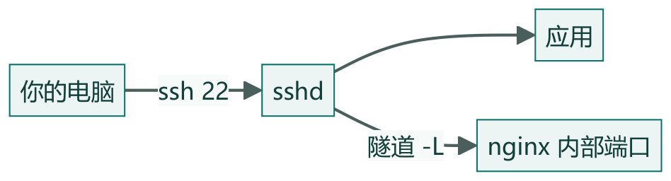

# 附录 A　一页纸地图与命令速查

## A.1 一张图

一次访问要穿过的东西，从上到下就这几层。


你干活的两条路。一条是把程序送上去，一条是把远方的东西拉下来。



## A.2 三句话版本的排错顺序

**一，程序在听吗。** `ss -lntp`，没有就是应用的问题。

**二，本机能连吗。** `curl 127.0.0.1:端口`，不通就是应用或绑定地址的问题。

**三，外面能连吗。** `nc -vz IP 端口`，不通就是防火墙或安全组的问题。

过了这三关还不通，问题在应用逻辑或者中间那层代理。

## A.3 命令速查

下面这些命令，除了 `ssh`、`scp`、`rsync` 和隧道那几条在你自己的电脑上敲，其余都在服务器上敲。分不清就看提示符，`root@xxx` 或 `alice@xxx` 是服务器，你自己的电脑通常是你设的主机名。

**看端口和连接**

```bash
ss -lntp                          # 谁在监听
ss -tnp state established          # 已建立的连接
ss -lntp | grep 8000               # 查某个端口
netstat -ano | findstr :8000       # Windows
```

**测连通**

```bash
nc -vz 203.0.113.24 22             # 测 TCP 端口
curl -v http://127.0.0.1:8000     # 测 HTTP
curl -I https://example.com        # 只看响应头
ping 203.0.113.24                  # 只测 ICMP，不代表端口通
traceroute 203.0.113.24            # 看路径
nslookup example.com               # 查 DNS
dig example.com +short             # 同上，更干净
```

**登录与传输**

```bash
ssh -p 2222 alice@203.0.113.24
ssh alice@host "uptime"            # 执行一条命令就退出
scp -r ./dir alice@host:/home/alice/
rsync -avz --partial ./dir/ alice@host:/home/alice/dir/
ssh-keygen -t ed25519 -C "note"
ssh-copy-id -i ~/.ssh/id_ed25519.pub alice@host
ssh-keygen -R 203.0.113.24         # 删掉旧的指纹记录
```

**隧道**

```bash
ssh -L 8080:10.0.0.9:80 alice@jump     # 本地转发
ssh -R 9000:127.0.0.1:3000 alice@pub   # 远程转发
ssh -D 1080 alice@jump                 # SOCKS 代理
ssh -J alice@jump1,alice@jump2 alice@target
```

**进程与服务**

```bash
ps -ef | grep python
top                                # 或 htop
kill 12345
systemctl status myapp
systemctl restart myapp
systemctl enable --now myapp
journalctl -u myapp -n 50
journalctl -u myapp -f
```

**文件与权限**

```bash
ls -l
chmod 600 file
chown alice:alice file
df -h                              # 磁盘
du -sh *                           # 当前目录各项大小
tar -czf out.tar.gz dir/
sha256sum file
```

**防火墙**

```bash
sudo ufw status
sudo ufw allow 8000/tcp
sudo firewall-cmd --list-all
sudo firewall-cmd --add-port=8000/tcp --permanent && sudo firewall-cmd --reload
```

## A.4 部署完成后的八项自检

```text
□ 关掉 SSH 窗口，等一分钟，网站还能打开（说明进程不依赖会话）
□ 服务器重启后，服务自动起来（systemctl is-enabled）
□ 应用绑的是 127.0.0.1，只有 nginx 绑 0.0.0.0
□ 数据库和缓存的端口没有对公网开放
□ .env 不在 git 里，权限是 600
□ 安全组只开了必要的端口，来源尽量收窄
□ 日志能看到请求，且不会无限增长
□ 有一份能恢复的备份，且知道怎么恢复
```

## A.5 我该去第几章

| 你的问题 | 章节 |
| --- | --- |
| 别人打不开我的页面 | 1、3、6 |
| 端口被占用 | 2 |
| 改了域名不生效 | 4 |
| 一直转圈最后超时 | 5、6 |
| 不知道怎么选服务器 | 7 |
| 登录不上服务器 | 8、9 |
| 看不懂 AI 给的 Linux 命令 | 10 |
| 关掉终端程序就没了 | 11 |
| 502、504、413 | 12 |
| 想知道整体是怎么跑起来的 | 13 |
| 密钥该放哪 | 14 |
| 大文件传一半断了 | 15 |
| 不知道桶和 key 是什么 | 16 |
| 403 | 17 |
| 内网的服务想在本地访问 | 18 |
| VPN 连上了但还是访问不了 | 19 |
| 想在服务器上写代码 | 20 |
| AI 给的答案不靠谱 | 21 |
| 看到报错不知道什么意思 | 22 |
| 怕被黑、怕账单爆炸 | 23 |
