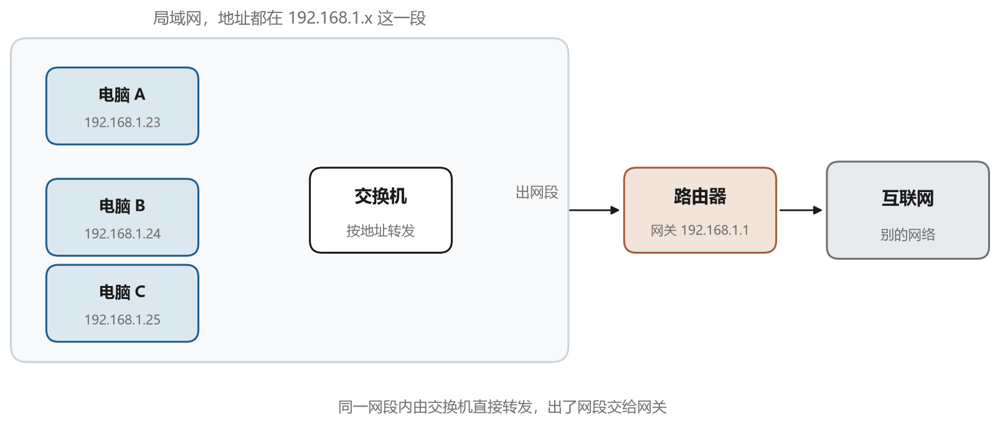
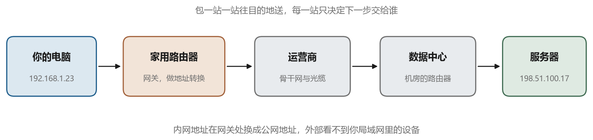

# 数据是怎么走过去的

## 2.1 先看看你桌上的那堆设备

从你面前的电脑往远处走，第一站是一根网线（或者 Wi-Fi 信号）。

网线插在机器背后的网口上，网口后面是一块叫**网卡**的硬件。它的工作很朴素：把电脑里的 0 和 1 变成电信号送出去，也把收到的电信号还原成 0 和 1。

一台机器通常只有一两个网口。要让五台机器互相通信，不可能两两拉一根线，于是有了**交换机**：一个带很多网口的小盒子，所有机器都接到它上面，它负责把一台机器发出的数据转给另一台。

交换机再往上，是**路由器**。交换机只认识自己这一小片，遇到“要送到别的网络”的数据，就得交给路由器。路由器有几条“腿”，每条腿连一个网络，它看一眼数据要去哪，就从对应的腿送出去。

家里那台“路由器”其实是个合体设备：路由器、交换机、无线接入点、简单的防火墙，全都塞在一个塑料壳里。所以它既能发 Wi-Fi，又能让手机和电脑互访，还能连上运营商。

## 2.2 每台设备都要有个门牌号

交换机把数据转给谁，靠的是**地址**。最常用的地址叫 IP 地址，写成四组数字，比如 `192.168.1.23`。

前几组数字相同的设备，属于同一个**网段**。比如 `192.168.1.23`、`192.168.1.24`、`192.168.1.25` 都是一个网段，因为前三组都是 `192.168.1`。同网段的设备可以直接把数据发给对方，交换机就能完成转发。

要送到别的网段，就得找**网关**。网关通常是路由器在本网段里的那个地址，比如 `192.168.1.1`。可以把它想成小区的大门：所有出门的包裹都先送到门卫那里，由门卫决定往哪条路送。

把这些设备连起来，就是一个典型的局域网，如图 2-1。

## 2.3 一次访问，经过了哪些站

你打开浏览器，访问一台服务器，数据大致是这样走的：

1. 你的电脑先判断：目标地址和我在同一个网段吗？
2. 不在，就把数据交给网关（家里的路由器）
3. 网关把数据送进运营商的网络，经过一台台路由器
4. 到达服务器所在的数据中心，再送到那台服务器
5. 服务器处理完，把结果沿原路送回来

图 2-2 是这条路的样子。

这里有两个细节，知道就行：

第一，家里的网关会把你的内网地址换成它的公网地址再发出去。外面只看到网关的地址，看不到你家里具体是哪台设备。这个机制叫地址转换，第三章会讲。

第二，路上任何一站都可能出问题。所以“连不上”从来不是一个原因，而是一串可能。任何一环断了，外面看到的现象都差不多：转圈，然后超时。

## 2.4 为什么“连不上”要分段查

很多新手一遇到连不上，就去改代码、重装软件，越改越乱。

正确的思路是：这条路是一段一段的，那就一段一段验证。先看能不能找到对方，再看端口通不通，再看对方是不是拒绝你，最后才看账号对不对。

具体的查法，第四章会一步步讲。

## 2.5 这一章的三句话

- 数据从网卡出发，经交换机、路由器、网关，一站一站往前送。
- 地址决定“送到哪台机器”，网段决定“要不要出门”，网关是出门的那道门。
- 连不上不要乱改，按段验证：先找得到，再连得上。
