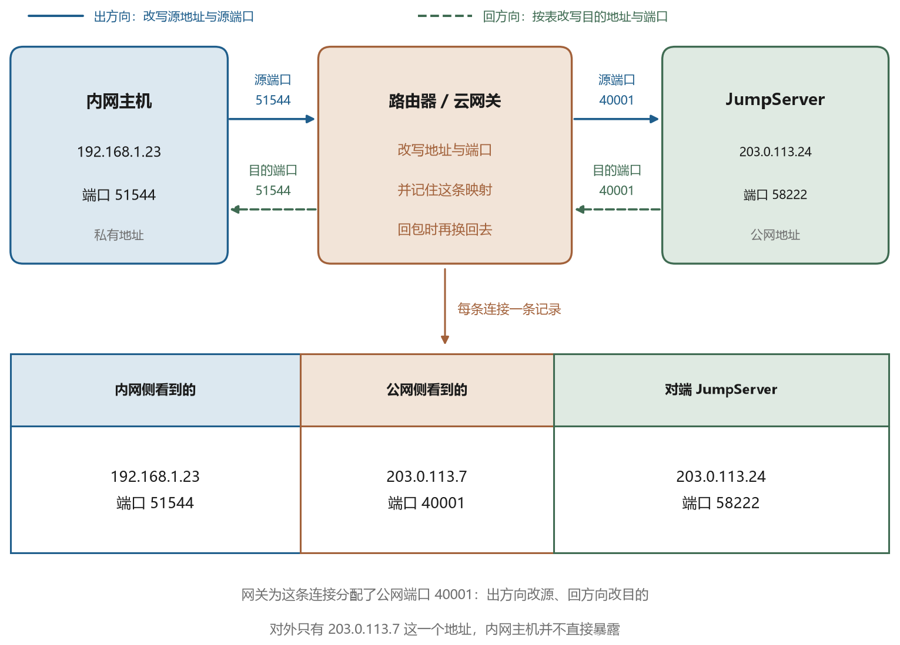

# 地址、端口和名字

## 3.1 同一个数字，在不同网络里指不同的机器

上一章说的 `192.168.1.23`，是一种**私有地址**。私有地址只在某一张内网里有意义。

常见的私有地址有三段：`192.168.x.x`、`10.x.x.x`、`172.16.x.x` 到 `172.31.x.x`。你家的路由器、公司的办公网、学校的机房，用的都是这几段。

这带来一个后果：全世界有几千万台机器都叫 `192.168.1.23`，但它们是不同的机器。所以在公网上，这个地址是“不可路由”的——外面的人没法直接连到你家里这台电脑，因为路由器不知道该送到哪一家。

云服务器不一样。它有一个**公网地址**，任何人都能向它发起连接。这也是为什么云主机一开通，就要赶紧配好访问规则。

## 3.2 端口：一台机器上的很多扇门

地址能把数据送到某台机器，但机器上同时跑着网页服务、数据库、SSH 服务，数据该交给哪一个？

靠**端口**。端口是一个编号，范围 0 到 65535。可以把它想成一台机器上的很多扇门：地址决定“哪栋楼”，端口决定“哪个门”。

几个常见的门：

| 端口 | 后面的服务 |
| --- | --- |
| 22 | SSH，远程登录 |
| 80 | 网站（明文） |
| 443 | 网站（加密） |
| 3306 | MySQL 数据库 |

服务器的 SSH 服务就守在 22 号门后面，等别人来敲。

注意一件事：“守着”和“连出去”是两回事。服务器在 22 端口守着，等别人来连；你的电脑连出去时，自己那一端会随机挑一个临时端口，比如 51544。一条连接的两头各有一个端口号，一头固定，一头随机。

## 3.3 名字：给人看的门牌

`198.51.100.17` 这样的地址，人记不住。于是有了**域名**，比如 `server.example.com`。

机器不认名字，只认地址。把名字换成地址的系统叫 **DNS**，可以把它想成一本全球共用的电话簿：输入名字，查出号码。

查的过程大致是：先看自己电脑的缓存，没有就去问网络设置里那台 DNS 服务器；它也不知道，就替你去问更上一级的服务器，一层层问到为止，然后把答案缓存一段时间。

所以改了域名解析之后，有些地方立刻生效，有些地方要等一会儿——那些地方手里的旧答案还没过期。

## 3.4 为什么家里的电脑，外面连不进来

你家里的电脑在 `192.168.1.x` 这个网段里，外面的人拿着你的公网地址敲门，是敲不到的。

原因在**地址转换**（NAT）。你的数据出门时，家里的网关把“你的内网地址 + 端口”换成“网关的公网地址 + 一个它管理的端口”，并在内存里记一条账。回包到了，它再按账本换回去。

图 3-1 是这个过程的示意。

这套机制带来两个结果：

- 外面看到的来源地址是网关的，不是你的真实地址，所以“按 IP 判断是谁”的规则会失效
- 外面没法主动连你，因为网关的账本里没有这条记录

要让外面连进来，得在网关上手工做端口映射，或者用一条从内向外的隧道。第七章的端口转发，做的就是后一件事。

服务器不需要这一套，因为它有公网地址，本来就在门外。

## 3.5 这一章的三句话

- 私有地址只在一张内网里有意义，公网地址谁都能连。
- 地址找到机器，端口找到机器上的服务，一条连接两头各有一个端口。
- 家里的设备靠地址转换出门，所以外面连不进来；要连进来，得做映射或隧道。
