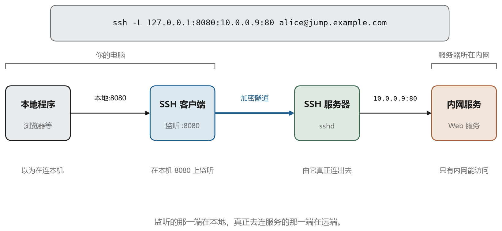

# 把远端的服务搬到手边：端口转发

## 7.1 一个很常见的困境

公司内网的数据库在 `10.0.0.8` 的 3306 端口上。你在工位上，用数据库客户端连它，一切正常。

晚上回家，同一个客户端、同一个地址，连不上。

原因第三章讲过：`10.x.x.x` 是私有地址，只在那张内网里有意义，你家里没有这台机器。

最直接的想法是：能不能让我的电脑“假装”也在那张内网里，至少让这一个数据库端口看起来在本地？

能。这条命令就能做到：

```bash
ssh -L 3306:10.0.0.8:3306 alice@198.51.100.17
```

## 7.2 这条命令在做什么

`-L` 的意思是“本地转发”。它由四段组成，用冒号隔开：

```text
-L  本地端口 : 目标地址 : 目标端口
```

上面那条命令的意思是：**在本机开一个 3306 端口；谁连这个端口，就把流量通过 SSH 连接送到服务器，再由服务器去连 `10.0.0.8` 的 3306。**

于是你在本机把数据库客户端指向 `127.0.0.1:3306`，就能连上公司那台数据库了。

图 7-1 是这个结构。



有一件事容易搞错：`10.0.0.8` 这个地址，是**服务器**去连的，不是你的电脑去连的。所以它只需要在服务器那一侧可达，你的电脑根本不需要认识它。很多人以为要先把 `10.0.0.8` 写进本机的 hosts，其实不必。

## 7.3 为什么这样是安全的

整个过程中，`10.0.0.8` 那台数据库没有对公网开放任何端口。它只接受来自服务器（内网里的一台机器）的连接。

你这一端，只在本机开了一个端口，默认还只有本机能连（`127.0.0.1`）。同一个办公室的人想借你的电脑当跳板，也连不进来。

通道是加密的：从你的电脑到服务器这一段，中间设备看不到你在传什么。

所以端口转发经常被用来临时访问内网服务：看一个内部网页、连一个数据库、调一个只对内网开放的管理接口。

## 7.4 它和 VPN 有什么不同

两者都能让你访问远处内网的东西，但做法不同：

- **端口转发**：一次开一个端口，开几个写几条。程序得把地址改成 `127.0.0.1`
- **VPN**：配一次，整台机器的流量都改道，程序什么都不用改

一句话：端口转发是“给某一个端口修一条小路”，VPN 是“把整张网搬过来”。

日常临时用，端口转发更轻；长期、要访问一堆服务，才考虑 VPN。

## 7.5 用的时候注意两点

第一，本地端口别和已有程序冲突。本机 3306 已经被本地数据库占了，就换个端口，比如 `-L 13306:10.0.0.8:3306`，客户端连 `127.0.0.1:13306`。

第二，这条命令要一直开着。窗口关了、连接断了，转发就没了。想让它稳定，可以加心跳参数，或者交给专门的工具托管。

## 7.6 这一章的三句话

- 端口转发把远端的一个端口，临时搬到本机来。
- `-L 本地端口:目标地址:目标端口`，目标地址是服务器去连的。
- 一次开一个端口；要整张网，才轮到 VPN。
