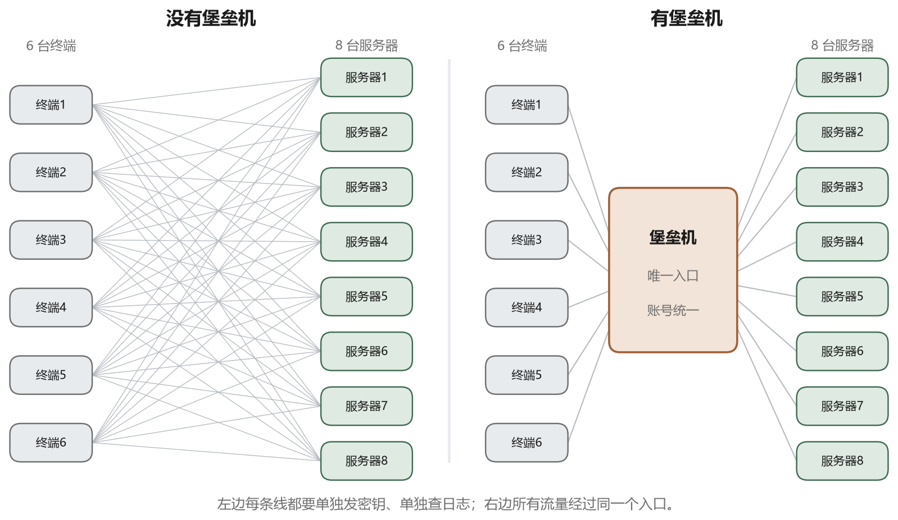

# 人多了怎么办：堡垒机

## 8.1 三五个人的时候，一切靠约定

只有几台机器、几个人的时候，远程访问可以很随意：每个人把自己的公钥装到每台机器上，谁走了就删掉。

这套做法在小规模下没问题。人一多，麻烦就来了：

- 谁有哪台机器的权限，说不清
- 谁在什么时候登录过，查不到
- 同事离职三个月，他的公钥还躺在某台机器上
- 生产库被误删，日志里只有一条 `root` 的操作记录，没人知道是谁

图 8-1 左边画的是这种“网状”连接：每个人都要连到每台机器。



## 8.2 堡垒机的思路：收成一个入口

堡垒机做的事很简单：**所有人先连它，再由它去连目标机器。**

于是连接关系从网状变成星形（图 8-1 右边）。它替团队做三件事：

- **收拢凭据**：服务器的密码和私钥只存在堡垒机里，由它统一保管、代填
- **写清授权**：谁能连哪台机器，写成一张可以查询、可以回收的表
- **留下记录**：每次会话录下来，事后能查、能回放

这三件事在人数少的时候靠约定就够了，人一多、机器一多、再加上合规要求，就必须有东西来承担。

## 8.3 一个看起来很奇怪的用户名

第一次连企业环境，你可能会看到这样的登录名：

```text
alice@ubuntu@10.0.0.5
```

一个用户名里有两个 at 符号。它是堡垒机的约定：三段分别表示“我是谁”“用哪个系统账号去连”“连哪台机器”。

普通 SSH 的用户名只有一个 at 符号，左边是人，右边是机器。堡垒机要在一次连接里同时知道三件事，而用户名只有一个字段，于是它把三件事拼进同一个字符串。

所以这串字符不是 SSH 的语法，是堡垒机自己的规矩。把它发给一台普通服务器，只会被当成一个不存在的账号。

## 8.4 什么时候需要它

判断标准不是“远程访问该不该有堡垒机”，而是“这个环境的规模和约束需不需要”。

| 场景 | 常见做法 |
| --- | --- |
| 个人服务器、家庭实验室 | 直连 |
| 小团队，机器少于十台 | 直连加统一的密钥管理 |
| 几十人、上百台机器 | 堡垒机 |
| 有等保、审计要求 | 堡垒机 |

代价也要知道：堡垒机是所有运维流量的必经之路，它挂了，所有人都进不去；它集中了所有凭据，一旦被攻破，损失比没有它更大。

## 8.5 这一章的三句话

- 堡垒机把“人人直连”改成“人人先连它”，凭据、授权、录像都收在一处。
- 两个 at 符号的用户名，是堡垒机把三件事塞进一个字段的办法。
- 它不是必需的，规模变大、要求变严时才值得上。
