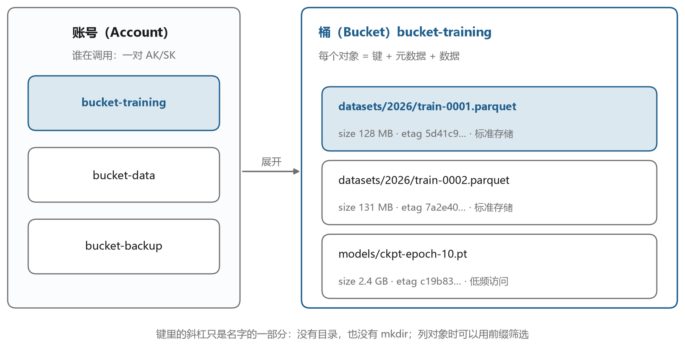

# 数据放在别人的磁盘上：对象存储

## 9.1 文件系统不够用的那天

平时我们把文件放在目录里：一个文件夹套一个文件夹，文件有名字、有路径。

数据量小的时候，这套办法很舒服。等到几十 TB、几千万个文件的时候，它开始吃力：目录结构要放在内存里，几千万个文件会把内存吃光；一台机器的硬盘有上限，扩容要停机；多台机器要共享同一批文件，还得搭一套共享文件系统。

对象存储是为这个场景设计的。它放弃了目录树，换来近乎无限的容量和简单的接口。

## 9.2 桶、键、对象

对象存储里只有三层东西：

- **账号**：谁在调用，用一对密钥证明
- **桶**：装对象的容器，名字全局唯一
- **对象**：一个键、一段数据、一组元数据

图 9-1 是这个层次。



键是对象的名字，可以写成 `logs/2026/11/04/app.log`，看起来像路径，**但它不是路径**。对象存储里没有 `logs` 这个目录，斜杠只是名字里普通的一个字符。控制台把它显示成目录树，是为了照顾人的习惯。

这带来一个后果：按前缀列举很快，但“操作一个目录”这种事不存在。想删掉一个“目录”，得先列出所有以这个前缀开头的对象，逐个删。

## 9.3 访问一个对象，就是访问一个网址

对象存储的接口是 HTTP。你要读一个对象，本质上是访问一个网址：

```text
https://bucket-1250000000.cos.ap-guangzhou.myqcloud.com/report.pdf
```

域名里带着桶名和地域，路径就是键。

这里没有“登录”这回事。每个请求都得自己带上身份证明，否则任何人都能读写你的数据。这个证明叫**签名**：用你的密钥对请求内容算出一个值，附在请求里；服务端用同样的方法算一遍，对不上就拒绝。

签名错一个字节，就会得到一个 `403`。这是对象存储最常见的错误，第十三章会讲怎么排查。

## 9.4 大文件怎么传

一个 2 GB 的文件，用一条请求传完很容易失败：中途断了要从头再来，服务器的内存和超时也吃紧。

常见的做法是**分片上传**：把文件切成固定大小的片，逐片上传，最后合并。某一片失败只重传那一片；还能并发传，跑满带宽。

下载也一样，可以只取文件的一段（断点续传），不必每次都从头下。

## 9.5 密钥和权限

访问对象存储用一对密钥：一个公开的 ID，一个保密的 Key。它和 SSH 的钥匙不是一回事——这里只有一对共享的密钥，没有公钥私钥之分。

所以它一旦泄露，等于把权限全部送人。实践上有几种保护方式：

- 不把密钥写进代码，放进环境变量或配置文件
- 用子账号的密钥，权限限定到某个桶、某个前缀
- 短期任务用临时密钥，几小时后自动失效
- 给外部临时访问时，签发一个限时、限对象的链接，而不是给密钥

## 9.6 这一章的三句话

- 对象存储只有账号、桶、对象三层，键不是路径。
- 每个请求都要签名，签错一个字节就是 403。
- 大文件靠分片和断点，密钥靠“不写进代码、限定权限、尽量短期”来保护。
