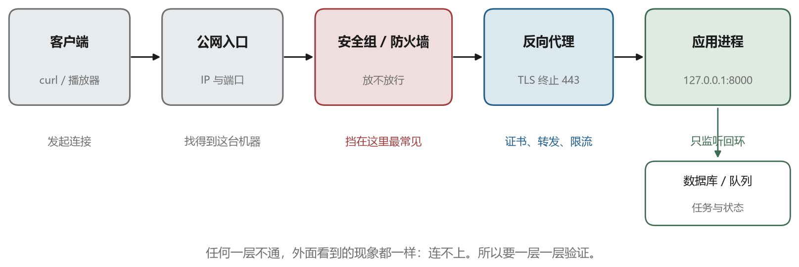

# 把你的程序变成别人能用的服务

## 10.1 从“我自己跑”到“别人能用”

前面九章讲的都是“你去用别人”：连服务器、开隧道、取对象。这一章反过来：你写了一个程序，放在服务器上，让别人来用它。

最典型的样子是：你写了一个小工具，上传一张照片，返回一张风格化的图。你自己在服务器上跑一跑没问题，可怎么让朋友的电脑、手机也能用？

要做成这件事，只需要两个条件：程序得一直守在某个端口上等人来连；网络上的路得允许别人走到这个端口。

第一条叫**监听**。程序告诉系统“我在 8000 端口等”，系统替它排队；有人连上来，程序接住，读请求、处理、回结果。

第二条是**放行**。云服务器的安全组、机器里的防火墙，任何一处不放行，外面都连不上。很多人卡在这里：程序明明在跑，`curl 127.0.0.1:8000` 也通，就是外面连不上——因为程序只监听了本机，或者安全组没开。

## 10.2 双方说什么话：HTTP

连接建立之后，客户端和服务端用 HTTP 说话。请求长这样：

```text
POST /jobs HTTP/1.1
Host: api.example.com

{"prompt": "a lighthouse at dusk"}
```

四部分：方法（做什么）、路径（对谁做）、请求头（附加信息，比如身份凭证）、请求体（真正的数据）。

响应也差不多，第一行换成状态码：

```text
HTTP/1.1 202 Accepted

{"id": 42, "status": "queued"}
```

状态码记住分段就够：`2xx` 成功，`4xx` 你的请求有问题，`5xx` 服务器出问题。常用的几个：`200` 成功、`401` 没登录、`403` 没权限、`404` 不存在、`429` 太频繁、`500` 服务端出错。

图 10-1 是一次请求从客户端走到应用的路径。



## 10.3 长任务：不要让它堵在请求里

转换一张图要三分钟。如果客户端发一个请求，服务端跑完再返回，会撞上三堵墙：浏览器和代理通常几十秒就超时；一个请求占一条连接；请求一断，进度全丢。

正确的做法是**异步**：请求只负责下单。

1. 客户端 `POST /jobs`，服务端写一条任务记录，立刻返回 `202` 和一个任务号
2. 后台的 worker 从队列里取任务，开始跑
3. 客户端拿任务号反复查 `GET /jobs/42`，或者等服务端推送进度
4. 跑完，状态变成“成功”，客户端再去下载结果

进度怎么回传？三种常见方式：轮询（隔一两秒问一次，最简单）、SSE（服务端单向推）、WebSocket（双向，但要处理心跳重连）。任务少、进度慢，轮询就够。

## 10.4 会员：谁能用，能用多少

如果你的服务要收费，就要回答四个问题：

- **身份**：这次请求是谁发的
- **认证**：怎么确认他确实是这个人
- **授权**：他能做什么，能碰哪些资源
- **额度**：他能用多少，超了怎么办

这些数据放在数据库里：用户表、角色表、订阅表、用量表、流水表。管理入口是后台界面加命令行脚本，两者操作同一套接口，不要直接改库。

密码绝对不能存明文，也不能用 MD5 这类快哈希。正确做法是“慢哈希加盐”：每个用户一个随机盐，用专门设计得慢的算法（bcrypt、Argon2）算一遍。登录成功后，用 Cookie 或 Token 记住他——前者把状态放服务端，后者把状态放在签名的凭证里。

还有一个最容易漏的点：**每条业务数据都要记“属于谁”**，查询时强制按归属过滤。没有这一条，一个普通会员就能下载别人的结果。

## 10.5 这一章的三句话

- 服务能被访问，靠两件事：程序监听在一个端口上，网络放行到这个端口。
- 长任务不能塞进一个请求，要拆成“下单、排队、查进度、取结果”。
- 会员体系是身份、认证、授权、额度四件事，缺一件就会出问题。

## 10.6 读完这本之后

到这里，入门册就结束了。你现在应该能：

- 看懂一条 `ssh` 命令在做什么
- 遇到连不上，知道按什么顺序查
- 说清密钥、端口转发、堡垒机、对象存储分别在解决什么问题
- 知道把程序做成服务，需要哪几块拼图

接下来可以读进阶册：那里有协议的细节、密码学的原理、完整的操作步骤，以及更多边界情况。想再深一层，深入册会拆开协议的线格式、密钥交换的数学、签名的完整推导。
