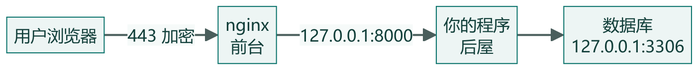

# 前台、接待和门牌

> 502 不是你的程序说的，是前台说的。

## 12.1 页面上那行字

```text
502 Bad Gateway
nginx
```

你第一反应是去查代码。代码没动过，昨天还是好的。

查了半天，发现是你重启了程序，但它没起来，端口上没人。nginx 去敲后端那扇门，没人应，于是它回了这么一句。

这句话是 nginx 说的，不是你的程序说的。认清楚这一点，能省掉很多冤枉路。

## 12.2 为什么中间要站一个人

程序自己也能监听 443，直接面对用户，为什么不用。

有几个现实的理由。

第一，1023 以下的端口需要管理员权限。你的程序要是用非 root 用户跑，绑不了 80 和 443。

第二，证书。HTTPS 需要证书，证书要续期，要处理握手。这件事让 nginx 做比让你的业务代码做要稳得多。

第三，一个端口只能一个程序。如果你有两个网站，或者一个网站加一个接口服务，它们没法都占 443。

第四，静态文件、压缩、缓存、限流、日志，nginx 干这些又快又省事，用 Python 干这些是浪费。

所以常见的结构是这样。



用户只认识前台。前台看请求里的域名和路径，决定把它交给后面哪个房间。这个角色叫反向代理。

“反向”这个词是相对“正向代理”说的。正向代理是你这边的代理，帮你出去访问别人，翻墙软件就是。反向代理是服务器那边的代理，替后面的服务接待外面的人。你只需要记住它是前台。

## 12.3 配置大概长这样

下面这段写在服务器上，是 nginx 读的那份配置文件。你自己的电脑上没有这个文件，除非你本地也装了 nginx。

```nginx
server {
    listen 443 ssl;
    server_name myapp.com;

    ssl_certificate     /etc/letsencrypt/live/myapp.com/fullchain.pem;
    ssl_certificate_key /etc/letsencrypt/live/myapp.com/privkey.pem;

    client_max_body_size 200m;

    location / {
        proxy_pass http://127.0.0.1:8000;
        proxy_set_header Host $host;
        proxy_set_header X-Forwarded-For $proxy_add_x_forwarded_for;
        proxy_set_header X-Forwarded-Proto $scheme;
    }
}
```

`listen 443 ssl` 是它守的门。`server_name` 是它认的域名，同一个 nginx 可以配很多个 server 块，靠这个字段区分。

`location /` 是路径匹配。所有路径都转给后面的 8000。

`proxy_set_header` 那三行是给后端传话用的。后端需要知道真实的访问者是谁，以及用户是用 https 还是 http 来的。不加这几行，你的程序看到的访问者 IP 全是 `127.0.0.1`，生成的链接可能变成 http。

`client_max_body_size` 是允许上传的最大体积，默认只有 1 MB。第一章那个朋友遇到的 413 就是这里。

## 12.4 几个错误码，分别是谁在说话

| 错误码 | 谁说的 | 意思 | 先查什么 |
| --- | --- | --- | --- |
| 502 | nginx | 我去敲后端，没人应或者应了但不对 | 程序起来了吗，端口对吗 |
| 504 | nginx | 后端接了但太久没回 | 程序是不是卡住了，日志里在等什么 |
| 413 | nginx | 上传的东西太大了 | `client_max_body_size` |
| 404 | 后端或 nginx | 这个路径没有东西 | 路由写了吗，路径对不对 |
| 403 | 后端或 nginx | 有这个东西但不给你 | 权限、鉴权、文件权限 |
| 500 | 后端 | 程序自己报错了 | 去看应用日志，一定有堆栈 |

502 和 504 都是前台的抱怨，区别在于有没有人接。502 是没人，504 是有人但不说话。这两个分清楚，方向就定了。

## 12.5 HTTPS 到底是什么

说人话，它做两件事。

一是证明身份。证书由受信任的机构签发，浏览器看到证书有效，就知道这个域名确实是这个服务器在服务，不是别人冒充的。

二是加密。握手之后，双方协商出一个只有彼此知道的密钥，后面的内容都加密传。中间人截获了也只能看到乱码。

证书以前要花钱买，现在有 Let's Encrypt，免费，三个月有效，可以自动续。用 certbot 一条命令就能配好，用 Caddy 的话连命令都不用，它自己申请自己续。

一个常见的误解是“上了 HTTPS 就安全了”。HTTPS 保证的是这条路上没人偷看、没人篡改，它不保证你的程序没有漏洞，也不保证你的服务器配置是对的。它是信封，不是门锁。

> **这一章记住一句**
>
> 502 是前台在说后面没人，不是你的代码在说话。

下一章把前面所有东西串起来，走一遍完整的路。那一章是全书的地图，迷路的时候回来看。
