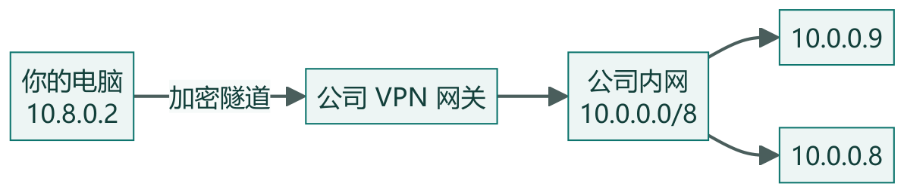

# 班车和前台

> VPN 让你“坐到公司里”，堡垒机让你“从前门进”。

## 19.1 两种完全不同的做法

上一章的隧道是一根管子，通到一个具体的服务。你要连数据库就挖一根，要连管理后台就再挖一根。服务多了就很麻烦。

公司里通常不这么干，它们用另外两样东西。

一样是 VPN。连上之后，你的电脑会拿到一个内网地址，比如 `10.8.0.2`，从那一刻起，你访问 `10.0.0.9` 就像坐在办公室里一样，不需要为每个服务单独开管子。

另一样是堡垒机。它不改变你的网络位置，它改变的是你进门的路径。所有对服务器的操作都必须先经过它，它在中间做认证、授权和记录。

这两样解决的是不同的问题。VPN 解决“我怎么到达那张网”，堡垒机解决“谁能操作哪台机器，做了什么要留痕”。

## 19.2 VPN 像班车

VPN 的全称是虚拟专用网络。虚拟的意思是，那条专线并不真的存在，它是从公网里挤出来的一条加密通道。

你可以把它想成公司的班车。你在家门口上车，车开进园区，你下车的时候已经在公司里了。你不需要知道路上怎么走的。

技术上它做了三件事。建一条加密通道到公司网关。给你的电脑分配一个内网地址。往你的路由表里加几条规则，告诉系统哪些地址要走这条通道。



连上之后，`ip addr` 会多出一个网卡，名字可能是 `wg0` 或者 `tun0`。`ip route` 里会多出几条路由。这两个命令能告诉你 VPN 到底有没有生效，比看客户端界面上的绿灯可靠。

## 19.3 全流量还是只走公司

VPN 有一个选项，很容易被忽略。

一种是全流量，你所有的上网都从公司出口出去。好处是统一管理，坏处是你访问 B 站也要绕公司一圈，慢了，而且公司能看到。

另一种是分流，只有访问公司网段的流量走 VPN，其他正常走本地宽带。日常办公基本都用这个。

分流配错了会出现一种奇怪的现象。网页能打开，但公司内部的系统打不开，或者反过来。这时候去看路由表，看目标地址匹配到了哪条规则。

还有一个坑是 DNS。有些 VPN 要求你用公司的 DNS 才能解析内部域名，但你的系统还在用运营商的 DNS，于是 `jira.internal` 这种名字解析不出来。这种情况下的表现是“别人能开我开不了”，而 IP 是通的。

## 19.4 为什么公司不给你开端口

你可能会想，直接把 22 端口对公网开放不就行了，何必搞这么复杂。

因为一台机器开放端口，风险是这一台。一百台机器开放端口，风险是一百台，而且你不知道哪一台的密码是 `123456`。

VPN 的思路是，只留一个入口，把这个入口守好。堡垒机的思路是，即使你进了内网，也不能随便连机器，得先过它这一关。

这两层加起来，攻击面从一百个变成两个。

## 19.5 堡垒机是前台加录像

堡垒机的正式名字叫运维审计系统，行业里常说 4A，认证、授权、账号、审计。

它的工作方式很具体。

你不再直接 `ssh` 到目标服务器。你 `ssh` 到堡垒机，登录你自己的账号。堡垒机根据你的权限，列出你能连的机器。你选一台，它替你去连，把中间的输入输出全部转发，同时录下来。

```text
你的终端 → 堡垒机 → 目标服务器
              ↓
           录像存档
```

对目标服务器来说，连它的是堡垒机，不是你的电脑。目标服务器上的密钥由堡垒机托管，你手上没有。你离职的那天，管理员在堡垒机里禁用你的账号，你就进不去了，不需要去一百台机器上删公钥。

这套东西在企业里是合规要求，很多行业规定运维操作必须可审计。对个人开发者来说，接触到它的场景通常是入职之后，公司给你一个堡垒机地址和一个账号。

## 19.6 跳板机和堡垒机的区别

跳板机是一台普通的服务器，放在内网边缘，大家先登它，再从它跳到别的机器。它解决的是“怎么到达”，没有审计，没有权限管理，本质上就是一台共享的中转机。

堡垒机是一个产品，它在跳板机的基础上加了账号体系、权限控制、操作录像、命令拦截。有些还能做 SQL 审计，你在数据库客户端里敲的每一条语句都会被记录。

小团队用跳板机就够了。上了规模，或者有合规要求，就上堡垒机。

## 19.7 你会在哪里遇到它们

面试的时候会被问，VPN 和堡垒机有什么区别。

入职的时候会拿到一个 VPN 客户端和一个堡垒机地址。

排查问题的时候会遇到“我连不上”，然后发现是 VPN 掉了，或者堡垒机上没有给你开这台机器的权限。

这三种场景的共同点是，问题都不在你的代码里。遇到的时候先确认自己处在哪一层，VPN 通不通，堡垒机能不能登，目标机器在不在你的授权列表里。

> **这一章记住一句**
>
> VPN 改的是你所在的位置，堡垒机改的是你进门的路径。

下一章讲现在最流行的一种形态。代码不落地，编辑器长在服务器上。
