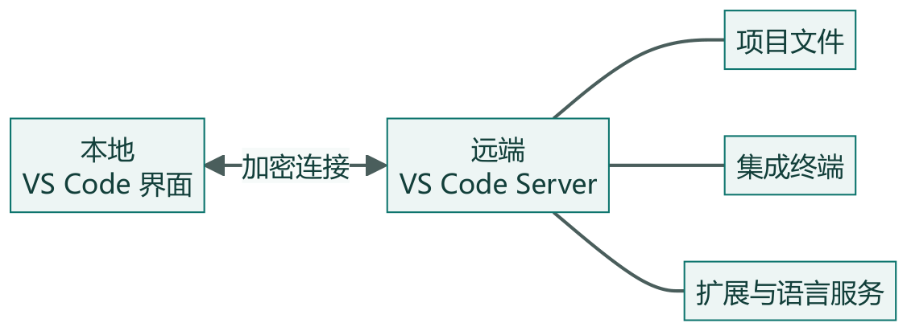

# 在远端写代码

> 远程开发不是把文件同步过去，是让编辑器住在服务器上。

## 20.1 以前是怎么干的

你要在服务器的显卡上跑训练，代码得在服务器上。于是流程变成这样。

本地用编辑器写代码。写完用 `scp` 传上去，或者 `git push` 再 `git pull`。在终端里 `ssh` 登录，跑起来，看日志。发现一个拼写错误，回本地改，再传一次。

一天下来，传文件的时间比写代码的时间长。更烦的是，本地的编辑器和服务器上的环境是两套，代码补全提示的库版本可能都不一样。

这件事有一个彻底的解决办法。

## 20.2 它到底在干什么

VS Code 有一个 Remote-SSH 扩展。装上之后，你选一个 SSH 主机，它会在这个主机上装一个服务端程序，然后你的编辑器界面通过一条加密连接和它通信。

看清楚这个分工。

界面、渲染、你的键盘鼠标，在本地。文件系统、终端、调试器、代码补全的语言服务，在服务器。



所以你在编辑器里打开的文件，是真的在服务器上，不是本地副本。你在集成终端里敲的命令，是在服务器上执行。代码补全用的是服务器上装的那些库。

它自己还用了一层端口转发，第八、十八章讲的那种，只是被封装起来了，你看不到。

## 20.3 为什么这个形态适合现在

三个原因。

**算力在服务器。** 训练、推理、大数据处理，本地笔记本跑不动。远程开发让你在本地写，在服务器跑，中间的摩擦几乎为零。

**环境一致。** 你在编辑器里看到的依赖，就是运行时用的依赖。不会出现“本地能跑服务器不能跑”。

**代码不落地。** 公司的代码库不允许下载到个人电脑，远程开发天然满足这个要求，文件从来没离开过服务器。

还有第四个原因，属于这个时代的。AI 编程助手在远端跑，它能直接读写项目文件、执行命令、看测试结果，整个闭环都发生在服务器上。你只负责看和点头。

## 20.4 配一次，以后省事

与其每次敲一长串 `ssh` 参数，不如写进配置文件。这个文件在你自己的电脑上。这个文件在 `~/.ssh/config`，Windows 上是 `C:\Users\你的用户名\.ssh\config`。

```text
Host gpu
    HostName 203.0.113.24
    Port 58222
    User alice
    IdentityFile ~/.ssh/id_ed25519
    ServerAliveInterval 30
    ServerAliveCountMax 3
```

写完保存。以后 `ssh gpu` 就等于那一整串。VS Code 的 Remote-SSH 也会读这个文件，列表里直接出现 `gpu` 这一项。

`ServerAliveInterval` 那两行是保活，防止长时间不操作被中间的 NAT 设备掐断连接。这在第十八章提过，远程开发时特别需要，否则你离开十分钟回来就发现断线了。

## 20.5 几个会卡住的地方

**服务器内存太小。** VS Code Server 要占几百兆内存，加上语言服务，一 G 内存的机器会很吃力，甚至直接被系统杀掉。这是“连上了但立刻断开”的常见原因，去看 `dmesg` 里有没有 OOM 的记录。

**磁盘满了。** `~/.vscode-server` 会累积很多旧版本，几个月后能占几个 G。定期清一下没用的目录。

**扩展要装在远端。** 有些扩展是本地用的，有些要在远端跑。装错了会提示“此扩展在远程环境中不可用”，在扩展面板里能看到“安装在 SSH: gpu”这个按钮。

**Windows 上路径的坑。** `IdentityFile` 如果用 Windows 路径，要写成 `C:/Users/...` 这种正斜杠形式，反斜杠会被当成转义符。

**连接超时。** 先确认命令行 `ssh gpu` 能不能通。命令行不通，VS Code 一定不通，而且它的报错更难看懂。

## 20.6 一个心态

远程开发会让你产生一种错觉，觉得自己在本机操作。

文件是真的在远端，`rm` 是真的删掉了服务器上的东西，集成终端里跑的命令是真的在那台机器上执行。

但有一点和第十一章相反，这里的终端是 VS Code Server 管着的，你关掉窗口，里面跑的程序一般也会结束，除非你用 `nohup` 或者 systemd。这一点在训练跑到一半的时候特别致命。

> **这一章记住一句**
>
> 界面在本地，文件和环境在远端。删东西是真的删。

第五篇结束。最后一篇讲怎么和 AI 配合，以及一些必须守住的底线。
