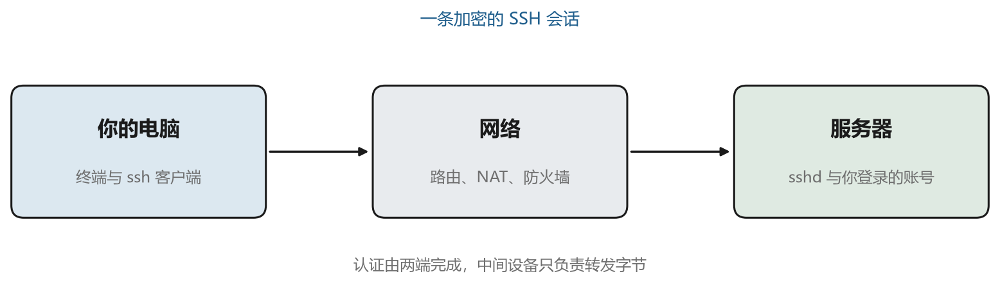
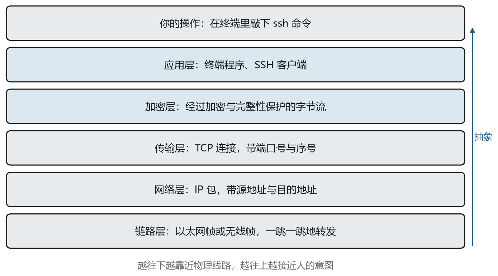

# 你按下回车之后

今天写代码的人，越来越少在自己面前的机器上干活。编译在远端的服务器上跑，训练在机房的集群里排队，数据放在一个只有网址的存储里，连编辑器都只负责画界面，真正读写文件的是几百公里外的另一个进程。计算被拆成了两半，一半在你眼前，一半在别处。

一旦拆开，就必须有一条通路把它们连起来。这条通路要回答三个问题。指令怎么送过去，对面凭什么相信发指令的人是你，出了事又怎么知道当时发生了什么。这三个问题听起来朴素，却是几十年里无数设计取舍的来源。SSH 回答第一个和第二个，堡垒机回答第二个和第三个，对象存储则用另一套办法回答“谁在动我的数据”。

这一章先不做解答，只做一件事，把一条命令的完整旅程走一遍。看清楚这条路上有哪些角色、分几段、每段负责什么。后面的章节会把每一段放大，直到你能自己判断问题出在哪里。

## 1.1 一份照着填的配置

先说一段我自己的经历，它适合用来说明背景知识缺位时会发生什么。几年前，一位做算法的朋友发给我一份配置指南，说照着填就能用 VS Code 连上实验室的机器。指南不长，核心就是配置文件里的两段：

```text
Host l40-server
    HostName 124.221.133.165
    User alice@ubuntu@119.45.34.99
    Port 58222
    IdentityFile C:/Users/alice/.ssh/ssh.jumpserver.pem
```

我照抄进去，把 `alice` 换成自己的账号，居然连上了。但随后冒出来一串问题。既然要连的是 `119.45.34.99`，为什么 `HostName` 写的是另一个地址。用户名里为什么有两个 at 符号，Linux 用户名不是不允许这种字符吗。端口 58222 是谁的端口，目标机上明明开着 22。`IdentityFile` 指向的 `.pem` 文件，和常见教程里的 `id_rsa` 又是什么关系。

这些问题在当时都没有答案。我照着做，能用，但一旦连不上，就完全不知道该动哪一行。后来花了不少时间把这些机制补上，才发现那份指南里的每一行都有明确的来历，而它们之所以看起来奇怪，是因为中间多了一台你平时看不见的机器。这类“照着填能用、离开指南就废”的处境，几乎都来自同一个原因，缺的不是操作步骤，是操作背后的结构。

## 1.2 那条命令交给了谁

在终端里敲 `ssh l40-server` 然后回车，最先动起来的是一个叫 `ssh` 的程序。它属于 OpenSSH 客户端，Windows 10 以后的系统自带，Linux 和 macOS 也自带。这个程序做的事情按顺序是下面几步。

它先读命令行参数，再去读配置文件 `~/.ssh/config`，把 `l40-server` 这个名字展开成一堆具体参数，包括真实地址、端口、用户名和私钥路径。然后它向那个地址的端口发起一条 TCP 连接。连接建立之后，双方开始协商加密方式、交换密钥、验证身份。等这一切都完成了，它才把你的键盘输入打包发出去，把对方的输出解包显示在屏幕上。

这条链路上，你自己的电脑里其实有三个角色在配合。最外面是你看到的终端窗口，负责显示字符、接收按键。中间是 `ssh` 客户端进程，负责协议。最底下是操作系统的网络栈，负责把字节变成电信号或者光信号送上网线。三者分工明确，所以出问题时可以分别检查。窗口没反应，可能是客户端卡住了；客户端报连接超时，那就是网络栈之下的事情。





## 1.3 四段路与三个身份

从你的电脑到目标服务器，中间通常隔着三段路，如图 1-1。第一段从你的电脑到公网，经过家里的路由器或者公司的出口网关。第二段在公网里穿行，经过若干台你完全不知道存在与否的路由器。第三段落在堡垒机上，它接受你的连接，然后再替你向目标机发起一条新的连接。

这段结构解释了指南里那个奇怪的配置。`HostName` 填的是堡垒机的地址，因为你的电脑能够直接访问的只有它。目标机的地址 `119.45.34.99` 被写进了 `User` 字段，因为堡垒机需要用这个信息找到终点。端口 58222 也是堡垒机的端口，目标机上那个 22 端口由堡垒机去连，你在本机根本碰不到。

同样地，这条链路上有三个不同的身份在起作用。本机上的 Windows 账户决定了你的文件放在哪里、`~/.ssh` 目录属于谁。堡垒机上有一个你自己的账户，用来登录堡垒机、接受审计。目标机上还有一个 Linux 账户，那是真正执行命令的身份。指南里的 `alice@ubuntu@119.45.34.99` 把后两个身份和终点地址拼成了一串，交给堡垒机去解析。第三章和第九章会把这套约定拆开细讲，现在只需要记住，一串字符里塞进了三层信息，看起来别扭是正常的。

这里还有一个容易忽略的事实。从你的电脑到堡垒机的那一段是加密的，从堡垒机到目标机的那一段也是加密的，但这是两条独立的加密连接。堡垒机在两段之间解密再加密，所以它在理论上能看到你输入的每一个字符。这正是它在企业里存在的原因，也是它的风险所在。

## 1.4 把复杂拆成几层

网络协议几乎都采用分层设计。分层的好处在于，每一层只需要关心自己那点事，上层不必知道下层用什么介质传输，下层也不必知道上层在传什么内容。图 1-2 是这条链路上涉及的层次。





最上面是你的意图，你想在远端执行一条命令。往下一层是应用程序，终端和 SSH 客户端都属于这一层。再往下是加密层，SSH 在这一层把明文变成密文，并加上完整性校验。然后是传输层，TCP 负责把字节流可靠地送到对端，处理丢包、重传、顺序。再往下是网络层，IP 负责寻址和路由，让数据包能跨越多个网络。最底下是链路层，负责在一段物理介质上把帧送出去。

分层不是为了好看，而是为了定位问题。当 `ssh` 报“连接超时”，问题多半在网络层或链路层，因为 TCP 连握手包都没送到。当它报“Permission denied”，说明网络一路通畅，问题出在认证层。当它连上了却卡在“Entering interactive session”，问题可能出在连接层的通道建立或者服务端的 shell 启动。知道每一层负责什么，报错信息就从天书变成了路标。

## 1.5 一次连接的完整时间线

把上面这些串起来，一次成功的登录大致经过图 1-3 里的几步。


第一步是 TCP 三次握手，这一步和 SSH 没有关系，任何基于 TCP 的服务都要走。握手成功后，双方各自发送一行版本字符串，形如 `SSH-2.0-OpenSSH_9.6`。这一行是明文，也是整条连接里唯一一定为明文的部分。接着双方各自列出自己支持的算法清单，从中挑出一套双方都支持的组合。再往后是密钥交换，双方通过数学运算协商出一个只有彼此知道的会话密钥。密钥算好之后，各自发送一个 NEWKEYS 消息，从这一刻起，后面的所有内容都加密。

加密通道建立之后才开始认证。这个顺序常被误解，很多人以为先验证身份再加密，实际上 SSH 是先建立加密通道，再在通道里验证身份。这样做的好处是，密码和公钥签名都不会以明文出现在网络上。认证成功后，客户端请求打开一个会话通道，服务端分配一个伪终端并启动 shell，你才看到那个熟悉的提示符。

表 1-1 把各阶段和常见的失败表现对应起来。这张表在第十三章的排错部分还会再用一次。

表 1-1　连接阶段与典型故障对照

| 阶段 | 你看到的现象 | 问题通常在哪里 |
| --- | --- | --- |
| TCP 握手 | `Connection timed out` | 地址错误、端口未开放、防火墙丢包 |
| TCP 握手 | `Connection refused` | 对端没有程序监听这个端口 |
| 版本交换 | `Connection closed by remote host` | 服务端限制、封禁、协议不匹配 |
| 算法协商 | `no matching key exchange method found` | 客户端与服务端没有共同算法 |
| 主机密钥 | `Host key verification failed` | 指纹与 known_hosts 记录不一致 |
| 身份认证 | `Permission denied (publickey)` | 私钥不对、公钥未授权、权限过宽 |
| 通道建立 | 卡住不动或者登录后立刻断开 | shell 启动失败、磁盘满、配额限制 |

## 1.6 怎么看见这些步骤

SSH 客户端自带调试输出，这是学习协议最方便的工具。在命令后面加 `-v` 会打印主要步骤，加 `-vv` 和 `-vvv` 会越来越详细。

```bash
ssh -vv l40-server 2>&1 | head -60
```

输出里每一行都以 `debug1` 或 `debug2` 开头，后面跟着这条信息属于哪个模块。你会依次看到连接建立、本地版本号、远端版本号、双方算法列表、密钥交换结果、可用的认证方式、认证尝试、通道打开。把这几十行读上三五遍，图 1-3 里的每个阶段就都能对上号了。

同样的信息在服务端也有一份。Linux 上 sshd 的日志通常在 `/var/log/auth.log`（Debian 系）或 `/var/log/secure`（Red Hat 系），用 systemd 的系统还可以用 `journalctl -u ssh` 查看。排查连接问题时，客户端和服务端的日志要对照着看，客户端说“我发了”，服务端说“我没收到”，问题就在中间那一段。

还有一个细节值得早点知道。调试输出里会打印主机密钥的指纹，形如 `ED25519 key fingerprint is SHA256:...`。这个字符串是你判断“对面是不是真机器”的唯一依据，第六章会专门讲它。现在只要记住，第一次连接时出现的那个 yes/no 提问不是走过场。

## 1.7 后面要解决的问题

这一章只给了一张地图，还没有进入任何一层的细节。第二章从最底下的地址与端口讲起，把“为什么连不上”变成可以逐段验证的判断题。第三章走到服务器内部，看看登录成功之后究竟是什么在等你。第四章和第五章进入密码学与 SSH 协议本身，解释那些算法名字背后的取舍。第六章到第七章处理密钥、指纹与隧道，把配置文件里剩下的几行讲完。

第三篇会换一个角度。前面讲的都是“一个人连一台机器”，而现实里往往是一群人连几百台机器，中间还要留下记录。堡垒机就是为这个场景发明的。第四篇则离开终端，去看数据存放的那一端，对象存储的接口看起来简单，签名与权限却能让人反复碰壁。

读完之后再回头看那份配置指南，你应该能一眼看出哪一行是关键，哪一行可以删掉，以及连不上时该先试什么。
