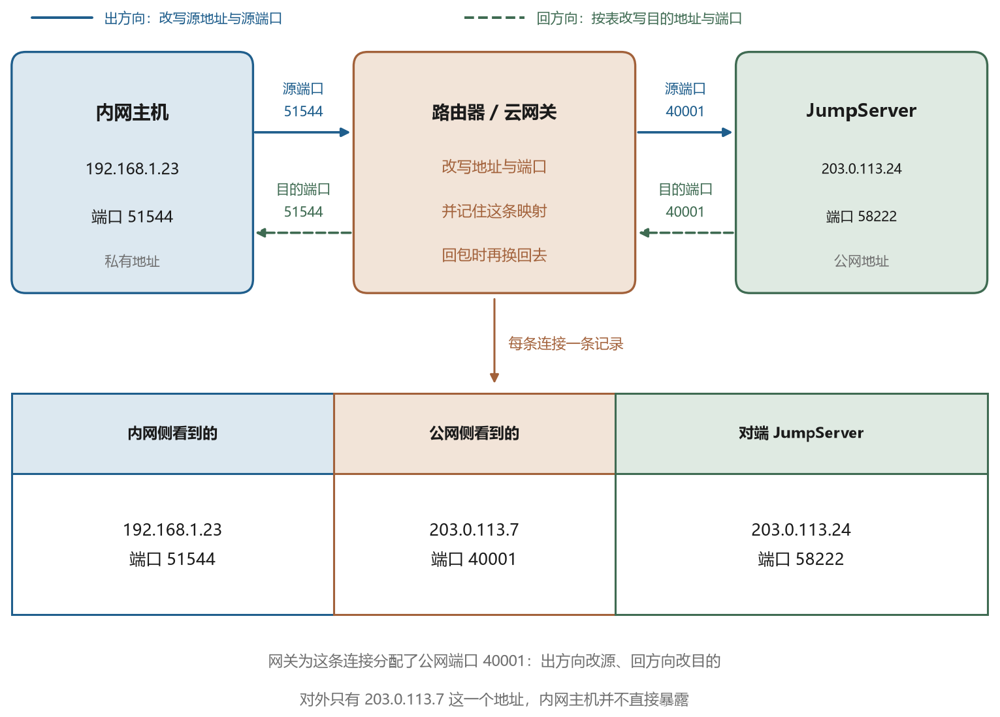
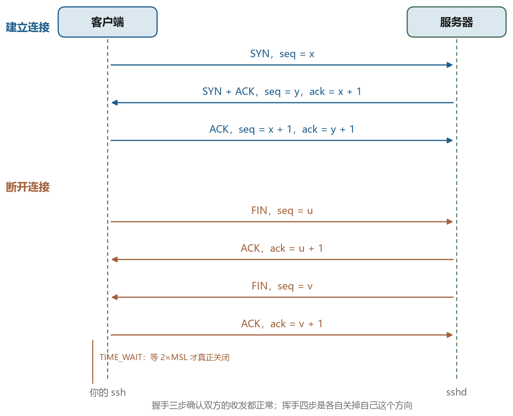
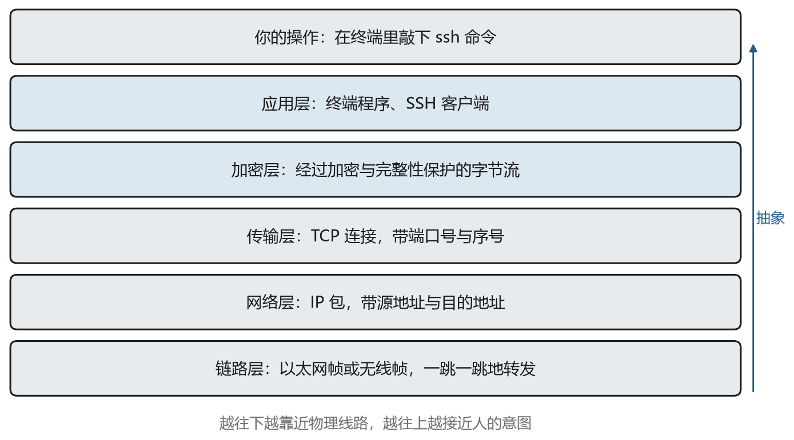

# SSH 是什么

## 2.1 从明文到加密

服务器通常没有显示器和键盘。它被放在机房的机架上，或者以虚拟机的形式跑在云里，通电、联网、启动，然后就静静地等着。要让这样的机器干活，只有一条路，把指令送过去，把结果取回来。

上一章结尾提到过 telnet。它是 1969 年出现的远程登录协议，工作方式很朴素，把本地敲下的字符原样变成字节发出去，把远端回传的字节原样显示出来。问题在于它不加密，登录时输入的用户名和密码以明文形式经过整条链路。网络还局限在同一个机房时，这个代价可以接受；网络扩展到校园、城市、跨洲之后，任何一段链路上的设备都能读到这些内容。

1995 年，芬兰赫尔辛基理工大学的研究者 Tatu Ylönen 在校园网出现窃听之后写了 SSH，本意是给同事一个能安全登录的工具。它保留了 telnet 的使用方式，你依然是在本地敲命令、看远端输出，但整条通道是加密的，双方还要互相证明身份。这个工具传得很快，一年之内就从校园扩散到全世界，后来由 IETF（互联网工程任务组，负责制定互联网标准的组织）标准化为 SSH-2 协议，文档编号是 RFC 4250 到 4254（RFC 是互联网标准的文档编号体系）。1999 年，OpenBSD 项目基于当时最后一版自由发布的代码整理出了 OpenSSH（一套开源的 SSH 实现），今天绝大多数 Linux 服务器上跑的 `sshd` 都是它的后代，Windows 10 之后的系统也自带了这个客户端。

## 2.2 SSH 的定义，以及它保证的四件事

SSH 的全称是 Secure Shell，安全外壳。这个名字容易让人以为它是一个加密版的终端，实际上它是一族协议的集合，规定了两个程序在一条不安全的网络连接上，如何建立一条可信的通道，如何确认彼此的身份，如何在这条通道里开出一个终端、执行一条命令、传一个文件，或者转发一段别的流量。

把它的承诺拆开，有四条。

第一条是身份认证。客户端要能证明“我是某个账号的主人”，服务端也要能证明“我确实是你以为的那台机器”。这两件事是分开的，前者用密码、公钥或证书，后者用主机密钥。公钥和私钥是一对，私钥自己留着，公钥可以公开；主机密钥是服务器用来证明自己身份的那一对；证书是由可信的第三方签发的公钥证明。很多工具只做前者，SSH 两件都做。

第二条是机密性。连接建立之后，链路上传输的所有字节都是加密的。中间经过的路由器、交换机、运营商的接入设备能看到包的来源、去向和大小，看不到内容。

第三条是完整性。每个数据包都带有校验值，接收方先验证再使用。任何一个字节被改动，连接立刻断开，不会出现“内容被悄悄改了一半”的情况。

第四条是复用。一条 SSH 连接里可以同时开多个逻辑通道，一个跑交互式 shell（接收命令并交给系统执行的程序），一个传文件，一个转发数据库端口，互不干扰。这也是它能顶替掉一大堆专用工具的原因。

需要说明的是，授权不在这四条里。你能登录之后能做什么，由服务端的策略决定，比如 `authorized_keys`（服务端保存允许登录的公钥的文件）里的限制选项、`sshd_config` 里的规则、操作系统本身的权限。SSH 协议只负责把你安全带进门，进门之后能走到哪个房间，是另一套机制的事。第三篇讲堡垒机（一种集中管控运维访问、记录操作的系统）时，这一点会变得很重要。

## 2.3 SSH 不是什么

初学者常把几个相邻的概念混在一起，先划清边界，后面读起来会顺很多。

SSH 不是一个软件，而是一套协议。OpenSSH 是这套协议最流行的实现，PuTTY、SecureCRT、各种语言的 SSH 库也都是实现。说“装一个 SSH”，严格讲是装一个实现。

SSH 不是 VPN。VPN 在网络层接管流量，配置好之后，访问内网的任何地址都像在本地一样，程序本身不需要知道。SSH 做不到这一点，它的转发是显式的，你得为每个目标端口写一条规则，程序还得把地址改成 `127.0.0.1`。两者解决的问题有重叠，机制完全不同。

SSH 不是文件同步工具。`scp` 和 `sftp` 做的是传输，把一个文件从这边搬到那边，不处理冲突、不做增量比对、不维护本地与远端的差异。需要同步语义，得用 rsync 之类的工具，而 rsync 又可以跑在 SSH 之上。

SSH 不是配置管理工具。Ansible 这类工具用 SSH 作为传输层，把脚本推过去执行，但它自己有一套清单、变量、幂等性规则。SSH 只是它脚下的一条路。

SSH 也不等于堡垒机。这一条值得单独说，因为它是很多人第一次接触企业环境时最容易误解的地方。

## 2.4 远程访问一定要经过堡垒机吗

不需要。

SSH 是点对点的协议。客户端直接连到服务器的 22 端口，双方认证，建立通道，这就是它最原始也最常见的用法。个人租的云主机、家里的树莓派、实验室里自己管的几台机器，都是这样用的。整个过程里没有任何“中间设备”的角色，也不需要。

堡垒机是组织规模变大之后才出现的架构角色。它不改变 SSH 协议，也不在协议里占一个位置。它的作用是替一个团队做三件事。把散落在每个人手里的密码和私钥收拢到一处，由它统一保管和代填。把“谁能连哪台机器”写成一张可以查询、可以回收的授权表。把每次会话录下来，事后能查、能回放。这三件事在只有三五台机器、三五个人的时候，靠约定和信任就能维持，人一多、机器一多、再加上合规要求，就必须有东西来承担。

所以判断标准不是“远程访问该不该有堡垒机”，而是“这个环境的规模和约束需不需要”。表 1-1 是一个粗略的对照。

表 1-1　直连与经过堡垒机的适用场景

| 场景 | 常见做法 | 原因 |
| --- | --- | --- |
| 个人服务器、家庭实验室 | 直连 | 只有一个人用，密码和密钥本来就在自己手里 |
| 小团队，机器少于十台 | 直连加统一密钥管理 | 人员流动少，口头约定够用 |
| 几十人、上百台机器 | 堡垒机 | 密码与密钥的分发回收成本随人数和机器数平方增长 |
| 有等保、审计要求 | 堡垒机 | 等保是国内对信息系统安全的强制分级要求，需要可追溯的会话记录 |
| 需要临时给外部人员开权限 | 堡垒机 | 可以限时、限资产、限操作，到期自动失效 |

代价也要说清楚。堡垒机是所有运维流量的必经之路，它挂了，所有人都进不去。它集中了所有资产的凭据，一旦被攻破，损失比没有堡垒机更大。它还会带来额外的网络跳数和带宽压力。这些都是真实的成本，第九章会展开讲。

理解了这一层，就能明白堡垒机为什么总是和“用户名里两个 at 符号”一起出现。那串字符不是 SSH 的语法，而是堡垒机为了在一次认证里同时表达三层信息而发明的约定。协议本身对此一无所知，它只是把用户名当成一个字符串原样传过去。

## 2.5 一次连接里的四个角色

抛开堡垒机，一次最普通的 SSH 连接涉及四样东西。图 2-1 画的是这个结构。



第一样是客户端。它是你本机上的一个程序，Windows 上是 `ssh.exe`，Linux 和 macOS 上通常就是 `/usr/bin/ssh`。它负责读配置、发起连接、协商算法、完成认证，然后把你的按键打包发出去。

第二样是服务端。它是远端运行的 `sshd`，默认守在一个叫 22 的端口上，等别人来连。端口是同一台机器上用来区分不同服务的编号，第三章会细讲。它负责接受连接、验证你的身份、分配会话、执行命令。

第三样是网络。两端之间可能隔着家用路由器、运营商的骨干网、云厂商的入口设备。这些设备只负责转发字节，不关心内容，但它们决定了连接能不能建立、稳不稳定、会不会中途被重置。

第四样是凭据。它是你用来证明身份的东西，可能是一个密码，一对公私钥，或者一张由 CA（证书颁发机构，专门替别人签发证书的机构）签发的证书。凭据不出现在网络上，出现在网络上的是用它算出的证明。

这四样东西里，只有凭据是“你自己的”。客户端和服务端都是现成的软件，网络更是你控制不了的。所以当连接出问题时，能改的通常只有凭据和配置，能查的则是另外三样各自留下的痕迹。

## 2.6 最小的一次使用

在终端里敲下面这一行，就完成了一次登录。

```bash
ssh alice@198.51.100.17
```

`alice` 是目标机上的账号，`198.51.100.17` 是它的地址。第一次连接时，会出现类似这样的提示。

```text
The authenticity of host '198.51.100.17' can't be established.
ED25519 key fingerprint is SHA256:9f2c1d...（一长串字符）.
Are you sure you want to continue connecting (yes/no/[fingerprint])?
```

这句话的意思是，客户端从来没有见过这台机器，无法确认对面是不是真的。输入 `yes` 之后，那把主机公钥会被记到 `~/.ssh/known_hosts`（一个专门记录服务器公钥的文件）里，下次再连就自动比对。这个机制叫首次使用即信任，它的作用、局限和风险在第七章讲。

登录成功后会看到一个提示符，和本地终端没什么区别。敲 `exit` 退出。如果只想执行一条命令，不必进交互界面。

```bash
ssh alice@198.51.100.17 "uptime"
```

这条命令会在远端执行 `uptime`，把输出送回本地，然后断开。批量巡检、临时查状态时常用这种写法。

两个最常用的选项也在这里交代一下。`-p` 指定端口，服务端不监听 22 时用。`-i` 指定私钥文件，一个账号有多把钥匙时用。

```bash
ssh -p 2222 -i ~/.ssh/id_ed25519_lab alice@198.51.100.17
```

想看到连接建立的过程，在命令后面加 `-v`，加两个 `v` 会更详细。输出里会依次出现连接、版本、算法、密钥、认证、通道这些词，现在还不必理解它们，只要知道它们排成一个固定的顺序。第六章会把每一段拆开讲，那时再回头读这份输出，会清楚得多。

到这里，日常使用需要的命令其实已经够了。剩下的是理解它为什么这样工作，以及出问题时该看哪里。

## 2.7 一次会话的轮廓

把一次连接按时间顺序摊开，会看到图 2-2 里的几个阶段。这张图先给出轮廓，细节在后面的章节逐一展开。



最先是 TCP 连接。SSH 跑在 TCP 之上，所以要先有一条可靠的字节流。TCP 是一种保证数据按顺序、不重不漏送达的协议，第三章会细讲。这一步和 SSH 无关，任何基于 TCP 的服务都要走，第三章讲。

接着双方各发一行版本字符串，形如 `SSH-2.0-OpenSSH_9.6`。这一行是明文，也是整条连接里唯一一定是明文的部分。

然后是算法协商。双方各自列出自己支持的密钥交换、加密、校验算法，从中挑出一套都能接受的组合。

再往后是密钥交换。双方通过数学运算协商出一份只有彼此知道的密钥材料，并由它派生出后面要用的所有密钥。

密钥就绪之后各自发送一个 NEWKEYS 消息，从这一刻起，后面所有内容都加密。第五章讲这套数学，第六章讲协议怎么组织这些步骤。

加密通道建立之后才开始认证。这个顺序常被误解，很多人以为先验证身份再加密，实际上是先有加密通道，再在通道里验证身份。好处是密码和签名（用私钥算出的一段数据，别人可以用对应的公钥验证它确实出自你手）都不会以明文出现在网络上。

认证成功后，客户端请求打开一个会话通道，服务端分配伪终端并启动 shell，你才看到那个提示符。第四章讲服务端这一侧的进程与终端，第六章讲通道与流控。

## 2.8 全书的知识地图

图 2-3 把这条链路上涉及的东西按层次排了一遍。它是全书的结构图，也是后面十三章的路线。



最上面是你的操作，接着是应用程序，再往下是加密层、传输层、网络层、链路层。越往下越靠近物理线路，越往上越接近人的意图。

这本书按四层展开。

第一篇讲链路，对应图里的传输层、网络层、链路层，以及服务器上的进程与终端。读完这一篇，你能把“连不上”拆成可以逐段验证的问题。

第二篇讲信任，对应加密层和 SSH 协议本身。密码学的基本工具、协议的三个子协议、密钥与指纹、端口转发，都在这一篇。

第三篇讲控制，也就是当连接从一个人扩展到一群人时发生的事。堡垒机、JumpServer、VS Code 的远程开发，都是在这个层面上做文章。

第四篇讲数据，离开终端，去看代码运行时读写的那一端。对象存储的模型、签名、权限，以及把四层串起来的完整链路。

每一章都按同一个顺序写。先说清它要解决什么问题，再说它用什么办法解决，最后说这些办法在你的终端、配置文件、日志里长什么样。这样读下来，学到的不是几条命令，而是一张能自己往里填细节的地图。
