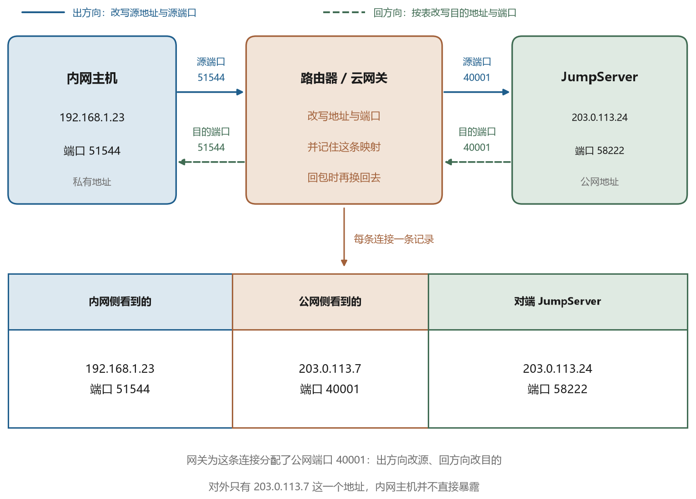
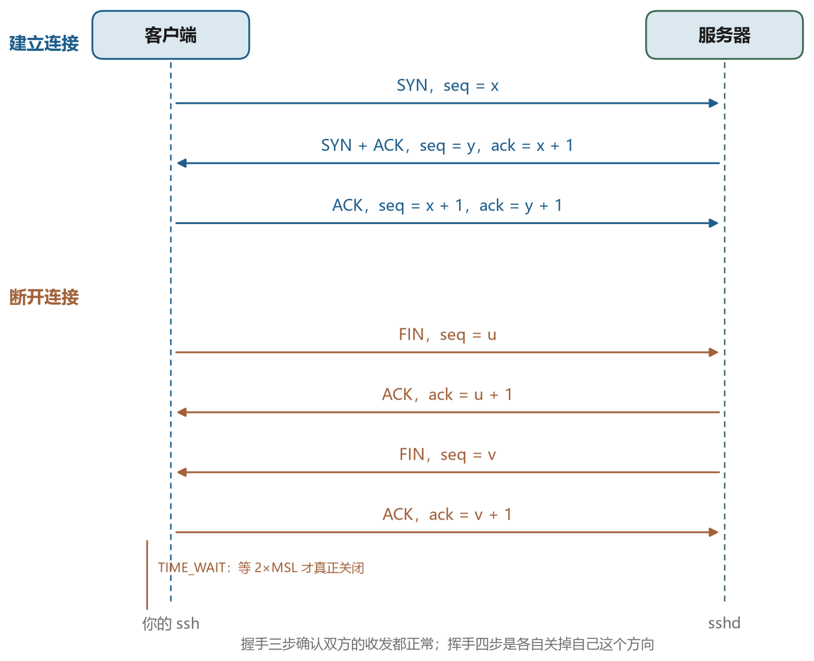
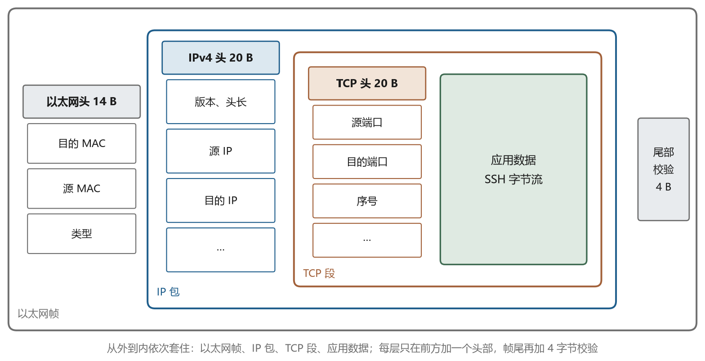

# 服务器上发生了什么

## 3.1 登录成功那一刻

认证通过之后，sshd 并不会把当前的进程直接交给你，而是做三件事。它先创建一个伪终端设备，把你的输入输出接到这个设备上。然后 fork 出一个子进程，在子进程里切换成你的用户身份，加载你的登录环境。最后在子进程里执行你的登录 shell，通常写在 `/etc/passwd` 的最后一段，比如 `/bin/bash`。

所以你在远端看到的那个提示符，背后是一条这样的链，sshd 在 22 端口监听，收到连接后 fork 出一个子进程处理这次会话，子进程认证通过后又 fork 出 shell，shell 再 fork 出你敲的每一条命令。这条链上的每个进程都有自己的进程号、自己的环境变量、自己的文件描述符。理解这一点，很多现象就顺了。比如你关掉终端窗口，shell 收到挂断信号退出，但它启动的后台任务可能继续跑，也可能跟着退出，取决于它们有没有脱离终端。





## 3.2 用户、组与权限

Linux 用数字标识用户，这个数字叫 UID。用户名只是给人看的别名，系统内部认的是数字。每个用户至少属于一个组，组也有数字标识，叫 GID。`/etc/passwd` 记录用户名、UID、GID、家目录和登录 shell，`/etc/group` 记录组的成员。

```bash
id                      # 我是谁，属于哪些组
whoami                  # 只输出用户名
getent passwd alice     # 查某个用户的记录
```

文件权限用九个二进制位表示，分成三组，分别是属主、属组和其他人的读、写、执行权限。`ls -l` 输出的第一列就是这九个位，前面还有一个字符表示文件类型，`-` 是普通文件，`d` 是目录，`l` 是符号链接。

```text
-rw-r--r--  1 alice dev  1204 Nov  4 10:12 notes.txt
drwxr-x---  2 alice dev  4096 Nov  4 10:12 project
```

第一行表示属主可读写，属组可读，其他人可读。换成八进制是 644。第二行表示属主可读写执行，属组可读执行，其他人什么都没有，八进制是 750。目录的执行权限含义特殊，它表示“能否进入这个目录”，没有它就无法访问目录里的任何文件，哪怕文件本身是 755。





这套权限体系和 SSH 有一个硬性交集，私钥文件的权限必须是 600。第六章会讲原因，这里先说结论，SSH 客户端在读取私钥之前会检查文件权限，如果发现同组或其他用户也能读，它会直接拒绝使用这把钥匙并给出警告。这条检查看起来吹毛求疵，实际很有必要，因为私钥一旦泄露，等于把身份送人。

```bash
chmod 600 ~/.ssh/id_ed25519
chmod 700 ~/.ssh
```

目录 `.ssh` 用 700，只有自己能进。公钥文件 `id_ed25519.pub` 可以 644，因为公钥本来就是给别人看的。`authorized_keys` 建议 600，虽然 sshd 对这个文件的要求因配置而异，但收紧一点没有坏处。

## 3.3 该记住的几个路径

服务器上的文件散落在各处，但和 SSH 相关的只有几个固定位置。表 3-1 是这本书里会反复用到的。

表 3-1　与 SSH 相关的常用路径

| 路径 | 所在机器 | 作用 |
| --- | --- | --- |
| `~/.ssh/config` | 客户端 | 主机别名与连接参数 |
| `~/.ssh/id_ed25519` | 客户端 | 私钥，权限 600 |
| `~/.ssh/id_ed25519.pub` | 客户端 | 公钥，可以公开 |
| `~/.ssh/known_hosts` | 客户端 | 记下见过的服务器主机密钥 |
| `~/.ssh/authorized_keys` | 服务端 | 允许登录的公钥清单 |
| `/etc/ssh/sshd_config` | 服务端 | sshd 的全局配置 |
| `/etc/ssh/ssh_config` | 客户端 | 全系统的客户端默认配置 |
| `/var/log/auth.log` | 服务端 | Debian 系的认证日志 |
| `/var/log/secure` | 服务端 | Red Hat 系的认证日志 |

注意 `ssh_config` 和 `sshd_config` 只差一个字母，含义完全不同。前者是客户端读的，后者是服务端读的。搜索配置项时一定要看清楚，把服务端的选项写进客户端的文件里，通常不会报错，只是静默失效，这种问题最难查。

## 3.4 伪终端是什么

早期的计算机，终端是一台真实的设备，通过串口线连到主机。操作系统里有一套终端驱动程序负责和它打交道。后来终端变成了软件，为了让那些只会和终端打交道的程序继续工作，系统提供了伪终端，用一对虚拟设备模拟串口的两端。一端叫 master，由 sshd 持有，另一端叫 slave，交给 shell。

这样做的结果是，shell 和它启动的程序都以为自己连着一台真正的终端。它们能收到窗口大小变化的信号，能使用行编辑、能显示颜色、能处理 Ctrl+C。如果 sshd 不分配伪终端，比如你执行 `ssh host "ls -l"` 这种一次性命令，那么 `ls` 会认为输出被重定向到了文件，于是不显示颜色，也不做列对齐。

伪终端的分配是一个可以控制的选项。客户端用 `-t` 强制分配，`-T` 禁止分配，配置文件里用 `RequestTTY`。什么时候需要关心它，通常是脚本里跑交互式程序的时候。比如用 `ssh` 执行 `sudo`，如果不分配伪终端，`sudo` 会因为拿不到终端而拒绝读取密码。

## 3.5 环境变量与 PATH

登录之后，shell 会读几个文件来设置环境变量。`/etc/profile` 对所有用户生效，`~/.bash_profile` 或 `~/.profile` 对当前用户生效。如果你用的是 zsh，对应的文件是 `~/.zshrc`。环境变量里最重要的一个是 `PATH`，它是一串用冒号分隔的目录，shell 找命令时就按这个顺序逐个目录搜索。





```bash
echo $PATH
which python3
export PATH="$HOME/.local/bin:$PATH"
```

这里有一个新手常踩的坑。你在 `~/.bashrc` 里加了 `export PATH=...`，用 `ssh host` 登录后发现没生效，原因是交互式登录 shell 读的是 `~/.bash_profile` 而不是 `~/.bashrc`，而 `~/.bash_profile` 里往往又只有一句 `source ~/.bashrc`，具体读哪个取决于发行版的默认配置。遇到“命令找不到”，先确认自己在哪种 shell 里，再确认那个 shell 读了哪些文件。

另一个坑和 sudo 有关。`sudo` 默认会重置环境变量，所以你在自己账户下能用的 `PATH`，切到 root 之后可能就变了。要用 `sudo -E` 保留环境，或者在 `sudoers` 里配置 `secure_path`。

## 3.6 常驻的服务

sshd 是一个常驻后台的进程，由 systemd 管理。开机时 systemd 读 `/etc/systemd/system/` 和 `/lib/systemd/system/` 下的单元文件，按依赖关系启动服务。sshd 的单元文件叫 `ssh.service` 或者 `sshd.service`，取决于发行版。

```bash
systemctl status ssh
systemctl restart ssh
journalctl -u ssh -n 50 --no-pager
```

这三条命令分别用于查看状态、重启服务和看最近的日志。改完 `sshd_config` 之后一定要重启或者 `systemctl reload ssh`，否则新配置不生效。重启前建议先保留一个已经登录的会话，因为配置写错可能导致再也连不上，那时候只能通过云厂商的救援控制台进去改。

systemd 还有一个能力值得知道，叫 socket 激活。有些发行版把 sshd 配置成由 systemd 监听 22 端口，收到连接才启动 sshd 进程。这种配置下，用 `ss -lntp` 看到的监听进程是 `systemd` 而不是 `sshd`，第一次见会以为装错了。判断方法很简单，看 `systemctl status ssh.socket` 是否存在。

## 3.7 日志里能看到什么

认证相关的日志包含的信息比多数人以为的多。一次成功的公钥登录会留下这样几行。

```text
sshd[2417]: Accepted publickey for alice from 203.0.113.7 port 51544 ssh2: ED25519 SHA256:xxxx
sshd[2417]: pam_unix(sshd:session): session opened for user alice by (uid=0)
sshd[2417]: Received disconnect from 203.0.113.7 port 51544:11: disconnected by user
```

第一行告诉你用的哪种认证方式、从哪个地址来、用的哪把钥匙的指纹。第二行说明会话已经建立。第三行是断开。失败时格式类似，只是把 `Accepted` 换成 `Failed`，后面会跟上原因，比如 `invalid user`、`authentication failure`、`Connection closed by authenticating user`。

如果日志里出现大量 `Failed password for invalid user admin`，说明有人在扫描。这类噪音在公网上是常态，处理方法在后面的章节会讲。真正需要警惕的是针对你自己账户名的连续失败，那说明有人在有针对性地尝试。

到这里，服务器这一侧的基础就差不多了。你现在应该能回答几个问题。登录之后是谁在跟你说话，你的命令是怎么变成一个进程的，为什么私钥的权限必须是 600，日志里的那些字段各是什么意思。下一篇要进入这本书最硬的部分，也就是把这些连接加密起来的那套数学。
