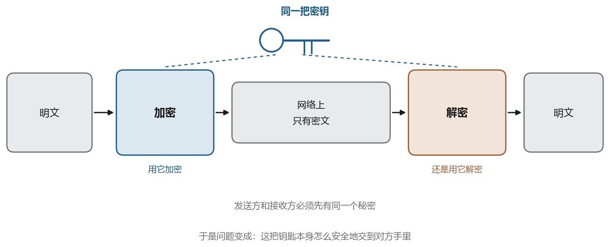
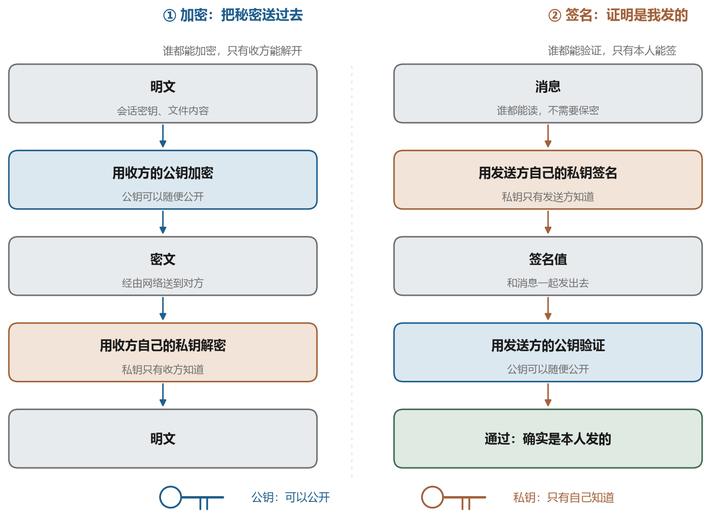
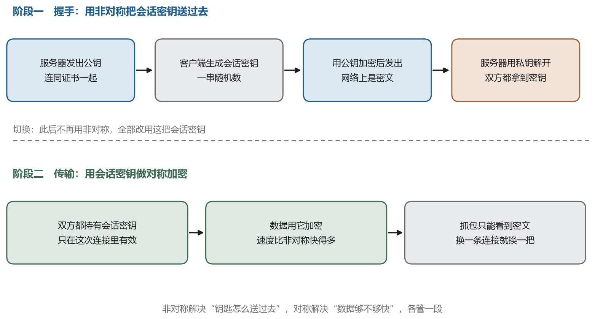
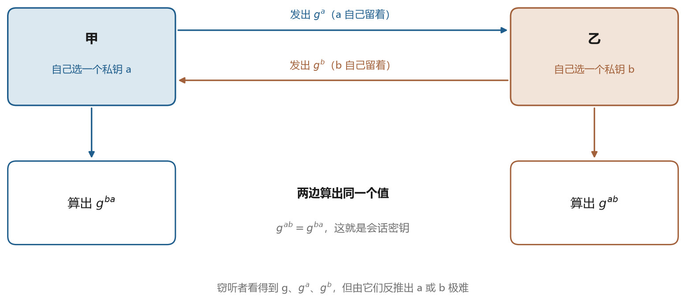

# 把话藏起来

## 4.1 三种敌人

　　远程登录要防的不是抽象的“黑客”，而是三种具体的攻击。

　　第一种是窃听。数据包经过的每一台路由器、每一个交换机、每一个运营商的接入设备，理论上都能把经过的字节抄一份。早年间 telnet 和 FTP 的用户名密码就是这样泄露的，因为它们是明文。第二种是篡改。攻击者不一定需要读懂内容，只要能在传输过程中改动几个字节，就可能让远端执行另一条命令。第三种是冒充。你连过去的地址可能是攻击者伪造的，或者攻击者在中间同时骗过两端，这叫中间人攻击。

　　三种攻击对应三种技术。加密解决窃听，完整性校验解决篡改，身份认证解决冒充。SSH 把这三件事都做了，而且做得很彻底。理解它的设计，需要先理解它用的三样工具。

## 4.2 一把钥匙的对称加密

　　对称加密是最古老也最快的加密方式。发送方和接收方用同一把密钥，用同一个算法把明文变成密文，再用同一个算法反过来算回去。图 4-1 是这个过程的示意。





　　今天的对称加密算法主要有两类。一类是分组密码，把数据切成固定大小的块逐块处理，AES 属于这一类，块长 128 位，密钥长度可以是 128、192 或 256 位。另一类是流密码，逐字节生成密钥流再和明文异或，ChaCha20 属于这一类。AES 在有大面积硬件加速的服务器上速度极快，ChaCha20 在没有 AES 硬件指令的手机和嵌入式设备上表现更好。SSH 两者都支持，连接时会协商使用哪个。

　　分组密码有个问题，如果对每个块都独立加密，相同的明文块会产生相同的密文块，攻击者能从重复模式里推断内容。所以实际使用时要配合工作模式。CTR 模式把一个计数器加密后作为密钥流，等价于把分组密码变成流密码。GCM 模式在 CTR 的基础上加了认证，一次运算同时完成加密和完整性校验。

　　对称加密的优点是快，缺点是密钥分发。双方必须事先共享同一把钥匙，而在一个几万台机器的机房里，让每两台机器都共享一把不同的钥匙，管理成本是平方级的。这个问题由非对称加密解决。

## 4.3 哈希与消息认证码

　　哈希函数把任意长度的输入压成固定长度的输出，而且满足几个苛刻的性质。给定输入算输出很容易，给定输出反推输入几乎不可能。输入改一个比特，输出会面目全非，这叫雪崩效应。找到两个不同输入产生同一输出，在计算上也做不到。

　　SHA-256 是最常用的哈希函数，输出 256 位，写成 64 个十六进制字符。你在下载软件时看到的校验值，在证书里看到的指纹，都是这种形式。哈希不是加密，因为它不可逆，没有“解密”这一步。它的用途是比对，只要两段数据的哈希相同，就可以认为数据相同。

　　单独用哈希还不够。如果攻击者能同时改数据和哈希值，比对就失去意义。所以需要一把密钥参与，这就是消息认证码。HMAC 是最常见的构造方式，把密钥和数据一起送进哈希函数，只有知道密钥的人才能算出正确的值。SSH 用它来保证每个数据包没有被改动。

```text
HMAC-SHA256(key, message) = SHA256((key ^ opad) || SHA256((key ^ ipad) || message))
```

　　这行公式不必记住，但要理解它的效果。没有密钥的人算不出正确的 HMAC，也就无法伪造一个能通过校验的包。SSH 的每个数据包后面都跟着一段 MAC，接收方先验 MAC 再解密，验不过就直接断开。这种“先认证再解密”的顺序可以避免把恶意构造的密文送进解密器。

## 4.4 非对称加密的两个用途

　　非对称加密用一对密钥，公钥和私钥。公钥可以公开，私钥必须自己保管。这一对密钥在数学上相关，但从公钥算不出私钥。它的用途有两个，方向刚好相反。

　　第一个用途是加密。用对方的公钥加密，只有对方的私钥能解开。这适合传递秘密，因为不需要事先共享密钥。第二个用途是签名。用自己的私钥对数据算一个签名，任何人用你的公钥都能验证这个签名确实出自你手，而且数据没被改过。这适合证明身份。





　　两种用途容易混淆，记住一句话就够了，加密是“给别人看”，签名是“证明是我”。SSH 的公钥认证用的是签名，不是加密。很多人以为登录时服务器用公钥加密一段数据发给客户端，客户端用私钥解开，这个理解是错的，SSH 的流程在第六章会详细展开。

　　常见算法有两族。RSA 依靠大整数分解的困难性，密钥长度通常 2048 位以上，签名和验证都比较慢。椭圆曲线算法 ECC 依靠离散对数的困难性，密钥短得多，256 位的 ECC 提供的安全强度大致相当于 3072 位的 RSA。Ed25519 是基于椭圆曲线的签名算法，密钥只有 32 字节，签名 64 字节，速度快，实现也简单，是今天 SSH 的推荐选择。

## 4.5 密钥交换

　　非对称加密虽然解决了密钥分发，但它的运算速度比对称加密慢几个数量级，用它加密大量数据不划算。所以实际做法是，用非对称的方法协商出一把临时的对称密钥，然后全部数据都用这把密钥加密。协商的过程叫密钥交换。





　　最经典的密钥交换协议是 Diffie 和 Hellman 在 1976 年提出的。双方各自选一个私密数字，用它算出对应的公开值，把公开值发给对方，再用对方的公开值和自己的私密数字算出同一个结果。图 4-4 是这个过程的示意。





　　这个协议的巧妙之处在于，窃听者能看到两个公开值，但要从公开值反推出私密数字，需要解离散对数问题，在计算上不可行。于是双方得到了一个只有他们知道的共享秘密，而这个秘密从未在网络上传输过。

　　SSH 里最常用的密钥交换是 `curve25519-sha256`，用 Curve25519 这条椭圆曲线做 Diffie-Hellman，再用 SHA-256 做哈希。它的优点是速度快、密钥短、实现不容易出错。此外还有基于 NIST 曲线的 `ecdh-sha2-nistp256` 等，以及传统的 `diffie-hellman-group14-sha256`。后者的参数是固定的，安全性依赖那个固定的素数，前向保密性略差一些。

## 4.6 为什么需要证书

　　非对称加密留下最后一个问题。你怎么知道手里这把公钥真的属于对方。如果攻击者在中间，把“服务器的公钥”换成自己的，你照样能建立加密通道，只是通道的另一端是攻击者。

　　HTTPS 用证书解决这个问题。服务器把公钥和身份信息交给一个受信任的第三方，也就是证书颁发机构，由它用自己的私钥签名，形成证书。浏览器内置了一批根证书，只要能沿着签名链一路验到某个根证书，就认为这把公钥是可信的。这套体系叫 PKI，公钥基础设施。

　　SSH 走了另一条路。它默认不使用证书，而是采用一种叫“首次使用即信任”的策略。第一次连接某台服务器时，客户端把服务器的主机公钥记到 `known_hosts` 里，以后每次连接都核对。如果哪天指纹变了，客户端会大声警告。这套办法的成本低，不需要第三方，缺点是第一次连接时你无法判断对面是不是真的。第六章会详细讨论这个取舍。

　　值得说明的是，SSH 也支持证书。企业里可以自建一个 CA，给几百台机器签发主机证书，客户端只需要信任这个 CA 的公钥，就能验证所有机器，省掉了每次手工确认指纹的麻烦。JumpServer 这类系统在托管资产时用的就是类似思路。

## 4.7 前向保密

　　假设某天你的服务器私钥泄露了。攻击者拿到私钥，能不能解开他过去录下来的加密流量。

　　如果密钥交换用的是 RSA 那种“用服务器公钥加密会话密钥”的方式，答案是能。因为过去每一段流量的会话密钥，都是用服务器公钥加密后传输的，攻击者只要保存了这些密文，拿到私钥就能一一解开。这种设计没有前向保密性。

　　如果密钥交换用的是 Diffie-Hellman 一族，答案是能也不能。攻击者拿到的是身份私钥，可以用来冒充服务器骗未来的连接，但过去的会话密钥是双方临时算出来的，从来没有用身份私钥加密过，也没有存储在磁盘上，所以解不开。这就是前向保密，也叫完美前向保密。

　　这也是为什么今天的 SSH 默认使用临时密钥交换算法，而早期的 `diffie-hellman-group1-sha1` 之类的算法被逐步淘汰。判断一个算法有没有前向保密，看它的名字里有没有 `dhe` 或者 `ecdh`。`ssh-rsa` 是签名算法，不涉及密钥交换，但用 RSA 做密钥交换的老方案确实没有前向保密。

## 4.8 这些工具在 SSH 里怎么分工

　　把上面几样工具放到一起，SSH 的一次连接是这样用它们的。

　　密钥交换阶段用 Diffie-Hellman 变体，双方算出共享秘密，由此派生出会话密钥。这一步保证了前向保密。服务器在密钥交换过程中用自己的主机私钥对交换内容签名，客户端用对应的公钥验证，这一步解决了冒充问题，前提是客户端知道正确的公钥。之后的所有数据用对称加密算法处理，每个包附带 MAC，这一步解决了窃听和篡改。

　　三者缺一不可。没有签名，中间人可以替换公钥。没有对称加密，速度慢到不可用。没有 MAC，攻击者可以改包。理解了这套分工，第五章的协议细节就不难读了。

　　顺带说一句密钥长度的现实。表 4-1 是几种常见算法组合的密钥与签名长度，这些数字来自算法规范，不涉及任何性能测量。

表 4-1　常见签名算法的密钥与签名长度

| 算法 | 公钥长度 | 私钥长度 | 签名长度 |
| --- | --- | --- | --- |
| Ed25519 | 32 字节 | 32 字节 | 64 字节 |
| ECDSA P-256 | 64 字节（未压缩点） | 32 字节 | 约 70 到 72 字节 |
| RSA 2048 | 约 270 字节（编码后） | 约 1190 字节（PEM） | 256 字节 |
| RSA 4096 | 约 530 字节（编码后） | 约 3270 字节（PEM） | 512 字节 |

　　这组数字解释了一个现象，用 RSA 密钥登录会比 Ed25519 慢一点，因为每次认证都要传更长的签名，做更慢的运算。差异在日常使用中不明显，但在自动化脚本里批量连接几千台机器时，能感觉出来。更重要的是，Ed25519 的密钥短，抄写、备份、贴进配置文件都不容易出错。
