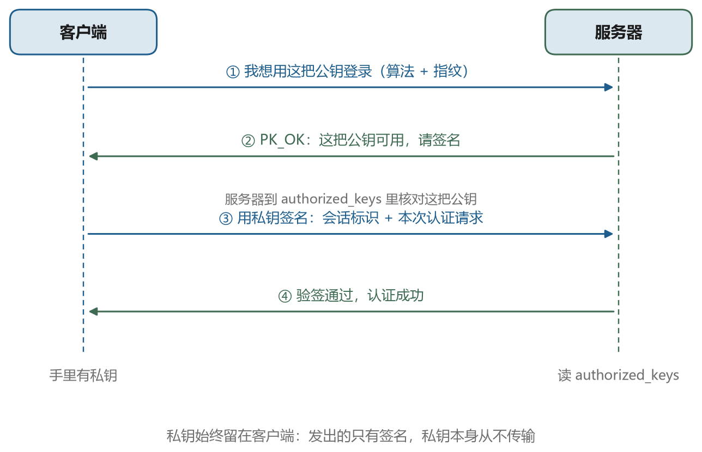
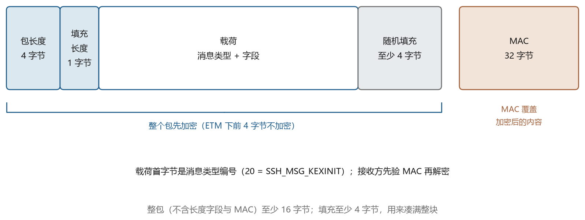
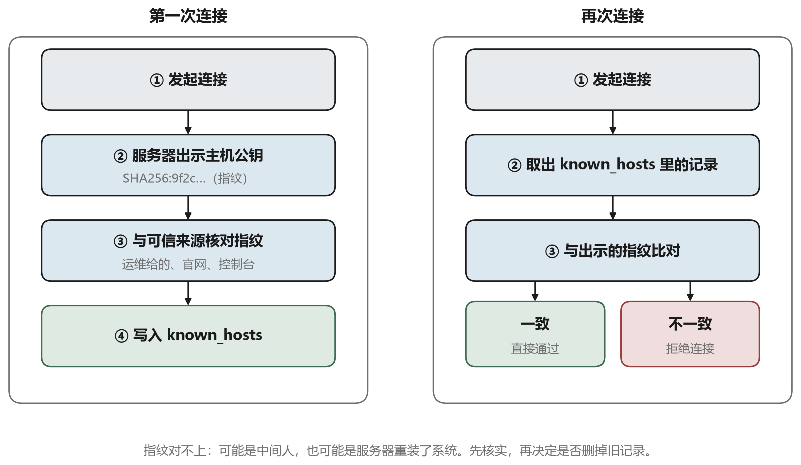
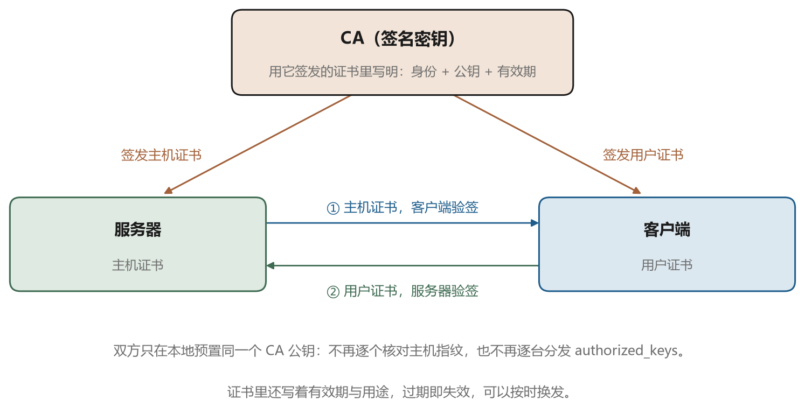

# SSH 协议的三层结构

## 6.1 一行明文的版本号

连接建立之后，双方各自先发一行文本，形如 `SSH-2.0-OpenSSH_9.6`。这一行是明文，以回车换行结束，最长 255 字节。它包含协议版本、软件名和可选的注释。之所以允许明文，是因为此时还没有协商出任何密钥，双方需要先说清自己讲的是哪种语言。

服务器通常先发，客户端后发，但协议允许任意顺序，双方都要能容忍对方先开口。这一行的第二个字段是协议版本，`2.0` 表示 SSH-2。历史上存在过 SSH-1，它的设计有严重缺陷，早被废弃，OpenSSH 从 7.6 版起默认不再支持。

这里有个有意思的细节。有些网络设备会往连接里注入自己的横幅，干扰版本交换。OpenSSH 的做法是，在收到以 `SSH-` 开头的行之前，把收到的其他行都当作噪音丢掉，最多容忍 1024 行。如果你在调试输出里看到 `banner exchange` 之后跟着一堆奇怪的内容，多半是中间设备的锅。

## 6.2 三个子协议

SSH 协议被拆成三个子协议，一层叠一层，各自负责一件事。图 6-1 是这个结构。





最底下是传输层协议，也就是 RFC 4253 描述的部分。它负责在 TCP 之上建立一个加密的、经过完整性保护的通道，完成版本交换、算法协商、密钥交换、密钥派生、重密钥和断开。它不关心你是谁，也不关心你要干什么。

中间是用户认证协议，RFC 4252。它跑在加密通道里面，负责让服务器确认“对面的这个人确实是某个账户的主人”。它支持多种认证方法，客户端可以按顺序尝试，服务器决定接受哪一种。认证成功之后，这个连接就绑定了某个用户身份。

最上面是连接协议，RFC 4254。它也跑在加密通道里，负责把一条连接切成多个逻辑通道，每个通道可以承载一种用途，交互式 shell、执行单条命令、文件传输、端口转发。一条 SSH 连接里可以同时开着很多个通道，它们互不干扰。

这个分层解释了为什么一条 SSH 连接能干那么多事。你开一个终端窗口跑命令，同时用 `scp` 传文件，又用 VS Code 在远端开发，如果都走同一条连接，只需要一次认证、一次密钥交换，后面全是通道复用。第八章讲端口转发时会用到这个性质。

## 6.3 一个数据包长什么样

加密通道建立之后，SSH 传输的是二进制包。每个包的格式固定，如图 6-2。





开头 4 个字节是包长度，表示后面还有多少字节。接下来 1 个字节是填充长度，然后是载荷（payload，包里真正要传的内容），最后是随机填充（padding，凑长度用的无用字节）。填充的作用是让包的长度是加密算法分组大小的整数倍，同时增加一点随机性。协议要求填充至少 4 字节，整个包（不含长度字段和 MAC）至少 16 字节。载荷最长 32768 字节，整包不超过 35000 字节，这是 RFC 4253 给出的下限要求，所有实现都必须能处理。

包尾是 MAC（消息认证码，第五章讲过），长度由协商的算法决定，HMAC-SHA256 是 32 字节。接收方收到包之后，先算 MAC 比对，通过之后再解密载荷。这种顺序叫“先认证后解密”，可以防止攻击者把构造的密文喂给解密器做旁路分析。

后来又出现了一种改进叫 ETM，全称是 encrypt-then-MAC。传统的顺序是先加密整个包（含长度字段），再对密文算 MAC。ETM 的做法是不加密长度字段，但把长度字段也纳入 MAC 的计算范围。这样做的好处是接收方可以先看长度、先验 MAC，再决定要不要解密，既省了算力，也避免了一些边界攻击。OpenSSH 的默认 MAC 算法都带 `-etm` 后缀。

载荷的第一个字节是消息类型编号，后面跟着这个消息自己的字段。表 6-1 是书里会用到的几个编号。

表 6-1　SSH 常用消息编号

| 编号 | 消息 | 出现在哪个阶段 |
| --- | --- | --- |
| 1 | `SSH_MSG_DISCONNECT` | 任意时刻，表示断开及原因 |
| 20 | `SSH_MSG_KEXINIT` | 算法协商，双方各发一次 |
| 21 | `SSH_MSG_NEWKEYS` | 密钥交换结束，通知切换密钥 |
| 30 | `SSH_MSG_KEX_ECDH_INIT` | 客户端发送临时公钥 |
| 31 | `SSH_MSG_KEX_ECDH_REPLY` | 服务端回复临时公钥、主机公钥与签名 |
| 50 | `SSH_MSG_USERAUTH_REQUEST` | 认证请求 |
| 51 | `SSH_MSG_USERAUTH_FAILURE` | 认证失败，并列出可用的方法 |
| 52 | `SSH_MSG_USERAUTH_SUCCESS` | 认证成功 |
| 60 | `SSH_MSG_USERAUTH_PK_OK` | 公钥被接受，可以开始签名 |
| 80 | `SSH_MSG_GLOBAL_REQUEST` | 全局请求，比如请求转发端口 |
| 90 | `SSH_MSG_CHANNEL_OPEN` | 打开一个通道 |
| 98 | `SSH_MSG_CHANNEL_REQUEST` | 通道内的请求，比如分配伪终端 |

这些编号不需要背，但看到抓包或者日志里出现 `SSH_MSG_KEXINIT` 这样的字符串时，能立刻知道现在处于哪个阶段，排查会快很多。

## 6.4 算法协商

版本交换完成后，双方各发一个 `SSH_MSG_KEXINIT`。这个消息里有一个 16 字节的随机 cookie，然后是一串名字列表，分别列出自己支持的密钥交换算法、主机密钥算法、加密算法、MAC 算法、压缩算法、语言，每个方向各一份。

```text
kex_algorithms          curve25519-sha256,ecdh-sha2-nistp256,diffie-hellman-group14-sha256
server_host_key_algs    ssh-ed25519,rsa-sha2-512,rsa-sha2-256
encryption_c2s          chacha20-poly1305@openssh.com,aes256-gcm@openssh.com,aes256-ctr
mac_c2s                 hmac-sha2-256-etm@openssh.com,hmac-sha2-512-etm@openssh.com
compression_c2s         none,zlib@openssh.com
```

协商规则很朴素，从客户端的列表里按顺序取，取第一个服务端也支持的。这个规则叫“客户端优先”，意味着最终选择主要由客户端决定。图 6-3 是这个比较过程的示意。





客户端优先的设计有一个副作用。如果客户端被换成了老版本，只能提供弱算法，服务端又兼容它，那这条连接就会用弱算法。这让老客户端的兼容性变好了，代价是安全性由最弱的一方决定。企业里如果统一了客户端版本，可以在服务端配置里写死允许的算法，把弱的全部禁掉。

协商失败时会看到这样的报错。

```text
Unable to negotiate with 10.0.0.5 port 22: no matching key exchange method found.
Their offer: diffie-hellman-group1-sha1
```

这类报错说明双方没有交集，处理方法有两个，要么升级一端，要么在客户端用 `-oKexAlgorithms=+diffie-hellman-group1-sha1` 显式允许那个老算法。后者是临时手段，不该长期使用。

## 6.5 密钥交换与密钥派生

协商完成后进入密钥交换。以 `curve25519-sha256` 为例，过程如图 6-4。





客户端生成一对临时密钥，把临时公钥 `Q_C` 放进 `SSH_MSG_KEX_ECDH_INIT` 发出去。服务端也生成一对临时密钥，用自己的主机私钥对一段哈希值签名，然后把主机公钥、临时公钥 `Q_S` 和签名一起放进 `SSH_MSG_KEX_ECDH_REPLY` 发回。双方各自用自己的临时私钥和对方的临时公钥算出共享秘密 `K`。

那段被签名的哈希值叫交换哈希，记作 `H`。它的计算方式是把双方的版本字符串、双方的 KEXINIT 原文、主机公钥、双方的临时公钥、共享秘密按固定顺序拼接后做哈希。

```text
H = SHA256(V_C || V_S || I_C || I_S || K_S || Q_C || Q_S || K)
```

这个 `H` 有两个作用。一是作为签名对象，让客户端确认服务端确实持有主机私钥。二是作为派生密钥的材料，`K` 只用来算 `H`，后面的会话密钥都从 `H` 派生。这样设计的好处是，即使 `K` 的某些比特有偏差，也不会直接影响密钥质量。

派生过程用同一个哈希函数反复计算，每次在末尾拼一个不同的字母。

```text
IV_c2s   = HASH(K || H || "A" || session_id)
IV_s2c   = HASH(K || H || "B" || session_id)
Key_c2s  = HASH(K || H || "C" || session_id)
Key_s2c  = HASH(K || H || "D" || session_id)
MAC_c2s  = HASH(K || H || "E" || session_id)
MAC_s2c  = HASH(K || H || "F" || session_id)
```

六个字母对应六个方向的密钥材料，客户端到服务端和服务端到客户端各有一套，互不共用。这叫双向独立密钥，好处是即使某一方向的密钥被攻破，另一方向仍然安全。`session_id` 是第一次密钥交换产生的 `H`，它在整条连接的生命周期里不变，用于把后续的重密钥绑定到最初的这次交换上。

密钥长度不够时，把前面的结果再哈希一次并拼接，直到够长。这套“扩展”规则在 RFC 4253 的第 7.2 节，实现起来只有几行代码。

## 6.6 重密钥

会话密钥不能一直用。用得越久，泄露的风险越大，被分析的材料也越多。协议建议在传输了 1GB 数据或者用满 1 小时之后重新做一次密钥交换，这两个阈值在 OpenSSH 里可以用 `RekeyLimit` 调整。

```bash
ssh -oRekeyLimit=500M l40-server
```

重密钥的过程和第一次密钥交换一样，只是不再重新协商算法，直接复用之前的结果。新算出的密钥替换旧的，`session_id` 保持不变。这个过程对上层完全透明，你的 shell 不会有任何感觉。

顺带解释一个现象。有时候 `ssh -vv` 的输出里会突然出现一段新的 `SSH2_MSG_KEXINIT`，看起来像是重新连接了，其实只是触发了重密钥。如果连接质量不好、丢包严重，重密钥可能失败并导致断开，这时把 `RekeyLimit` 调大一点能缓解。

## 6.7 认证层

加密通道建好之后，客户端发送 `SSH_MSG_USERAUTH_REQUEST`，里面包含用户名、要使用的服务名（固定是 `ssh-connection`）和认证方法。服务器可以接受，可以拒绝并列出它还支持哪些方法，也可以要求继续。

SSH 定义了三种基本方法。`password` 最简单，明文密码放在加密通道里传过去。`publickey` 用签名证明持有私钥，是这本书的重点，细节放在第七章。`keyboard-interactive` 是一问一答的形式，服务器可以问任意多个问题，适合一次性口令、短信验证码、多因素认证。此外还有 `hostbased` 和 `gssapi-with-mic`，前者用主机密钥认证，后者走 Kerberos，日常较少见。

认证可以多轮。服务器返回失败时会给一个列表，客户端按自己的策略依次尝试。OpenSSH 客户端默认最多尝试 6 次，可以用 `NumberOfPasswordPrompts` 限制。堡垒机场景下经常配置成只允许 `publickey`，这时密码登录会被直接拒绝，报错里会写 `Permission denied (publickey)`。

有一个细节容易让人困惑。公钥认证的第一步，客户端会先发一个“试探”请求，只带公钥不带签名，问服务器“这把钥匙你能接受吗”。服务器如果接受，回一个 `SSH_MSG_USERAUTH_PK_OK`，客户端才开始签名。这个设计的目的是避免在服务器不认可这把钥匙时白做一次签名运算，同时也让客户端知道该用哪把钥匙。有些服务器为了不泄露“某个用户名是否存在”，会跳过这一步直接要求签名，两种行为都合法。

## 6.8 连接层

认证成功之后，客户端可以打开通道。每个通道有本地编号和远端编号，双方各自维护一套，互不干扰。通道类型有几种，`session` 用于 shell 和命令执行，`direct-tcpip` 用于本地转发，`forwarded-tcpip` 用于远程转发。

打开通道之后，客户端在通道里发请求。最常见的几个是 `pty-req` 请求分配伪终端并告知窗口大小，`shell` 请求启动登录 shell，`exec` 请求执行一条命令，`subsystem` 请求启动一个子系统（`sftp` 就是通过它启动的），`window-change` 在窗口大小变化时通知对方。

连接层还有流量控制。每个通道有一对窗口大小，表示对方还能接收多少字节的数据。发送方发完数据要扣减窗口，接收方处理完数据后回一个 `CHANNEL_WINDOW_ADJUST` 把窗口补回去。如果窗口耗尽，发送方必须停下来等。这套机制防止了快速的生产者把慢速的消费者撑爆。传大文件时如果速度上不去，有时候和窗口大小有关。

全局请求独立于通道，比如 `tcpip-forward` 用于请求服务端监听某个端口，这是第八章远程转发的基础。还有一类请求叫 `keepalive@openssh.com`，客户端定期发一个，相当于心跳，防止中间的 NAT 设备因为长时间没有流量而把连接表项清掉。这就是 `ServerAliveInterval` 选项背后做的事。

## 6.9 看看自己的机器支持什么

OpenSSH 提供了查询算法清单的选项，比翻文档快。

```bash
ssh -Q kex          # 支持的密钥交换算法
ssh -Q key          # 支持的主机密钥与用户密钥类型
ssh -Q cipher       # 支持的对称加密算法
ssh -Q mac          # 支持的 MAC 算法
ssh -Q key-sig      # 支持的签名算法
```

把这些输出和 `sshd -T` 的结果对照，就能知道协商会落在哪个算法上。

```bash
sudo sshd -T | grep -E 'kexalgorithms|ciphers|macs|hostkeyalgorithms'
```

`sshd -T` 会打印服务端生效的完整配置，包括默认值和配置文件里的覆盖值。这是排查“为什么用了这个算法”的最快方式，比读配置文件可靠，因为配置文件可能有 `Include`、有 `Match` 块，肉眼追不全。

## 6.10 抓包能看到什么

最后说一个常见疑问。既然 SSH 加密了，抓包还有用吗。

有用，但只能看到结构。版本交换那一行是明文，能直接读出来。之后的包，载荷是不可读的随机字节；长度字段是否可见取决于双方是否启用 ETM，启用了就能看到明文长度，没启用则连长度也一起加密。无论哪种情况，包的大小和出现的时间都瞒不住。比如你敲一个字符，客户端可能立刻发一个很小的包，交互式命令的输出会产生一串中等大小的包，传文件时包长接近上限。通过分析包长和时序，可以推测出你正在做什么类型的事，这类研究叫流量分析。

防御流量分析需要固定长度的填充，代价是带宽浪费，SSH 没有这么做。企业里如果确实担心这个，通常是在外层再套一层隧道，或者在网络层面做流量整形。对绝大多数场景，这个风险可以忽略。

抓包在排错时仍然很有价值。`tcpdump -n -i any port 22` 能看到连接是否建立、有没有重传、RST（强制断开连接的消息）是谁发的。这些信息足以区分“网络不通”和“服务拒绝”。真要看协议内容，用 `ssh -vv` 比抓包方便得多，因为客户端本来就会把每个阶段的解析结果打印出来。

协议这一层讲完，回到操作现场。下一章从生成密钥开始，讲清楚密钥文件的结构、指纹是怎么算的、第一次连接时那个“yes/no”到底在问什么。
