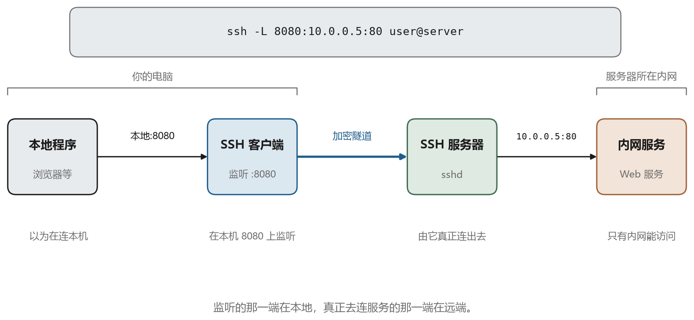
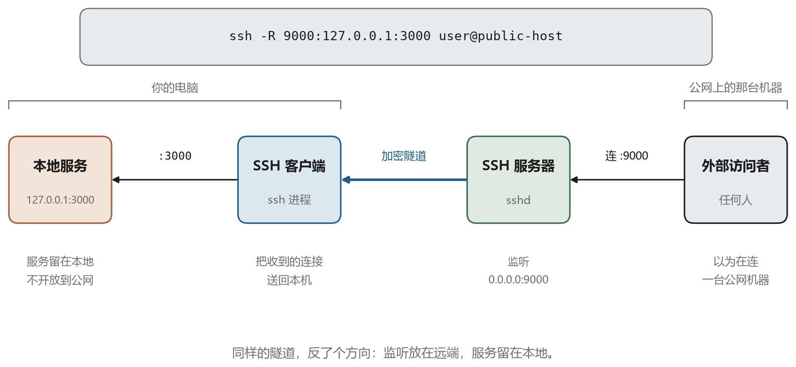
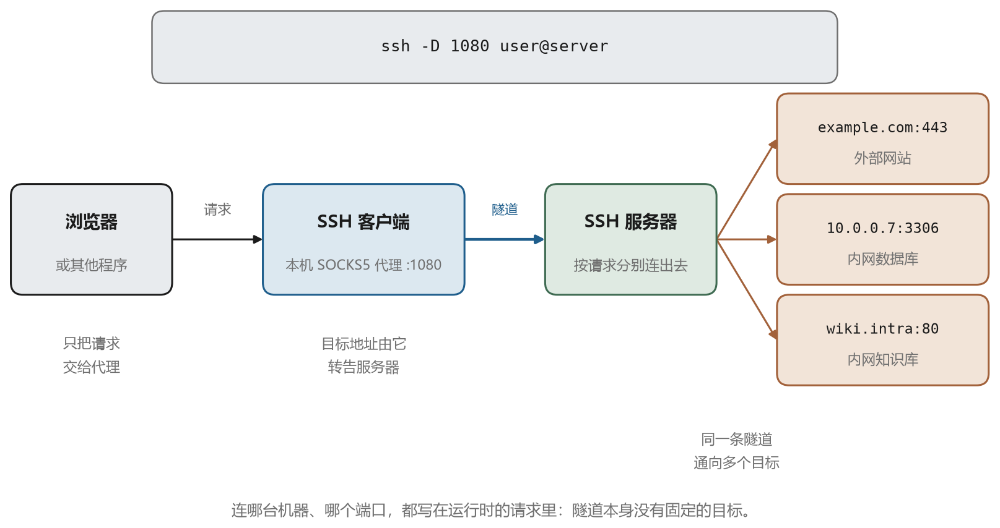
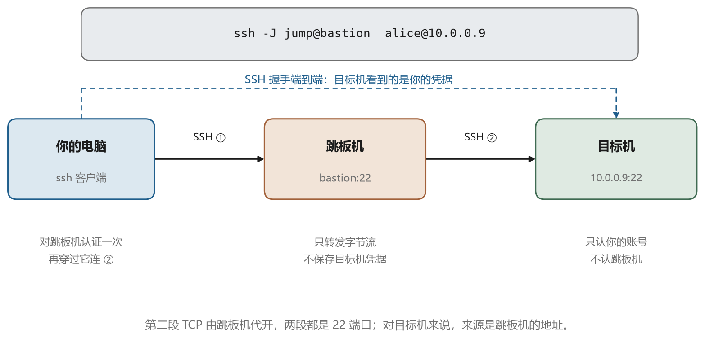

# 端口转发，把远方的服务搬到本地

## 7.1 只开一个端口的世界

　　很多内网只允许外部访问一个端口，通常就是 SSH 的 22。数据库、内部网页、监控面板全在里面，从外面碰不到。这种设计出于安全考虑，但也带来不便。你需要临时看一眼内网的某个网页，或者用本地的图形化工具连一下内网的数据库，怎么办。

　　办法是把那些服务“搬”到你本地来。SSH 的连接层本来就支持多路复用，一条加密连接里可以开很多个通道，每个通道承载一路数据。端口转发就是利用这个能力，把某个 TCP 端口上的流量塞进 SSH 通道，从另一端送出去。对使用者来说，本地凭空多了一个端口，连它就等于连到了远端的某个服务。

　　SSH 定义了三种转发方式，本地转发、远程转发、动态转发。它们的区别只在于谁监听、谁发起连接。

## 7.2 本地转发

　　本地转发的语法是 `-L`，格式为 `本地地址:本地端口:目标地址:目标端口`。

```bash
ssh -L 127.0.0.1:8080:10.0.0.9:80 alice@jump.example.com
```

　　这条命令的意思是，在本机监听 8080 端口，任何连到这个端口的流量，都通过 SSH 连接送到 `jump.example.com`，再由那台机器向 `10.0.0.9` 的 80 端口发起连接。图 7-1 是这个结构。





　　这里有一个特别容易搞错的地方。`目标地址` 是由 SSH 服务器去解析和连接的，不是由你的本机。所以 `10.0.0.9` 这个地址只需要在服务器那一侧可达，你的本机根本不需要认识它。很多人以为要先把 `10.0.0.9` 写进本机的 hosts，其实不必。

　　另一个容易搞错的地方是监听地址。写 `127.0.0.1:8080` 表示只监听本机回环，其他机器连不进来。写 `0.0.0.0:8080` 表示监听所有网卡，同一个局域网里的人也能用你的机器做跳板。默认建议用前者，除非你明确知道自己在做什么。

```bash
ssh -L 8080:10.0.0.9:80 alice@jump.example.com    # bind 127.0.0.1 by default
ssh -L 0.0.0.0:8080:10.0.0.9:80 alice@jump.example.com
```

　　本地转发最典型的用法有三个。看内网的网页面板，把远端的 80 或 443 映射到本地。连内网的数据库，把 3306 映射出来，用本地的客户端连 `127.0.0.1:3306`。访问只允许从特定机器访问的服务，比如某个只对跳板机开放的管理接口。

## 7.3 远程转发

　　远程转发把方向倒过来，语法是 `-R`，格式为 `远程地址:远程端口:目标地址:目标端口`。

```bash
ssh -R 0.0.0.0:9000:127.0.0.1:3000 alice@public.example.com
```

　　这条命令的意思是，在 `public.example.com` 上监听 9000 端口，任何连到它的流量，通过 SSH 连接送回你的本机，再由你的本机连到 `127.0.0.1:3000`。图 7-2 是这个结构。





　　这个方向适合的场景是，你的开发机在内网，没有公网地址，但你想让外面的人访问你本机跑的服务。或者反过来，你在家里，想把公司内网某台机器的服务暴露到一台有公网地址的跳板机上，临时给同事看。

　　远程转发有一个常见的坑，就是监听地址。默认情况下，即使你写了 `0.0.0.0:9000`，服务端也可能只在回环地址上监听，外面仍然连不进来。原因是 sshd 的配置项 `GatewayPorts` 默认是 `no`，它禁止把转发的端口绑定到非回环地址。要让外部能连，服务端必须设置 `GatewayPorts yes` 或者 `GatewayPorts clientspecified`，然后重启 sshd。这件事你自己改不了，需要服务器管理员配合。

## 7.4 动态转发

　　前面两种转发都要事先指定目标地址和端口。如果你想让浏览器把所有网站都走 SSH 出去，总不能每个网站配一条 `-L`。这种需求用动态转发，语法是 `-D`。

```bash
ssh -D 127.0.0.1:1080 alice@jump.example.com
```

　　这条命令在本机 1080 端口起了一个 SOCKS5 代理。浏览器配置成使用这个代理之后，每次访问网站，浏览器先把“我要访问 example.com 的 443 端口”告诉代理，代理通过 SSH 通道让服务器去连，再把数据转发回来。目标地址是运行时由客户端指定的，所以一条命令能覆盖所有目标。图 7-3 是这个结构。





　　动态转发的用途主要是两类。一类是临时改变出口位置，让流量从服务器那一侧出去。另一类是访问内网资源，浏览器通过 SOCKS 代理访问内网的多个站点，不用一个个配 `-L`。

　　需要提醒的是，`-D` 只处理 TCP。有些应用用 UDP，比如某些 DNS 查询和视频通话，这些不会走 SOCKS 代理。另外，浏览器自己会做 DNS 解析，如果配置不当，目标域名可能在本地就被解析了，泄露你在访问什么。Firefox 可以在 `about:config` 里把 `network.proxy.socks_remote_dns` 设为 true，让 DNS 也走代理。

## 7.5 跳板与 ProxyJump

　　前面讲的转发是在一条已经建立的连接上做文章。还有一类需求是在建立连接的过程中绕路，也就是先连 A，再从 A 连 B。这件事由 `ProxyJump` 完成。

```bash
ssh -J alice@jump.example.com alice@10.0.0.5
```

　　这条命令先连跳板机，认证通过之后，在跳板机上再发起一条到 `10.0.0.5` 的连接，然后把两条连接拼接起来。你的客户端看到的是一条到 `10.0.0.5` 的 SSH 连接，实际上中间经过了跳板机。图 7-4 是这个结构。





　　这里有个关键细节，第二条连接的认证是由你的本机完成的，只是数据包经过跳板机转发。跳板机上不需要放任何私钥，也不需要开启 Agent Forwarding。这是它比 `ssh -A jump` 再手动 `ssh` 更安全的地方。

　　`ProxyJump` 可以串联多级，用逗号分隔。

```bash
ssh -J alice@jump1,alice@jump2 alice@target
```

　　配置文件里的写法更清爽。

```text
Host jump
    HostName jump.example.com
    User alice

Host lab
    HostName 10.0.0.5
    User alice
    ProxyJump jump
```

　　老一些的环境可能还在用 `ProxyCommand`，效果类似，写法更底层。

```text
Host lab
    HostName 10.0.0.5
    ProxyCommand ssh -W %h:%p jump
```

　　`-W` 表示把标准输入输出接到目标地址的指定端口上，`%h` 和 `%p` 会被替换成主机名和端口。`ProxyJump` 本质上就是这个命令的封装，从 OpenSSH 7.3 起可用，现在应该优先用它。

## 7.6 转发与堡垒机的关系

　　第七章讲的这些技巧，在堡垒机环境里会遇到额外的限制，这不是偶然。

　　堡垒机的核心价值是审计。它需要知道你连了哪台机器、敲了什么命令、传了什么文件。如果允许端口转发，你就可以把一条数据库连接塞进 SSH 通道，堡垒机只能看到一串加密的字节流，看不到你执行了什么 SQL。同理，动态转发可以让浏览器访问内网任意网站，堡垒机完全无法审计。所以多数堡垒机的默认策略是禁止端口转发，JumpServer 在资产授权里就有“允许开启 SSH 端口转发”这样的开关，默认关闭。

　　这也解释了为什么用堡垒机时，一些平时很顺手的做法会失效。VS Code 的 Remote-SSH 需要建立端口转发才能工作，如果堡垒机禁用转发，连接会在某个阶段卡住或者报错。遇到这种情况，正确做法是让管理员在授权里打开对应的权限，或者在堡垒机上使用专门为图形化与 IDE 场景设计的接入方式。绕过限制自己搭隧道，既违反策略，也会让审计记录出现空洞。

## 7.7 让隧道稳定下来

　　隧道最容易出的问题是莫名其妙地断开。原因通常是中间的网络设备认为连接闲置太久，把 NAT 表项清掉了。表现是终端卡住，过一会儿报 `Connection reset by peer` 或者 `Broken pipe`。

　　解决办法是定期发心跳。客户端侧用 `ServerAliveInterval`，服务端侧用 `ClientAliveInterval`。

```text
Host *
    ServerAliveInterval 30
    ServerAliveCountMax 3
    TCPKeepAlive yes
```

　　`ServerAliveInterval 30` 表示每 30 秒发一个加密的空包，`ServerAliveCountMax 3` 表示连续 3 次没有回应才断开。加了这两个选项，闲置的隧道能撑很久。

　　另一个常见问题是转发端口被占用。本地 8080 已经被别的程序用了，`-L` 会报 `bind: Address already in use`。换一个端口，或者用 `-L 127.0.0.1:0:...` 让系统随机分配。后者在脚本里很有用，配合 `-v` 能看到实际分配的端口号。

　　还有 `ExitOnForwardFailure` 这个选项值得打开。默认情况下，如果转发建立失败，SSH 仍然会登录成功，只是隧道没起来，你会以为连上了。打开之后，转发失败就整体失败，脚本里更容易发现。

```bash
ssh -o ExitOnForwardFailure=yes -L 8080:10.0.0.9:80 jump
```

## 7.8 一条通道能装多少东西

　　回到连接层。一条 SSH 连接里可以开多个通道，每个通道独立流控。本地转发的每个 `-L` 是一个通道，远程转发是另一种通道，交互式 shell 也是一个通道。它们的数量受限于服务端的 `MaxSessions`，默认是 10。

```bash
ssh -L 8080:10.0.0.9:80 -L 3306:10.0.0.8:3306 -L 6379:10.0.0.7:6379 jump
```

　　这一条命令同时开了三个转发，加上登录 shell 本身用掉的通道，还没到上限。VS Code 的远程开发会开更多通道，文件服务、终端、扩展通信各占一路，所以用 IDE 连接时偶尔会碰到 `open failed: administratively prohibited: open failed` 这类报错，含义是通道数超了，调大 `MaxSessions` 即可。

　　理解了通道复用，也就能理解为什么一条 SSH 连接可以很“重”。它不只是一个终端，而是一条可以承载多种用途的管道。下一章换一个角度，看看当几十个人、几百台机器都需要这样一条管道时，事情会变成什么样。
