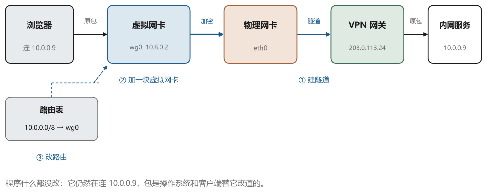
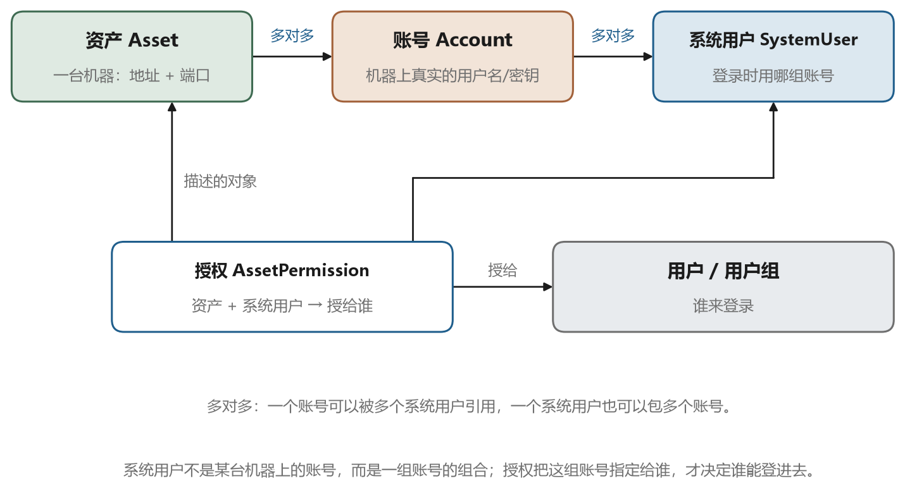
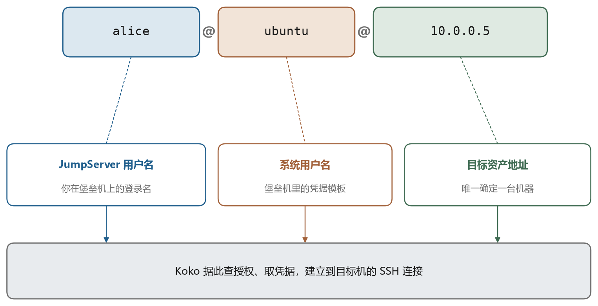
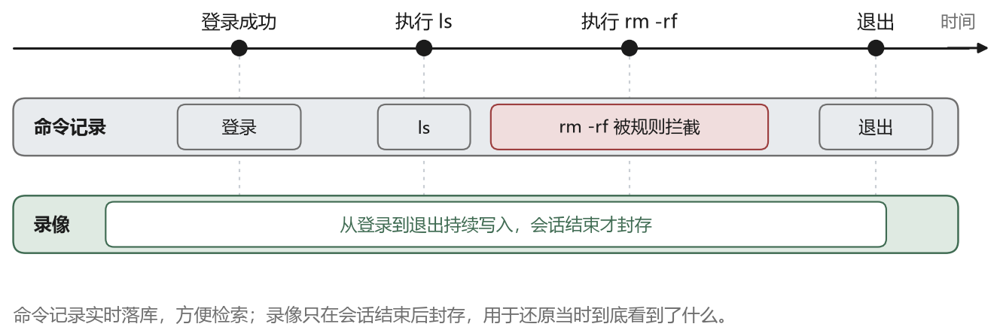

# VPN：把一整张内网搬到身边

## 9.1 一条走不通的地址

公司内网的代码托管平台在 `10.0.0.9` 上。白天在工位，浏览器里敲这个地址，页面立刻出来。晚上回家，同一台笔记本、同一个浏览器、同一个地址，转圈转到超时。

这时候最容易得出的结论是“服务器挂了”。可第二天到公司，它好端端的。

问题不在服务器，在你和 `10.0.0.9` 之间没有路。第三章讲过，以 10 开头的地址是私有地址，只在一个内网里有意义。你家路由器分给你的是 `192.168.1.23`，它知道怎么去公网，也知道怎么去自己那几台设备，但它不知道 `10.0.0.9` 在哪，也没有理由替你把包送过去。运营商那边更不会，因为全世界有几百万个内网都在用这个地址，它不属于任何一个人。

于是有了一个朴素的想法。能不能在回家之前，先在公司的内网里占一个位置，让家里的机器看起来就坐在那个网段里？地址不用改，程序不用改，连 DNS 都不用动。

VPN 做的就是这件事。全称是虚拟专用网（Virtual Private Network），关键词是“虚拟”两个字。物理上你在家，逻辑上你在这张内网里。第八章的端口转发也解决过类似的问题，但它一次只开一个端口，一个服务一条规则。VPN 想做的是一步到位，把整张网搬过来。

## 9.2 三个动作：隧道、虚拟网卡、路由

配好一个 VPN，机器上实际发生了三件事。图 9-1 画的是这三件事合起来的样子。



第一件是建隧道。客户端先连到公司出口的 VPN 网关，双方认证，协商出一套加密参数，然后在这条连接上封装数据。这一段的握手过程和 SSH 有相似之处，都是先证明身份，再谈密钥，只不过参与者和协议不同。

第二件是加一块虚拟网卡。系统里多出一个网络接口，名字可能叫 `wg0`、`tun0`，也可能是“以太网适配器 VPN”。它没有物理形态，驱动是软件模拟的。网关会给它分配一个内网地址，比如 `10.8.0.2`，从此你的机器在这张内网里有了合法身份。

第三件是改路由。这一步最容易被忽略，却是决定“流量走不走 VPN”的唯一开关。操作系统的路由表里会多出一条记录，大意是“凡是发往 `10.0.0.0/8` 的包，从 `wg0` 出去”。以前这类包交给家里的路由器，现在交给虚拟网卡；虚拟网卡收下之后，交给客户端进程加密，再通过物理网卡发往网关。

这三件事合起来，效果就是“程序完全不知情”。浏览器仍然连 `10.0.0.9`，它不知道这个包先被包了一层、绕了一圈、最后在公司的网关上被拆开。这一点是 VPN 和端口转发最根本的区别：端口转发是程序配合，把目标地址改成 `127.0.0.1:8080`；VPN 是操作系统配合，程序什么都不用改。

也正因为改的是路由，VPN 装好之后出问题时，第一件要看的就是路由表，而不是客户端界面上的那个绿灯。

## 9.3 封装：包外面再套一个包

隧道这个词听起来玄，机制其实很直白：把一个完整的包，塞进另一个包里。图 9-2 是这个过程的拆解。



你本来要发的是这样一个包：源地址 `10.8.0.2`，目的地址 `10.0.0.9`，里面装着一个 TCP 段。这个包没法直接扔到公网上，因为公网不认识 `10.8.0.2`，也不认识 `10.0.0.9`。客户端于是把它整体加密，当成一段数据，再加上隧道协议自己的头部，最后加上一个公网能路由的新 IP 头：源地址是你家的公网地址，目的地址是公司 VPN 网关。

到了网关，这个过程反过来走一遍。剥掉外层，解密，得到原来那个包，再按内网的规则送出去。对 `10.0.0.9` 来说，这个包就是从 `10.8.0.2` 发来的，和你坐在工位上没有区别。

封装带来三个后果，都得知道。

一是开销。每个包外面要多套几十个字节，IP 头 20 字节，UDP 头 8 字节，隧道协议自己的头部和认证标签加起来又是几十字节。千兆链路上这点开销无所谓，但在本来就拥堵的链路上，它会让有效带宽再降一点。

二是 MTU 变小。以太网的默认 MTU 是 1500 字节，套上一层之后装不下这么多，常见的做法是把隧道内的 MTU 降到 1400 到 1420。这一步如果没配好，就会出现一种很迷惑的现象：`ping` 通，`ssh` 也能登录，但一传大文件就卡住，网页加载到一半停住。原因是大包被打了“不许分片”的标记，中途被丢掉，而小包一路畅通。第三章讲过这个机制，隧道是它最常见的触发场景。

三是可识别性。中间设备看不到你在传什么，但能看到你在和同一个地址、同一个端口持续通信，流量特征很明显。所以有些网络会直接封掉常见的 VPN 端口，这也是为什么不少 VPN 要伪装成 443 端口的 HTTPS 流量。

## 9.4 隧道两端的互相信任

隧道建起来之前，双方要先解决信任问题：网关凭什么相信连上来的是公司员工，客户端凭什么相信对面是公司的网关而不是冒充者。这一步的思路和 SSH 完全一致，先认证，再协商密钥，只是具体协议不同。

企业里常见的有三类做法。

第一类是 IPsec，全称是 IP 安全（IP Security）。它工作在网络层，由操作系统或者专门的网关设备实现，认证与密钥协商交给 IKE 协议，数据用 ESP（一种把整个 IP 包重新打包加密的格式）封装。它的长处是站点到站点：两个办公室之间拉一条常驻隧道，两边内网互相可见，员工什么都不用装。缺点是配置复杂，而且要处理各种中间设备的干扰，比如 NAT 穿越。

第二类是 SSL VPN，名字里的 SSL 是 TLS 的旧称，所以它就是跑在 HTTPS 那套协议之上的 VPN。端口通常是 443，和你访问网站用的是同一层协议。因为 443 几乎不会被封，它的穿透性最好；早期形态是网页门户，登录后在页面上点开内部系统的链接，后来演化出轻客户端，可以把指定网段也塞进隧道。

第三类是 OpenVPN 和 WireGuard，两个具体的 VPN 软件。它们不依赖上面两套标准，各自定义了协议。OpenVPN 用 TLS 做握手，跑在 UDP 1194 上，跨平台成熟；WireGuard 更年轻，握手基于 Noise 框架，算法组合固定，代码量小到可以通读，配置只有几十行，近几年被大量采用。

无论哪一类，都要记住一件事：隧道只保护“你家到公司网关”这一段。出了网关，流量就在内网里跑，安全等级取决于内网自己的策略。所以“连了 VPN 就安全了”是个误解，它做的事情是把信任边界从公网挪到了公司出口，边界里面的世界并没有因此变成保险箱。

## 9.5 全隧道与拆分隧道

路由表怎么写，决定了哪些流量走隧道。这是 VPN 配置里最有存在感的一个选择，图 9-3 画的是两种极端。



第一种叫全隧道。路由表里加一条默认路由，`0.0.0.0/0` 全部指向虚拟网卡，意思是“除了本地网段，所有流量都进隧道”。效果是你的出口 IP 变成公司的出口 IP，访问任何网站都经过公司的防火墙和审计设备，公司能看到的和你坐在工位上时一样多。

第二种叫拆分隧道。路由表里只加几条具体的：`10.0.0.0/8` 走隧道，`0.0.0.0/0` 仍然走家里的路由器。访问内网系统走隧道，看视频、下载更新走本地宽带，互不干扰。

两种做法各有代价。全隧道的好处是行为统一、审计完整、策略简单，坏处是所有流量绕行，公司出口的带宽成了瓶颈，你在家开个视频会议都要经过公司。拆分隧道快，但审计上出现缺口：员工可以一边连着 VPN，一边用本地网络访问外部服务，公司看不见；更隐蔽的是 DNS，如果查询仍然发给家里运营商的 DNS，访问了哪些域名就暴露在外面，业内管这个叫 DNS 泄漏。

判断标准不在技术，在合规。要求“所有访问都留痕”的环境，只能用全隧道；只是要访问几个内部系统的场景，拆分隧道更实用。这也解释了一个常见现象：同一家公司的 VPN，在不同部门发的配置不一样，因为约束不同。

## 9.6 连不上时按这个顺序查

VPN 的故障排查比 SSH 简单，因为它的环节少，而且每一环都能单独验证。按下面的顺序走，多数问题在第三步之前就能定位。

先看隧道有没有起来。客户端界面上的状态只是参考，真正可靠的是命令。WireGuard 用 `wg show`，会列出对端、最近一次握手时间、收发字节数。最近握手是几分钟前，说明隧道活着；显示“从未握手”，说明连网关这一步就没成，问题在地址、端口、防火墙或者认证。

再看有没有拿到虚拟地址。`ip addr` 或者 Windows 的 `ipconfig`，看那块虚拟网卡上有没有 `10.8.0.2` 这样的地址。没有地址，说明认证过了但地址分配失败，通常和网关的地址池或者策略有关。

第三步看路由指向谁，这一步最容易出问题。

```bash
ip route get 10.0.0.9
```

这条命令会告诉你，发往 `10.0.0.9` 的包实际会从哪块网卡出去。如果显示的是 `eth0` 而不是 `wg0`，说明路由没生效，或者被一条更精确的路由抢走了。最常见的两种抢法：一是你家路由器的网段恰好也是 `10.0.0.0/8` 里的，本地直连路由的优先级更高；二是你同时连着公司的有线网和 VPN，两条路都通内网，系统选了先来的那条。

第四步才轮到内网。能 `ping` 通网关但 `ping` 不通目标机，说明隧道没问题，是内网的 ACL（访问控制列表，一串按顺序匹配的放行与拒绝规则）、防火墙或者目标机自己的规则拦住了。这时候要看的是公司那边的策略，不是你的客户端。

最后一种情况是“小包通、大包不通”。`ping` 目标机通，`ssh` 登录卡在认证之后，`scp` 一传就断。这是 MTU 问题，用带“不许分片”标记的包试探：

```bash
ping -M do -s 1400 10.0.0.9
```

从 1400 往下试，找到刚好能通的那个值，把隧道 MTU 设成它。Windows 上的写法是 `ping -f -l 1400 10.0.0.9`，`-f` 表示不许分片，`-l` 是包大小。这类问题不解决，其他一切看起来都正常，只有大文件传不动，很容易被误判成网络不稳定。

## 9.7 校园网里的那个客户端

说一个几乎每个上过大学的人都遇到过的场景。宿舍插上网线，浏览器打不开任何网页，装了学校发的那个客户端，输入学号密码，网才通。客户端图标常驻在托盘里，关掉就掉线，有时还弹出一句“检测到共享上网”。

很多人把这个客户端叫 VPN。它确实常常带着 VPN 功能，但它为主干的那件事，严格说不是 VPN。

校园网要解决的是另一类问题：谁能接入这张网络。学校里几万个网口，每个网口后面是谁，出了事能不能找到人，费用怎么算，这些都要有答案。技术上有两条常见的路。

第一条是 802.1X，作用在链路层。你插上网线之后，交换机的那个端口处于未授权状态，只放行一种报文，就是认证报文。客户端在这条链路上和交换机对话，交换机把内容转给背后的 RADIUS 服务器（远程认证拨号用户服务，一套集中认证的协议），服务器查账号、查密码、查策略，返回一个结论。通过了，交换机把端口打开，必要时还会给你分配一个特定的 VLAN。图 9-4 是这个过程的时序。



第二条是 Portal 认证，也就是用网页代替客户端的那种登录，作用在网络层。你先正常拿到 IP 地址，但网关只放行 DNS 和认证服务器，你打开任何网页都会被重定向到一个登录页。输入学号密码，网关记住你的地址，把你加入放行名单，有效期到了再认证一次。这条路的优点是浏览器就能用，不必装客户端；缺点是掉线后你未必知道，得重新打开网页。

iNode 这类客户端（H3C 出的一套接入软件，国内高校里最常见）把它们装在了一起，还顺手带上了 SSL VPN 和 IPsec VPN 的拨号功能。所以一个图标背后其实是四套东西：接入认证、门户认证、远程拨号、策略检查。学生把它笼统地叫作“校园网客户端”，厂商管它叫智能客户端，名字里没有一个词提到它到底在做什么，混淆就是这么来的。

学校为什么要设这么多限制，答案在管理上。一人一号，才能计费；账号绑定身份，才能在你访问了不该访问的东西之后找到人；地址和账号绑定，才能防止一个账号拖一整个宿舍的路由器。于是客户端要绑 MAC 地址、绑 IP、定期发心跳、检测多网卡和代理软件，一旦发现共享就强制下线。这些要求和你家里的网络体验是冲突的，所以这类客户端总显得难用，而它难用的每一点，背后都对应一条管理规定。

把两件事分开看，就清楚了。VPN 回答的是“我不在这张网里，怎么进去”；802.1X 和 Portal 回答的是“我就插在这张网的网口上，凭什么让你进来”。前者是在网络之上再架一层，后者是网络本身的闸门。它们经常叠在一起用：在校外先拨 VPN 回到学校，进来之后仍然要过接入认证。同一个客户端把两件事都做了，人就容易以为它们是一件事。

## 9.8 它和端口转发、堡垒机各管什么

到这里，书里已经出现了三种“把远方的资源搬到手边”的办法。它们经常被拿来互相替代，其实回答的是三个不同的问题。表 9-1 是一个对照。

表 9-1　三种做法的分工

| 做法 | 它管的问题 | 典型场景 | 主要代价 |
| --- | --- | --- | --- |
| SSH 转发 | 一个端口怎么过去 | 临时开一个数据库端口 | 逐条加规则，换机重配 |
| VPN | 一整张网怎么过去 | 出差接入内网 | 全隧道时全部绕行 |
| 堡垒机 | 谁连哪台、做了什么 | 多人运维、需要审计 | 单点故障、凭据集中 |

这三者可以层层叠加，而且企业里通常就是这么用的。常见的一种是：员工在家先拨 VPN 进内网，再从内网连堡垒机，最后由堡垒机连到目标机。这样网络上多了一层边界，权限上又收拢了一次。另一种是把堡垒机直接暴露在公网，不要求先拨 VPN，适合需要让外部供应商临时接入的场景，代价是那台堡垒机本身必须做得非常结实。

这三种做法共同的思路是“把边界画在某个地方，然后守住它”。近几年流行起来的零信任接入，思路是把这个边界打散：不再一次性把整张网交给你，而是每访问一个应用就验证一次，只开一条到那个应用的通道。听起来很新，做起来其实就是把第八章的端口转发产品化、策略化，再配上一套身份系统。理解了隧道和转发，零信任的文档读起来就不难了。

第二篇到此结束。这一篇讲的是信任和通道：怎么确认对面是谁，怎么把数据加密着送过去，怎么把一条通道、一张网搬到手边。接下来的问题不再是技术上的“怎么连”，而是组织上的“让谁连”。当几十个人、几百台机器都需要这样一条通道时，凭据放在谁手里、操作记录留给谁看，就成了另一件必须专门解决的事。下一章从一场事故讲起。
