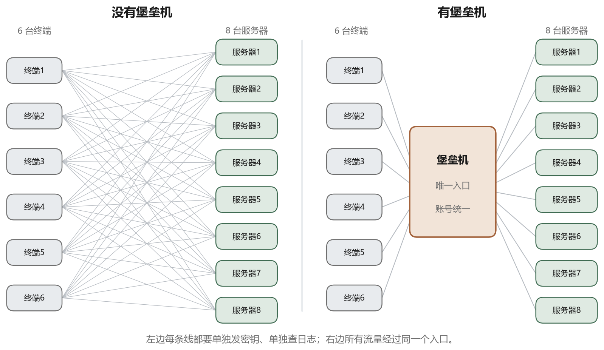
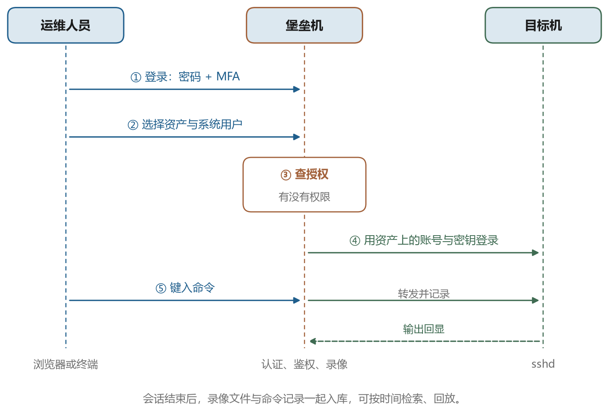

# 为什么需要堡垒机

## 10.1 一个常见的事故

设想这样一件事。测试环境的数据库忽然连不上了，查下来机器还在，端口也在监听，只是数据少了一半。日志里有一条凌晨的 `DELETE` 语句，执行者用的是 `root`。问题是团队里有五个人知道 `root` 的密码，谁也说不清那条语句是谁执行的。有人猜是定时任务，有人猜是误操作，最后不了了之。

这类事情在只有几台机器的小团队里发生概率不高，机器一多就变成常态。人是会流动的，项目是会交接的，三年前配的免密登录还留在某台机器的 `authorized_keys` 里，离职同事的笔记本上可能还存着生产库的私钥。等到出事，你甚至无法回答最基本的问题，谁在什么时候从哪台机器做了什么。

堡垒机就是为了回答这几个问题而出现的一类系统。它把“所有人直接连服务器”改成“所有人先连堡垒机，由堡垒机连服务器”，中间这个节点负责认证、授权、记录。

需要先说清楚，它并不是远程访问的必要环节。SSH 是点对点的协议，客户端直连服务器是最常见也最省事的形态，个人服务器、家庭实验室、几个人的小团队都是这样用的。堡垒机解决的是规模和约束带来的问题，第二章第四节已经给出了判断标准，这里接着讲它具体怎么解决问题。

## 10.2 网状连接的代价

没有堡垒机的时候，连接关系是网状的。图 10-1 左边画的是一个小团队的样子，六台办公终端、八台服务器，理论上每条“人”和“机器”的组合都需要一条通路。

网状结构带来三个具体问题。

第一个是凭据扩散。每台服务器上都要放每个人的公钥，每个人手里都要有每台服务器的地址和账号。新同事入职，要在一周内把几十台机器的访问配好。同事离职，要在一夜之间把几十台机器上的公钥删干净。漏掉一台，就是一条长期存在的后门。

第二个是权限失控。为了方便，很多人直接用 `root` 登录，或者在 `sudoers` 里给自己开全权限。时间一长，谁有什么权限没人说得清。等到要做权限审计，只能一台台机器去看 `authorized_keys` 和 `sudoers`，工作量巨大。

第三个是没有记录。Linux 的命令历史（`~/.bash_history`）是用户自己维护的，可以删、可以改、可以不写入。多个人共用同一个账号时，历史记录混在一起，无法归属到具体的人。真出了事故，只能靠猜。

改成星形之后，这三个问题都有了着力点，如图 10-1 右边。凭据只在堡垒机上有一份，人员进出只改堡垒机的授权。权限集中在授权表里，可以查询、可以回收。所有会话经过堡垒机，天然可以记录。

## 10.3 4A

堡垒机的功能通常用四个词概括，英文都以 A 开头，所以叫 4A。图 10-2 是这四个能力的示意。

认证解决“你是谁”。除了密码，还要支持公钥、短信验证码、动态口令、企业微信扫码，重要系统要求双因素。认证的意义在于把操作绑定到一个具体的人，而不是一个共用的账号。

授权解决“你能做什么”。给某个人分配某几台机器，允许他用某个系统账号登录，允许上传下载但不允许复制粘贴，这些都属于授权的范围。授权应该是可查询、可回收、有有效期的。

账号解决“用什么身份连机器”。这里有两层，一层是堡垒机自己的账号，一层是目标机器上的账号。用户登录堡垒机用自己的账号，堡垒机连目标机时用目标机上的账号。后者的密码或私钥由堡垒机托管，用户看不到。这就是所谓的“密码托管”，也是堡垒机最核心的价值之一。

审计解决“你做了什么”。会话录像、命令记录、文件传输记录、登录日志，都属于审计的范畴。审计数据要防篡改，要有保留期限，要能检索。

图 10-3 把一次登录的过程画了出来。用户先认证到堡垒机，选择要访问的资产，堡垒机检查他有没有对应授权，有的话用托管的凭据连到目标机，同时把整个会话录下来。用户看到的界面和直接连目标机几乎一样，区别是所有操作都留了痕。

## 10.4 流量怎么走

堡垒机接入流量的方式有两种，理解它们的区别对排查问题很重要。

第一种叫网关模式，也叫代理模式。用户直接用 SSH 客户端连堡垒机的某个端口，堡垒机在中间做协议代理。用户的连接终止在堡垒机上，堡垒机再向目标机发起一条新连接。这种方式下，堡垒机能完整解析 SSH 协议，所以能做到命令级的过滤和记录。代价是兼容性，某些客户端特性可能不支持，比如复杂的端口转发。

第二种叫直连模式，用户先通过 Web 界面拿到一张“通行证”，再直连目标机，堡垒机只做认证和记录。这种方式对网络要求低，性能好，但记录能力弱，因为流量不经过堡垒机。

多数企业用网关模式，因为它能提供完整的审计。JumpServer 的 Koko 组件就是干这个的，第十一章会详细讲。

这里有一个网络设计上的细节。网关模式下，堡垒机需要能够访问所有目标资产。它通常部署在运维区，同时能通向外网和内网。如果堡垒机到某台资产不通，用户会看到“连接超时”，而这条链路上其实有两段，用户到堡垒机、堡垒机到资产。排查时要分清是哪一段断了，方法是在堡垒机上直接 `nc -vz 资产IP 端口` 试一下。

## 10.5 合规要求

堡垒机在国内的普及和等级保护制度有直接关系。等保指的是信息安全等级保护，国内对信息系统的强制分级要求，2.0 是现行的版本，三级是其中较高的一档。它对运维审计提出了明确要求，包括对远程运维进行身份鉴别、访问控制、操作审计，审计记录要包含日期时间、用户、事件类型、结果，并且要保护记录不被删除、修改。

另一条常被引用的是网络安全法的要求，网络日志留存不少于六个月。这条规定直接决定了堡垒机的存储设计，录像文件要能存半年，容量规划必须按这个来算。

合规要求解释了一些看起来不合理的限制。比如为什么不能直接把生产库的公网端口开出去，为什么运维必须走堡垒机而不能用 VPN 直连，为什么堡垒机要限制文件上传下载。这些限制不是为了给工程师添麻烦，而是审计上的硬性要求。

## 10.6 堡垒机保护不了什么

说了这么多好处，也要说清楚边界。堡垒机不是万能的，把它当成安全问题的终极答案会带来新的风险。

它防不住有权限的人做坏事。一个有生产库删除权限的工程师，通过堡垒机删了数据，录像会记录这一切，但数据已经没了。堡垒机的作用是事后追责和事前威慑，不是事前阻止。真正减少这类风险要靠权限最小化和审批流程。

它本身是单点。所有运维流量都经过它，它挂了，所有人都进不去。所以生产环境里的堡垒机通常要做高可用，至少两台，前面挂负载均衡。这一套的成本不低，小团队往往承担不起。

它集中了所有凭据。堡垒机上存着几百台机器的密码和私钥，一旦被攻破，后果比没有堡垒机更严重。这也是为什么堡垒机的部署要求特别高，要单独划分安全域，要限制访问来源，要定期打补丁，数据库要加密。

它可能和生产环境抢带宽。网关模式下所有流量都过堡垒机，传大文件时带宽是瓶颈。有些团队因此给堡垒机单独开了一条链路，或者对文件传输做限速。

理解了这些边界，再看堡垒机的配置项就不会觉得是繁文缛节。限制复制粘贴是因为剪贴板里的内容不会被录像记录；限制文件下载是因为下载走的是另一条通道；要求双因素是因为单靠密码无法确认操作者是不是账号的主人。每一条限制背后都有一个具体的攻击场景。
