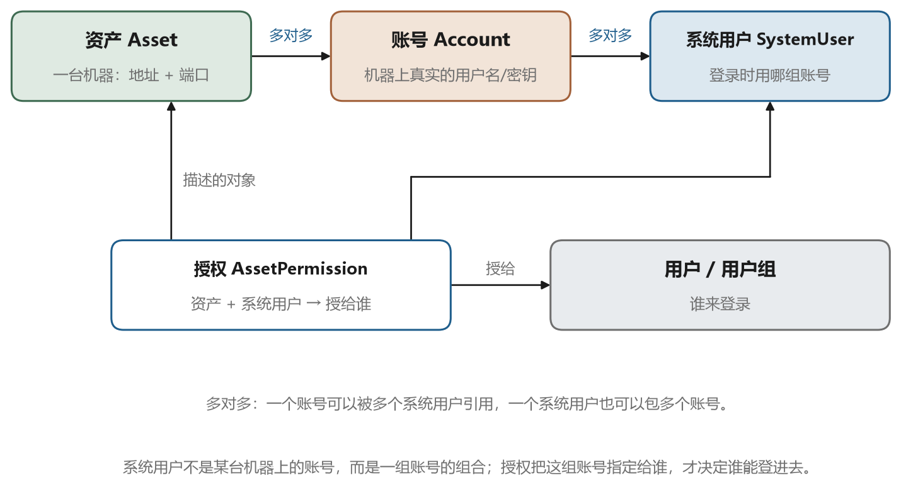
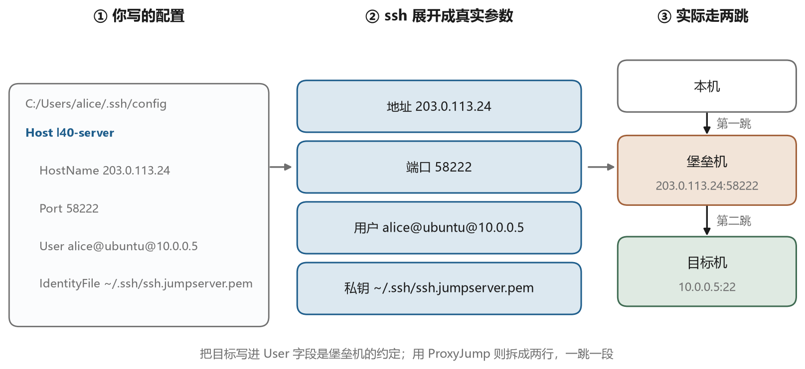

# VS Code 是怎么连过去的

## 10.1 一个编辑器，四个进程

VS Code 看起来是一个程序，实际上是一组进程。打开任务管理器，能看到好几个 Code.exe。这个结构继承自 Electron，也决定了远程开发可能的形态。

最外层是主进程，负责窗口、菜单、文件对话框、更新。中间是渲染进程，每个窗口一个，负责画界面。再往下是扩展宿主进程，所有扩展的代码都跑在这里，一个扩展崩溃不会把界面带崩。还有一个 pty 宿主进程，专门管理终端，让终端里的程序运行在独立进程里。

知道这个结构，就明白远程开发要解决什么问题。你希望代码在远端，编译和运行在远端，但界面和键盘在自己眼前。最直接的做法是把整个 VS Code 搬到远端，界面通过远程桌面显示，但那样延迟高、体验差。VS Code 选择的方案是把一部分进程搬到远端，本机只留界面。


图 10-1 是这个分工。本机保留界面进程和一部分扩展，远端跑一个叫 `vscode-server` 的服务，里面有远端扩展宿主、文件服务、终端服务。两者之间通过一条加密通道通信，通道上跑的是普通的 HTTP 和 WebSocket。

扩展被分成两类。只影响界面的扩展，比如主题、图标、快捷键提示，跑在本机。需要读写文件、调用编译器、访问远端的扩展，比如语言服务、调试器、Jupyter，跑在远端。VS Code 会根据扩展声明的 `extensionKind` 自动决定装在哪边，也可以手工指定。

## 10.2 连接时发生了什么

Remote-SSH 扩展做的事情，可以拆成图 10-2 里的几步。





你在界面上选一个主机，扩展读 `~/.ssh/config`，把别名展开成具体参数。然后它调用系统的 `ssh` 客户端，也就是你平时在终端里用的那个，建立一条连接。注意这一步用的是系统自带的 ssh，不是自己实现的协议栈，所以你在 `config` 里写的所有选项、你的 `known_hosts`、你的 `ssh-agent`，全都照常生效。

连上之后，扩展在远端执行一小段脚本来检查环境。它检查三件事，`~/.vscode-server` 目录是否存在、里面的版本是否匹配当前 VS Code 的版本、远端能不能正常执行命令。版本不匹配或者目录不存在，它就下载一个对应版本的 server 包，解压到 `~/.vscode-server/bin/<commit-id>/` 下面。

下载这一步是最容易失败的地方。远端机器需要能访问更新服务器，如果它在一个没有外网的机房里，下载就会超时。解决办法有两个，一是在本地下载好安装包，手工传上去解压；二是配置代理，让远端的下载走你的本机。后者的做法是在 `config` 里加 `Remote.SSH.RemoteServerListenOnSocket` 之类的选项，或者更简单地用第七章的本地转发把更新服务器的地址映射过去。

server 起来之后，它会监听一个本地端口或者一个 Unix socket。扩展在本机也启动一个监听，然后通过 SSH 的端口转发把两边接起来。界面通过 `127.0.0.1` 上的这个端口和远端通信，对你来说完全透明。

## 10.3 那条隧道的两端

图 10-3 画的是这条隧道两端的细节。


本机这一端，VS Code 随机选一个空闲端口，通常是 5 万多的一个数字，监听在 `127.0.0.1`。远端那一端，`vscode-server` 监听一个 Unix socket 文件，路径在 `~/.vscode-server/` 下面，或者监听一个 `127.0.0.1` 上的随机端口。中间的转发由 `ssh` 客户端完成，用的是 `-L` 或 `-R` 的等价机制。

这个设计解释了几个现象。第一，你在远端用 `ss -lntp` 会看到 `vscode-server` 监听在回环地址上，端口号是随机的，从外部连不进去。第二，如果你在堡垒机上禁用了端口转发，Remote-SSH 会在建立隧道这一步失败，报错通常出现在输出面板里，而不是终端里。第三，隧道断了之后界面会显示“正在重新连接”，因为 WebSocket 断了，VS Code 会尝试重连并重新建立端口转发。

## 10.4 ssh_config 的解析规则

Remote-SSH 完全依赖系统的 ssh 客户端，所以 `config` 文件的解析规则就是 OpenSSH 的规则，值得花点时间搞清楚。

文件从上往下读，对每一段 `Host`，检查当前连接的主机名（也可能是命令行里给的别名）是否匹配。匹配的段里的选项生效，后面的段可以覆盖前面的同名选项。`Host *` 匹配所有主机，所以它通常放在最前面作为默认值。

```text
Host *
    ServerAliveInterval 30

Host lab-*
    User alice
    IdentityFile ~/.ssh/id_ed25519_lab

Host lab-gpu
    HostName 10.0.0.9
    ProxyJump jump
```

上面的例子里，连 `lab-gpu` 时，三段都匹配。`ServerAliveInterval` 来自第一段，`User` 和 `IdentityFile` 来自第二段，`HostName` 和 `ProxyJump` 来自第三段。这就是为什么默认值要写在最前面。

支持的写法还有 `Include`，可以把配置拆成多个文件。

```text
Include ~/.ssh/config.d/*
```

OpenSSH 7.3 起支持，通配符和 `~` 都能用。企业里常用它把不同环境的配置分开管理。

几个替换符号在写 `ProxyCommand` 时会用到。`%h` 是目标主机名，`%p` 是端口，`%r` 是用户名，`%d` 是本机的家目录。写 `ProxyCommand ssh -W %h:%p jump` 时，这些符号会被替换成实际值。

还有两个容易忽略的点。一是 `HostName` 不写时默认等于 `Host` 后面的名字，所以 `Host lab` 加 `HostName 10.0.0.5` 两者都要写清楚，别指望它能猜。二是 `Host` 后面的名字区分大小写，`Lab` 和 `lab` 是两个不同的别名。

## 10.5 逐行拆解那份配置

现在回到第一章那份让人困惑的配置。图 10-4 把每一行的作用标了出来。





```text
Host l40-server
    HostName 124.221.133.165
    User alice@ubuntu@119.45.34.99
    Port 58222
    IdentityFile C:/Users/alice/.ssh/ssh.jumpserver.pem
```

`Host l40-server` 定义了一个别名，你在 VS Code 里选的就是这个名字，命令行里 `ssh l40-server` 用的也是它。名字本身可以随便起，只要自己记得住。

`HostName 124.221.133.165` 是真正要连接的地址。这里是堡垒机的公网地址，不是你目标机的地址。这一点是整份配置里最容易误解的地方。

`User alice@ubuntu@119.45.34.99` 是三合一用户名，第九章讲过它的三段含义。SSH 客户端不解析这个字符串，它原样发给服务器，由堡垒机去解析。

`Port 58222` 是堡垒机 SSH 网关的端口。不是 22，因为堡垒机的 22 端口通常留给系统自身的运维，网关用另一个端口。

`IdentityFile` 指向你在堡垒机上注册的公钥对应的私钥。这个私钥认证的是你本人，也就是 `alice` 这个堡垒机账号，不是目标机上的账号。

把五行合起来读，意思是“连接 124.221.133.165 的 58222 端口，用这把私钥证明我是 alice，然后告诉它我要用 ubuntu 这个系统用户去连 119.45.34.99”。一行配置里塞了两次认证、三段信息，难怪第一次看会懵。

这里有一个实际会遇到的问题。VS Code 的 Remote-SSH 在内部会解析用户名，某些版本会把 `User` 按第一个 at 符号切开，导致只把 `alice` 发过去。如果遇到这种版本，解决办法是在 `config` 里用 `User alice@ubuntu@119.45.34.99` 的同时，加上 `Remote.SSH.UseLocalServer` 或者改用 `ProxyCommand` 手工拼参数。具体做法随版本变化，判断依据是输出面板里的日志，看它实际发出的用户名是什么。

## 10.6 出问题时看哪里

Remote-SSH 的错误提示往往很笼统，只说“无法连接”。真正的细节在输出面板里。

打开方式是菜单里的“视图 → 输出”，然后在右侧下拉里选 “Remote - SSH”。这里会打印完整的 ssh 命令行、连接过程、每一步的输出。它其实就是在替你执行一条 `ssh` 命令，把参数都拼好了。

```text
Running script with connection command: ssh -T -D 5xxx "l40-server" sh
```

看到这一行，就可以把它复制到终端里手工执行，加上 `-v` 看更详细的输出。这是排查最快的路径，因为你在终端里能拿到完整的调试信息，而输出面板有时候会截断。

几个常见故障和对应的原因。报“Could not establish connection”，先看是不是网络不通或者端口写错。报“Permission denied”，检查私钥路径、私钥权限、堡垒机上的公钥是否配对。卡在“Downloading VS Code Server”，是远端下载失败，检查外网连通性或者手工安装。连上了但界面一直转圈，多半是端口转发被禁用，或者远端的 `vscode-server` 进程僵死。

清理远端残留是另一个常用操作。有时候 `vscode-server` 的进程卡住，删掉目录重来最快。

```bash
ls ~/.vscode-server/bin/
ps -ef | grep vscode-server
rm -rf ~/.vscode-server
```

VS Code 里还有一个命令叫 “Kill VS Code Server on Host”，效果一样，不用记路径。执行之后重新连接，它会重新下载并启动。

最后提醒一句资源问题。`vscode-server` 会占内存，语言服务和索引在大项目上能吃掉几个 GB。如果在共享的 GPU 机器上开发，注意别让它把内存吃满，导致训练任务被 OOM 杀掉。可以在远端限制扩展数量，只装必需的语言支持。
