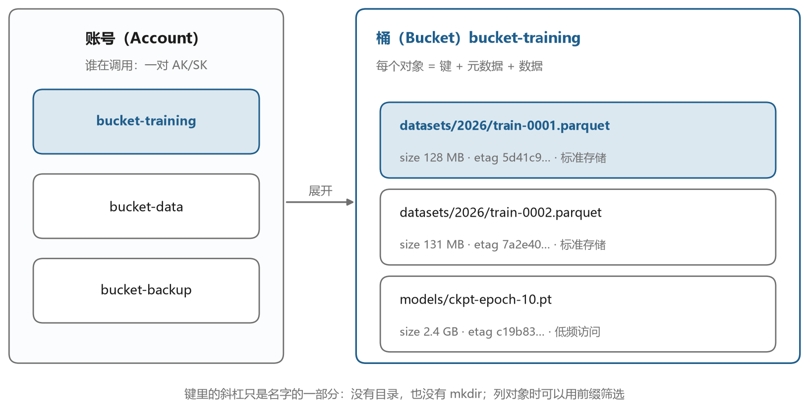
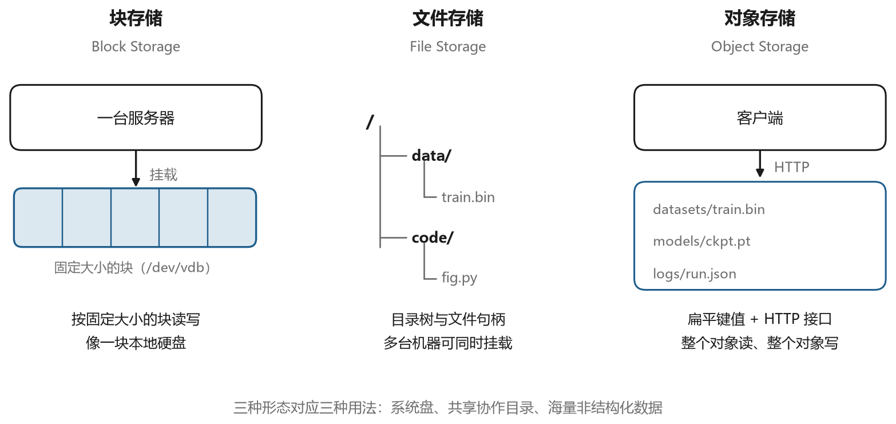
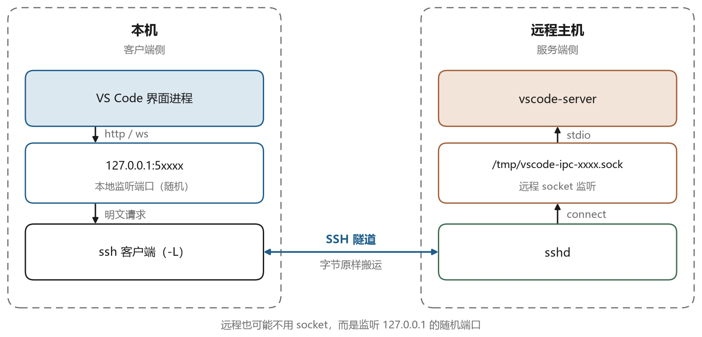
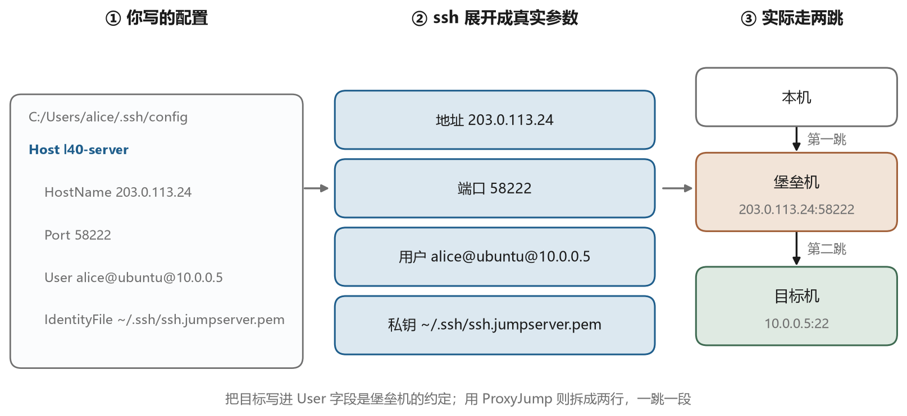

# JumpServer 的内部构造

## 11.1 组件地图

JumpServer 是国内使用最广的开源堡垒机，用 Python 和 Go 写成，前后端分离，按协议类型拆成多个组件。图 11-1 是它的组件结构。





Core 是后端服务，用 Python 的 Django 框架写成，对外提供 API（程序之间调用的接口）。它管理资产、用户、授权和会话记录，所有组件的配置都从这里取，所有操作记录都往这里写。它连接一个关系型数据库存元数据（描述数据的数据，比如资产清单和授权记录），连接 Redis（一种内存里的键值存储）做缓存和消息队列。

Luna 是 Web 前端，用 Vue 写成。你在浏览器里看到的资产列表、会话窗口、录像回放都是它。它自己不碰目标机器，所有操作都通过 API 转给后端或者对应的网关组件。

Koko 是字符协议网关，用 Go 写成，处理 SSH、SFTP、Telnet。用户用 SSH 客户端连堡垒机时，连的就是它。它负责解析 SSH 协议、校验授权、用托管的凭据连目标机、把整个会话录下来。

Lion 是图形协议网关，处理 RDP、VNC。原理类似，只是它代理的是图形协议，录像是一段视频。

Magnus 是数据库代理，把 MySQL、PostgreSQL、Oracle、Redis 这些协议的连接接进来，做账号托管和 SQL 审计。

Razor 是远程应用发布，把只能跑在 Windows 上的客户端程序（比如某些管理工具）包装成网页里的一个窗口。

Chen 是任务编排，用来批量执行脚本、做定期巡检，本质上是把 Ansible 包装成了可视化界面。

这套拆分的好处是各协议互不影响，SSH 网关出问题不影响 RDP。缺点是部署复杂，组件多了之后，端口、证书、配置同步都容易出问题。官方提供了一键安装脚本和容器化部署方案，生产环境通常用后者。

## 11.2 资产模型的四层

JumpServer 的权限模型有四个核心概念，理解了它们，界面上的大部分操作就不用猜了。图 11-2 是它们的关系。





资产（Asset）是一台被管理的机器，记录它的地址、端口、平台类型（Linux、Windows、网络设备）、节点归属。节点是一棵树的节点，用来给资产分组，比如“生产环境 / 华东 / 数据库”。

系统用户（SystemUser）是“登录资产时使用的身份模板”。它记录用户名、认证方式（密码或者密钥）、密码或私钥、提权方式（sudo 或者 su）。系统用户分为普通用户和特权用户，特权用户用来做自动化采集，普通用户用来给人登录。

账号（Account）是某个资产上真实存在的账号。系统用户和资产结合，就产生一条账号记录，里面存着这台机器上这个用户的实际密码或密钥。同一个系统用户在不同资产上的密码可以不同，JumpServer 会分别保存。

授权（AssetPermission）是把“谁”和“哪些资产、用哪个系统用户、能做哪些动作”绑在一起的记录。授权的对象可以是用户，也可以是用户组。动作包括连接、上传、下载、复制、粘贴、删除等等，粒度很细。

这四层的关系可以用一句话概括，授权决定某个人能用某个系统用户登录某些资产，登录时用的具体凭据来自账号表。新人入职，管理员做的是建用户、加用户组、给用户组授权，不用碰任何一台真实机器。

## 11.3 三合一用户名

现在可以解释企业环境里常见的那种看起来别扭的配置了。

```text
User alice@ubuntu@10.0.0.5
```

JumpServer 的 SSH 网关需要在一开始就知道三件事，谁在登录、用哪个系统用户、连哪台资产。SSH 协议的用户名字段只有一个字符串，于是它把三件事拼在一起，用 at 符号分隔。图 11-3 是这个解析过程。





这个格式只对堡垒机有意义。把同样一串用户名发给一台普通的服务器，它只会当成一个不存在的账号，直接拒绝。协议没有为它留任何位置，是网关在收到之后自己做了解析。

第一段 `alice` 是 JumpServer 上的用户名，用来认证你本人。第二段 `ubuntu` 是系统用户名，对应 JumpServer 里配置的一个系统用户，它决定了用哪套凭据去连目标机。第三段 `10.0.0.5` 是资产地址，Koko 用它来定位具体是哪台机器。

这个格式对 SSH 客户端来说是合法的，因为用户名只是一个字符串，协议没有规定不能包含 at 符号。但它在两个地方会带来麻烦。一是有些工具会按第一个 at 符号切分用户名和主机，导致解析错误。二是命令行里如果涉及 URL 编码，at 符号需要转义成 `%40`。VS Code 的 Remote-SSH 属于前者，所以它的配置文件里要特别小心，不能让它把用户名再拆一次。第十二章会讲它怎么处理。

还要注意一点，第二段是“系统用户名”，不是目标机上真实的 Linux 用户名。系统用户里记录的用户名可能和它同名，也可能不同。你看到 `ubuntu`，不代表目标机上的账号一定叫 `ubuntu`，那只是 JumpServer 里给这套凭据起的名字。这一点在实际排查时很容易搞混。

## 11.4 一次 SSH 网关会话

把上面这些串起来，一次通过网关的登录是这样走的。

你的客户端连到堡垒机的 58222 端口，Koko 接受连接。它先和你完成 SSH 握手，用你上传的公钥或者密码认证你的身份，这一步验证的是“你是 alice”。认证通过后，Koko 解析用户名里的三段信息，去数据库查 alice 有没有权限用 `ubuntu` 这个系统用户连接 `10.0.0.5` 这台资产。有权限的话，它从账号表里取出这台机器上这个账号的凭据，向目标机的 22 端口发起一条新的 SSH 连接。这条连接用的是托管的密码或私钥，你完全看不到。

两条连接都建立之后，Koko 在中间做双向转发，同时把整个会话录下来。你敲的每一个字符、目标机返回的每一段输出，都写进录像文件。录像不是简单的文本记录，而是带时间戳的终端会话流，回放时能看到打字的速度和节奏。

如果授权里配置了命令过滤，Koko 还会在转发之前检查你输入的命令。匹配到禁用规则的命令会被拦下来，你在终端里会看到一段提示，命令不会到达目标机。这个检查和你在目标机上配置的 `sudo` 规则是两回事，前者在堡垒机侧，后者在目标机侧，两者都可能拦住你。

## 11.5 命令过滤与会话录像

图 11-4 是一次会话的时间轴，标出了几种记录发生的位置。





命令记录是结构化的，每执行一条命令就写一条，包含时间、用户、资产、命令内容、执行结果。它适合检索，比如查“上周谁在这台机器上执行过 rm”。但命令记录有局限，它抓的是你敲进去的字符串，如果命令是通过脚本执行的，或者用了交互式程序（比如 `vi`、`mysql` 客户端），记录就不完整。

会话录像弥补了这个缺口。它记录的是终端上的原始字节流，回放时把这些字节按时间重新播放一遍，看起来就像当时的屏幕。对于 `vi` 里改了什么、`mysql` 里执行了什么 SQL，录像都能还原。

两者结合，审计才算完整。查问题时先看命令记录定位到时间段，再调出录像看具体操作。这也解释了为什么录像文件占空间，一个小时的交互式会话，录像可能有几 MB 到几十 MB，按六个月留存算，容量规划要认真做。

## 11.6 凭据是怎么存的

堡垒机最敏感的数据是托管的密码和私钥。JumpServer 用对称加密保存这些内容，加密密钥放在配置文件或者环境变量里，和数据库分开存放。这样即使数据库被拖走，没有密钥也解不开。

```text
SECRET_KEY=...
BOOTSTRAP_TOKEN=...
```

这两个值在安装时生成，写在 `/opt/jumpserver/config/config.txt` 里。很多人图省事，把它们留在默认值或者提交到了代码仓库，这是严重的错误。拿到这两个值加上数据库，等于拿到所有资产的登录权限。

更麻烦的是密钥轮换。改了加密密钥，已经存进去的密码全部解不开，需要重新录入。所以正规做法是在部署初期就规划好密钥管理，用密钥管理服务或者外部保险箱，而不是写死在配置文件里。

堡垒机托管私钥还带来一个架构上的变化。原来每个人手里有自己的私钥，现在私钥集中在堡垒机上。这意味着堡垒机本身成了最高权限的持有者，它的安全等级必须高于它管理的所有资产。这条要求在实际部署中经常被忽略，堡垒机和被管理的机器放在同一个网段、用同一套弱密码，等于把锁和钥匙放在同一个抽屉里。

## 11.7 部署时的几个关键项

JumpServer 的配置文件里有几项值得提前想清楚。

网关端口是其中之一。默认的 SSH 网关端口是 2222，示例里用的是 58222。改端口的意义不大，但能减少扫描噪音。真正重要的是把这个端口只对运维网段开放，不要暴露在公网。

另一个是 `SECURITY_INSECURE_MODE` 之类的开关，用来允许或禁止某些不安全的行为，比如跳过主机密钥校验。这些开关在生产环境必须关闭，否则等于放弃了中间人防护。

还有会话保留策略。录像文件默认存在本地磁盘，容量有限。生产环境要配置成存到对象存储，第五章讲的对象存储在这里派上了用场。这也顺带解释了为什么这本书把对象存储放在最后一篇，它和堡垒机是同一套运维体系的两端，一端管人怎么进来，一端管数据存在哪里。
