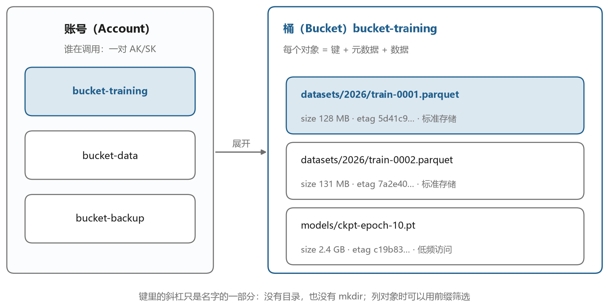
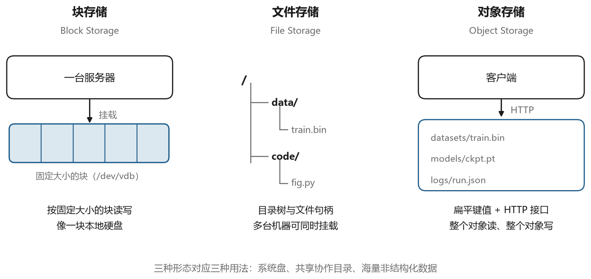
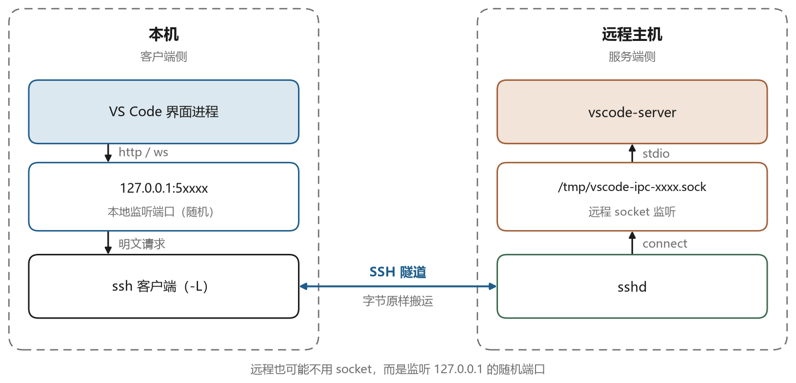

# 对象存储的模型

## 12.1 为什么不用文件夹

服务器上的数据通常放在文件系统里，一个目录套一个目录，文件有名字、有路径、有属性。这套模型用了几十年，很成熟。但当数据量到了几十 TB、文件数到了几千万，文件系统开始吃力。目录树的元数据要放在内存里，几千万个 inode（文件系统里记录单个文件属性的数据结构）会把内存吃光；单机的容量有上限，扩容要停机；跨机器共享要靠 NFS（一种让多台机器挂载同一个目录的协议），性能和稳定性都不理想。

对象存储是为这个场景设计的。它放弃了目录树，放弃了随机写，放弃了文件锁，换来的是近乎无限的容量、很高的持久性和简单的 HTTP 接口。代价是你不能像本地文件那样 `append` 一段内容，也不能 `rename` 一个目录，每次操作都是整体替换一个对象。





图 12-1 是它的数据模型。最上层是账号，账号下面可以建多个存储桶（Bucket），桶里放对象（Object）。对象由三部分组成，一个键（Key）、一段数据、一组元数据。键是一个字符串，可以包含斜杠，看起来像路径，但它不是路径。

```text
logs/2026/11/04/app.log
```

这个键在对象存储里就是一个完整的名字，没有 `logs` 这个目录。控制台上把它显示成目录树，是为了照顾人的习惯，实际存储时它就是一串字符。这个设计带来一个后果，按前缀列举很快，按“目录”操作不存在。想删除一个“目录”，得先列出所有以这个前缀开头的对象，逐个删。

桶的名字全局唯一，跨账号也不能重复，因为访问时要用它拼域名。腾讯云 COS 的域名形如 `example-1250000000.cos.ap-guangzhou.myqcloud.com`，其中前半段是桶名加 APPID，后半段是地域。AWS S3 的域名形如 `bucket-name.s3.region.amazonaws.com`。这个域名规则在排查访问问题时很重要，因为签名计算和域名绑定，写错地域就会报签名不匹配。

## 12.2 三种存储形态

块存储、文件存储、对象存储经常被放在一起比较，它们解决的是不同层次的问题。图 12-2 是这三者的示意。





块存储提供的是一块裸设备，操作系统在上面建文件系统，用起来和本地磁盘一样。云厂商的云硬盘属于这一类。它的优点是延迟低、支持随机读写，适合数据库。缺点是同一时刻只能挂给一台机器，共享要靠集群文件系统。

文件存储提供的是共享目录，多台机器同时挂载（把远端目录接到本地的一个路径下，用起来像本地目录），看到同一份数据。NFS、SMB（两种共享目录的协议）属于这一类，云上的 NAS（专门提供共享目录的设备）也是。它适合多台机器共享配置、共享代码，缺点是元数据操作多的时候性能下降明显。

对象存储提供的是 HTTP 接口，通过 PUT 和 GET 存取整个对象。它不适合放数据库文件，也不适合放需要频繁修改的文件。它适合放图片、视频、备份、日志、训练数据、模型权重，这些内容写进去之后很少改，但量很大。

判断用哪种存储，可以问三个问题。需要随机读写吗，需要多机共享吗，数据量大到单机放不下吗。数据库用块存储，共享配置用文件存储，海量冷数据用对象存储。

## 12.3 接口就是 HTTP

对象存储的接口是 REST 风格的 HTTP。上传一个对象用 PUT，下载用 GET，删除用 DELETE，查元数据用 HEAD。这几个方法都是幂等的，同一个 PUT 执行两次，结果一样，这对重试很友好。

```bash
curl -X PUT "https://bucket-1250000000.cos.ap-guangzhou.myqcloud.com/test.txt" \
     -H "Authorization: ..." \
     --data-binary "hello"
```

返回的状态码能说明大部分问题。200 表示成功，204 表示成功但没有内容，403 表示没有权限或者签名不对，404 表示对象不存在，409 表示冲突（比如桶名已被占用），412 表示前置条件失败，429 表示请求过于频繁，5xx 表示服务端问题。排错时先看状态码，再看返回的 XML 里的错误码，后者更具体。

```xml
<?xml version="1.0" encoding="UTF-8"?>
<Error>
  <Code>SignatureDoesNotMatch</Code>
  <Message>The request signature we calculated does not match...</Message>
  <Resource>/test.txt</Resource>
  <RequestId>...</RequestId>
</Error>
```

`Code` 字段是最有价值的信息，第十三章会把常见的几个错误码和它们的成因列出来。

还有一个容易忽略的方法 HEAD。它只返回头部，不返回内容，可以用来快速判断对象是否存在、有多大、是什么类型，不用把整个对象下载下来。

```bash
curl -I "https://bucket-1250000000.cos.ap-guangzhou.myqcloud.com/big-model.bin"
```

## 12.4 大文件怎么传

对象存储的单个 PUT 有大小限制，通常是 5 GB。超过这个大小必须用分片上传。即使没超，大文件用分片上传也更可靠，因为某一片失败只需要重传那一片。

分片上传分三步，如图 12-3。先发起一个分片上传请求，服务端返回一个 UploadId。然后按顺序或者并发上传各个分片，每片带上序号，服务端返回每片的 ETag（服务端为这段内容算出的校验值，用来确认分片完整）。最后提交完成请求，把所有分片的序号和 ETag 列出来，服务端按顺序拼接成一个对象。





这套机制有两个细节值得知道。第一，分片有大小限制，除了最后一片，每片不能小于 1 MB（不同厂商的数字略有差异，S3 是 5 MB），最大不能超过 5 GB。第二，未完成的分片上传会占用存储空间，因为已经上传的分片还在服务端。所以要配置生命周期规则，自动清理超过一定天数还没完成的分片，否则存储费用会莫名其妙地上涨。

分片上传还支持断点续传。客户端把 UploadId 和已完成的分片列表存下来，下次从断点继续。`coscli`、`aws s3 cp` 这些工具内部都实现了这套逻辑，命令行看起来是一条命令，背后可能是几十个并发请求。

## 12.5 元数据与存储类型

每个对象除了数据，还有一组元数据。系统元数据由服务端维护，包括大小、修改时间、ETag、内容类型。用户元数据是自定义的键值对，以 `x-cos-meta-` 或者 `x-amz-meta-` 开头，可以用来记录业务信息。

```text
x-cos-meta-project: video-2dto3d
x-cos-meta-owner: alice
```

ETag 常被误认为是文件的 MD5。对普通上传的单文件，它确实是内容的 MD5；对分片上传的对象，它是各分片 MD5 拼接后再算 MD5，和整个文件的 MD5 不同。用它做完整性校验时要小心，比较靠谱的做法是自己在本地算 MD5 或者 SHA-256，存进用户元数据。

存储类型决定了费用和取回时间。标准存储适合频繁访问的数据，低频存储便宜一些但取回要等，归档存储更便宜但要解冻几个小时。这些类型可以按规则自动转换，比如“创建 30 天后转低频，90 天后转归档”，这就是生命周期规则。

## 12.6 一致性与持久性

对象存储宣传的持久性通常是“11 个 9”，意思是每年丢失数据的概率是千亿分之一。这个数字来自冗余设计，同一份数据存多个副本或者用纠删码编码后分散到多台机器、多个机架，坏掉几个不影响整体。

一致性是另一个维度。早期的 S3 只保证最终一致，上传之后立刻读可能读到旧版本。2020 年底 AWS 宣布 S3 对新建对象的读写提供了强一致性，覆盖列表操作。国内厂商的文档里也有类似说明，但具体行为要看版本。这一点对训练任务有实际影响，上传完数据立刻开始训练，如果读到的是旧版本或者读不到，会很困惑。稳妥的做法是上传后校验，或者等几秒再开始。

## 12.7 工具与挂载

日常使用对象存储有三类工具。

图形界面的客户端，用来浏览桶、上传下载、生成分享链接。这类工具适合偶尔用，不适合批量操作。

命令行工具，比如 `coscli`、`aws s3`、`rclone`。它们支持并发、断点续传、同步目录、按规则过滤，是脚本里的主力。

```bash
coscli cp ./data/ cos://bucket-1250000000/dataset/ --recursive
coscli sync ./checkpoints/ cos://bucket-1250000000/ckpt/ --delete
```

挂载工具，比如 `cosfs`、`s3fs`、`goofys`。它们把桶挂成一个本地目录，应用程序不用改代码就能读写。这看起来很美好，坑却不少。

第一个坑是延迟。每次读文件都是一次 HTTP 请求，随机读小文件的性能比本地磁盘差两个数量级。第二个坑是随机写。对象存储不支持在文件中间插入数据，很多程序（比如数据库、某些编译工具）会先写临时文件再改名，这种模式在挂载的文件系统上可能失败或者产生额外开销。第三个坑是文件锁。对象存储没有锁的概念，多台机器挂载同一个桶，同时写同一个文件会互相覆盖。

结论是，挂载适合“读多写少、顺序访问”的场景，比如让训练脚本直接读数据集。不适合放数据库、不合适放代码仓库、不合适放需要频繁 rename 的编译输出。

## 12.8 和堡垒机的关系

这两件事看起来无关，其实在企业里经常连在一起。

堡垒机的会话录像要存起来，本地磁盘存不下六个月的数据，于是存到对象存储。训练任务的日志和模型权重也要存，于是也放对象存储。数据的入口和人的入口，构成了运维体系的两端。

这也带来一个安全上的共同点。两者都依赖凭据，堡垒机托管服务器的密码和私钥，对象存储依赖访问密钥。凭据泄露的后果一样严重。第十三章要讲的签名机制，本质上就是让凭据在使用时不出现在网络上，这一点和 SSH 的公钥认证思路相同。
