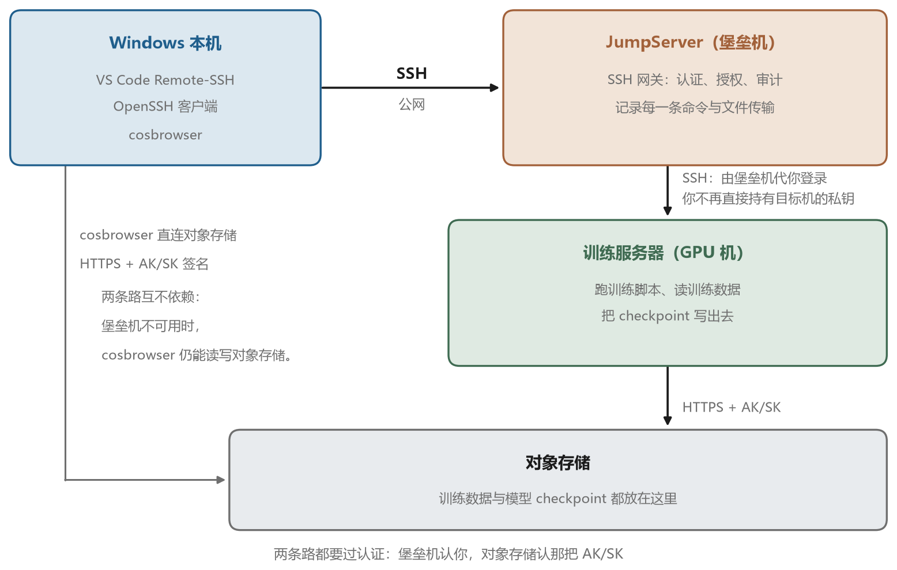
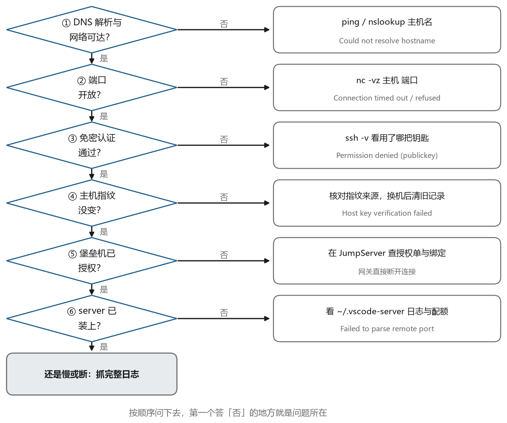

# 把四件事串成一条链路

## 13.1 一个真实的工作流

　　前面十二章各自讲了一个部件，这一章把它们装到一起。

　　设想这样的场景。你在办公室的 Windows 电脑上写代码，代码要跑在实验室的一台 GPU 服务器上，那台服务器在机房内网，外面进不去，只有一台堡垒机暴露在公网。训练数据有几百 GB，放在对象存储的一个桶里，模型权重也要定期存回桶里。你希望能在本地的 VS Code 里编辑远端代码、开终端、跑训练，同时让训练脚本自己从桶里读数据、往桶里写检查点。

　　这个场景里用到了四样东西，SSH 客户端、堡垒机、VS Code 的远程开发、对象存储的 API。它们分别对应这本书的四篇。图 13-1 是整体的拓扑。





　　图里有四条链路，每条都有自己的认证方式。本机到堡垒机是一次 SSH 认证，用的是你的私钥。堡垒机到训练机是另一次认证，用的是堡垒机托管的凭据，你看不到。本机到训练机之间还有一条逻辑上的 VS Code 通道，它跑在前两条连接之上。训练机到对象存储是一次 HTTPS 请求，用的是访问密钥的签名。

　　把这四条链路的认证对象分清楚，排错时就不会乱。图 13-2 是本机侧常见问题的判断路径，后面几节会用到。





## 13.2 第一步，把登录打通

　　一切从一条能用的 SSH 连接开始。在本机建好配置文件，内容大致如下。

```text
Host lab-gpu
    HostName 124.221.133.165
    Port 58222
    User alice@ubuntu@10.0.0.9
    IdentityFile C:/Users/alice/.ssh/ssh.jumpserver.pem
    IdentitiesOnly yes
    ServerAliveInterval 30
    ServerAliveCountMax 3
```

　　五行核心配置，第一章已经逐行拆过。这里补充三行可选项。`IdentitiesOnly yes` 让客户端只用指定的这把钥匙，不去试 agent 里的其他钥匙，避免因为尝试次数过多被服务器拒绝。两个 `ServerAlive` 选项负责保持连接，防止中间设备把闲置的会话清掉。

　　配好之后先别急着开 VS Code，在终端里试一下。

```bash
ssh -v lab-gpu
```

　　能进到远端的提示符，说明前三段链路都通了。进不去的话，按图 13-2 从上往下查。先确认域名或者地址能通，再确认端口开放，再看认证。

```powershell
Test-NetConnection 124.221.133.165 -Port 58222
```

　　这条命令在 Windows 上测端口连通性，比 `ping` 靠谱，因为很多服务器禁 ping 但端口是开的。如果端口不通，问题在网络或者安全组，和密钥无关。

　　认证失败时，报错通常是 `Permission denied (publickey)`。这时依次检查四件事，私钥文件是否存在、权限是否过宽、公钥是否已经登记在堡垒机、用户名里的三段是否写对。第三件事最容易被忽略，很多人把公钥加到了目标机的 `authorized_keys` 里，却忘了在堡垒机上登记，结果怎么都不通。

## 13.3 第二步，让编辑器连上

　　终端能登录之后，VS Code 的远程连接通常一次就成。装好 Remote-SSH 扩展，按 `F1` 调出命令面板，选“连接到主机”，输入 `lab-gpu`。

　　第一次连接会慢一些，因为要在远端安装 `vscode-server`。如果远端的家目录所在分区空间紧张，这一步会失败。先看一下余量。

```bash
df -h ~
```

　　装好之后，界面左下角会显示远端的主机名，表示已经连上。这时打开远端的项目目录，编辑、保存、开终端都在远端进行。你的本机只负责显示。

　　如果卡在“正在下载 VS Code Server”，说明远端下载失败。可以在本机下载对应的安装包，用 `scp` 传上去手工解压。安装包的地址在输出面板的日志里能找到，形如 `https://update.code.visualstudio.com/commit/<commit-id>/server-linux-x64/stable`。

```bash
wget https://update.code.visualstudio.com/commit/<commit-id>/server-linux-x64/stable
mkdir -p ~/.vscode-server/bin/<commit-id>
tar -xzf stable -C ~/.vscode-server/bin/<commit-id> --strip-components=1
```

　　这条路在离线环境里很常用，值得记下来。`<commit-id>` 在 VS Code 的“关于”对话框里能找到。

## 13.4 第三步，让训练机读写桶

　　训练脚本要读写对象存储，需要在训练机上配置凭据。这一步最容易出事，因为凭据一旦落到磁盘上，就成了一条长期风险。

　　最稳妥的做法是用临时密钥。用一个有签发权限的身份去换一组只在几小时内有效的凭据，注入到环境变量里，不写文件。

```bash
export COS_SECRET_ID="<TEMP_SECRET_ID>"
export COS_SECRET_KEY="<TEMP_SECRET_KEY>"
export COS_SESSION_TOKEN="<TEMP_SESSION_TOKEN>"
```

　　如果没有临时密钥的签发能力，退一步用子账号密钥，把它写进只有自己能读的配置文件，权限 600。

```bash
mkdir -p ~/.coscli
cat > ~/.coscli/config.yaml <<'EOF'
cos:
  base:
    secretid: <YOUR_SECRET_ID>
    secretkey: <YOUR_SECRET_KEY>
    sessiontoken: ""
  buckets:
    - name: dataset-1250000000
      alias: dataset
      region: ap-guangzhou
EOF
chmod 600 ~/.coscli/config.yaml
```

　　配置好之后先做一次最小验证，列一下桶里的内容，确认权限没问题。

```bash
coscli ls cos://dataset/
coscli ls cos://dataset/train/ --limit 20
```

　　能列出来，说明读权限有了。再试一次写，往一个临时前缀里传一个小文件。

```bash
echo test > /tmp/probe.txt
coscli cp /tmp/probe.txt cos://dataset/tmp/probe.txt
coscli rm cos://dataset/tmp/probe.txt
```

　　这三条命令验证了列、写、删三个动作。很多 403 就是在这个阶段暴露出来的，早发现比训练跑到一半才发现好。

## 13.5 第四步，把结果取回来

　　训练结束，检查点和日志要取回来。小文件直接下载，大文件用分片加快，中断了能续。

```bash
coscli cp cos://dataset/ckpt/epoch-10.pt ./ckpt/epoch-10.pt
coscli sync cos://dataset/logs/ ./logs/ --include "*.txt"
```

　　`sync` 只传输有差异的文件，适合日志这种持续增长的内容。`--include` 和 `--exclude` 支持通配符，可以精确控制传哪些。传大文件时注意本机磁盘空间，一个模型检查点几个 GB 很常见。

　　如果要把结果分享给别人，不要直接给桶的公共链接，用预签名 URL，设一个合理的有效期。

```bash
coscli sign cos://dataset/ckpt/epoch-10.pt --expire 3600
```

　　这条命令返回一个带签名的链接，一小时后失效。分享之前确认链接里没有敏感信息，因为 URL 里的路径本身就是对象名。

## 13.6 排错的时候按顺序来

　　图 13-2 的决策树可以展开成一张检查清单。遇到问题，从上往下逐项确认，不要跳步。

　　先看能不能通。`Test-NetConnection` 测端口，`ping` 测地址，`tracert` 看路径。这一步不通，后面全是白费。

　　再看认证。`ssh -v lab-gpu` 的输出里找 `Authentications that can continue`，它列出了服务器接受的认证方式。如果只有 `publickey`，说明密码登录被禁用，得用密钥。如果连这一行都没有，问题在更早的阶段。

　　然后看授权。堡垒机的授权是独立于 SSH 认证的一层，SSH 认证通过不代表你有权限连某台资产。表现是连接建立后立刻被断开，或者提示没有权限。这时要去堡垒机界面确认授权是否包含这台资产和这个系统用户。

　　接着看隧道。VS Code 连上但界面转圈，多半是端口转发被禁用。在输出面板里找 `Remote-SSH` 的日志，如果看到 `open failed: administratively prohibited`，就是这个原因。

　　最后看对象存储。`SignatureDoesNotMatch` 查地域和密钥，`AccessDenied` 查策略，`RequestTimeTooSkewed` 查时钟。三条线索对应三个不同的层面，不要混着改。

## 13.7 一份可以照着做的检查清单

　　把全书的安全要点收成一份清单，部署或者接手一个新环境时可以逐条对照。

　　凭据方面。私钥权限 600，目录 700。密钥设口令，口令进 agent。不用共享账号，一人一把钥匙。离职当天回收授权，不只是删机器上的公钥，还要删堡垒机上的账号。对象存储的主密钥不进代码，业务用子账号，临时任务用临时密钥。

　　连接方面。关闭密码登录，只留公钥。关闭 root 直接登录。改默认端口能减少噪音但不是安全保障。`known_hosts` 的警告要认真看，不要习惯性删掉。

　　堡垒机方面。默认禁止端口转发和复制粘贴，按需开放。开启会话录像和命令记录，保留期不少于六个月。录像存到对象存储，别放本地磁盘。堡垒机本身单独划分安全域，只对运维网段开放。

　　对象存储方面。桶一律私有，公共读要单独评估。开启访问日志。配置生命周期，清理未完成的分片和过期对象。跨域规则只对需要的域名开放，不要写 `*`。

　　这些条目看起来琐碎，每一条背后都有具体的事故。把它们做成检查表，新环境上线前过一遍，比事后复盘便宜得多。

## 13.8 最后

　　这本书从一条 `ssh` 命令讲起，走到了对象存储的签名。中间经过了网络分层、密码学、协议握手、堡垒机的权限模型、编辑器的进程结构。这些内容看起来分散，其实都在回答同一个问题，一个远方的资源，凭什么相信你，你又凭什么相信它。

　　SSH 用密钥和签名回答这个问题，堡垒机用集中管理和审计回答这个问题，对象存储用 HMAC 签名回答这个问题。手段不同，思路一致。理解了这一点，再遇到新的工具、新的协议，你也能顺着这条线索把它拆开。

　　剩下的就是动手。把配置文件改一改，把 `ssh -v` 的输出读一读，把桶的权限调一调，看看会发生什么。工具的价值在使用中才会显现，而这些原理的价值，在于让你在使用时知道自己在做什么。
