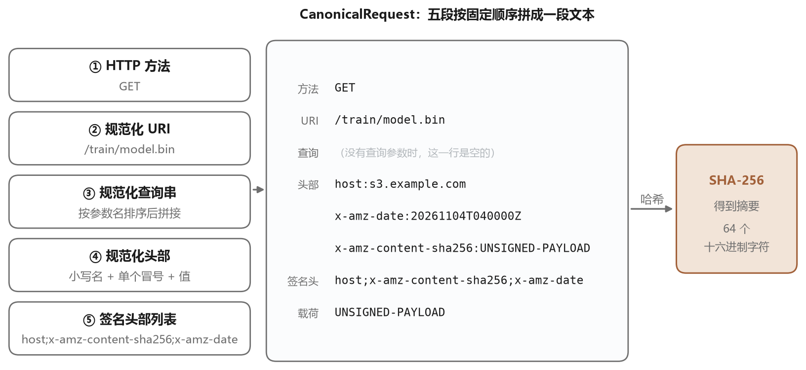
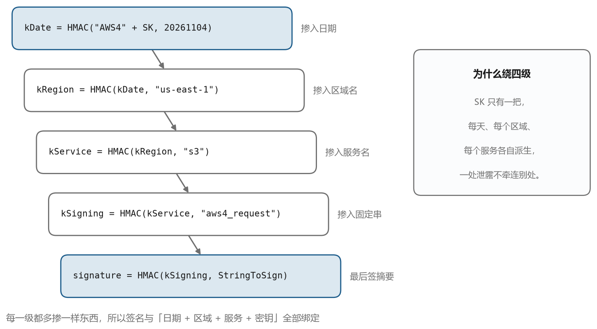
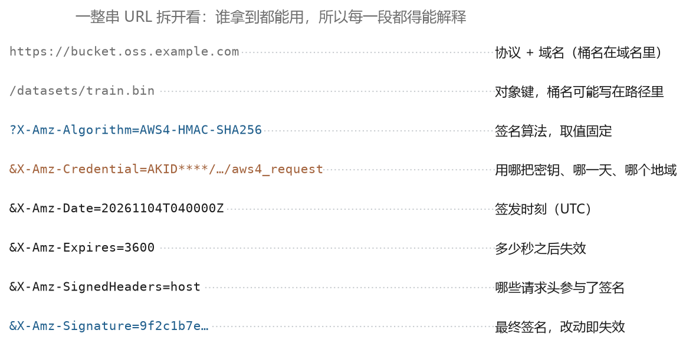
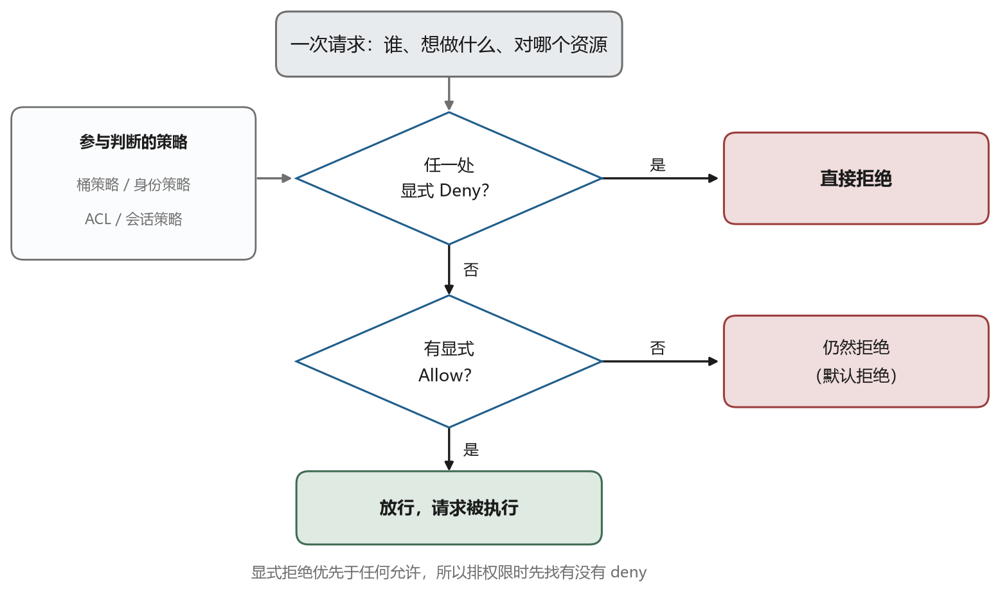

# 签名、密钥与 403

## 14.1 每个请求都要证明自己

对象存储的接口是 HTTP，服务器不记得你上次来过。每个请求都得自己带上身份证明，否则任何人都能读写你的数据。这种证明就是签名。

签名的思路和 SSH 的公钥认证有相似之处。客户端持有一把密钥，服务端也存一份，客户端用密钥对请求内容算出一个值，附在请求里，服务端用同样的方法算一遍，比对是否一致。差别在于 SSH 用的是非对称签名，对象存储用的是对称的 HMAC，因为双方共享同一把密钥，不需要公钥基础设施。

这套机制有两个直接后果。第一，密钥绝不能泄露，它不像私钥那样有配对的公钥可以公开，拿到它就等于拿到全部权限。第二，请求的内容参与了签名，改一个字节签名就对不上，所以中间人无法篡改。

## 14.2 访问密钥

对象存储的凭据叫访问密钥，由两部分组成，一个公开的 ID 和一个保密的 Key。AWS 叫 Access Key ID 和 Secret Access Key，腾讯云叫 SecretId 和 SecretKey。ID 用来标识身份，Key 用来算签名。ID 可以出现在日志里，Key 一次都不能。

```text
SecretId  = AKIDexampleExampleExampleExample
SecretKey = exampleSecretKeyDoNotUseThisInRealLife
```

凭据分几类。主账号的密钥权限最大，能操作账号下所有资源，绝不该写进代码或者放到客户端。子账号（主账号下另外建立的身份，权限可以单独限制）的密钥按策略授权，能限定到某个桶、某个前缀、某些操作。临时密钥由安全令牌服务（云上专门签发短期凭据的服务，常简称 STS）签发，带有效期，用完自动失效，适合分发给临时任务或者前端。

这里有一个常见的错误。有人把密钥写进前端页面的 JavaScript 里，以为别人看不到。前端代码是公开的，任何人打开开发者工具就能读出来。正确做法是后端签发一个临时密钥或者预签名 URL，让前端拿着有限权限的凭据去操作。

## 14.3 签名的计算过程

对象存储的签名算法在业界基本统一，AWS 的叫 Signature Version 4，简称 SigV4，其他厂商大多兼容或借鉴。它的计算分四步，核心思想是把请求的各个部分按固定格式拼成一个字符串，然后逐层做 HMAC。

第一步，构造规范化请求。把 HTTP 方法、路径、查询参数、头部按规则整理成固定格式，再拼上请求体的哈希。

```text
CanonicalRequest =
  HTTPRequestMethod + '\n' +
  CanonicalURI + '\n' +
  CanonicalQueryString + '\n' +
  CanonicalHeaders + '\n' +
  SignedHeaders + '\n' +
  HexEncode(Hash(Payload))
```

图 14-1 是这个拼接过程的示意。





每一步都有细节。URI 要做百分号编码，但斜杠不编码。查询参数要按参数名的字典序排列，同名的按值排序。头部的名字要转小写，值要去掉首尾空格、把连续空格压成一个，然后按名字排序。这些规则看起来繁琐，目的是让不同语言、不同库算出的结果一致。签名对不上，十次里有八次是某一步的规范化没做对。

第二步，构造待签字符串。把算法名、时间戳、凭据范围、上一步的哈希拼起来。

```text
StringToSign =
  "AWS4-HMAC-SHA256" + '\n' +
  "20261104T040000Z" + '\n' +
  "20261104/ap-guangzhou/s3/aws4_request" + '\n' +
  HexEncode(Hash(CanonicalRequest))
```

第三步，派生签名密钥。这一步是四层 HMAC，每一层用上一层的输出作为密钥。





```text
kDate    = HMAC("AWS4" + SecretKey, "20261104")
kRegion  = HMAC(kDate,    "ap-guangzhou")
kService = HMAC(kRegion,  "s3")
kSigning = HMAC(kService, "aws4_request")
```

为什么要派生而不是直接用 SecretKey，原因有两个。一是把密钥和日期、地域、服务绑定，同一个 SecretKey 在不同场景下算出的签名密钥不同，一处泄露不影响其他场景。二是让签名密钥每天变化，减少长期密钥被分析的风险。

第四步，算出签名并放进请求头。

```text
Signature = HexEncode(HMAC(kSigning, StringToSign))

Authorization: AWS4-HMAC-SHA256
  Credential=AKID.../20261104/ap-guangzhou/s3/aws4_request,
  SignedHeaders=host;x-amz-content-sha256;x-amz-date,
  Signature=abcdef...
```

服务端收到请求后，用自己存的 SecretKey 重算一遍。算出来的值和你给的一致，就认为请求合法。整个过程中 SecretKey 从未出现在网络上，出现的只有它的运算结果。

这段推导看起来复杂，实际写代码时都用 SDK，不需要手工实现。但理解它有两个好处。一是看到 `SignatureDoesNotMatch` 时知道该检查什么，通常是路径编码、头部排序或者时间戳。二是能理解预签名 URL 的原理，它就是把签名结果放进查询参数。

## 14.4 预签名 URL

有时候你需要让别人临时访问一个对象，但不能把密钥给他，也不想让他走你的服务器中转。这种场景用预签名 URL。

```text
https://bucket-1250000000.cos.ap-guangzhou.myqcloud.com/report.pdf
  ?X-Amz-Algorithm=AWS4-HMAC-SHA256
  &X-Amz-Credential=AKID...%2F20261104%2Fap-guangzhou%2Fs3%2Faws4_request
  &X-Amz-Date=20261104T040000Z
  &X-Amz-Expires=3600
  &X-Amz-SignedHeaders=host
  &X-Amz-Signature=abcdef...
```

图 14-3 是这段 URL 的组成。





原理是把 Authorization 头里的内容挪到查询参数里，签名时把这些参数也算进去。任何拿到这个 URL 的人，在有效期内都能按指定的方法访问这个对象，过期就失效。签名的范围可以限定得很细，只允许 GET、只允许某个对象、只在一小时内有效。

预签名 URL 有几个坑。第一，它是一串明文，谁拿到谁就能用，所以要通过安全的渠道传递，不要贴在公开的群聊里。第二，有效期不能太长，几天甚至几个月的有效期等于长期后门。第三，URL 里的签名基于当时的头部和参数，如果中间有代理改写了头部（比如加了 `X-Forwarded-For`），签名可能对不上，这时要把那些头部从 `SignedHeaders` 里去掉。

## 14.5 临时密钥

比预签名 URL 更灵活的方式是临时密钥。用一个长期密钥去换一组短期的凭据，包含临时的 ID、Key 和一个会话令牌（Token）。请求时要把令牌放在 `x-amz-security-token` 头里，签名时也要把它算进去。

```bash
sts assume-role --role-arn ... --duration 3600   # pseudo command, syntax varies
```

临时密钥的好处是权限可控、自动过期、可以追溯。给一个训练任务发一组只在两小时内有效的密钥，任务结束后密钥自动失效，即使泄露了也没有长期风险。企业里的最佳实践是主密钥只在签发临时密钥的服务里使用，业务代码一律用临时密钥。

## 14.6 权限是怎么判的

对象存储的权限有三个层次。最外层是身份策略，绑定在子账号或者角色上，规定这个身份能做什么。中间是桶策略，挂在桶上，规定谁能对这个桶做什么，可以指定其他账号。最内层是 ACL（访问控制列表，一条条“谁可以做什么”的记录），挂在桶或者对象上，粒度最粗，通常只在需要公共读的时候用。





求值顺序如图 14-4。任何一个层次出现显式拒绝，请求就被拒绝，其他层次的允许都不作数。没有任何拒绝，但只要有一处显式允许，请求就通过。既没有拒绝也没有允许，默认拒绝。

这个顺序解释了一个常见困惑。你在身份策略里给了 `s3:*`，为什么还是 403。因为桶策略里有一条显式拒绝，或者桶的公共访问被组织级策略锁死了。排查时要把三个层次都看一遍，而不是只改自己手里那个。

另一个常见困惑是权限的粒度。对象存储的权限可以精确到前缀，比如只允许访问 `dataset/` 下面的对象，不允许访问 `ckpt/`。这在多人共享一个桶时很有用，每人一个前缀，互不干扰。配置时注意前缀要以斜杠结尾，否则 `dataset` 会匹配到 `dataset-backup`。

## 14.7 403 家族

表 14-1 是几个最常遇到的错误码和它们的成因。看到错误码先查这张表，能省很多时间。

表 14-1　对象存储常见错误码

| 错误码 | 含义 | 常见原因 |
| --- | --- | --- |
| `SignatureDoesNotMatch` | 签名不匹配 | 路径编码不对、头部没排序、地域写错、SecretKey 错 |
| `RequestTimeTooSkewed` | 请求时间偏差过大 | 本机时钟不准，与服务器相差超过 15 分钟 |
| `InvalidAccessKeyId` | 密钥 ID 不存在 | 密钥被删、复制时漏了字符、用了别的账号的密钥 |
| `AccessDenied` | 没有权限 | 策略没授权、被显式拒绝、桶策略限制来源 IP |
| `NoSuchBucket` | 桶不存在 | 桶名拼错、地域写错、桶已被删除 |
| `NoSuchKey` | 对象不存在 | 键名拼错、前缀不对、对象已过期被生命周期删除 |
| `InvalidRequest` | 请求格式错误 | 分片上传的片序号越界、Content-Length 与实际不符 |

地域写错是最隐蔽的一个。COS 的桶在某个地域，请求必须发到那个地域的域名，签名里的凭据范围也要写那个地域。如果你的 SDK 配置成了 `ap-shanghai`，桶却在 `ap-guangzhou`，请求会先被重定向，签名随之失效，报出来的错却是 `SignatureDoesNotMatch`。遇到这个错误先检查地域，再检查密钥。

时钟偏差是第二隐蔽的。虚拟机的时钟偶尔会漂移，尤其是长期挂起的实例恢复之后。签名里带了时间戳，服务端允许的正负偏差通常是 15 分钟，超出就拒绝。

```bash
date -u
sudo systemctl restart systemd-timesyncd
```

这两条命令能确认和修复时间问题。云端机器建议开启 NTP 同步，避免这类莫名其妙的失败。

## 14.8 几条实践建议

把这一章的内容收拢成几条可执行的建议。

密钥分级。主密钥只放在签发临时凭据的服务里，业务用子账号密钥，临时任务用临时密钥。任何密钥都不要写进代码仓库，用环境变量或者密钥管理服务注入。

权限最小化。给一个任务只授它需要的桶和前缀，只给 GET 就不给 PUT。上线前用一组只读密钥跑一遍，确认没有多余的写操作。

打开访问日志。桶的访问日志能记录每个请求的来源、操作、结果，出问题时是唯一的证据。日志本身也存到一个单独的桶里，设置较长的保留期。

关闭公共读。除非确实要做公开的资源分发（比如网站静态文件），否则桶一律私有。公共读的桶会被爬虫和扫描器盯上，数据泄露往往就是这么发生的。

定期轮换。长期密钥每季度换一次，换的时候先在代码里加新密钥，确认生效后再停用旧的。临时密钥的有效期尽量短，够用就行。
