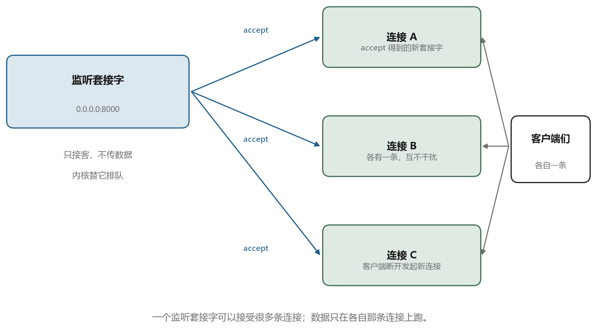
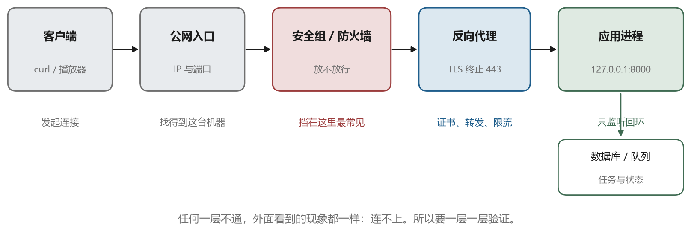

# 端口、监听与 HTTP：程序怎么变成服务

## 16.1 从“我写的程序”到“别人能用的服务”

前面十五章讲的都是你主动去连别人：连服务器、开隧道、取对象。这一篇反过来，你写一个程序放在服务器上，让别人来连它。别人的播放器、浏览器、手机 App，都算“别人”。

要让这件事成立，只需要两个条件，缺一不可：

第一，服务器上得有一个程序守在某个端口上，等连接进来。这个动作叫监听。

第二，网络上的路要通，连接能从外面走到这个端口。云平台的安全组、机器里的防火墙、路由与地址，任何一处不放行，连接就到不了。

这两条看起来简单，却是新手最容易卡住的地方：程序明明跑起来了，在自己机器上 `curl 127.0.0.1:8000` 也通，换个机器就连不上。原因通常不在代码，而在监听地址或者网络规则。这一章把这两条拆开讲。

## 16.2 监听：一个端口怎么“守着”

假设你写了一个小服务：上传一张照片，返回一张风格化图片。程序主体是一个函数，接收请求、处理、返回结果。但要让它能被访问，还得有人把网络上的连接接进来。这件事由“套接字”完成，分三步。

第一步，创建套接字。它就是一个句柄，程序通过它读写网络，和文件描述符是一类东西。

第二步，绑定地址和端口。这一步要选一个地址，选择不同，结果完全不同：

- `127.0.0.1:8000`：只接受本机发起的连接。你在服务器上 `curl` 得通，外面一律连不上
- `0.0.0.0:8000`：接受所有网卡上的连接。写成 `0.0.0.0` 表示“不挑网卡”，外网才有机会进来

第三步，listen。套接字进入等待状态，内核替它维护一个等待队列，连接进来先排队。

之后是 accept：程序每取一次，就得到一个**新的套接字**，专门负责那条连接；原来的监听套接字继续留在原地等人。图 16-1 画的是这两个东西的区别。



这个区别值得记牢。监听套接字本身不传数据，它只负责“接客”；真正收发字节的是 accept 出来的那条连接。所以一个进程能同时服务几百个客户端，每个客户端各有一条连接，互不干扰。也正因为如此，`ss -lntp` 里看到的是监听套接字，而 `ss -tnp` 里看到的是已经建立的连接。

常见的两个报错都和这一步有关。`Address already in use` 表示端口被别的进程占了，用 `ss -lntp | grep 8000` 找出是谁，或者换一个端口。`Permission denied` 出现在端口号小于 1024 的时候，比如 80 和 443，这些端口只有特权进程能监听，普通用户要用就得走反向代理（16.4 会讲）。

## 16.3 一次 HTTP 请求长什么样

连接建立之后，双方在上面说的“话”就是 HTTP。它是一段纯文本，格式简单到可以直接用 `nc` 手打出来：

```text
POST /jobs HTTP/1.1
Host: api.example.com
Authorization: Bearer eyJhbGciOi...
Content-Type: application/json

{"prompt": "a lighthouse at dusk", "steps": 30}
```

四部分：第一行是方法、路径、版本；接着是若干请求头；一个空行；然后是请求体。方法表达意图，`GET` 读取、`POST` 提交、`PUT` 覆盖、`PATCH` 局部修改、`DELETE` 删除。路径表达“对哪个东西做什么”，`/jobs` 是任务集合，`/jobs/42` 是 42 号任务。请求头里放元信息，比如身份凭证、内容类型、长度。请求体放真正的数据，上传文件时就是文件本身。

响应也是同样的结构，只是第一行换成了状态码：

```text
HTTP/1.1 202 Accepted
Content-Type: application/json

{"id": 42, "status": "queued"}
```

状态码分五段，记住分段就够用了：`2xx` 成功，`3xx` 让你去别处，`4xx` 是你的请求有问题，`5xx` 是服务器自己出了问题。表 16-1 是这本书里会反复出现的几个。

表 16-1　常用的 HTTP 状态码

| 状态码 | 含义 | 什么时候出现 |
| --- | --- | --- |
| `200` | 成功 | 读取任务、下载结果 |
| `201` | 已创建 | 提交任务并立刻有了资源 |
| `202` | 已接受，正在处理 | 提交长任务，先给任务号 |
| `204` | 成功但没有内容 | 删除成功 |
| `301` | 永久重定向 | 域名换了、强制跳 HTTPS |
| `400` | 请求格式不对 | JSON 解析失败、参数缺失 |
| `401` | 没认证 | 没带凭证，或凭证过期 |
| `403` | 认证过了，但没权限 | 会员等级不够、资源不属于你 |
| `404` | 资源不存在 | 任务号写错 |
| `409` | 冲突 | 重复提交、状态不允许 |
| `413` | 请求体太大 | 上传超过上限 |
| `429` | 请求太频繁 | 触发限流、队列已满 |
| `500` | 服务器内部错误 | 代码抛了异常 |
| `502` | 上游返回了坏响应 | 反向代理等不到应用 |
| `504` | 上游超时 | 应用太久没响应 |

`401` 和 `403` 常被混用。区别是：`401` 是“我不知道你是谁”，`403` 是“我知道你是谁，但你不能做这件事”。客户端看到这两个码，处理方式也不同：前者去登录，后者去升级会员或者联系管理员。

还有两个性质要提一句。HTTP 是**无状态**的，每个请求彼此独立，服务器不会自动记得上一个请求是谁发的——所以每个请求都得自己带凭证，这就是第 18 章要解决的“登录之后怎么记住你”。另一个是**幂等**：`GET` 不该改变服务器状态，重复发一百次结果一样；`POST` 不保证，重复提交可能建出十个任务，这件事在第 17 章用“幂等键”处理。

## 16.4 前面为什么还要放一个反向代理

最省事的做法是让应用直接监听 80 和 443。但生产环境几乎都会在应用前面再放一层，叫反向代理，常见的是 Nginx、Caddy、Traefik。

原因是这一层能替应用干几件它不擅长的活：

- **终止 TLS**。证书只装在一处，应用内部用明文 HTTP 说话，省去在每个服务里配证书
- **按域名和路径分发**。`api.example.com` 转给端口 8000，`www.example.com` 转给静态文件
- **托管静态文件**。图片、前端打包产物由 Nginx 直接给，不占应用的进程
- **限流（限制单位时间内的请求数）与防护**。按 IP 限速、挡住明显的扫描、限制请求体大小
- **补上真实来源**。转发时加上 `X-Forwarded-For` 和 `X-Forwarded-Proto`，应用才知道访问者的真实 IP、原始协议是 HTTP 还是 HTTPS

请求的路径因此变成了：客户端 → 反向代理（443）→ 应用（127.0.0.1:8000）。图 16-2 是这条路径，注意应用只监听回环地址，外网根本碰不到它，所有入口都收在代理这一层。



配置出来大概是这样，读懂大意即可：

```text
server {
    listen 443 ssl;
    server_name api.example.com;

    ssl_certificate     /etc/letsencrypt/live/api.example.com/fullchain.pem;
    ssl_certificate_key /etc/letsencrypt/live/api.example.com/privkey.pem;

    client_max_body_size 200m;

    location / {
        proxy_pass http://127.0.0.1:8000;
        proxy_set_header Host $host;
        proxy_set_header X-Forwarded-For $proxy_add_x_forwarded_for;
        proxy_set_header X-Forwarded-Proto $scheme;
    }
}
```

`client_max_body_size` 这一行值得单独说：Nginx 默认只允许 1 MB 的请求体，上传稍大的文件就会得到 `413`。这个默认值坑过很多人，而报错信息来自代理，应用日志里什么都没有。

## 16.5 端口开了，为什么还是连不上

这是最常见的一类问题，排查要按层来，从上到下逐段验证，不要跳步。

第一步，程序在不在听。`ss -lntp | grep 8000`，看有没有进程、监听在哪个地址。如果只有 `127.0.0.1:8000`，外面永远连不上，改成 `0.0.0.0`。

第二步，本机通不通。`curl -v http://127.0.0.1:8000/health`。这一步验证的是应用本身。

第三步，机器内的防火墙放不放行。Ubuntu 上常见的是 `ufw`，Red Hat 系是 `firewalld`，底层都是 `iptables` 或 `nftables`。`ufw status` 看一眼规则。

第四步，云平台的安全组。它是云厂商在机器外面再加的一层防火墙，和机器里的防火墙是两套，只改一处不生效。安全组里要放行 TCP 8000（或者 443），来源可以先限制成自己的 IP。

第五步，公网地址对不对。云主机的公网 IP 有时是映射出来的，机器上 `ip addr` 看不到它，这不代表没有公网入口，要以控制台显示为准。

这五步走完，通常能定位到具体是哪一层。很多人卡住，是因为只检查了其中一层就下结论。

## 16.6 让服务活下来

在终端里直接跑 `python app.py`，或者用 `nohup` 挂在后台，都只适合临时验证。它会遇到三个问题：SSH 断开可能被带走、机器重启不会自己起来、进程崩了没人拉起。

生产环境用 systemd 托管，写一个单元文件：

```text
[Unit]
Description=Image style API
After=network.target

[Service]
User=app
WorkingDirectory=/srv/image-api
EnvironmentFile=/srv/image-api/.env
ExecStart=/srv/image-api/.venv/bin/uvicorn app:api --host 127.0.0.1 --port 8000
Restart=always
RestartSec=3

[Install]
WantedBy=multi-user.target
```

几个字段的意思：`User` 指定用哪个账号跑，别用 root；`EnvironmentFile` 把密钥和配置放在一个文件里，不写进代码；`ExecStart` 是启动命令；`Restart=always` 让它崩了自动拉起；`WantedBy` 决定开机自启。

日常操作用 `systemctl start image-api`、`status`、`restart`，看日志用 `journalctl -u image-api -f`。日志要分两类：应用日志记业务（谁提交了什么、失败了为什么），访问日志记请求（方法、路径、状态码、耗时）。两者混在一起，出问题时很难查。

再补一个 `/health` 接口，返回一句 `{"status": "ok"}` 就行。它的用处是让监控、负载均衡、你自己都能一句话判断“服务活着没有”，而不必去看业务接口。

## 16.7 接到域名上，并换成 HTTPS

用 IP 加端口访问能跑通，但不适合给别人用：IP 会变、端口难记、浏览器会提示不安全、很多平台要求 HTTPS。

接域名的动作在 DNS 上：给 `api.example.com` 加一条 A 记录，指向服务器 IP。等解析生效（第三章讲过 TTL），域名就通了。

HTTPS 的证书现在基本不用买。Let's Encrypt 免费签发，Caddy 可以自动申请和续期，Nginx 配 `certbot` 也只要一条命令。证书装好之后，反向代理监听 443，80 端口做成跳转。

为什么这一步不能省：这一篇后面要传的东西——会员密码、登录凭证、上传的原图、生成的结果——全在链路上走。HTTP 是明文，中间任何一跳都能看（第五章讲过）。把 `http` 改成 `https` 也不会自动变安全，服务器得真的配好证书，客户端还得校验证书链。

配完用两个办法验证：浏览器地址栏有没有锁，`curl -I https://api.example.com/health` 返回的证书信息对不对。

到这里，服务能被人访问了。但真正的业务不止“一问一答”：用户要上传几十 MB 的素材，转换要跑几分钟，结果要能下载。这些都不是一个请求能装下的，下一章讲怎么把它们拆开。
