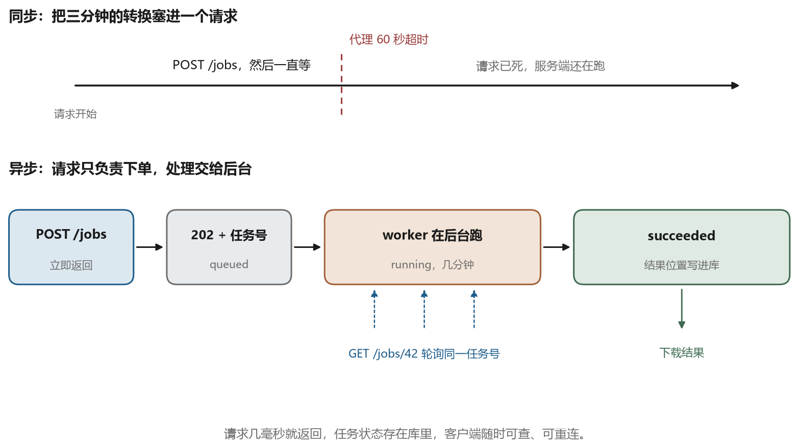
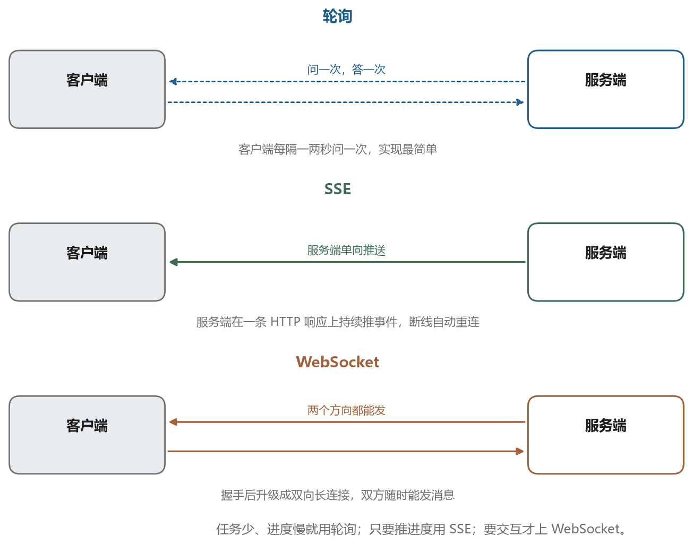

# 上传、下载与长任务

## 17.1 一次上传，字节去了哪里

用户选了一张 20 MB 的照片，点上传。接下来发生的事，可以拆成四段。

第一段，客户端把文件切成字节流，写进 HTTP 请求体。请求头里有 `Content-Type: image/jpeg`、`Content-Length: 20971520`，告诉服务器“这是什么、有多长”。

第二段，字节经过网络到达服务器，由反向代理或应用框架接收。默认情况下，很多框架会先把整个请求体收进内存再交给业务代码。20 MB 还行，2 GB 就会把内存吃满——`413`、`502`，或者进程被系统杀掉，都是这么来的。

第三段，应用把它写成临时文件，校验类型和大小，再决定下一步。这一步要防两件事：文件其实不是图片（改个扩展名就能骗过初检），以及同名覆盖。

第四段，处理完之后，临时文件要么被搬进存储目录，要么被传进对象存储，要么进队列等待转换。

“上传”在服务端看，就是**把请求体落到自己的磁盘上**。服务器读不到你电脑上的 `G:\素材`，它只有你传过去的那一份，这一点第四章讲路径时提过。所以同一个文件名，在你机器上和服务器上是两份互不相干的副本。

## 17.2 大文件：分片、断点、校验

一个 2 GB 的文件用一条请求传完，问题有三个：中途断了要从头再来；服务器的内存和超时都吃紧；进度只能靠客户端自己猜。

解决办法是把文件切成固定大小的片，比如每片 5 MB，逐片上传。这就是分片上传，第十三章讲对象存储时提过它的服务端形态，这里说协议这一侧。

流程是三步：

1. 客户端先请求“我要传一个 2 GB 的文件”，服务端返回一个上传编号，以及每片的上传地址
2. 客户端并发上传各片，每片单独请求，失败只重传这一片
3. 全部传完，客户端请求“合并”，服务端按顺序拼起来，返回最终文件的校验值

好处很直接。某一片失败，重传那一片就行；并发上传能跑满带宽；每一片都能显示进度；服务重启后，客户端凭上传编号继续，不必从头。

还要一个校验。客户端算文件的哈希（第五章的 SHA-256），传完之后让服务端核对；不一致说明中间出了问题，删掉重来。只比大小是不够的，大小对但内容坏的情况并不罕见。

## 17.3 下载：流式与 Range

下载看起来比上传简单，其实有两个坑。

第一个坑是“一次性读进内存”。把 2 GB 的文件读成字节数组再返回，服务直接崩。正确做法是**流式响应**：读一块、发一块，发完就丢，内存里始终只有几 MB。

第二个坑是断点续传。用户下到 80% 断了，再点下载要从头开始，体验很差。HTTP 用 `Range` 头解决这件事：

```text
GET /jobs/42/result HTTP/1.1
Range: bytes=1048576-
```

意思是“从第 1 MB 开始给我剩下的部分”。服务端返回 `206 Partial Content`，并在 `Content-Range` 里写明这次给的是哪一段。客户端把几段拼起来，就是完整文件。多线程下载器就是同时发好几个 Range 请求，各下一段。

服务端要支持这件事，得能随机读取文件、能算出总长度、能在响应头里给出 `Accept-Ranges: bytes`。自己写流式接口时，这两件事经常被漏掉。

## 17.4 长任务不能塞进一个请求里

假设转换要跑三分钟。最直觉的做法是：客户端发一个请求，服务端跑完再返回结果。

这条路在实验环境能走通，生产环境会撞上三堵墙。

第一堵是超时。浏览器、反向代理、负载均衡、客户端库，每一层都有自己的超时，通常 30 秒到 60 秒。跑三分钟的请求，会在这条链的某一环被掐断，而服务端还在傻跑。

第二堵是连接占用。一个请求占一条连接，几十个用户同时转换，连接池就满了，其他接口（比如查历史）全部排不上队。

第三堵是失败不可恢复。请求断了，任务状态就丢了；用户刷新一下页面，之前跑的进度无从查起。

所以长任务要改成**异步**：请求只负责“下单”，处理交给后台。图 17-1 是两种做法的对比。



异步的骨架是这样：

1. 客户端 `POST /jobs`，带上素材和参数
2. 服务端把任务写进数据库，状态 `queued`，立刻返回 `202` 和一个任务编号
3. 后台的 worker 从队列里取任务，状态改成 `running`，开始跑
4. 客户端拿着编号反复查 `GET /jobs/42`，或者等服务端推送（17.5）
5. 跑完，状态 `succeeded`，结果的位置写进数据库
6. 客户端请求下载

这里多出一个角色：worker。它和 Web 服务是两个进程，共享同一个数据库或者消息队列。好处是各干各的：Web 服务只负责接单，worker 只负责干活；GPU 任务把 worker 卡住，也不会让接口失去响应。

队列的存法有两种。简单一点，直接把任务表当队列，worker 轮询（隔几秒问一次）取“最老的 queued 任务”，用一条带条件的 `UPDATE` 保证同一个任务不会被两个 worker 同时拿走。复杂一点用 Redis、RabbitMQ 这类专门的消息队列。小规模用前者足够，第十三章讲的“状态放数据库”在这里同样成立。

状态机要写清楚，不要只有“成功/失败”两个值：

```text
queued -> running -> succeeded
                  -> failed
queued/running -> cancelled
```

每个状态允许哪些转换、谁能取消、失败能不能重试，都定下来，接口才好写，前端才好显示。

## 17.5 进度怎么回传

任务在后台跑，客户端要知道跑到哪了。三种常见做法，各有取舍。

**轮询**：客户端每隔一两秒 `GET /jobs/42`。实现最简单，任何 HTTP 客户端都能做，服务端也不需要保持连接。缺点是延迟取决于间隔，请求多了也是负担，而且大量任务同时查，数据库压力不小。

**SSE**（Server-Sent Events）：服务端在一条 HTTP 响应上持续推送文本事件，客户端用 `EventSource` 接收。它比轮询实时，实现也不复杂，断线能自动重连。缺点是单向的，客户端不能在这条通道上发指令；有些代理会缓冲响应，需要额外配置关掉缓冲。

**WebSocket**：一次握手之后升级成双向长连接，双方随时可以发消息。适合需要实时双向交互的场景，比如协同编辑、在线游戏。代价是要自己处理心跳、重连、消息格式、连接数，服务端和客户端的实现都更重。

表 17-1 是三者对照。

表 17-1　进度回传的三种方式

| 方式 | 方向 | 实时性 | 实现成本 | 适合 |
| --- | --- | --- | --- | --- |
| 轮询 | 客户端问，服务端答 | 取决于间隔 | 最低 | 任务少、进度变化慢 |
| SSE | 服务端单向推 | 实时 | 中 | 单任务进度、日志流 |
| WebSocket | 双向 | 实时 | 高 | 需要客户端随时发指令 |

不管用哪种，进度本身要有个统一的定义。一个百分比不够，用户还需要知道“现在在哪个阶段”：排队中、加载模型、生成、后处理、封装。接口里就给两个字段，`stage` 和 `progress`，再加一个 `queue_position` 表示前面还有几个任务。图 17-2 是这三种通道的示意。



进度还有个诚实性问题。模型跑一步多久并不固定，百分比只能反映“已经完成的步数占比”，不能直接换算成剩余秒数。把百分比当倒计时显示，用户会觉得一直在骗他。

## 17.6 幂等、重试与清理

网络不稳的时候，客户端会重试。重试带来一个新问题：同一次提交被发了两次，服务端建了两个任务，用户被扣了两次额度。

解决办法是幂等键。客户端为每次“逻辑上的提交”生成一个唯一字符串，放在请求头里：

```text
POST /jobs HTTP/1.1
Idempotency-Key: 3f9c2a6e-20261106-0001
```

服务端把键和任务号一起存下来。同样的键再来一次，直接返回原来的任务号，不新建。这样客户端可以放心重试。

失败也要分清楚。有些错误重试有用，比如数据库连接闪断、下游服务临时不可用；有些重试没用，比如参数不合法、素材损坏。所以任务记录里要存“错误码”和“是否可重试”，重试次数要有上限，退避要越来越长（1 秒、2 秒、4 秒……），别把下游打垮。

最后是清理。上传的临时文件、失败任务的中间产物、过期的结果文件，都得有删除策略。磁盘满的时候，新任务会全部失败，而且报错往往指向一个和“磁盘”无关的地方。定期清理、给目录设配额（用量上限）、把老结果转进对象存储，都是常规做法。

## 17.7 结果怎么交回去

任务跑完，结果通常是一个文件。交给客户端有几种方式。

最简单是应用直接把文件流回去，`GET /jobs/42/result`。适合小文件，缺点是所有流量都过应用，大文件会把带宽吃满。

第二种是给一个**签名 URL**：应用生成一个带签名、带有效期的地址，客户端直接去对象存储取。流量不经过应用，还能限时失效。第十三、十四章已经把对象存储和签名讲透了，这里只是把它接进任务流程。

第三种是 WebSocket 或 SSE 推一个“完成”事件，客户端再自己去下载。适合需要即时通知的场景。

不管哪种，响应里都建议带上三样东西：文件大小、校验值、过期时间。客户端据此显示进度、校验完整性、决定什么时候重新申请地址。

服务能访问、任务能跑、进度能看、结果能取，这条线就通了。但还有一个问题没解决：谁有资格上传、谁有资格下载、会员和非会员的差别在哪。下一章讲身份、权限和会员体系。
