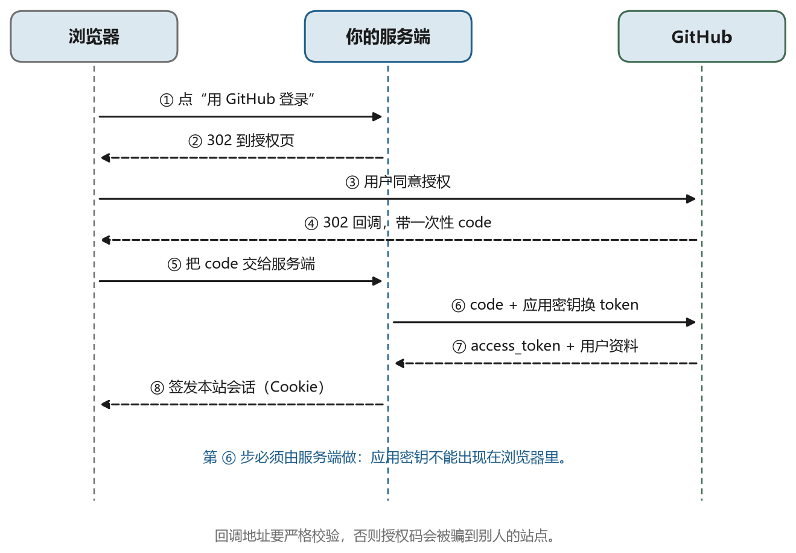
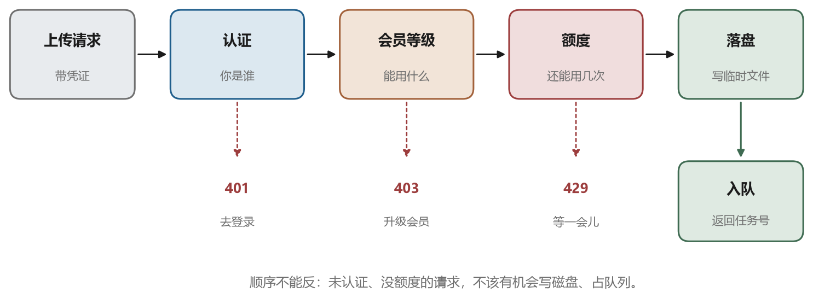

# 会员、登录与权限

## 18.1 会员到底是一组什么东西

产品说“要会员才能用”，技术上要落到四件事上，缺一件就做不完整：

- **身份**：怎么知道这次请求是谁发的
- **认证**：怎么确认他确实是这个人，而不是拿着别人的凭证
- **授权**：这个人能做什么，能碰哪些资源
- **额度**：他能用多少，超了怎么办

很多项目只做了前两件，做到“能登录”就以为完成了。结果是一个普通会员可以下载别人的结果，或者一个免费用户能无限次提交转换。这类问题不是黑客攻击，而是权限没写。

从“共享令牌”升级到“每人一个身份”，是一次结构性变化：以前全系统只有一个密码，现在每个请求都要带上“我是谁”的证据，服务端每次都要判断“他能不能做这件事”。这一章按顺序把这条链拆开。

## 18.2 注册与登录：密码怎么存

注册时用户给一个邮箱和密码。服务器绝对不能存明文，也不能用 MD5、SHA-1 这类“快”哈希。

原因很直接：数据库一旦泄露，明文就是全部账号；快哈希可以被离线暴力破解，一张显卡一秒钟能试几十亿次。正确的做法是**慢哈希加盐**：

- **盐**：每个用户一个随机串，和密码拼在一起再哈希。这样两个人的密码相同，哈希也不同，攻击者不能一次撞一片
- **慢**：算法故意设计得慢，比如 bcrypt、scrypt、Argon2，单次计算几十到几百毫秒。正常登录感觉不到，暴力破解的成本却成倍上升

存进数据库的是算法名、参数、盐和结果，登录时按同样的参数再算一遍比对。升级算法时还能顺势迁移：用户下次登录成功时，用新算法重算一遍存回去。

密码之外还要有防护：登录失败计数、验证码、异常地点提醒。这些是工程细节，不影响原理，但直接决定账号会不会被撞库。

## 18.3 登录之后怎么记住你

HTTP 是无状态的，登录成功之后，下一个请求服务器怎么知道还是你？

两条路，本质都是“给客户端一个凭证，之后每次带上”。

**Session 加 Cookie**：服务端生成一个随机的会话编号，把“编号 → 用户”存在服务端（内存、Redis、数据库都行），通过 `Set-Cookie` 发给浏览器。之后浏览器每次自动带上这个 Cookie。用户看不到内容，服务端一查就知道是谁。

**Token**：服务端签发一段自带信息的凭证，最常用的是 JWT（JSON Web Token）。它分三段：头部、载荷、签名，载荷里写着用户编号、角色、过期时间。服务端不存会话，每次验签就行。

表 18-1 是两者的取舍。

表 18-1　Session 与 JWT 的取舍

| | Session + Cookie | JWT |
| --- | --- | --- |
| 状态存在哪 | 服务端 | 客户端（凭签名防篡改） |
| 撤销 | 删掉服务端的记录，立刻生效 | 到期前一直有效，要额外维护黑名单 |
| 横向扩展 | 多台机器要共享存储 | 天然无状态 |
| 适合 | 网页、需要立刻踢人 | 客户端 App、服务间调用 |

安全上有几条硬要求：Cookie 要加 `HttpOnly`（脚本读不到）、`Secure`（只走 HTTPS）、`SameSite`（防跨站请求伪造）；JWT 一定要验签、验过期时间，且不能把敏感信息放进载荷——载荷只是编码，不是加密，谁都能解开看。

还有一个常见错误：把 token 存在浏览器的 `localStorage` 里，然后靠前端判断权限。前端的判断只是界面友好，真正的权限必须服务端再判一次。绕过前端太容易了。

## 18.4 第三方登录

“用 GitHub 登录”“用微信登录”背后是 OAuth2（一个开放的授权框架）的授权码流程。它的目的不是把密码交给第三方，而是让第三方证明“这个人确实是他的用户”。

流程四步，图 18-1 是这条链：

1. 用户点“用 GitHub 登录”，浏览器跳到 GitHub 的授权页，带上你的应用编号和回调地址
2. 用户同意后，GitHub 把浏览器跳回你的回调地址，附带一个一次性的授权码
3. 你的服务端拿这个码，加上自己的密钥，去 GitHub 换一个访问令牌
4. 用令牌读用户资料（编号、昵称、邮箱），在你的库里建账号或找到已有账号，然后签发自己的会话

关键在第三步：换令牌这件事必须由服务端做，密钥不能出现在前端。回调地址要严格校验，否则别人可以把授权码骗到自己的站点。



## 18.5 谁能做什么：角色与资源归属

认证解决“你是谁”，授权解决“你能做什么”。最常用的模型是 RBAC（Role-Based Access Control，基于角色的访问控制）：用户挂角色，角色挂权限。

```text
user -> role -> permission
alice -> member   -> job:create, job:read:own, result:download:own
bob   -> admin    -> job:*, user:*, billing:*
```

光有角色不够，还要有**资源归属**。同一个“读取任务”的权限，普通会员只能读自己的，管理员能读所有。所以每条业务数据都要记一个 `owner_id`，查询时强制带上 `where owner_id = 当前用户`。这一条比角色配置更重要：没有归属检查，角色配得再细也会越权。

还有一层是**会员等级**。免费用户能上传但只能生成低分辨率，付费用户能用高清模型、能排队优先、能批量。这类差异落在两个地方：接口里判断等级决定参数，队列里按等级排优先级。

图 18-2 是一次上传请求走过的检查：先验身份，再查会员等级，再查额度，最后才落盘。顺序不能反，否则未认证的请求也会消耗磁盘和队列。



## 18.6 额度、限流与计费

会员体系一定连着额度，否则“付费”没有意义。常见三种限制：

- **次数**：每月 100 次转换
- **并发**：同时最多 2 个任务
- **资源**：单任务最长 10 分钟、最大 4 GB

限制要在服务端算，且要能解释。用户看到“额度不足”时，界面应该告诉他本月用了多少、上限多少、什么时候重置，而不是一个干巴巴的 `429`。

限流是另一件事：它防的不是付费意愿，而是滥用和故障。按 IP、按用户、按接口分别限速，返回 `429` 时带上 `Retry-After`，告诉客户端多久后再试。

计费则要落到流水上：谁、什么时候、因为什么、扣了多少。支付回调要验签、要幂等（同一个订单回调两次不能加两次会员），要有对账手段。这些属于业务系统，但都是“认证与授权”这条链的延伸。

## 18.7 会员数据放在哪、怎么管

用户、角色、订阅、流水，这些是关系型数据，放在数据库里，用几张表说清楚：

| 表 | 关键字段 | 作用 |
| --- | --- | --- |
| `users` | 编号、邮箱、密码哈希、状态 | 账号主体 |
| `roles` | 编号、名称 | 角色定义 |
| `user_roles` | 用户编号、角色编号 | 谁是什么角色 |
| `subscriptions` | 用户编号、等级、起止时间、状态 | 会员有效期 |
| `usage` | 用户编号、周期、已用次数/时长 | 额度统计 |
| `ledger` | 用户编号、金额、原因、时间 | 计费流水 |

管理有两个入口。一个是**后台管理界面**，运营用来查用户、改等级、补额度、封号；另一个是**命令行或脚本**，用于批量操作和应急。两者操作的是同一套接口和同一张表，不要为了图快直接改数据库——没有审计记录，出了问题查不出来。

还有一件容易忽略的事：**数据隔离**。每个用户的上传、中间产物、结果，目录或对象键里要带上用户编号，删除账号时能一起清掉，备份和迁移时也不会混在一起。

## 18.8 从共享令牌到每人一个身份

如果现在的服务还是“全系统一个令牌”，升级路径可以分三步走，不必推倒重来。

第一步，先把令牌换成“用户 + 令牌”的形式：仍然只有一个令牌，但每个请求都带一个用户编号，数据库里的任务补上 `owner_id`，查询时按归属过滤。这一步不改登录方式，却堵住了最大的越权漏洞。

第二步，加入登录接口，签发会话或 JWT，令牌退居为“服务间调用”或“临时下载”的凭证。老客户端在这段时间里还能用旧令牌，两者并存。

第三步，收紧权限：下载走签名 URL（限时、限对象、限用户），上传按等级限速限量，管理接口单独一套权限。到这一步，会员体系才真正闭环。

这三步每一步都能独立上线、独立回滚，比一次性重写安全得多。

五篇到这里结束。回过头看，这一篇讲的其实是一件很朴素的事：把前四篇的零件装成一个别人能用的产品——网络让它能被访问，认证让它知道来的是谁，任务系统让它能跑很久，权限让它只对合适的人开放。
