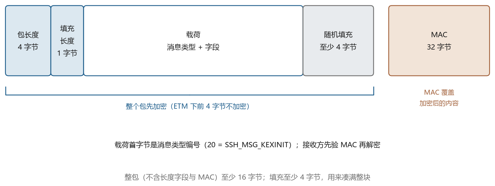

# 抓一个 SSH 连接：从版本串到 NEWKEYS

## 1.1 抓包能看到什么

在服务器上用 `tcpdump -n -i any port 22` 抓一段 SSH 握手，看到的是一串二进制。把它按 SSH 的线格式拆开，能看清每个阶段在传什么。

有三件事要先说清楚，否则容易误判：

- 版本交换那一行是明文，能直接读
- 之后的包体是加密的，看不到载荷
- 包的长度、方向、时间间隔看不到内容也瞒不住

所以抓包能回答“进行到哪一步、谁先发的、有没有重传”，回答不了“用户敲了什么”。

## 1.2 版本交换：整条连接里唯一的明文

TCP 建好之后，双方各发一行：

```text
SSH-2.0-OpenSSH_9.6\r\n
```

规则很宽：以 `SSH-` 开头，以回车换行结束，最长 255 字节，前面允许有若干行其他文本（有些设备会先打印欢迎语）。这一行之后，双方切到二进制协议，长度字段从这一刻起才有意义。

这一行的作用只有一个：确认双方说的是 SSH 2.0，并且顺便暴露了软件与版本。运维上有人会改 banner 来减少信息泄露，但那只是提高了一点门槛，挡不住真正的探测。

## 1.3 一个包的结构

加密通道里的每个包都长这样：

```text
+----------+----------+---------------------+----------+--------+
| 包长度 4B | 填充长 1B | 载荷（消息类型+字段） | 随机填充   | MAC    |
+----------+----------+---------------------+----------+--------+
```

图 1-1 是它的示意。



几个字段的作用：

- **包长度**：后面还有多少字节，不含长度字段自身和 MAC
- **填充长度**：随机填充有多少字节，至少 4 字节
- **载荷**：真正的消息，第一个字节是消息类型编号
- **填充**：让整包长度是加密分组大小的整数倍，同时增加随机性
- **MAC**：对整个包的完整性校验

协议要求整包（不含长度字段与 MAC）至少 16 字节、载荷最长 32768 字节、整包不超过 35000 字节。这些下限保证“即使消息很小，包也不会小到泄露信息”。

## 1.4 算法协商：两份清单，客户端优先

版本交换之后，双方各发一个 `SSH_MSG_KEXINIT`（编号 20）。消息里有一个 16 字节的随机 cookie，然后是十组名字列表：密钥交换、主机密钥、加密（两个方向各一份）、MAC（两个方向各一份）、压缩、语言。

协商规则是“客户端优先”：服务端拿到客户端的列表，从头开始找第一个自己也支持的算法。所以最终用什么，主要由客户端决定。

这套规则有一个副作用：客户端越老，能提供的算法越弱；服务端如果为了兼容而保留弱算法，连接就会用弱的。企业里通常会在服务端配置里写死允许的算法，把弱的全部关掉。

## 1.5 密钥交换与 NEWKEYS

以 `curve25519-sha256` 为例，四步就够：

1. 客户端发 `KEX_ECDH_INIT`（30），带自己的临时公钥 Q_C
2. 服务端回 `KEX_ECDH_REPLY`（31），带主机公钥 K_S、临时公钥 Q_S，以及用主机私钥对交换内容做的签名
3. 双方各自算出共享秘密 K，再由它派生出会话标识与各方向的密钥
4. 双方各发 `NEWKEYS`（21），从下一条消息起改用新密钥

这里有一个容易被忽略的细节：**签名覆盖的不只是临时公钥**，而是一段拼接起来的哈希，里面包含双方版本串、两份 KEXINIT 原文、主机公钥、双方的临时公钥、共享秘密。任何一项被改，签名就对不上。

`NEWKEYS` 之后，连接上再出现的包就全是密文了。抓包到这里，能看到的信息只剩长度和方向。

## 1.6 一个包的一生

发送侧：组包 → 加密 → 算 MAC → 发出去。
接收侧：收包 → 先验 MAC → 再解密 → 交给上层。

这个顺序叫“先认证后解密”。它的意义是：攻击者构造的畸形密文，在解密之前就被 MAC 挡掉了，解密器不会接触到它，旁路攻击的入口少了一个。

MAC 的值还和**序号**有关。双方各自维护两个方向的序号，每发一个包加一，序号不放进包里，由双方各自数。所以即使两个包内容完全一样，MAC 也不同；丢包或插包也会让序号错位，MAC 对不上，连接直接断开。

## 1.7 重密钥

连接用久了，或者传了一定量的数据，双方会重新协商一次密钥。过程与第一次相同，但不重新协商算法，直接复用结果。

新的密钥替换旧的，`session_id` 保持不变——它是第一次密钥交换的哈希，整条连接内不变，用来把后续的签名和这次会话绑定在一起。

对上层来说，这个过程完全透明，你的 shell 不会有任何感觉。

## 1.8 这一章记住什么

- 版本串是唯一的明文；之后包体加密，但长度与方向仍可见。
- 包 = 长度 + 填充长 + 载荷 + 填充 + MAC，最小 16 字节是有原因的。
- 协商是客户端优先，弱算法由客户端决定，所以服务端要写死允许列表。
- MAC 先于解密，序号不进包，靠双方各自计数。
