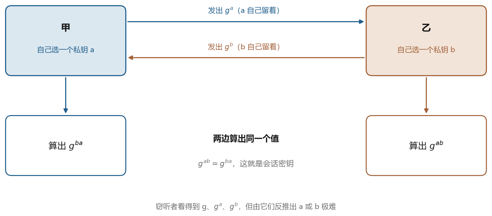

# 密钥交换的数学：DH、ECDH 与前向保密

## 2.1 一个混色的比喻

两个人要在一条被人监听的线上，商量出一个只有他俩知道的颜色。

各自选一个私密颜色，不告诉任何人；把私密颜色和公共的黄色混在一起，得到一罐混合色，公开发过去；收到对方的混合色之后，再掺进自己的私密颜色。

结果两个人得到同一种颜色，旁观者只有两罐混合色，没有私密颜色，配不出来。

这就是 Diffie-Hellman 的直觉。把“混色”换成一个数学上不可逆的运算，它就成了协议。

## 2.2 离散对数：为什么反推不出来

最经典的版本用模运算：

```text
公开参数：一个大素数 p，一个生成元 g
A 选私钥 a，发出 g^a mod p
B 选私钥 b，发出 g^b mod p
A 收到后算 (g^b)^a = g^(ab) mod p
B 收到后算 (g^a)^b = g^(ab) mod p
```

双方得到同一个值 `g^(ab)`，旁观者看得到 `g`、`g^a`、`g^b` 和 `p`，想反推出 `a`，要做的是离散对数问题。在参数选得足够大的时候，这个问题没有已知的可行解法。

安全性的关键全在参数上。`p` 太小、`g` 选得不好，或者用了被预计算过的群，都会让问题变简单。历史上被淘汰的 `diffie-hellman-group1-sha1` 用的就是 1024 位的老参数，今天不该再出现。

## 2.3 ECDH：换成椭圆曲线

椭圆曲线版本把“模幂”换成“点乘”：

```text
公开：一条曲线、一个基点 G
A 选私钥 a，发出 aG
B 选私钥 b，发出 bG
A 算 a(bG)，B 算 b(aG)，得到同一个点
```

同样的道理：从 `aG` 反推 `a`，是椭圆曲线离散对数问题。在同等安全强度下，椭圆曲线的密钥短得多——256 位的曲线大致相当于 3072 位的 RSA。

SSH 里最常见的 `curve25519-sha256` 用的是一条为性能和常数时间实现专门设计的曲线。它的特点是：参数固定、实现简单、不容易写出侧信道漏洞。

图 2-1 是一次 ECDH 交换的示意。



## 2.4 临时密钥与前向保密

注意一个词：**临时**。

每次连接，双方都新生成一对密钥，用完就丢。这意味着即使某一天服务器的长期主机私钥被偷了，攻击者也没法解密以前录下来的流量——因为那些会话用的临时私钥早就销毁了。

这个性质叫前向保密。它不是靠“加密得更强”实现的，而是靠“密钥用过就扔”。

反过来说，如果实现里复用了临时密钥（有的老实现会缓存），前向保密就打了折扣。判断方法看协商结果：`curve25519-sha256`、`ecdh-sha2-*` 这类都带临时密钥；不带 `e` 前缀的固定 DH 组，安全性要差一些。

## 2.5 从共享秘密到六个密钥

双方算出的那个共享秘密，不能直接拿来加密。要经过一次密钥派生：

```text
H = HASH(版本串 ‖ KEXINIT_C ‖ KEXINIT_S ‖ K_S ‖ Q_C ‖ Q_S ‖ K)
```

`H` 就是交换哈希。再由它和会话标识派生出六个值：两个方向的加密密钥、两个方向的 MAC 密钥、两个方向的初始向量。

为什么是六个而不是两个？因为每个方向独立：客户端到服务端一套，服务端到客户端另一套。这样即使一个方向的密钥泄露，另一个方向仍然安全。

会话标识也是一个哈希，取第一次交换的 `H`，整条连接不变。后面所有签名都把它带上，等于把“这次认证”和“这条连接”绑死，防止把一次握手的结果搬到另一次连接里重用。

## 2.6 常见错误

- 允许 1024 位的固定 DH 组（`group1`），安全性不足
- 允许不带 ETM 的 CBC 模式 MAC，边界攻击面更大
- 为了兼容老客户端，把弱算法留在服务端列表里
- 自己实现曲线运算，写出非常数时间的代码，泄露私钥的比特

前三条靠配置解决：`ssh -Q kex` 看客户端支持什么，服务端用 `KexAlgorithms`、`MACs`、`Ciphers` 写死允许列表。最后一条只有一个建议：不要自己实现密码学。

## 2.7 这一章记住什么

- DH 的安全性建立在离散对数难解上，参数选错就全盘皆输。
- ECDH 用点乘代替模幂，密钥更短，Curve25519 是当前的默认选择。
- 临时密钥带来前向保密：长期密钥泄露，也解不开旧流量。
- 共享秘密要经过派生，得到六个方向独立的密钥；会话标识把认证与连接绑定。
