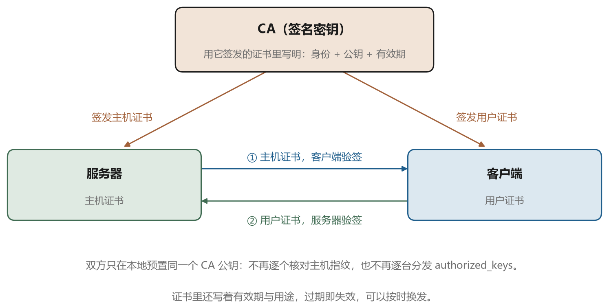

# 签名与证书链：从 Ed25519 到 CA 签发

## 3.1 签名要证明的三件事

一个签名成立，等于同时证明了三件事：

- 这份内容确实出自持有私钥的人
- 内容没有被改动
- 签名与“这一次”绑定，不能被搬到别处重用

第三件事常被忽略。如果签名只覆盖“我同意”，攻击者就能把你昨天的签名贴到今天的文件上。所以签名必须覆盖足够多的上下文——在 SSH 里，就是交换哈希 `H`；在对象存储里，是整个规范化请求。

## 3.2 Ed25519 签什么

Ed25519 的密钥很短：公钥 32 字节，私钥 32 字节，签名 64 字节。签名分两部分：一个点 R，一个标量 S，各 32 字节。

验证者做的事，用一句话说：用公钥、消息哈希、R、S 算一个等式，成立就通过。具体公式不必记，要记的是它的性质：

- 同一个密钥、同一条消息，签名是确定的（不像 ECDSA 每次要随机数）
- 不需要额外的随机源，减少了“随机数复用导致私钥泄露”这一类事故
- 验证速度稳定，适合每连接都要验一次的场景

在 SSH 里，被签的内容不是原始消息，而是交换哈希 `H`。这一点决定了签名不能脱离这次握手单独使用。

## 3.3 证书：把“公钥属于谁”写下来

指纹能防篡改，但不能回答“这把公钥应不应该被信任”。机器一多，`known_hosts` 就变成噩梦：每加一台机器、每换一次密钥，都要通知所有人。

证书解决的是“信任的可扩展性”。它的结构很简单，本质是一段被 CA 签过名的声明：

```text
主体：web01.example.com
公钥：ssh-ed25519 AAAA...
类型：主机证书
有效期：52 周
签名：由 CA 私钥对上面所有字段计算
```

客户端只需要预先信任 CA 的公钥（一行配置），就能验证任意一台服务器出示的证书：签名对不对、主机名对不对、有没有过期、是不是主机证书而不是用户证书。

图 3-1 是这条信任链。



用户证书是同一套机制的另一个用法：CA 给“alice”签一张用户证书，服务器只要信任这个 CA，所有持有效证书的用户都能登录，不必逐个往 `authorized_keys` 里加公钥。权限控制靠证书里的 principals 字段，而不是靠用户名。

## 3.4 两种信任模型的取舍

| | `known_hosts` | 证书 |
| --- | --- | --- |
| 信任的起点 | 每台机器的公钥，逐个记 | 一个 CA 公钥 |
| 扩容成本 | 线性增长 | 常数 |
| 换密钥 | 通知所有人清记录 | 重新签发即可 |
| 撤销 | 手动删行 | CA 维护吊销列表或短有效期 |
| 适合 | 个人、几台机器 | 几十台以上、需要轮换 |

小规模用 `known_hosts` 完全够，简单直接。规模上来之后，证书的收益非常明显：新增机器不用改任何客户端的配置。

## 3.5 常见的失败模式

- **主机名不匹配**：证书是给 `web01` 签的，你用 `10.0.0.5` 连过去，验证失败。证书绑定的是名字，不是地址
- **过期**：有效期过了，验证直接失败。短有效期加自动续签是常规做法
- **用错类型**：把用户证书当主机证书用，或者反过来
- **CA 私钥泄露**：这是最严重的一种，等于整个信任体系失效。所以 CA 私钥应该离线保存，签发用中间层
- **时钟不对**：客户端时间偏差太大，会把有效证书判成过期

排查时先看 `ssh -vv` 的输出，它会打印证书主体、签发者、有效期和失败原因。比猜快得多。

## 3.6 这一章记住什么

- 签名要证明“是谁、没被改、绑定这一次”，所以签名对象里必须有上下文。
- Ed25519 密钥短、签名确定、不依赖随机数，是当前 SSH 的默认选择。
- 证书把“公钥属于谁”写成一段被 CA 签名的声明，客户端只信任 CA。
- 规模小用 `known_hosts`，规模大用证书；失败先看 `ssh -vv`。
