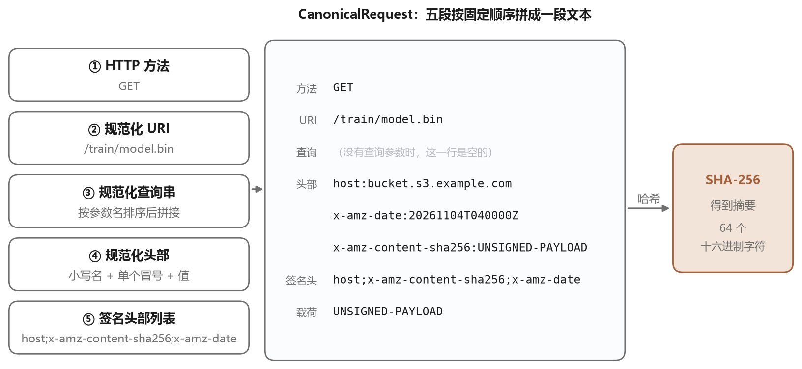
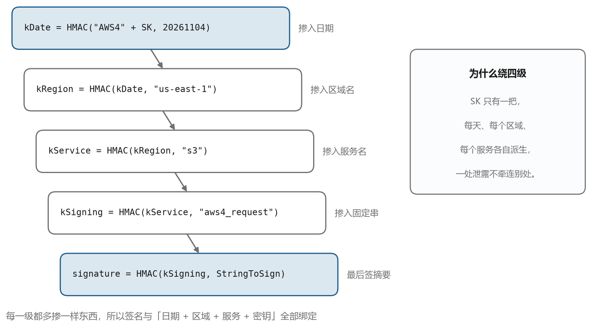

# SigV4：一次签名的完整推导

## 4.1 为什么需要“规范化”

对象存储的请求是 HTTP：方法、路径、查询串、头部、请求体，任何一项不同，语义就不同。

但 HTTP 允许同样的语义有多种写法：头部顺序随意、空格多少不限、查询参数的顺序可以调、路径可以用不同的百分号编码表示同一个字符。如果直接对这些逐字节签名，客户端和服务端算出来的结果一定对不上。

所以签名之前要先**规范化**：把请求整理成唯一一种写法，再对这段文本签名。规范化的目的不是好看，是让“不同实现算出同一个结果”。

## 4.2 五段拼成规范请求

```text
CanonicalRequest =
  HTTPRequestMethod            + '\n' +
  CanonicalURI                 + '\n' +
  CanonicalQueryString         + '\n' +
  CanonicalHeaders             + '\n' +
  SignedHeaders                + '\n' +
  HexEncode(Hash(Payload))
```

逐段说明：

- **方法**：大写，`GET`、`PUT`。
- **URI**：路径，逐段做百分号编码，但斜杠 `/` 不编码。`/a b/c` 变成 `/a%20b/c`。
- **查询串**：按参数名的字典序排序，同名的按值排序；键和值都要编码；空值写成 `key=`。
- **头部**：只取 `SignedHeaders` 里列出的那些，名字转小写，值去掉首尾空格、把连续空格压成一个，最后按名字排序。每一项写成 `name:value\n`。
- **签名头列表**：参与签名的头部名，小写、分号分隔、按字母序，比如 `host;x-amz-content-sha256;x-amz-date`。
- **载荷哈希**：请求体的 SHA-256 十六进制；流式上传时用固定的 `UNSIGNED-PAYLOAD`。

图 4-1 是这一段的拼接过程。



## 4.3 待签字符串

```text
StringToSign =
  "AWS4-HMAC-SHA256"           + '\n' +
  "20261104T040000Z"           + '\n' +
  "20261104/ap-guangzhou/s3/aws4_request" + '\n' +
  HexEncode(Hash(CanonicalRequest))
```

第二行是时间戳，第三行是“凭据范围”：日期、地域、服务、终止符。这三行把签名钉死在“某一天、某个地域、某个服务”上。

## 4.4 四层派生

签名的密钥不是 SecretKey 本身，而是从它派生出来的：

```text
kDate    = HMAC("AWS4" + SecretKey, "20261104")
kRegion  = HMAC(kDate,    "ap-guangzhou")
kService = HMAC(kRegion,  "s3")
kSigning = HMAC(kService, "aws4_request")

Signature = HexEncode(HMAC(kSigning, StringToSign))
```

图 4-2 是这四层。



为什么要派生出四层，而不是直接用 SecretKey？两个原因：一是把密钥和日期、地域、服务绑定，同一个 SecretKey 在不同场景下算出的签名密钥不同，一处泄露不影响别处；二是让签名密钥每天变化，减少长期密钥被分析的风险。

## 4.5 实现时最容易错的六处

1. **路径编码**：把 `/` 也编码了，或者该编码的空格没编码。规则是逐段编码、保留斜杠。
2. **查询串排序**：按未编码的键排序，而不是按编码后的字符串。
3. **头部空格**：`a   b` 要压成 `a b`，前后空格要去掉，名字必须小写。
4. **`host` 头**：必须参与签名，且要和实际请求的域名（含端口，如果不是默认端口）完全一致。
5. **时间戳与时钟**：服务端通常允许 15 分钟偏差，机器时间漂移会直接导致 `RequestTimeTooSkewed`。
6. **地域写错**：签名里写 `ap-guangzhou`，请求发到 `ap-shanghai`，服务端算出来的签名不同，报 `SignatureDoesNotMatch`，但错误信息不会告诉你地域错了。

排查顺序建议：先看错误码，`SignatureDoesNotMatch` 查规范化和编码，`RequestTimeTooSkewed` 查时钟，`AccessDenied` 查策略。

## 4.6 预签名 URL 的差别

预签名把签名从请求头挪到查询参数里，好处是不需要把密钥交给对方，链接本身带权限，到期失效。

差别有三点：

- 载荷哈希用 `UNSIGNED-PAYLOAD`，因为签名时还没看到请求体
- 多一个 `X-Amz-Expires`，单位是秒，服务端用它判断是否过期
- 签名的结果要再做一次 URL 编码，因为 `+`、`/`、`=` 在查询串里有特殊含义

一个签名 URL 的权限范围由三件事决定：允许的方法、限定的对象、有效期。给外部临时访问时，这三项都要收紧，不要图省事签一个“全桶、GET、七天有效”。

## 4.7 这一章记住什么

- 规范化的目的是让不同实现算出同一个结果，不是让请求好看。
- 签名 = 四层 HMAC 派生出密钥，再对“算法 + 时间 + 范围 + 请求哈希”做一次 HMAC。
- 绝大多数 `SignatureDoesNotMatch` 出在路径编码、查询排序、头部空格、地域这四处。
- 预签名 URL 的三个收紧点：方法、对象、有效期。
