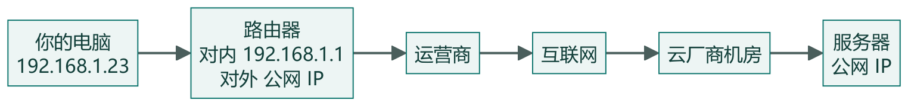

# 你家到服务器，中间隔了几道门

> 本机能打开，只证明程序活着，不证明别人进得来。

你在自己电脑上跑起一个小网站，终端里出现一行提示，服务运行在 `http://localhost:3000`。你打开浏览器，页面出来了。然后你把链接发给朋友。朋友回你一句，打不开。你刷新了三次，还是好的。你开始怀疑是他网络有问题。这个怀疑有道理，但这次不是。

## 1.1 localhost 指的是谁

`localhost` 这个词的意思是“这台机器自己”。它不是某台具体的电脑，它是一个所有电脑都有的自我称呼。

你的 `localhost` 是你的电脑。朋友的 `localhost` 是他的电脑。他打开那个链接，浏览器真的去连了，连的是他自己电脑上的三千号端口，那里什么都没有，于是打不开。

你可以做个实验。在自己电脑上再开一个终端，输入 `curl http://localhost:3000`，能拿到页面。换成你家的内网地址，比如 `curl http://192.168.1.23:3000`，如果程序绑的是 `0.0.0.0`（第 3 章会讲这个写法），也能拿到；绑 `127.0.0.1` 的话就只有本机能连。这两次请求都没有出过你家的大门。

## 1.2 你家有个小区

你家的手机、电脑、电视、扫地机器人，都连在同一个 Wi-Fi 上。这个 Wi-Fi 加上那台方方正正的路由器，构成了一个很小的网络，行话叫局域网。

局域网里的设备互相说话，用的是内网地址，长得像 `192.168.1.23`。这类地址有几个固定的开头，`192.168.` 最常见，`10.` 和 `172.16.` 到 `172.31.` 也常见。

内网地址的特点是可以重复。你家可以用 `192.168.1.23`，你邻居家也可以用，全世界几亿个家庭都在用。因为它在设计上就不打算被外面的人看见，它只是小区内部的门牌号。

同一个小区的设备可以直接找到彼此。你的手机能投屏到电视，就是因为它们在同一个网段里，喊一嗓子就能听见。

## 1.3 出门要经过门卫

数据要离开小区，必须经过路由器。路由器在你家这个网络里的那个地址，通常写成 `192.168.1.1`，这个角色叫网关。

网关像小区大门。所有往外送的东西都先交给它，由它决定走哪条路。数据从外面回来，也先在它这里落地。

路由器还有另一个身份。它连着运营商，运营商给了它一个能在全互联网上被找到的地址，这叫公网 IP。

想知道这个地址是多少，可以在浏览器里打开一个查 IP 的网站，或者在搜索引擎里搜“我的 IP”。这类工具本身没什么神奇，它就是别人写的一个小应用，做的事只有一件，把你访问它时用的来源地址原样显示出来。它看到的不是你电脑上的 `192.168.1.23`，那个地址在半路上就被门卫换掉了，它看到的是路由器出门时用的那个地址。

所以搜出来的那个数字是路由器对外的身份，不是你电脑的。换一台设备连同一个 Wi-Fi 再查一次，数字一样，原因就在这里。

现在关键的地方来了。你的电脑没有公网 IP，只有内网地址。数据出门的时候，路由器会做一件事，把你的包裹拆开，把寄件人从 `192.168.1.23` 改成自己的公网 IP，再封上送出去。回信到了，它再按自己记的账把收件人换回你。

这件事叫 NAT，网络地址转换。它当年是为了省地址想出来的办法，因为公网 IP 不够分。副作用是，你家所有设备在外面看起来都是同一个地址，像一栋楼共用一个收发室。

好处很明显，外面的人扫不到你家的电脑。坏处也很明显，外面的人想主动找你，找不到。门卫手上没有你的登记记录，不知道该把包裹送给谁。

你需要知道这个副作用，因为很多“我明明开了端口”的问题，根子就在这里。家里宽带默认只能出不能进，想让外面访问你家里的机器，得另外想办法，第十八章讲的那种地道就是干这个的。

顺便说一个会让很多人卡住的情况。如果查出来的地址以 `10.` 或者 `100.64.` 开头，说明运营商在你家外面又套了一层门卫，你拿到的不是独立的公网 IP。这种情况下，即使你在路由器上做了端口映射也没用，因为外面那层门卫不认你。

## 1.4 服务器为什么不在这条路上

服务器住在机房里。机房是一栋专门放机器的楼，里面有电、有空调、有网线、有保安，还有一条很粗的网线直通运营商。

云厂商把机房里的机器切成很多份租给你，每一份都直接给一个公网 IP。它不需要 NAT，因为它就站在主干道上，门牌号是公开的。

所以你的电脑和服务器，看起来只是两台电脑，实际上处在两种完全不同的位置。你在一栋居民楼里，它在临街的商铺。你在家里能访问它很容易，因为它门牌公开。它要反过来主动访问你，就得先解决门卫的问题。

这也解释了一件常被误会的事。你 `ping` 得通服务器，说明它那条路是通的。但反过来不成立。

有人想验证“外面能不能访问我”，就在自己电脑上 `ping` 自己的公网 IP。这件事很容易误会。你 `ping` 的那个地址其实长在路由器上，不在你的电脑上。所以这不是自己跟自己说话，而是你在问门卫。包连家门都没出，回话的也是门卫本人。

顺便把三个地址分清。`ping 127.0.0.1` 是自己问自己，包不出网卡。`ping 192.168.1.23` 还是自己问自己，只是走的是内网网卡。`ping 203.0.113.24` 才是在问路由器，因为那个地址配在它的外网口上。

路由器回不回这一声，看它怎么配。有的回，有的直接丢掉，很多家用路由器出厂就关了。所以 `ping` 通不能说明外面能进来，`ping` 不通也不能说明网坏了或者端口被封了。它测的是门卫愿不愿意答应，不是门开没开。

想确认外面能不能进来，只能从外面试。用手机流量访问一次，先把 Wi-Fi 关掉；或者找一台不在你家的机器跑 `nc`；或者用一个在线的端口检测网站。这三种做法都比 `ping` 自己的公网 IP 靠谱。

## 1.5 三个地址，三种含义

| 你看到的地址 | 它指的是 | 谁能访问 |
| --- | --- | --- |
| `127.0.0.1` 或 `localhost` | 这台机器自己 | 只有这台机器 |
| `192.168.1.23` 这类内网地址 | 同一局域网里的这台机器 | 同一个局域网里的设备 |
| `203.0.113.24` 这类公网地址 | 互联网上的这台机器 | 理论上全世界 |

判断“为什么别人打不开”的时候，第一件事不是看代码，是看这三行。你给别人的链接属于哪一行，决定了它该不该打得开。

如果 AI 给你的启动提示是 `http://localhost:8000`，那它只是告诉你“我起来了”，并没有承诺别人能进来。这两件事在网络里差得很远，中间隔着地址、门禁和一条很长的路。

> **这一章记住一句**
>
> 地址决定了谁找得到你，剩下的问题才有意义。

下一章讲地址后面的那半截，端口。一台服务器只有一个门牌号，却同时跑着十几个服务，靠的就是它。
