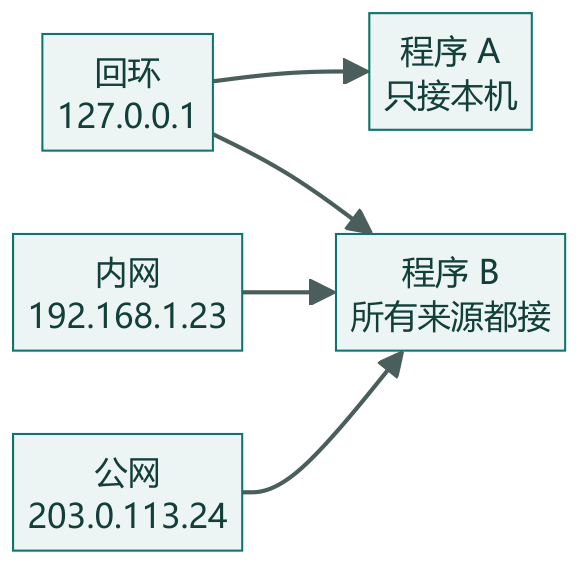

# 127.0.0.1 和 0.0.0.0

> `0.0.0.0` 不是“更通”的写法，是“全开”的写法。

这一章值得读两遍。它是新手踩得最多的地方，也是后果最严重的地方。前面那种是打不开，后面那种是被人搬空。

## 3.1 一个真实的故事

有人在服务器上跑了一个 Redis（把数据放在内存里的键值存储），用来存会话。图省事，配置文件里 `bind 0.0.0.0`，云服务器的安全组顺手放行了全部端口，因为他当时正在调另一个服务，嫌一个个加麻烦。

三天后服务器开始变慢。登录上去看，CPU 跑满，多了一个从没见过的定时任务。Redis 里多了一把名为 `backup` 的键，内容是勒索信息。攻击者用 Redis 的写入功能往机器里塞了一个公钥，然后大摇大摆地 `ssh` 进来，装了个挖矿程序。

整个过程不需要任何漏洞。Redis 默认没有密码，绑在 `0.0.0.0` 上，端口对公网开放。这三件事凑在一起，等于把仓库门打开放在马路边，还贴了张纸写着“里面有钱”。这个故事的每一个环节，都值得你理解。

## 3.2 程序在听哪个地址

程序启动的时候，通常要指定两样东西，端口和地址。地址这一项经常被忽略，因为它长得像个技术细节，其实它是安全设置。

先说清网卡是什么。一台机器不止一块网卡。笔记本至少有回环和无线两块，插网线时多一块有线，装了 Docker（一个把程序和运行环境打包起来跑的软件）会多出几块虚拟的，连了 VPN 再多一块。服务器通常是一块对内网，一块对公网。

每块网卡有自己的地址。在**服务器**上敲 `ip addr`，能把这台机器上所有网卡和地址列出来，名字像 `lo`、`eth0`；你自己的 Windows 电脑上对应的是 `ipconfig`。程序启动时指定哪个地址，就等于告诉系统：我只在这块网卡上接电话。

写 `127.0.0.1`，意思是这个程序只接从**它所在那台机器**内部发来的连接——程序跑在服务器上，就是只接服务器自己发出的连接，和你的笔记本无关。这个地址有个专门的名字，回环地址，它对应一块叫 `lo` 的虚拟网卡。数据发到这里，根本不会走到真实网卡上去，操作系统在内部就把它转回来了。像房间里的内线电话，只能打到这间屋子里的另一部电话。

写 `0.0.0.0`，意思是所有网卡上的连接我都接。公网的、内网的、回环的，全都收。像把总机接到所有外线上，谁打进来都通。

写 `192.168.1.23`，意思是只接这个地址上的连接，也就是只在这块内网网卡上接电话。同一个局域网里的设备能连，外面的人连不上。



## 3.3 什么时候用哪个

开发的时候用 `127.0.0.1`。你只在自己电脑上调试，不需要别人访问，绑本机最安全。很多框架的默认值就是这个，AI 生成的代码也常常是它，这是对的。

部署到服务器上要给别人用，就得让外面的请求能进来。请求从公网来，落在公网网卡上，绑 `127.0.0.1` 的程序收不到，所以会打不开。这时候改成 `0.0.0.0` 是对的。

但“对”是有条件的。条件是这台机器的最外层需要一个守门的，防火墙要只放该放的端口，应用本身要有密码和鉴权。

真正要小心的不是应用，是那些“本来只该自己人用”的东西。数据库、缓存、管理后台、Jupyter Notebook、Docker 的管理接口，这些东西一旦绑在 `0.0.0.0` 上并且端口对外开放，就是一个公开的入口。它们很多默认没有密码，有些连用户名都没有。

## 3.4 Docker 在这里埋了一个坑

这条命令在哪台机器上执行，容器就开在哪台机器上。书里默认是在服务器上跑服务。

```bash
docker run -p 8000:8000 myapp
```

这行命令很多人天天敲，但很少人注意到 `-p 8000:8000` 等价于 `-p 0.0.0.0:8000:8000`。它默认把容器的端口映射到宿主机的所有网卡上。

先认一下这两个数字。`-p` 后面是“宿主机的端口:容器里的端口”，冒号左边是外层，右边是内层。`8000:8000` 表示外面访问宿主机的 8000，转进容器的 8000。两边一样只是因为例子里的程序本来就监听 8000，写成 `-p 18000:8000` 就是宿主机的 18000 转进容器的 8000。想让这个服务只有**宿主机自己**能访问（也就是跑 Docker 的那台服务器，不是你的笔记本），得写成这样。

```bash
docker run -p 127.0.0.1:8000:8000 myapp
```

同理，`docker-compose.yml` 里的 `ports: - "6379:6379"` 也是全开，宿主机上所有网卡都能连到容器里的 Redis。写 `"127.0.0.1:6379:6379"` 才只给宿主机自己。这也是为什么被扫走的 Redis 里，很大一部分是这么写出来的。

注意，8000 这个数字本身没有含义，开发服务器常用的几个是 3000、5000、8000、8080，谁先占谁用。6379 有含义，它是 Redis 的默认端口，所以上面那句通常出现在一个 Redis 容器上。

这个差别在本地开发时完全看不出来，因为本地就一台机器。等到上了服务器，它就是那扇被推开的窗。

## 3.5 一条可以照抄的规矩

只有最外层的那个服务绑 `0.0.0.0`，其他所有服务绑 `127.0.0.1`。最外层一般就是 nginx 或者你直接对外的应用。nginx 监听 443，把请求转给 `127.0.0.1:8000` 上的应用。数据库监听 `127.0.0.1:3306`，只有应用能连。Redis 监听 `127.0.0.1:6379`，同理。你要在自己电脑上连服务器上的数据库，用 SSH 隧道（第十八章），不要为此把数据库开到公网。

这条规矩的好处是，即使某一层被攻破，攻击者也只能在机器内部横着走，还得再破一层才能出去。而如果你的服务全都开在公网，破一个就等于破全部。

| 绑定写法 | 谁能连 | 什么时候用 |
| --- | --- | --- |
| `127.0.0.1` | 只有这台机器自己（服务器） | 开发、数据库、缓存、内部服务 |
| `0.0.0.0` | 所有能到达这台机器的网络 | 只有最外层对外的服务 |
| `192.168.x.x` | 同一内网的设备 | 内网互访，比如应用连数据库 |

## 3.6 两个 0.0.0.0，别混

读到这里，你大概见过两种写法：程序配置里的 `0.0.0.0`，和安全组规则里的 `0.0.0.0/0`。它们长得像，意思完全不同，混起来会得出错误的结论。

**第一种是“绑定地址”**，写在程序或容器的启动参数里，比如 `uvicorn --host 0.0.0.0`、Redis 的 `bind 0.0.0.0`、Docker 的 `-p 8000:8000`。它回答的问题是：**这个程序在哪几块网卡上监听**。写 `127.0.0.1` 只在本机内部听；写 `0.0.0.0` 在本机所有网卡上听。它生效的位置，就是**程序运行的那台机器**。

**第二种是“来源网段”**，写在云平台的安全组或服务器的防火墙规则里，比如来源填 `0.0.0.0/0`。它回答的问题是：**哪些来源地址的包可以进来**。`0.0.0.0/0` 的意思是“任何地址”，相当于不限制来源。它生效的位置，是**替这台机器看门的那一层**——云控制台，或者机器上的 `ufw`、`firewalld`。

两件事互不相干，可以任意组合。下面四种情况，正好覆盖了新手最常遇到的疑惑：

| 程序绑定 | 安全组/防火墙 | 结果 |
| --- | --- | --- |
| `127.0.0.1` | 放行 8000 给所有人 | **外面还是连不上**，因为程序根本不在对外的网卡上听 |
| `0.0.0.0` | 只放行你自己的 IP | 只有你能连，别人连不上 |
| `0.0.0.0` | 放行给所有人 | 全世界都能连，风险最大 |
| `127.0.0.1` | 不放行 | 只有这台机器自己能连，最安全 |

第一行是最容易误判的：安全组明明放行了，为什么还是打不开？因为放行只是“允许包进来”，程序没在对外的网卡上听，包进来也没人接（第 6 章会把这条链路拆得更细）。

现在回答一个具体的问题：**“打开 0.0.0.0”到底是在自己电脑上，还是在服务器上？**

看你要让谁连。

- 程序跑在**服务器**上，想让公网访问：改的是**服务器上那个程序的配置**（`--host 0.0.0.0`），再配合云安全组放行。
- 程序跑在**自己电脑**上，想让同一个 Wi-Fi 下的手机访问：改的是**你电脑上那个程序的配置**，绑 `0.0.0.0`，手机连你电脑的内网地址。这时候和云、和安全组都没关系。
- 用 SSH 隧道时写 `-L 0.0.0.0:8080:...`（第 18 章）：这个 `0.0.0.0` 是让 **ssh 客户端在你电脑的所有网卡上监听**，好让同事从局域网连你的电脑，再由隧道转发出去。

一句话：`0.0.0.0` 不是一个“开关”，而是一个“在所有网卡上听”的写法；它总是写在**程序所在的那台机器**上。而 `0.0.0.0/0` 是另一个东西，写在看门的那一层。

## 3.7 一个自我检查的习惯

每次看到 AI 生成的启动命令或者部署配置，扫一眼里面有没有 `0.0.0.0`。如果有，问它一句，这个服务需要被公网访问吗，如果不需要，为什么绑 `0.0.0.0`。

AI 会老老实实回答你，而且大部分时候它会承认这里应该收紧。它给你 `0.0.0.0` 不是要害你，是因为它在训练数据里见到的部署示例大多是这么写的，那些示例写在教程里，教程假设你在本地玩。机器是你租的，账单是你付的，数据丢了是你的。这个判断得你自己做。

> **这一章记住一句**
>
> `0.0.0.0` 意味着所有网卡都收，写之前先想清楚这台机器有没有守门的。

下一章讲一个你每天都在用、但从来没想过它怎么工作的东西，域名。
