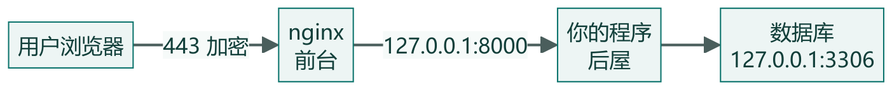

# 前台、接待和门牌

> 502 不是你的程序说的，是前台说的。

## 12.1 页面上那行字

```text
502 Bad Gateway
nginx
```

你第一反应是去查代码。代码没动过，昨天还是好的。查了半天，发现是你重启了程序，但它没起来，端口上没人。nginx 去敲后端那扇门，没人应，于是它回了这么一句。

这句话是 nginx 说的，不是你的程序说的。认清楚这一点，能省掉很多冤枉路。下一节先把它是什么讲清楚。

## 12.2 nginx 到底是什么

一句话：nginx（读作 engine-x）是一个装在服务器上的软件，专门负责接待外部的请求。

它出生在 2004 年，作者是俄罗斯工程师 Igor Sysoev。当时的动机很朴素：一台机器要同时扛住几万个连接，老牌的 Apache 扛不动，于是他换了一种写法——用少量进程加事件驱动，而不是一个连接一个进程。今天它几乎是 Linux 服务器上的标配——在**服务器**上敲 `ss -lntp`，占着 80 或 443 的进程通常就是它。它主要干两件事。

第一，直接发文件。网页、图片、JS、CSS 这些不需要计算，nginx 读出来就发，比任何后端语言都快。

第二，把请求转给别人。需要计算的部分，它转给后面的程序，比如 `127.0.0.1:8000` 上跑的那个，拿到结果再回给用户。这个角色叫反向代理，下一节细说。

同类软件还有 Caddy、Apache、Traefik，概念一样：站在最外层，负责接待、分发、加密、限流。选哪个不影响原理。

## 12.3 为什么中间要站一个人

程序自己也能监听 443，直接面对用户，为什么不用。有几个现实的理由。

第一，1023 以下的端口需要管理员权限。你的程序要是用非 root 用户跑，绑不了 80 和 443。

第二，证书。HTTPS 需要证书，证书要续期，要处理握手。这件事让 nginx 做比让你的业务代码做要稳得多。

第三，一个端口只能一个程序。如果你有两个网站，或者一个网站加一个接口服务，它们没法都占 443。

第四，静态文件、压缩、缓存、限流、日志，nginx 干这些又快又省事，用 Python 干这些是浪费。所以常见的结构是这样。



用户只认识前台。前台看请求里的域名和路径，决定把它交给后面哪个房间。这个角色叫反向代理。“反向”这个词是相对“正向代理”说的。两者都是“替人办事的中间人”，差别只在于站在哪一边、替谁办事。

先看正向代理。它站在你这边：你的浏览器或系统先把请求交给它，它替你去访问目标网站，把结果带回来。对目标网站来说，来访者是代理，不是你。

什么场合会用到它？公司的统一上网出口（所有人先连它，再由它出去，方便做审计和限流）、给内网机器临时开一个出口，以及最常见的一种——让访问看起来像是从另一个地方发出的。

“翻墙软件”就是正向代理的一种，更中性的叫法是跨境代理或科学上网工具。它的做法分三步：本机装一个客户端，浏览器或系统把请求交给它；它把请求加密，送上一台在境外的服务器；那台服务器替你去访问目标网站，再把结果加密送回来。目标网站看到的是那台服务器的地址，看不到你。

这里要分清两层：**转发**是代理做的，**加密**是隧道做的。普通代理不加密，流量特征很明显，容易被识别和阻断；所以这类工具通常在代理之上再套一层加密和伪装，让流量看起来像普通的 HTTPS 访问。第九章讲的 VPN 也是“加密加改道”，区别是 VPN 在网络层接管整台机器的流量，而代理一般在应用层按规则分流：哪些域名走代理，哪些直连。

隧道就是在现有网络连接里“套一层外壳”，把原始流量封装起来，从一端送到另一端，中间网络只看到外壳，看不到里面跑的是什么。技术上，隧道做的是协议封装。比如你的代理客户端和远端服务器先建立一条 TLS/HTTPS 连接，然后把代理协议数据塞进这条 TLS 连接里传。外部观察者（比如政府机构、校园网管理员）看到的是“访问了一个 HTTPS 站点”，而不是明显的代理流量。代理流量的协议等特征跟普通流量不同，一旦被外部观察者明确识别为代理流量，最直接的后果就是被精准阻断或限流，导致代理完全失效。常见形式有 TLS 隧道、WebSocket 隧道、HTTP CONNECT 隧道、SSH 隧道、QUIC 隧道等。

代理像“转发员”，决定哪些请求帮你转，哪些直连。隧道像“快递信封/集装箱”，把你的原始数据装进去，外面看起来是一封普通 HTTPS 快递，到了对端再拆开。

需要提醒一句：不同地区对跨境代理工具有不同的法律规定，有些地方需要备案或授权，单位也可能有自己的制度。本书只讲原理，要不要用、怎么用，先看当地规定。

反向代理正好反过来：它站在服务器这边，替后面的服务接待外面的人。用户只认识前台，不知道后面有几台机器、跑的是什么。你只需要记住它是前台。两种代理放在一起，差别一眼能看出来：

| | 正向代理 | 反向代理 |
| --- | --- | --- |
| 站在哪边 | 客户端这边 | 服务器这边 |
| 替谁办事 | 替客户端出去访问 | 替服务器接待进来 |
| 隐藏了谁 | 隐藏客户端 | 隐藏后端 |
| 谁来配置 | 用户或客户端软件 | 服务器管理员 |
| 常见用途 | 统一出口、审计、限流、跨境访问 | TLS 终止、负载均衡、静态文件、灰度、防护 |
| 例子 | Squid、公司网关、浏览器里的代理设置 | nginx、Caddy、云厂商的负载均衡 |

怎么一眼分辨：需要你在自己电脑上填一个代理地址的，多半是正向代理；你什么都没配，网站却能把你转给后台的，是反向代理。看到报错里写着 `nginx` 和 `502`，说明中间站着一个反向代理。

## 12.4 配置大概长这样

下面这段是 nginx 读的配置文件，要放在**服务器**上。你自己的电脑上没有这个文件，除非你本地也装了 nginx。

具体放在哪，取决于发行版：Debian/Ubuntu 通常放在 `/etc/nginx/sites-available/` 再软链到 `sites-enabled/`，或者直接放在 `/etc/nginx/conf.d/` 下建成 `myapp.conf`；CentOS 系习惯用 `/etc/nginx/conf.d/`。改完先 `sudo nginx -t` 检查语法，通过了再 `sudo systemctl reload nginx`。顺序不能反：语法错的时候 reload 会让 nginx 直接停下，站点当场全挂。

```nginx
server {
    listen 443 ssl;
    server_name myapp.com;

    ssl_certificate     /etc/letsencrypt/live/myapp.com/fullchain.pem;
    ssl_certificate_key /etc/letsencrypt/live/myapp.com/privkey.pem;

    client_max_body_size 200m;

    location / {
        proxy_pass http://127.0.0.1:8000;
        proxy_set_header Host $host;
        proxy_set_header X-Forwarded-For $proxy_add_x_forwarded_for;
        proxy_set_header X-Forwarded-Proto $scheme;
    }
}
```

`listen 443 ssl` 是它守的门。`server_name` 是它认的域名，同一个 nginx 可以配很多个 server 块，靠这个字段区分。`location /` 是路径匹配。所有路径都转给后面的 8000。

`proxy_set_header` 那三行是给后端传话用的。后端需要知道真实的访问者是谁，以及用户是用 https 还是 http 来的。不加这几行，你的程序看到的访问者 IP 全是 `127.0.0.1`，生成的链接可能变成 http。

`client_max_body_size` 是允许上传的最大体积，默认只有 1 MB。第一章那个朋友遇到的 413 就是这里。

## 12.5 几个错误码，分别是谁在说话

| 错误码 | 谁说的 | 意思 | 先查什么 |
| --- | --- | --- | --- |
| 502 | nginx | 我去敲后端，没人应或者应了但不对 | 程序起来了吗，端口对吗 |
| 504 | nginx | 后端接了但太久没回 | 程序是不是卡住了，日志里在等什么 |
| 413 | nginx | 上传的东西太大了 | `client_max_body_size` |
| 404 | 后端或 nginx | 这个路径没有东西 | 路由写了吗，路径对不对 |
| 403 | 后端或 nginx | 有这个东西但不给你 | 权限、鉴权、文件权限 |
| 500 | 后端 | 程序自己报错了 | 去看应用日志，一定有堆栈 |

502 和 504 都是前台的抱怨，区别在于有没有人接。502 是没人，504 是有人但不说话。这两个分清楚，方向就定了。

## 12.6 HTTPS 到底是什么

说人话，它做两件事。一是证明身份。证书由受信任的机构签发，浏览器看到证书有效，就知道这个域名确实是这个服务器在服务，不是别人冒充的。

二是加密。握手之后，双方协商出一个只有彼此知道的密钥，后面的内容都加密传。中间人截获了也只能看到乱码。

证书以前要花钱买，现在有 Let's Encrypt，免费，三个月有效，可以自动续。申请和续期也都在**服务器**上做：用 certbot 一条命令就能配好，用 Caddy 的话连命令都不用，它自己申请自己续。

用之前有两个前置条件容易漏：域名已经解析到这台服务器（在域名服务商那边配，不是在这台机器上）；80 端口能通——Let's Encrypt 要访问 `http://你的域名/.well-known/...` 来验证域名归你所有，所以**云控制台**的安全组和服务器防火墙都要放行 80。这两步没做，certbot 会报验证失败。

一个常见的误解是“上了 HTTPS 就安全了”。HTTPS 保证的是这条路上没人偷看、没人篡改，它不保证你的程序没有漏洞，也不保证你的服务器配置是对的。它是信封，不是门锁。

> **这一章记住一句**
>
> 502 是前台在说后面没人，不是你的代码在说话。

下一章把前面所有东西串起来，走一遍完整的路。那一章是全书的地图，迷路的时候回来看。
