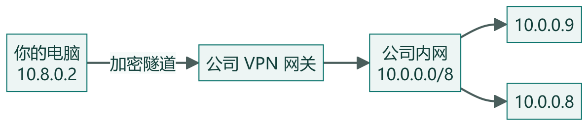

# 班车和前台

> VPN 让你“坐到公司里”，堡垒机让你“从前门进”。

## 19.1 两种完全不同的做法

上一章的隧道是一根管子，通到一个具体的服务：要连数据库就挖一根，要连管理后台就再挖一根。服务一多就很麻烦，而且每根管子的权限、审计都是散的，谁开了哪根，没人说得清。公司里通常不这么干，它们用另外两样东西。

一样是 **VPN**。连上之后，你的电脑会拿到一个内网地址，比如 `10.8.0.2`，从那一刻起，访问 `10.0.0.9` 就像坐在办公室里一样，不需要为每个服务单独开管子。

另一样是**堡垒机**。它不改变你的网络位置，改变的是你进门的路径：所有对服务器的操作都要先经过它，由它做认证、授权和记录。

这两样解决的是不同的问题。VPN 解决“我怎么到达那张网”，堡垒机解决“谁能操作哪台机器、做了什么要留痕”。很多人把它们混为一谈，其实一个改的是位置，一个改的是路径。

## 19.2 VPN 像班车

VPN 的全称是虚拟专用网络。虚拟的意思是，那条专线并不真的存在，它是从公网里挤出来的一条加密通道。

可以把它想成公司的班车：你在家门口上车，车开进园区，你下车时已经站在公司里了，路上的路线你不需要知道。

技术上它做了三件事：和公司网关建立一条加密通道；给你的电脑分配一个内网地址；在路由表里加几条规则，告诉系统哪些目标要走这条通道。第 3 章讲的路由表，在这里成了唯一的开关。



常见的技术有三类：IPsec 工作在网络层，多见于两个办公点之间的常驻连接；SSL VPN 跑在 443 端口上，穿透性好，客户端轻；WireGuard 更年轻，配置只有几十行，握手快。名字不同，思路一致——先认证，再协商密钥，然后把包封装起来送进隧道。

连上之后，用两条命令验证比看客户端界面可靠。**这两条在你自己的电脑上敲**（VPN 客户端装在本机，不在服务器上）：`ip addr` 会多出一块网卡，名字可能是 `wg0` 或 `tun0`；`ip route` 里会多出几条路由，指向那块网卡。Windows 上对应的是 `ipconfig` 和 `route print`。界面上的绿灯只代表“客户端认为连上了”，路由表才代表“流量真的会走这条路”。

## 19.3 全流量还是只走公司

VPN 有一个选项很容易被忽略：是全流量，还是只走公司网段。全流量模式下，你所有的上网都从公司出口出去。好处是策略统一、审计完整、出口 IP 固定；坏处是访问视频网站也要绕公司一圈，慢了，而且公司看得到你在看什么。

分流模式（常叫拆分隧道）下，只有发往公司网段的流量走 VPN，其他正常走本地宽带。日常办公基本都用这个，速度快、不占公司带宽。

分流配错会出现一种奇怪的现象：网页能打开，但公司内部系统打不开，或者反过来。这时候去看路由表，看目标地址匹配到了哪条规则——最长前缀匹配，永远是最具体的那条生效。

还有一个坑是 DNS。有些 VPN 要求你用公司的 DNS 才能解析内部域名，而系统仍在用运营商的 DNS，于是 `jira.internal` 这种名字解析不出来。表现是“同事能开我开不了”，但 `ping` 那个 IP 是通的。判断方法是在**你自己的电脑**上运行 `nslookup jira.internal`，看它问的是哪台 DNS；如果返回的是运营商的 DNS 给出的“不存在”，说明查询没有走公司那条通道。

## 19.4 为什么公司不给你开端口

你可能会想，直接把 22 端口对公网开放不就行了，何必搞这么复杂。因为一台机器开放端口，风险是这一台；一百台机器开放端口，风险是一百台，而且你不知道哪一台的密码是 `123456`，哪一台半年没打补丁。公网上的扫描器每天都在跑，一个开放端口从暴露到被尝试登录，往往只有几小时。

VPN 的思路是只留一个入口，把这个入口守好——强认证、限制来源、监控异常。堡垒机的思路是，即使你已经进了内网，也不能随便连机器，得先过它这一关。两层加起来，攻击面从一百个变成两个，而且这两个都有日志。

## 19.5 堡垒机是前台加录像

堡垒机的正式名字叫运维审计系统，行业里常提 4A：认证、授权、账号、审计。它的工作方式很具体。你不再直接 `ssh` 到目标服务器，而是先连堡垒机，登录自己的账号；堡垒机根据你的权限列出能连的机器；你选一台，它替你去连，把中间的输入输出全部转发，同时录下来。

```text
你的终端 → 堡垒机 → 目标服务器
              ↓
           录像存档
```

对目标服务器来说，连它的是堡垒机，不是你的电脑。目标机的密钥由堡垒机托管，你手上没有；你离职那天，管理员在堡垒机里禁用账号，你就进不去了，不需要去一百台机器上删公钥。这是它比跳板机值钱的地方。

除了录像，堡垒机通常还有几样能力：命令过滤（`rm -rf /` 这类命令直接拦下）、文件传输管控（能不能上传下载、单个文件多大）、会话审批（高危操作需要第二个人点同意）、以及按资产分组的细粒度授权。这些东西在小团队看来是繁文缛节，在几十人的运维团队里是刚需——它们对应的是真实发生过的事故。

## 19.6 跳板机和堡垒机的区别

跳板机是一台普通服务器，放在内网边缘，大家先登它，再从它跳到别的机器——注意第二次 `ssh` 是在**跳板机上**敲的，不是在你的电脑上敲的；这正是它和 `ssh -J`（第 18 章）的区别，后者两次连接都由你的电脑发起。它解决的是“怎么到达”，没有审计，没有权限体系，本质上是一台共享的中转机。它的优点是便宜、简单，一台机器加几个账号就能用。

堡垒机是一个产品，在跳板机的基础上加了账号体系、权限控制、操作录像、命令拦截，有些还能做数据库审计——你在数据库客户端里敲的每条 SQL 都会被记录。它的缺点是要部署、要维护、要花钱，而且它自己成了单点：堡垒机挂了，所有人都进不去。小团队用跳板机就够了。上了规模，或者有合规要求，才值得上堡垒机。

## 19.7 你会在哪里遇到它们

面试时会被问“VPN 和堡垒机有什么区别”；入职时会拿到一个 VPN 客户端和一个堡垒机地址；排查问题时会遇到“我连不上”，最后发现是 VPN 掉了，或者堡垒机上没给你开这台机器的权限。

这三种场景的共同点是，问题都不在你的代码里。遇到时先确认自己在哪一层：VPN 通不通，堡垒机能不能登，目标机器在不在你的授权列表里。这三句话能把范围缩得很快。

> **这一章记住一句**
>
> VPN 改的是你所在的位置，堡垒机改的是你进门的路径。

下一章讲现在最流行的一种形态：代码不落地，编辑器长在服务器上。
