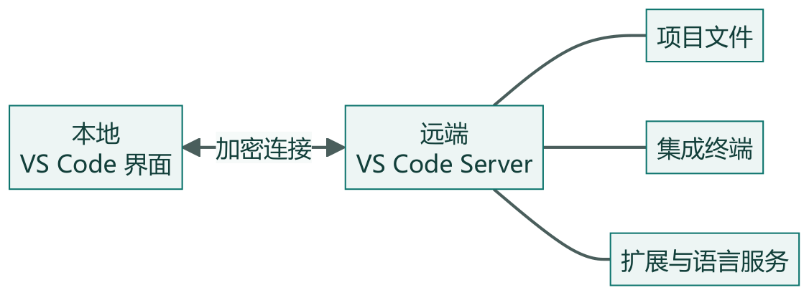

# 在远端写代码

> 远程开发不是把文件同步过去，是让编辑器住在服务器上。

## 20.1 以前是怎么干的

你要在服务器的显卡上跑训练，代码就得在服务器上。于是流程变成这样：在**你自己的电脑**上写代码，写完用 `scp` 传上去，或者 `git push` 再 `git pull`；然后 `ssh` 登录服务器，跑起来，看日志；发现一个拼写错误，回自己电脑改，再传一次。

这套流程的代价可以算出来。一个中等项目，改一行代码 → 上传十几兆 → 登录 → 重启进程 → 看日志，一轮两三分钟；一天改三十次，就是一个半小时。更烦的是两边的环境不一致：你电脑上装的是编辑器，服务器上装的是运行环境，补全提示的库版本对不上，你电脑上能跑的东西到服务器上报 `ModuleNotFoundError`，你也不知道是代码问题还是环境问题。

后来出现了文件同步工具（`rsync` 定期同步，或者 `lsyncd`、`unison` 这类监听目录变化、自动上传的工具），体验好一些，但仍然解决不了环境不一致：补全、跳转、调试器用的还是你电脑上那套。真正的解法是反过来——**让编辑器的一部分直接住在服务器上**。

## 20.2 它到底在干什么

VS Code 有一个 Remote-SSH 扩展。装上之后，你选一个 SSH 主机，它会在那台主机上装一个服务端程序 `vscode-server`，然后你电脑上的编辑器界面通过一条加密连接和它通信。

这一章里只用两个词，先把它们钉死：

- **你电脑这一侧**：窗口、界面、渲染、键盘鼠标、一部分只影响显示的扩展。
- **服务器这一侧**：文件系统、集成终端、调试器、代码补全的语言服务、需要读写文件的扩展。

| 你看到的 | 实际跑在哪一侧 |
| --- | --- |
| 编辑器窗口、标签页、主题 | 你的电脑 |
| 打开的文件内容 | 服务器（按需传给你电脑显示） |
| 集成终端里敲的命令 | 服务器 |
| 代码补全、跳转、找引用 | 服务器（语言服务在那边索引） |
| 调试器 | 服务器 |



所以你在编辑器里打开的文件，是真的在服务器上，不是你电脑上的副本；集成终端里敲的命令，是在服务器上执行；代码补全用的是服务器上装的那些库。你电脑上的这个窗口更像一个遥控器，它显示服务器那一侧的状态，把操作送回服务器那一侧。

**这一点最容易搞混**，因为 VS Code 的界面在两侧长得一模一样：同样一个终端面板，可能是你电脑上的 PowerShell，也可能是服务器上的 bash。三个办法分辨：

- 看窗口左下角的绿色标记，连上之后会显示 `SSH: gpu` 这样的字样；没有就是本地窗口。
- 看集成终端的提示符，`alice@gpu:~$` 是服务器，`C:\Users\alice>` 是你电脑。
- 最可靠的是敲一句 `hostname`，返回服务器的主机名还是你自己的电脑名，一目了然。

连接过程其实复用了前面几章的全部知识：它调用系统自带的 `ssh` 客户端，读你电脑上的 `~/.ssh/config`，用你的密钥认证，然后在服务器那一侧启动 `vscode-server`。界面和这个程序之间走的是一条被封装起来的端口转发，第八、十八章讲的那种，只是你看不到。所以你 `config` 里写的 `ProxyJump`、`IdentityFile`、`ServerAliveInterval` 全都照常生效——它没有另造一套协议，只是把 SSH 用到了极致。

服务器那一侧的 `vscode-server` 不是一个程序，而是一组进程：主服务负责和你电脑通信，扩展宿主（extension host）跑你的扩展，文件监听进程盯着目录变化，终端服务管理集成终端里的 shell。这也解释了它为什么占内存——不是编辑器重，是这一整套工具链都在服务器上跑着。

## 20.3 为什么这个形态适合现在

第一个原因是算力在服务器。训练、推理、大数据处理，你手边这台笔记本跑不动。远程开发让你在电脑上写、在服务器上跑，中间的摩擦几乎为零，不用来回传文件。

第二个原因是环境一致。编辑器里看到的依赖就是运行时用的依赖，不会出现“我电脑上能跑、服务器上不能跑”。语言服务跑在服务器那一侧，索引的是服务器上那份代码和那些库，补全和跳转因此是准的。

第三个原因是代码不落地。公司的代码库不允许下载到个人电脑，远程开发天然满足这个要求：文件从来没有离开过服务器，你电脑上只缓存了界面需要的片段。

还有第四个原因，属于这个时代的。AI 编程助手越来越多地跑在服务器上：它能直接读写项目文件、执行命令、看测试结果，整个闭环都发生在服务器那一侧，你的工作变成了给目标、划边界、验收结果。如果代码在你电脑上、运行在服务器上，助手就得多跨一道同步，效果会打折。

## 20.4 配一次，以后省事

与其每次敲一长串参数，不如写进**你电脑上**的 SSH 配置文件：`~/.ssh/config`，Windows 上是 `C:\Users\你的用户名\.ssh\config`。

```text
Host gpu
    HostName 203.0.113.24
    Port 58222
    User alice
    IdentityFile ~/.ssh/id_ed25519
    ServerAliveInterval 30
    ServerAliveCountMax 3
```

写完保存，以后 `ssh gpu` 就等于那一整串。VS Code 的 Remote-SSH 也读这个文件，主机列表里会直接出现 `gpu`。

`ServerAliveInterval` 那两行是保活：每 30 秒发一个空包，连续 3 次没回应才断开。远程开发时特别需要它，否则你离开十分钟去开会，回来就发现连接被中间的 NAT 设备清掉，编辑器卡在“正在重新连接”。这个参数在第十八章讲过，那里是为了隧道稳定，这里是同一个道理。

如果前面还有一层堡垒机，就在这个文件里加一行 `ProxyJump`，把“先跳再连”写成配置，VS Code 不用改任何东西就能用。这也是为什么第 18 章建议把跳板写进配置而不是每次手敲。

## 20.5 几个会卡住的地方

**服务器内存太小。** `vscode-server` 加上语言服务和索引，几百兆到几个 G 都可能。一 G 内存的机器会很吃力，甚至被系统直接杀掉。表现是“连上了但立刻断开”。排查要在**服务器上**做：`dmesg | tail` 看有没有 OOM 的记录，`free -h` 看内存余量。

**磁盘满了。** 服务器上的 `~/.vscode-server` 会累积多个版本，几个月后能占几个 G。在**服务器上**用 `du -sh ~/.vscode-server` 看一眼，再定期清理旧目录；也可以整个删掉重装——下次连接时它会自动下载。

**扩展要装在服务器那一侧。** 有些扩展只在你电脑上跑（主题、快捷键），有些必须在服务器上跑（语言服务、调试器）。装错地方会提示“此扩展在远程环境中不可用”，在扩展面板里能看到“安装在 SSH: gpu”这个按钮。扩展的 `extensionKind` 字段决定了它装在哪一侧。

**文件监听有上限。** 大项目里文件多，服务器上 Linux 的 `inotify` 默认句柄数不够，表现是“改了文件但热更新没反应”。在**服务器上**调大 `fs.inotify.max_user_watches` 能解决。

**网络延迟。** 界面在你电脑上、文件在服务器上，每次操作都过一次网络。延迟在 50 毫秒以内基本无感，超过 150 毫秒打字会明显滞后。同城机房没问题，跨国的话要考虑把开发机放在离你近的地域。

**连接超时。** 先在**你自己的电脑上**跑 `ssh gpu`（这条在电脑上敲，不在服务器上）。命令行不通，VS Code 一定不通，而且它的报错更难看懂。命令行通了，再去看 Remote-SSH 的输出面板，那里有完整的 ssh 命令和每一步的输出。

## 20.6 几种相似的方案

远程开发不是只有一种形态，见到别的名字时不必慌，它们解决的是同一类问题，取舍不同。

| 做法 | 代码 | 环境 | 适合 | 代价 |
| --- | --- | --- | --- | --- |
| 电脑上编辑 + `scp`/`rsync` | 你的电脑 | 服务器 | 偶尔改几个文件 | 每轮都要同步，环境两套 |
| 远程桌面（VNC/RDP） | 服务器 | 服务器 | 需要图形界面 | 延迟高、带宽大 |
| Remote-SSH | 服务器 | 服务器 | 日常开发、GPU 机器 | 依赖网络质量 |
| 容器化开发（devcontainer） | 服务器（容器里） | 容器 | 团队统一环境 | 要维护镜像 |
| 云端 IDE（Codespaces 等） | 云端 | 云端 | 临时环境、协作 | 受平台限制，按小时计费 |

它们的共同点是“代码和环境在一起，界面在别处”。差别在隔离级别和运维成本：Remote-SSH 最轻，直接用现成的机器；容器化多一层镜像，换来环境可复制；云端 IDE 把机器也托管了，换来开箱即用，代价是数据在别人那里、按时间计费。

选择的标准不是哪个更先进，而是你的瓶颈在哪：瓶颈是环境不一致，就上容器；瓶颈是机器太远、延迟高，就把开发机放到离你近的地域；瓶颈是同事之间环境对不上，就让团队统一一份 devcontainer 配置。

## 20.7 一个心态

远程开发会让你产生一种错觉，觉得自己还在操作自己电脑上的文件。

事实是：文件在服务器上，`rm` 删的是服务器上的东西，集成终端里跑的命令也在服务器上执行。这一点和第十一章讲的服务不一样——终端是 `vscode-server` 管着的，你关掉窗口，里面跑的程序一般也会结束，除非你用 `nohup` 或 systemd 托管。训练跑到一半把窗口关了、结果进程没了，是新手最常犯的错误之一。

> **这一章记住一句**
>
> 界面在你电脑这一侧，文件和环境在服务器那一侧。删东西是真的删。

第五篇结束。最后一篇讲怎么和 AI 配合，以及一些必须守住的底线。
