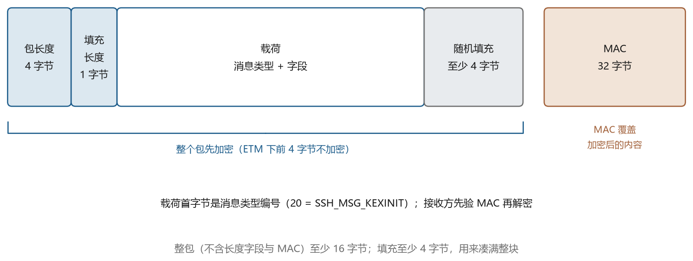

# 抓一个 SSH 连接：从版本串到 NEWKEYS

## 1.1 抓包能看到什么

在服务器上用 `tcpdump -n -i any port 22` 抓一段 SSH 握手，看到的是一串二进制。把它按 SSH 的线格式拆开，能看清每个阶段在传什么。

有三件事要先说清楚，否则容易误判：

- 版本交换那一行是明文，能直接读
- 之后的包体是加密的，看不到载荷
- 包的长度、方向、时间间隔看不到内容也瞒不住

所以抓包能回答“进行到哪一步、谁先发的、有没有重传”，回答不了“用户敲了什么”。

第二条要补一个精确边界：**加密的起点是 NEWKEYS，不是版本串那一行之后**。版本串、两份 KEXINIT、`KEX_ECDH_INIT`、`KEX_ECDH_REPLY` 和 `NEWKEYS` 本身都是明文，算法清单、主机公钥、双方临时公钥、主机密钥签名在 pcap 里全部可读。只有 NEWKEYS 之后的认证请求与通道数据才是密文。

第一步不是打开 Wireshark，而是先把整条流落盘，再用 tshark 反复问：

```bash
# capture to a file first, analyse later
tcpdump -i any -n -s 0 -w ssh.pcap 'tcp port 22'

# only SYN / FIN / RST of the flow
tcpdump -r ssh.pcap -nn 'tcp[tcpflags] & (tcp-syn|tcp-fin|tcp-rst) != 0'

# let tshark dissect SSH and print selected fields
# add -d tcp.port==2222,ssh when the daemon listens on a non standard port
tshark -r ssh.pcap -Y ssh -T fields -e frame.number -e ip.src -e tcp.len -e ssh.protocol
```

`-s 0` 表示不截断，默认的 snaplen 会把大包剪掉，剪掉的正好是载荷；`-w` 写原始 pcap，是唯一不丢信息的做法。

还要先建立一个观念：**一个 tcpdump 行不等于一个 SSH 包**。带十几个算法名的 KEXINIT 常超过一千字节，在 MTU 1500 的链路上会分成两段；按键回声只有几十字节，几个会挤进同一段。tshark 的 SSH 解析器按长度字段重组，`tcpdump -X` 不会。

## 1.2 版本交换：整条连接里唯一的明文

TCP 建好之后，双方各发一行：

```text
SSH-2.0-OpenSSH_9.6\r\n
```

规则很宽：以 `SSH-` 开头，以回车换行结束，最长 255 字节，前面允许有若干行其他文本（有些设备会先打印欢迎语）。这一行之后，双方切到二进制协议，长度字段从这一刻起才有意义。

按 RFC 4253 的语法，这一行是四段：`SSH-` 前缀、协议版本、软件版本、以及一个空格之后的注释。协议版本只有 `2.0` 和 `1.99` 值得关注，后者是“说 2.0 但兼容 1.5”的历史遗留。软件版本里不允许有空格，所以 Debian、Ubuntu 把包版本塞进注释段，抓包里就成了 `SSH-2.0-OpenSSH_9.6 Ubuntu-3ubuntu0.6`。

解析时有几条容错规则。不能假设它落在单个 TCP 段里，255 字节的上限在小 MSS 链路上照样会被切开，必须按 CRLF 找行尾；服务端可以在它之前发任意多行提示文本，客户端要一直读到以 `SSH-` 开头的行为止。`SSH-` 必须大写，某些老实现会在行尾多补一个 CR 或空格，宽容的解析器会先剥掉尾部空白再比较。

```text
what a tolerant reader does
  1. buffer bytes until CRLF is seen
  2. strip trailing CR and spaces
  3. skip the line if it does not start with "SSH-"
  4. give up after 255 bytes or N lines -> protocol error
```

版本阶段失败的抓包特征很干净。连到 443 端口时服务端回的是 TLS 二进制记录，客户端读到非 ASCII 字节，报 `Protocol mismatch` 或者 `kex_exchange_identification: banner line contains invalid characters`，然后主动关闭；抓包里能看到三次握手成功、服务端发来一段不以 `SSH-` 开头的字节、客户端立刻 FIN。只有 SYN 重传、连 SYN-ACK 都没有，则是更下面一层的问题。

这一行的作用只有一个：确认双方说的是 SSH 2.0，并且顺便暴露了软件与版本。运维上有人会改 banner 来减少信息泄露，但那只是提高了一点门槛，挡不住真正的探测。

## 1.3 一个包的结构

加密通道里的每个包都长这样：

```text
+----------+----------+---------------------+----------+--------+
| 包长度 4B | 填充长 1B | 载荷（消息类型+字段） | 随机填充   | MAC    |
+----------+----------+---------------------+----------+--------+
```

图 1-1 是它的示意。



几个字段的作用：

- **包长度**：后面还有多少字节，不含长度字段自身和 MAC
- **填充长度**：随机填充有多少字节，至少 4 字节
- **载荷**：真正的消息，第一个字节是消息类型编号
- **填充**：让整包长度是加密分组大小的整数倍，同时增加随机性
- **MAC**：对整个包的完整性校验

协议要求整包（不含长度字段与 MAC）至少 16 字节、载荷最长 32768 字节、整包不超过 35000 字节。这些下限保证“即使消息很小，包也不会小到泄露信息”。

拿一个真实的小包逐字节走一遍。curve25519 协商的第一个消息是 `KEX_ECDH_INIT`（编号 30），载荷是“消息类型 + 32 字节公钥”，共 37 字节。若本轮用 `aes128-ctr` 加 `hmac-sha2-256`，填充要补到让“4 + 包长度”是 16 的倍数：

```text
payload            = 1 (msg id 30) + 4 (string length) + 32 (Q_C) = 37
packet_length      = 1 (padding_length) + 37 + padding
4 + packet_length  = 42 + padding  ==  0 (mod 16)
padding            = 6   ->  4 + 44 = 48 bytes
on the wire        = 4 + 44 + 32 (mac) = 80 bytes
```

表 1-1 是它的偏移表。密文状态下直接读前四字节只会读到噪声，解密之后才是这些值。

表 1-1　一个 KEX_ECDH_INIT 包的逐字节布局

| 偏移 | 长度 | 字段 | 取值 | 含义 |
| --- | --- | --- | --- | --- |
| 0–3 | 4 | packet_length | 44 | 其后 44 字节，不含自身与 MAC |
| 4 | 1 | padding_length | 6 | 填充 6 字节 |
| 5 | 1 | message id | 30 | `SSH_MSG_KEX_ECDH_INIT` |
| 6–9 | 4 | string length | 32 | 公钥先写长度 |
| 10–41 | 32 | Q_C | 随机 | 客户端 X25519 公钥 |
| 42–47 | 6 | padding | 随机 | 只影响长度 |
| 48–79 | 32 | MAC | 32 字节 | HMAC-SHA256 输出，明文传输 |

几个数字背后都有理由。填充至少 4 字节，是为了让最小的包（只有一个字节的 `SSH_MSG_IGNORE`）也有足够的随机尾巴，攻击者无法从“总长刚好等于载荷长”推断消息类型；整包含长度字段必须是分组大小的整数倍，好让长度分布不至于过分规整。35000 这个上限则从 32768 推出来，既留足余量，又能拦住“长度写 4 GB”的恶意头部。

还有一处容易看错：**长度字段是不是明文取决于模式**。传统组合把长度字段一起加密，抓包读不出包长；ETM 和 AEAD 故意把长度留在明文，接收方才知道该读多少字节再验完整性。

## 1.4 算法协商：两份清单，客户端优先

版本交换之后，双方各发一个 `SSH_MSG_KEXINIT`（编号 20）。消息里有一个 16 字节的随机 cookie，然后是十组名字列表：密钥交换、主机密钥、加密（两个方向各一份）、MAC（两个方向各一份）、压缩、语言。

名字列表的编码是“4 字节总长度 + 若干带长度前缀的字符串”，空列表就是长度为 0 的字段。十组列表见表 1-2。

表 1-2　KEXINIT 中的十个名字列表

| 序号 | 字段 | 例子 | 作用 |
| --- | --- | --- | --- |
| 1 | kex_algorithms | `curve25519-sha256` | 密钥交换 |
| 2 | server_host_key_algorithms | `ssh-ed25519` | 主机密钥签名 |
| 3 | encryption_c2s | `chacha20-poly1305@openssh.com` | 上行加密 |
| 4 | encryption_s2c | `aes128-ctr` | 下行加密 |
| 5 | mac_c2s | `hmac-sha2-256-etm@openssh.com` | 上行完整性 |
| 6 | mac_s2c | `hmac-sha2-256` | 下行完整性 |
| 7 | compression_c2s | `none` | 压缩 |
| 8 | compression_s2c | `zlib@openssh.com` | 压缩 |
| 9 | languages_c2s | 空 | 未使用 |
| 10 | languages_s2c | 空 | 未使用 |

列表之后还有两个字段：一个布尔值 `first_kex_packet_follows`，以及一个必须为 0 的保留整数。前者是省往返的优化：客户端猜服务端会选自己列表的第一项，不等回复就直接按那个算法把公钥包发出去；猜错时服务端静默丢弃那个包，客户端再重发。抓包上表现为同一方向出现两个公钥包，第一个没有任何响应。

协商规则是“客户端优先”：服务端拿到客户端的列表，从头开始找第一个自己也支持的算法。所以最终用什么，主要由客户端决定。

这套规则有一个副作用：客户端越老，能提供的算法越弱；服务端如果为了兼容而保留弱算法，连接就会用弱的。企业里通常会在服务端配置里写死允许的算法，把弱的全部关掉。

列表里还会混进不是算法的名字。`ext-info-c` 是 RFC 8308 的伪算法，出现在 KEX 列表里只表示“我支持扩展协商”，不能被选中；握手成功后服务端会发一条 `SSH_MSG_EXT_INFO` 告知支持的签名算法。`kex-strict-c-v00@openssh.com` 同理，是缓解 Terrapin 一类前缀截断攻击的能力标记。

从抓包读算法清单最省事，因为 KEXINIT 是明文。tshark 把每个列表解析成 `ssh.kex_algorithms` 这类字段，字段名随版本略有差异，用 `tshark -G fields | grep ssh\.` 列一遍即可；两端列表并排看，从左往右第一个交集就是选中项。

协商失败的抓包特征同样明确：两个 KEXINIT 之后几十毫秒内连接就 FIN，中间没有 `KEX_ECDH_INIT`，客户端打出 `no matching key exchange method found` 或者 `no matching host key type found`。这种情况不需要解密，看两份明文列表的交集就能定位；麻烦的是列表有交集但实现不一致，那会走到收到 `KEX_ECDH_REPLY` 之后才断开。

## 1.5 密钥交换与 NEWKEYS

以 `curve25519-sha256` 为例，四步就够：

1. 客户端发 `KEX_ECDH_INIT`（30），带自己的临时公钥 Q_C
2. 服务端回 `KEX_ECDH_REPLY`（31），带主机公钥 K_S、临时公钥 Q_S，以及用主机私钥对交换内容做的签名
3. 双方各自算出共享秘密 K，再由它派生出会话标识与各方向的密钥
4. 双方各发 `NEWKEYS`（21），从下一条消息起改用新密钥

这里有一个容易被忽略的细节：**签名覆盖的不只是临时公钥**，而是一段拼接起来的哈希，里面包含双方版本串、两份 KEXINIT 原文、主机公钥、双方的临时公钥、共享秘密。任何一项被改，签名就对不上。

这段拼接有严格的类型规定，错一个字节哈希就完全不同。版本串按 string 编码且不含 CRLF，两份 KEXINIT 是完整载荷（含首字节 20），主机公钥是线上原始 blob，临时公钥各是一个 string，共享秘密按 mpint 编码：

```text
H = HASH( V_C || V_S || I_C || I_S || K_S || Q_C || Q_S || K )

V_C, V_S : identification strings, without CRLF, as SSH string
I_C, I_S : the whole KEXINIT payload, message id 20 included
K_S      : host key blob exactly as sent on the wire
Q_C, Q_S : ephemeral public keys, as SSH string
K        : shared secret, as mpint
```

`H` 就是交换哈希。第一次交换算出的 `H` 同时被定义为会话标识 `session_id`，整条连接内不再变化；后续重密钥会算出新的 `H`，但 `session_id` 保持第一次的值。这个区分很重要：`H` 每次都变，`session_id` 只变一次。

密钥不是从 `K` 直接切出来的，而是用 `K`、`H`、`session_id` 加一个单字母标签再哈希一次。六个标签 A 到 F 对应六个方向明确的密钥：

```text
IV_C2S  = HASH(K || H || "A" || session_id)
IV_S2C  = HASH(K || H || "B" || session_id)
KEY_C2S = HASH(K || H || "C" || session_id)
KEY_S2C = HASH(K || H || "D" || session_id)
MAC_C2S = HASH(K || H || "E" || session_id)
MAC_S2C = HASH(K || H || "F" || session_id)
```

需要的长度超过哈希输出时继续往后接：`K1 = HASH(K || H || X || session_id)`，`K2 = HASH(K || H || K1)`。AES-256 要 32 字节，SHA-256 一次就够；`chacha20-poly1305` 要 64 字节，是两个 32 字节子密钥，一个管包长度与 Poly1305 密钥，一个管载荷。

`NEWKEYS` 之后的状态变化有个容易说错的细节：**两个方向不是同时切换**。发送方发出 `NEWKEYS` 后立刻用新密钥发下一条消息，但必须继续用旧密钥解密对端在途的包，直到收到对端的 `NEWKEYS`。抓包时间轴上因此有一小段“一个方向已换新、另一个还是旧”的窗口，长度约半个 RTT；这也解释了为什么 `NEWKEYS` 自身必须用旧密钥保护。

`NEWKEYS` 之后可能紧跟一条 `SSH_MSG_EXT_INFO`（编号 7），用新密钥加密，内容就是 `server-sig-algs` 列表。它是唯一一条“密钥交换之后、认证之前”出现的元信息消息，看到不必当成异常。

`NEWKEYS` 之后，连接上再出现的包就全是密文了。抓包到这里，能看到的信息只剩长度和方向。

不过公钥交换阶段留下了一条线索：`KEX_ECDH_REPLY` 里的主机公钥是明文，用 `ssh-keygen -lf` 算一次指纹，就能确认那次连接到底连到了哪台机器。排查误连测试环境或者被引流到别处时，这一步比翻配置文件快。

## 1.6 一个包的一生

发送侧：组包 → 加密 → 算 MAC → 发出去。
接收侧：收包 → 先验 MAC → 再解密 → 交给上层。

这个顺序叫“先认证后解密”。它的意义是：攻击者构造的畸形密文，在解密之前就被 MAC 挡掉了，解密器不会接触到它，旁路攻击的入口少了一个。

但“先认证后解密”不是所有模式的默认行为，它取决于 MAC 覆盖的是明文还是密文。传统组合（`hmac-sha2-256` 这类不带后缀的 MAC 配 CBC/CTR）算的是明文包，接收方必须先解密才能算 MAC，实际顺序成了“解密 → 验 MAC → 使用”；ETM 把 MAC 改成覆盖密文，才真正做到“先验后解”：

```text
standard (MAC over plaintext):
    mac = HMAC(key, seq || packet_length || padding_length || payload || padding)
    verify needs decrypted bytes   ->  decrypt first, then verify

encrypt-then-MAC (suffix -etm@openssh.com):
    mac = HMAC(key, seq || packet_length || encrypt(rest))
    packet_length stays in clear   ->  verify first, then decrypt

AEAD (chacha20-poly1305, aes-gcm):
    tag covers the ciphertext, seq folded into the nonce, one pass
```

表 1-3　三种完整性保护的顺序与代价

| 方式 | MAC 覆盖 | 接收方顺序 | 长度字段 | 主要风险 |
| --- | --- | --- | --- | --- |
| 传统 MAC | 明文包 | 解密后验 | 加密 | 解密器接触未认证数据 |
| ETM | 密文包 | 验后解密 | 明文 | 长度泄露 |
| AEAD | 密文 | 验后解密 | 明文 | nonce 管理出错 |

选哪一种在协商阶段由 MAC 列表的第一项决定，所以服务端把带 `-etm` 的 MAC 排在前面是有意义的动作。

MAC 的值还和**序号**有关。双方各自维护两个方向的序号，每发一个包加一，序号不放进包里，由双方各自数。所以即使两个包内容完全一样，MAC 也不同；丢包或插包也会让序号错位，MAC 对不上，连接直接断开。

序号的输入位置在 MAC 计算的最前面，占 4 字节，大端：

```text
mac_input = uint32(seq) || the bytes listed above
```

这个设计有三个连带后果。第一，重放不可能，同一个包第二次出现时序号不同，MAC 立刻失败。第二，乱序不可能，中间设备一旦重排或丢弃，后续所有包序号都对不上，连接只能断。第三，SSH 被绑死在可靠有序的传输上，只能跑在 TCP 或者自己实现了可靠性的隧道里。

序号是 32 位，回绕后从 0 继续，不重置。回绕本身不是问题，4 GB 个包早就触发了重密钥。一个例外是严格 KEX 扩展：要求 NEWKEYS 之后把序号归零，用来堵住“切换前后插入或截断消息”的一类攻击。

两类异常在抓包上可以分辨。MAC 校验失败时，接收方算完 MAC 发现不符，会发一个 `DISCONNECT` 然后直接关连接，pcap 上表现为数据流走到一半突然出现一个短包紧接 FIN 或 RST，客户端报 `Corrupted MAC on input` 或者 `message authentication code incorrect`；这类失败不会“重传后自愈”，因为重传的字节还是错的。序号错位则表现为连接在固定位置反复断开，重连后在同一个偏移再次失败，路径上有设备改写或丢弃过字节时最常见。

## 1.7 重密钥

连接用久了，或者传了一定量的数据，双方会重新协商一次密钥。过程与第一次相同，但不重新协商算法，直接复用结果。

严格说，重密钥也会重新走一遍 KEXINIT，算法在协议上允许变；多数实现让两端列出同样的列表，看起来就像“没重新协商”。不变的是 `session_id`，它始终指向第一次交换。

触发条件是“数据量、时间，先到者触发”。OpenSSH 的默认值通常是 1 GB 或 1 小时，可以用 `RekeyLimit` 在两端各自调整，写成 `512M` 或 `1h`。这个阈值背后是分组密码的生日界：64 位分组在约 2^32 个块之后碰撞概率开始不可忽略，96 位随机 nonce 的 GCM 在 2^32 条消息附近也必须换钥。

重密钥在抓包上有稳定特征：密文流中间突然出现一段双向小包往返，两条方向各三到四个包，然后数据流恢复。这一段就是加密后的 KEXINIT、公钥交换和 NEWKEYS，区别是 KEXINIT 已经看不到算法列表，只能靠 `ssh -vv` 确认。

重密钥期间上层会感到一次短暂停顿，通道数据必须等新密钥就绪才能继续发，大文件传输时表现为吞吐曲线上的小坑。如果重密钥失败——对端发了不合规消息，或者严格 KEX 检查没通过——连接不会退回旧密钥，而是直接断开。

新的密钥替换旧的，`session_id` 保持不变——它是第一次密钥交换的哈希，整条连接内不变，用来把后续的签名和这次会话绑定在一起。

对上层来说，这个过程完全透明，你的 shell 不会有任何感觉。

## 1.8 这一章记住什么

- 版本串是唯一的明文；之后包体加密，但长度与方向仍可见。
- 包 = 长度 + 填充长 + 载荷 + 填充 + MAC，最小 16 字节是有原因的。
- 协商是客户端优先，弱算法由客户端决定，所以服务端要写死允许列表。
- MAC 先于解密，序号不进包，靠双方各自计数。
- ETM 与 AEAD 才真正“先验后解”，传统 MAC 组合必须先解密。
- 加密的真正起点是 NEWKEYS，首轮握手的算法清单与主机公钥都能在 pcap 里读出来。
- 交换哈希把版本串、两份 KEXINIT、主机公钥、临时公钥与共享秘密绑成一个值，签名签的是它。
- 序号绑定让重放与乱序立刻暴露，代价是 SSH 只能跑在可靠有序的传输上。
- 重密钥由数据量或时间触发，`session_id` 不变，失败则直接断开。
