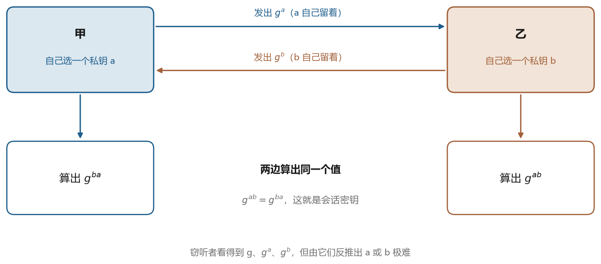

# 密钥交换的数学：DH、ECDH 与前向保密

## 2.1 一个混色的比喻

两个人要在一条被人监听的线上，商量出一个只有他俩知道的颜色。

各自选一个私密颜色，不告诉任何人；把私密颜色和公共的黄色混在一起，得到一罐混合色，公开发过去；收到对方的混合色之后，再掺进自己的私密颜色。

结果两个人得到同一种颜色，旁观者只有两罐混合色，没有私密颜色，配不出来。

这就是 Diffie-Hellman 的直觉。把“混色”换成一个数学上不可逆的运算，它就成了协议。

比喻丢掉了两样东西。一是“不可逆”在这里是计算意义上的：混合色里完整包含了私密颜色的信息，只是没人能在可接受时间内算出来，所以参数一小、算法一进步，昨天的“不可逆”今天就变成可逆。二是比喻里没有身份，谁都能端一罐混合色过来，这一块要靠第三章的签名补上。

## 2.2 离散对数：为什么反推不出来

最经典的版本用模运算：

```text
公开参数：一个大素数 p，一个生成元 g
A 选私钥 a，发出 g^a mod p
B 选私钥 b，发出 g^b mod p
A 收到后算 (g^b)^a = g^(ab) mod p
B 收到后算 (g^a)^b = g^(ab) mod p
```

双方得到同一个值 `g^(ab)`，旁观者看得到 `g`、`g^a`、`g^b` 和 `p`，想反推出 `a`，要做的是离散对数问题。在参数选得足够大的时候，这个问题没有已知的可行解法。

安全性的关键全在参数上。`p` 太小、`g` 选得不好，或者用了被预计算过的群，都会让问题变简单。历史上被淘汰的 `diffie-hellman-group1-sha1` 用的就是 1024 位的老参数，今天不该再出现。

为什么两边一定算得一样，值得看一眼。模运算把乘法“折叠”进一个有限集合：结果都对 `p` 取余，落在 `1` 到 `p-1` 之间。折叠不破坏乘法结构，`(g^a)^b` 与 `(g^b)^a` 展开都是 `g` 自乘 `ab` 次，所以两边必然相等。

严格说，`g` 并不是在 `1` 到 `p-1` 的全体里随便取。这个集合对模乘法构成一个群，元素个数是 `p-1`；`g` 的阶是最小的正整数 `q` 使得 `g^q ≡ 1 mod p`，只有阶等于 `p-1` 的 `g` 才叫生成元。SSH 通常用安全素数 `p = 2q + 1`，此时取 `g` 使它的阶为 `q` 就够用，强度只由 `q` 的大小决定。

知道“难”还不够，要知道难到什么程度，因为参数尺寸就是按这个定的。通用算法不利用群的任何结构，只靠碰撞：大步小步法要存 `sqrt(q)` 个表项，Pollard 的 rho 方法把内存降到常数但时间仍是 `sqrt(q)`，所以 256 位的子群只能提供 128 位强度。另一类是专门针对素域的指数演算与数域筛，它利用“整数可以分解成小素数”这个额外结构，复杂度是亚指数的，比平方根快得多——这正是同样 128 位强度下，椭圆曲线只要 256 位、素域 DH 却要 3072 位的原因。

参数被复用的危害在 2015 年的 Logjam 工作里被摆上了台面：`group1` 那个 1024 位素数的离散对数可以被大规模预计算，之后每条用它建立的连接都能快速解开。`diffie-hellman-group-exchange-sha256` 让服务端按需生成参数，避开了单一目标，但引入“参数可能被换成弱值”的新风险，所以现代实现会给它设尺寸下限。

弱参数的具体形态有这么几种，看到任何一种都该判为不安全。`p` 太小，直接可算；`p-1` 有很多小因子，离散对数可以分而治之；`g` 生成的子群很小，攻击者只需要在小集合里搜索；公钥没有校验，攻击者发一个精心构造的值把共享秘密压进一个只有几个元素的子群，这叫小子群约束攻击。最后一种最隐蔽，因为协议流程完全正常，只有校验缺失。

一个极端的例子能说明为什么必须校验。令对端发来的公钥是 `1`，无论自己的私钥是什么，共享秘密都是 `1`；令它是 `p-1`，共享秘密只在 `1` 和 `p-1` 之间跳。攻击者不需要解开任何离散对数，只要猜中这几种情况，就把共享秘密变成了一个可枚举的小集合。防御手段是两条：检查公钥落在 `1` 与 `p-1` 之间（不含两端），并且 `e^q ≡ 1 mod p` 成立。

表 2-1 是常见参数规模与估计强度的对照，数字是数量级意义上的，不同评估机构的结论会有出入。

表 2-1　常见 DH 参数与估计安全强度

| 算法族 | 参数规模 | 估计强度 | 备注 |
| --- | --- | --- | --- |
| MODP DH | 1024 位 | 约 80 位 | group1，已被预计算攻破 |
| MODP DH | 2048 位 | 约 112 位 | group14，当前下限 |
| MODP DH | 3072 位 | 约 128 位 | 与 P-256 相当 |
| MODP DH | 4096 位 | 约 150 位 | group16，开销明显 |
| ECDH | P-256 | 约 128 位 | 256 位坐标 |
| ECDH | Curve25519 | 约 128 位 | 255 位坐标 |

## 2.3 ECDH：换成椭圆曲线

椭圆曲线版本把“模幂”换成“点乘”：

```text
公开：一条曲线、一个基点 G
A 选私钥 a，发出 aG
B 选私钥 b，发出 bG
A 算 a(bG)，B 算 b(aG)，得到同一个点
```

同样的道理：从 `aG` 反推 `a`，是椭圆曲线离散对数问题。在同等安全强度下，椭圆曲线的密钥短得多——256 位的曲线大致相当于 3072 位的 RSA。

曲线本身是一条方程 `y^2 = x^3 + ax + b` 在有限域上的解集，坐标是模 `p` 的整数，所以“曲线”其实是散在一张 `p × p` 网格上的点。这些点可以相加：给两个点画一条割线，它与曲线还有第三个交点，把这个点沿 x 轴翻折就是和；同一个点相加时割线退化成切线，公式变成倍点。无穷远点充当零元素，点加法满足结合律与交换律，于是它成了一个群。

私钥是一个标量，公钥是“基点自加若干次”，实现上是倍点与加法的组合，叫 double-and-add：把标量写成二进制，从高位往低位扫，每步先倍点，遇到 1 再加一次基点。这个流程天然和私钥的比特相关，分支与内存访问模式会泄露信息，所以真正的实现要么用 Montgomery ladder 之类的固定流程，要么用常数时间的选择指令代替分支。

一条曲线的公开参数是五元组：素域大小 `p`、系数 `a` 与 `b`、基点 `G`，以及基点的阶 `n`。曲线上的点总数 `#E` 等于 `h · n`，`h` 叫余因子，通常很小（1、4 或 8）。`h` 大于 1 意味着除了 `G` 生成的子群之外还有别的点，接收方必须验证拿到的点确实在曲线方程上，否则攻击者可以用弱曲线上的点做“无效曲线攻击”，逐步套出私钥的比特。

曲线参数从哪来，是容易被忽略的信任问题。NIST 的 P-256 系数由一段可复现的哈希过程推导，排除了隐藏后门的可能，但推导依赖一个种子，仍然需要信任；Curve25519 把参数取成最简形式（`a = 486662`、`b = 1`、基点 `u = 9`），“没有可挑的”比“承诺没挑过”更容易验证。

图 2-1 是一次 ECDH 交换的示意。



SSH 里最常见的 `curve25519-sha256` 用的是一条为性能和常数时间实现专门设计的曲线。它的特点是：参数固定、实现简单、不容易写出侧信道漏洞。

素域取 `p = 2^255 - 19`，于是“对一个 255 位数取模”可以用两次移位加一次小乘法完成，比通用除法快得多，而 19 小到可以直接写进常数时间的代码。它只算 x 坐标，用 Montgomery ladder 一次走完所有比特，每轮做一次条件交换，没有分支，私钥的比特不会通过时序泄露。

只算 x 坐标带来一个副作用：无法验证点是否在曲线上，因为 y 被消掉了。设计者把这个缺点转成了优点——无论输入是什么 32 字节，它都对应某条曲线（或它的扭曲线）上的点，扭曲线的阶是 `8` 乘一个大素数，同样难算，所以随机输入不会把结果拖进小集合。代价是共享秘密可能是全零（对端发了低阶点），实现必须显式拒绝全零输出。

私钥那一侧还有“钳位”（clamping）：把 32 字节私钥的最低三位清零、最高位清零、次高位设为 1。这不是为了安全强度，而是让标量落在一个固定比特长度上、且不被小子群困住——低位清零保证标量是 8 的倍数，任何 8 阶的点都被“跳过”，恰好抵消余因子 8 带来的风险。代价是私钥空间比 32 字节均匀取值少一些，但剩下的量仍然远超可搜范围。

表 2-2 把 SSH 里常见的几种密钥交换放在一起比较，开销是数量级，具体数字随 CPU 和实现差别很大。

表 2-2　常见密钥交换方法的开销与特点

| 方法 | 公钥大小 | 一次运算开销 | 特点 |
| --- | --- | --- | --- |
| `curve25519-sha256` | 32 字节 | 最低，几十微秒 | 常数时间，无需点校验 |
| `ecdh-sha2-nistp256` | 65 字节 | 约 2 到 3 倍 | 需要校验点在曲线上 |
| `diffie-hellman-group14-sha256` | 256 字节 | 高一个数量级 | 2048 位模幂 |
| `diffie-hellman-group16-sha512` | 512 字节 | 再高数倍 | 4096 位模幂 |

开销差异在单条连接上看不出来，在每秒上千次握手的前置机上就是另一回事。一台机器每秒处理几千个握手时，模幂运算会占满一两个核，而 X25519 通常还在噪声里；这也是“换算法”经常是扩容之外最便宜的一次性能优化。

## 2.4 临时密钥与前向保密

注意一个词：**临时**。

每次连接，双方都新生成一对密钥，用完就丢。这意味着即使某一天服务器的长期主机私钥被偷了，攻击者也没法解密以前录下来的流量——因为那些会话用的临时私钥早就销毁了。

这个性质叫前向保密。它不是靠“加密得更强”实现的，而是靠“密钥用过就扔”。

反过来说，如果实现里复用了临时密钥（有的老实现会缓存），前向保密就打了折扣。判断方法看协商结果：`curve25519-sha256`、`ecdh-sha2-*` 这类都带临时密钥；不带 `e` 前缀的固定 DH 组，安全性要差一些。

严格一点，前向保密要同时满足四个条件，缺一个就退化。每次会话必须生成新的临时密钥对；临时私钥只存在于内存，不落盘、不进日志；用完及时清零，而不是留给分配器回收；长期密钥只用来签名，不参与任何会话密钥的派生。最后一条最容易被破坏——只要主机私钥参与了密钥派生，长期密钥泄露就等于所有历史会话泄露。

失效的情形比想象的多，而且大多不是算法问题，是工程问题。最经典的是随机数太弱：某些系统在启动早期熵不足，生成的“临时”密钥高度可预测，2006 到 2008 年间 Debian 的 OpenSSL 缺陷就属于这一类。另一类是状态被复制：虚拟机快照、core dump、交换分区都可能把内存里的临时私钥留下来。还有一类是设计上的复用，比如把会话密钥缓存起来做“快速重连”，本质上是把前向保密换成了握手延迟。

验证前向保密有没有生效，有个很直接的办法：抓两次连接，比较 `KEX_ECDH_INIT` 里客户端发的那 32 字节。两次不同，说明临时密钥确实每次新生成；两次相同，说明某处做了缓存。这一步不需要解密，因为公钥是明文。

前向保密还有一层边界：它只保护“过去”，不保护“未来”。如果攻击者今天录下流量，等到某天量子计算机能解开椭圆曲线离散对数，这些流量照样会被解开。这也是 `sntrup761x25519-sha512@openssh.com` 这类混合方案存在的原因：把后量子算法和 X25519 的结果拼在一起做哈希，只要其中一个不被攻破，会话密钥就安全。

## 2.5 从共享秘密到六个密钥

双方算出的那个共享秘密，不能直接拿来加密。要经过一次密钥派生：

```text
H = HASH(版本串 ‖ KEXINIT_C ‖ KEXINIT_S ‖ K_S ‖ Q_C ‖ Q_S ‖ K)
```

`H` 就是交换哈希。再由它和会话标识派生出六个值：两个方向的加密密钥、两个方向的 MAC 密钥、两个方向的初始向量。

为什么是六个而不是两个？因为每个方向独立：客户端到服务端一套，服务端到客户端另一套。这样即使一个方向的密钥泄露，另一个方向仍然安全。

会话标识也是一个哈希，取第一次交换的 `H`，整条连接不变。后面所有签名都把它带上，等于把“这次认证”和“这条连接”绑死，防止把一次握手的结果搬到另一次连接里重用。

在讲派生之前，必须先补上一件数学解决不了的事：**算出了共享秘密，不等于知道对面是谁**。DH 只保证两端得到同一个值，不保证这个值是“和你”算的。主动攻击者站在中间可以做两次完整交换：对客户端扮服务端，对服务端扮客户端，两边各自以为谈成了，实际各握着一把攻击者知道的钥匙。这个攻击不需要解开任何数学难题，只需要能在路径上改包。

堵住它的办法不是把 DH 换强，而是加一层身份认证。服务端在 `KEX_ECDH_REPLY` 里附上主机公钥，并用对应的私钥对交换哈希 `H` 签名；客户端验证签名，再查这把公钥是不是自己认识的那台机器。攻击者能伪造交换，但拿不到主机私钥，签不出能被接受的 `H`，他只能替换主机公钥，而这会被 `known_hosts` 或者证书链挡住。整条信任链是“签名证明持有私钥，配置证明这把公钥属于谁”。

签名对象选了 `H` 而不是 `Q_S`，是因为 `H` 把上下文全裹进去了。版本串、两份 KEXINIT、主机公钥、双方临时公钥、共享秘密，任何一项被替换，`H` 就变，签名立刻失效。如果只签 `Q_S`，攻击者就可以在协商阶段做降级：把客户端的算法列表改成只含弱算法的那一份，或者把两份 KEXINIT 掉包，只要最后公钥对得上，签名照样通过。第三章会把这个结构完整拆开。

现在回到派生的细节。`K` 在哈希里按 mpint 编码，`H` 是上一步算出的交换哈希，`session_id` 是会话标识，字母 A 到 F 是六个用途标签：

```text
IV_C2S  = HASH(K || H || "A" || session_id)
IV_S2C  = HASH(K || H || "B" || session_id)
KEY_C2S = HASH(K || H || "C" || session_id)
KEY_S2C = HASH(K || H || "D" || session_id)
MAC_C2S = HASH(K || H || "E" || session_id)
MAC_S2C = HASH(K || H || "F" || session_id)
```

表 2-3 是这六个值的用途。长度取决于算法：AES-128 要 16 字节密钥、AES-256 要 32 字节，CTR 模式的初始向量是 16 字节，HMAC-SHA256 的密钥通常取 32 字节。

表 2-3　六个派生值的用途

| 标签 | 名称 | 典型长度 | 用途 |
| --- | --- | --- | --- |
| A | IV client to server | 16 字节 | 客户端方向的初始向量 |
| B | IV server to client | 16 字节 | 服务端方向的初始向量 |
| C | key client to server | 16 或 32 字节 | 客户端方向的加密密钥 |
| D | key server to client | 16 或 32 字节 | 服务端方向的加密密钥 |
| E | MAC client to server | 32 字节 | 客户端方向的完整性密钥 |
| F | MAC server to client | 32 字节 | 服务端方向的完整性密钥 |

为什么不直接把 `K` 当密钥用，答案有两层。第一层是分布：`K` 是一个群元素，它的字节表示未必均匀——Curve25519 的输出最高位固定为 0，素域 DH 的共享秘密可能比 `p` 短，直接切出来会带进可预测的结构。第二层是隔离：一次哈希只能产出一个值，而协议需要六个用途不同的值；用不同标签分别哈希，等于给每个用途开一条独立的派生路径，一条泄露不会连累另一条，这叫域分离。

六个值的方向划分还有一个不太显眼的作用：顺手挡掉了反射攻击。方向共用时，攻击者可以把客户端发来的包原样反射回去，接收方用同一把密钥解开，看起来完全合法；一分方向，反射回来的包就解不开了。

`session_id` 参与派生，把密钥和“这是哪条连接”绑在一起。它是第一次交换的 `H`，之后每次重密钥都会算出新 `H`，但 `session_id` 不变，于是同一条连接里所有世代的密钥都带着同一个连接标识，跨连接无法互相替代。用户认证阶段的签名也把 `session_id` 放进被签内容，攻击者即使截获了一次完整的认证请求，也没法把它重放到另一条连接上，因为那边的 `session_id` 不一样。

## 2.6 常见错误

- 允许 1024 位的固定 DH 组（`group1`），安全性不足
- 允许不带 ETM 的 CBC 模式 MAC，边界攻击面更大
- 为了兼容老客户端，把弱算法留在服务端列表里
- 自己实现曲线运算，写出非常数时间的代码，泄露私钥的比特

前三条靠配置解决：`ssh -Q kex` 看客户端支持什么，服务端用 `KexAlgorithms`、`MACs`、`Ciphers` 写死允许列表。最后一条只有一个建议：不要自己实现密码学。

除了这四条，还有两类错误值得单独列出来。一类是“校验缺失”：收到对端的公钥不检查是否落在正确的子群里，也不检查 Curve25519 的输出是不是全零，前者让小子群攻击成立，后者让共享秘密退化成常数。另一类是“参数过弱”：`group-exchange` 允许客户端请求参数尺寸，如果服务端没有设下限，一次握手就能把强度拉回 1024 位。

自查可以从三个命令开始。`ssh -Q kex` 列出本机支持的密钥交换方法，`ssh -Q key` 列出主机密钥类型，`ssh -G host` 打印针对某个主机最终生效的配置。把这三份输出和服务端的 `sshd_config` 对一遍，能覆盖绝大多数“以为关了其实没关”的情况；剩下的问题通常在中间设备上，比如某个老旧负载均衡器只支持 `group1`，于是整条链路被压回弱参数。

## 2.7 这一章记住什么

- DH 的安全性建立在离散对数难解上，参数选错就全盘皆输。
- ECDH 用点乘代替模幂，密钥更短，Curve25519 是当前的默认选择。
- 临时密钥带来前向保密：长期密钥泄露，也解不开旧流量。
- 共享秘密要经过派生，得到六个方向独立的密钥；会话标识把认证与连接绑定。
- 强度由子群大小决定，通用攻击的代价是它的平方根，素域还有更快的专门算法。
- 弱参数与缺失的校验比算法选择更常见，全零输出和未验证的公钥都要显式拒绝。
- DH 本身不认人，中间人可以做两次交换；签名把身份绑到交换哈希上，才补上这一环。
- 前向保密是工程属性：密钥要新、只存在内存、用完清零，长期密钥不能参与派生。