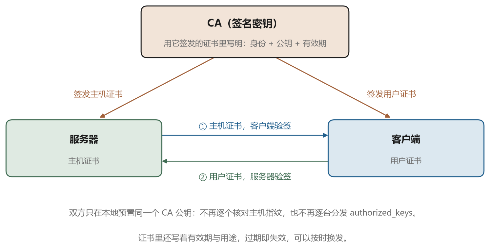

# 签名与证书链：从 Ed25519 到 CA 签发

## 3.1 签名要证明的三件事

一个签名成立，等于同时证明了三件事：

- 这份内容确实出自持有私钥的人
- 内容没有被改动
- 签名与“这一次”绑定，不能被搬到别处重用

第三件事常被忽略。如果签名只覆盖“我同意”，攻击者就能把你昨天的签名贴到今天的文件上。所以签名必须覆盖足够多的上下文——在 SSH 里，就是交换哈希 `H`；在对象存储里，是整个规范化请求。

把第三件事再拆细，会看到三种不同的失败方式，它们的防御手段并不相同。第一种是**重放**：同一段字节被原样搬到另一个时间或另一条连接上，防御办法是在被签内容里放一个只属于“这一次”的量，比如临时公钥或者会话标识。第二种是**可延展性**（malleability）：攻击者不碰私钥，只对签名本身做变换，得到另一个对同一消息也有效的签名；它不改变消息，却破坏了“签名唯一”这个假设，凡是拿签名当标识、当去重键、当审计凭据的地方都会出问题。第三种是**类型混淆**：同一串字节，在一个上下文里是签名，在另一个上下文里被解释成公钥或者别的结构，防御办法是给每种用途加上明确的标签，也就是域分离。

Ed25519 在设计上把前两种压得很小。它的签名是确定性的，同一条消息用同一个密钥只会产生一种签名，这本身就是最强的反延展性质；但“确定”不等于“编码唯一”，验证方必须检查标量的规范范围，否则 `S` 加上一个群的阶仍然能通过验证，同一份签名就有了两个合法写法。这一点在实现里是几行检查，漏掉就成了漏洞。

SSH 还额外做了一层保护：签名在线上的编码自带算法名字符串。`ssh-ed25519` 的签名 blob 是“字符串 `ssh-ed25519` 加一个 64 字节的字符串”，名字在字节流里，验证方先读名字再决定怎么解释后面那段。这就把“把 Ed25519 签名当成 ECDSA 签名用”这条路堵死了，因为类型一读出来就不对。

## 3.2 Ed25519 签什么

Ed25519 的密钥很短：公钥 32 字节，私钥 32 字节，签名 64 字节。签名分两部分：一个点 R，一个标量 S，各 32 字节。

验证者做的事，用一句话说：用公钥、消息哈希、R、S 算一个等式，成立就通过。具体公式不必记，要记的是它的性质：

- 同一个密钥、同一条消息，签名是确定的（不像 ECDSA 每次要随机数）
- 不需要额外的随机源，减少了“随机数复用导致私钥泄露”这一类事故
- 验证速度稳定，适合每连接都要验一次的场景

不过“不必记”是给使用者说的，实现者最好知道等式长什么样，否则无法判断哪些检查不能省。私钥那 32 字节其实是一个种子，先做一次 SHA-512，前半段钳位后当标量 `s`，公钥是 `A = s·B`，后半段留作签名时的随机化前缀。签名的过程是：用前缀和消息算出 `r`，取 `R = r·B`，再用 `R`、`A`、消息算出挑战 `k`，最后 `S = (r + k·s) mod L`：

```text
seed            -> SHA-512 -> clamp -> s        (private scalar)
A               = s * B                          (public key)
r               = SHA-512(prefix || M) mod L
R               = r * B
k               = SHA-512(R || A || M) mod L
S               = (r + k * s) mod L
signature       = R || S
verify          : S * B == R + k * A
```

验证等式之所以成立，是因为把 `S` 代进去展开后两边都是 `(r + k·s)·B`。`L` 是一个固定的素数，约等于 2^252，所有标量运算都在模 `L` 下进行；`S` 必须小于 `L`，否则同一个签名有多种编码，前面说的延展性就回来了。另外因为曲线有余因子 8，严格的实现会在两边同乘 8 再比较，或者在验证前把 `A` 和 `R` 都乘一次余因子，避免小阶点带来的边界情况。

在 SSH 里，被签的内容不是原始消息，而是交换哈希 `H`。这一点决定了签名不能脱离这次握手单独使用。

具体到字节层面，`ssh-ed25519` 的公钥 blob 是“字符串 `ssh-ed25519` 加字符串（32 字节公钥）”，签名 blob 是“字符串 `ssh-ed25519` 加字符串（64 字节，`R` 与 `S` 直接拼接）”。两种结构都以算法名开头，名字不对就无法把一种结构当成另一种解释，这本身就是域分离。

为什么签 `H` 而不签 `H` 的哈希，也是个值得说清的问题。`HASH(H)` 并不会更安全，`H` 本身已经是哈希输出，再哈希一次只是多一次计算；真正的区别在于对象：签 `H` 意味着签名验证方必须自己重算出 `H` 才能比对，而重算 `H` 需要版本串、两份 KEXINIT、主机公钥、双方临时公钥和共享秘密——缺一样都算不出来。签名因此变成了“对整次握手的承诺”，而不是“对某个公钥的承诺”。

用户认证阶段的签名又是另一套被签对象。客户端要签的是会话标识加上请求本身的字段：用户名、服务名、方法名、公钥算法名、公钥 blob，全部按 SSH 的字符串编码拼起来，最后加上布尔值表示“签名确实附在后面”。会话标识进了被签内容，所以一次认证请求无法被搬到另一条连接上重放，哪怕用户名和公钥完全一样。

签名算法的历史能说明“算法名”这件事有多重要。`ssh-rsa` 这个老名字指的是“RSA 密钥配 SHA-1”，而 SHA-1 的碰撞在 2017 年被实际构造出来，OpenSSH 从 8.8 起默认禁用了它。替代方案 `rsa-sha2-256` 与 `rsa-sha2-512` 用的还是同一把 RSA 密钥，只是把哈希换成了 SHA-256 或 SHA-512；也就是说，**密钥类型和签名算法是两件事**，协商列表里的 `server_host_key_algorithms` 列的其实是后者。这也解释了为什么服务端要发 `server-sig-algs`：客户端得知道对面支持哪一种，才能挑对签名算法。

ECDSA 的经验则指向另一个方向。它每次签名需要一个随机数 `k`，`k` 一旦重复或者可预测，私钥就能被直接解出来——游戏主机的那次事故就是这么发生的。Ed25519 用“从种子和消息确定性地推导 `r`”绕开了这个陷阱，代价是无法做盲签名之类的特殊构造，但对 SSH 这种每连接签一次的场合完全够用。

## 3.3 证书：把“公钥属于谁”写下来

指纹能防篡改，但不能回答“这把公钥应不应该被信任”。机器一多，`known_hosts` 就变成噩梦：每加一台机器、每换一次密钥，都要通知所有人。

证书解决的是“信任的可扩展性”。它的结构很简单，本质是一段被 CA 签过名的声明：

```text
主体：web01.example.com
公钥：ssh-ed25519 AAAA...
类型：主机证书
有效期：52 周
签名：由 CA 私钥对上面所有字段计算
```

上面这段是给人看的摘要，线上格式是一串按顺序排列的字段，全部用 SSH 的类型编码。表 3-1 是 OpenSSH 证书的实际布局，顺序不能变，因为签名覆盖的就是这些字节的拼接。

表 3-1　OpenSSH 证书的字段

| 字段 | 类型 | 内容 |
| --- | --- | --- |
| 证书类型 | string | 如 `ssh-ed25519-cert-v01@openssh.com` |
| nonce | string | 签发时随机生成，防止证书被预计算 |
| 公钥 | 按类型 | 与普通公钥的字段相同 |
| serial | uint64 | 序列号，吊销时按它定位 |
| 类型 | uint32 | 1 表示用户证书，2 表示主机证书 |
| key id | string | 便于人读的标识，日志里会出现 |
| valid principals | string 列表 | 允许的主体名，主机名或登录名 |
| valid after | uint64 | 生效时间，Unix 秒 |
| valid before | uint64 | 失效时间，Unix 秒 |
| critical options | string 列表 | 不认识的必须拒绝 |
| extensions | string 列表 | 不认识的可以忽略 |
| reserved | string | 预留给未来，当前为空 |
| signature key | string | CA 的公钥 blob |
| signature | string | CA 对以上所有字段的签名 |

签名覆盖的范围是从“证书类型”一直到“signature key”，签名本身不参与。这条规则决定了字段顺序不能改、不能多也不能少：任何一个字节变了，验签就失败。`critical options` 和 `extensions` 的差别也来自这里——前者如果验证方不认识，必须整张证书判为无效；后者不认识就跳过，这样新加的功能不会打死老客户端。

客户端只需要预先信任 CA 的公钥（一行配置），就能验证任意一台服务器出示的证书：签名对不对、主机名对不对、有没有过期、是不是主机证书而不是用户证书。

图 3-1 是这条信任链。



签发过程是四步，每一步都能在命令行里看到：

```bash
# 1. create the CA key, keep it offline
ssh-keygen -t ed25519 -f ca -C "host CA"

# 2. create the host key, no passphrase, owned by root
ssh-keygen -t ed25519 -f ssh_host_ed25519_key -N ""

# 3. sign the host key, host type, bound to names and a lifetime
ssh-keygen -s ca -I web01 -h -n web01.example.com,10.0.0.5 -V +52w \
    ssh_host_ed25519_key.pub

# 4. inspect what was produced
ssh-keygen -L -f ssh_host_ed25519_key-cert.pub
```

第三步里 `-h` 决定这是主机证书而不是用户证书，`-n` 是 principals，`-I` 是 key id，`-V` 是有效期。生成出来的 `-cert.pub` 和普通公钥一样发给客户端，服务端在 `sshd_config` 里用 `HostCertificate` 指过去。客户端侧则是往 `known_hosts` 里写一行 `@cert-authority *.example.com ssh-ed25519 AAAA...`，从此这个域下所有机器都不用逐台记录。

用户证书是同一套机制的另一个用法：CA 给“alice”签一张用户证书，服务器只要信任这个 CA，所有持有效证书的用户都能登录，不必逐个往 `authorized_keys` 里加公钥。权限控制靠证书里的 principals 字段，而不是靠用户名。

两类证书的差别全在几个字段上，表 3-2 把它们并排看。最容易踩的坑是把两者混用：服务端只接受用户类型的证书来认证登录，客户端只接受主机类型的证书来确认身份，类型字段对不上就直接拒绝，和签名对不对无关。

表 3-2　主机证书与用户证书的差别

| 项目 | 主机证书 | 用户证书 |
| --- | --- | --- |
| 类型字段 | 2 | 1 |
| principals 含义 | 主机名或地址 | 登录用户名 |
| 谁信任它 | 客户端，写在 `known_hosts` 的 `@cert-authority` | 服务端，由 `TrustedUserCAKeys` 指定 |
| 典型有效期 | 几周到一年 | 几小时到几天 |
| 附加限制 | 少见 | `force-command`、`source-address` 等 |

用户证书里最能体现“证书不只是身份”的是 critical options。`force-command` 把这条连接能执行的命令锁死成一个字符串，`source-address` 限定来源网段，两者都写在被 CA 签名的字段里，改一个字节签名就废。运维上这比在 `authorized_keys` 前面加限制前缀更可靠，因为限制和身份在同一次签名里，不会出现“公钥换了、限制忘了搬”的情况。

## 3.4 两种信任模型的取舍

表 3-3　两种信任模型的取舍

| | `known_hosts` | 证书 |
| --- | --- | --- |
| 信任的起点 | 每台机器的公钥，逐个记 | 一个 CA 公钥 |
| 扩容成本 | 线性增长 | 常数 |
| 换密钥 | 通知所有人清记录 | 重新签发即可 |
| 撤销 | 手动删行 | CA 维护吊销列表或短有效期 |
| 适合 | 个人、几台机器 | 几十台以上、需要轮换 |

小规模用 `known_hosts` 完全够，简单直接。规模上来之后，证书的收益非常明显：新增机器不用改任何客户端的配置。

这套模型有一个必须提前想清楚的失效点：**CA 私钥是单点**。它一旦泄露，攻击者可以给任意主机名签发任意证书，所有信任这个 CA 的客户端都会接受。所以工程上的常规做法是把 CA 私钥离线保存，签发动作在一台不联网的机器上完成，签出来的证书再拷出去；更严格的做法是分成“签发用”和“备份用”两把，或者引入有效期极短的签发流程，把泄露窗口压到最小。

吊销机制在 SSH 里是 KRL（密钥吊销列表），用 `ssh-keygen -k` 生成，服务端用 `RevokedKeys` 引用，既可以按序列号舔销一张证书，也可以按 key id 或整个 CA 吊销。它的弱点是分发：每个验证方都得拿到最新的列表，漏一份就等于漏一个入口，所以实际部署里更常用的是短有效期，把“需要吊销”变成“等它自然过期”。

与 TLS 的证书体系对比，差别集中在层次、字段语义和生态上。表 3-4 是逐项对照，其中“是否支持链”这一条最影响架构：OpenSSH 的证书只能由受信任的 CA 直接签发，没有中间 CA 的概念，想模拟分层只能用“信任多个 CA”来代替。

表 3-4　SSH 证书与 TLS 证书的对比

| 项目 | SSH 证书 | X.509（TLS） |
| --- | --- | --- |
| 编码 | SSH 类型编码的二进制 | ASN.1 DER |
| 层次 | 单层，CA 直接签发 | 根、中间、叶，可多层 |
| 名字 | principals 列表 | SAN 里的 DNS 名 |
| 通配符 | 支持，`*.example.com` | 支持 |
| 有效期 | 秒级时间戳，可短到几分钟 | NotBefore 与 NotAfter，通常 90 天 |
| 吊销 | KRL，按序列号或 key id | CRL 与 OCSP |
| 透明日志 | 无 | 证书透明（CT） |
| 认证方向 | 双向，两端都要证明身份 | 服务端必须，客户端可选 |

差异的根源是历史与目标不同。TLS 要面对的是“浏览器不认识任何服务器”，所以必须有层层分级的 CA、必须有吊销查询、必须有透明日志来约束 CA 的行为；SSH 面对的是“运维人员本来就认识自己的机器”，规模小得多，于是选了更简单的格式，代价是缺少审计与分层的工具，只能靠短有效期和内部流程补。

实际选择往往不是二选一。许多团队的做法是：主机侧用证书，因为机器数量多、变更频繁；用户侧也用证书，但把有效期压到几小时，用统一的身份系统签发；`known_hosts` 仍然保留，用来兜底少数不支持证书的老设备，并且明确标注哪些条目是历史遗留，避免有人以为它们还在生效。

## 3.5 常见的失败模式

- **主机名不匹配**：证书是给 `web01` 签的，你用 `10.0.0.5` 连过去，验证失败。证书绑定的是名字，不是地址
- **过期**：有效期过了，验证直接失败。短有效期加自动续签是常规做法
- **用错类型**：把用户证书当主机证书用，或者反过来
- **CA 私钥泄露**：这是最严重的一种，等于整个信任体系失效。所以 CA 私钥应该离线保存，签发用中间层
- **时钟不对**：客户端时间偏差太大，会把有效证书判成过期

最后一条在 SSH 里要打个折扣：验证方只会沿着一层签名走到信任锚，所以“中间层”不是链，而是另一个独立的 CA——要么在 `known_hosts` 里多写一行 `@cert-authority`，要么用极短有效期把风险窗口压小。

排查时先看 `ssh -vv` 的输出，它会打印证书主体、签发者、有效期和失败原因。比猜快得多。

具体要看的行有几处。`ssh -vv` 里出现 `Server host certificate:` 之后，会依次打印 `Certified by`、`Type`、`Valid`、`Principals`，这几行直接对应表 3-1 的字段；如果主机名不在 principals 里，接着就会出现 `Certificate invalid: name is not a listed principal`。过期与未生效的报错分别是 `Certificate invalid: expired` 与 `Certificate invalid: not yet valid`，两者都指向时间：前者通常是有效期太短或者客户端时钟快了，后者是证书还没生效或者客户端时钟慢了。

服务端那侧的日志在用户证书出错时更有用。`sshd` 会以 `Failed publickey` 开头记下失败的尝试，后面跟原因，常见的是 principals 不在允许列表、证书类型不对、CA 不在 `TrustedUserCAKeys` 里、证书已被 KRL 吊销。这些行默认可能被日志级别压掉，排查时临时把 `LogLevel` 提到 `VERBOSE` 最省事，事后记得改回去。

客户端侧的排查工具有三个，配合起来能覆盖大部分情况。`ssh-keygen -L -f cert.pub` 打印证书的全部字段，一眼就能看出 principals 里有没有你要连的名字；`ssh-keygen -F host -f known_hosts` 检查某条记录是否被匹配到，对哈希过的 `known_hosts` 尤其有用；`ssh -G host` 打印最终生效的配置，能确认 `@cert-authority` 那一行到底有没有被读进去。

还有两类失败容易被误判成证书问题。一类是权限：私钥文件权限过宽，客户端直接拒绝加载，报 `Permissions ... are too open`，和证书无关。另一类是 `known_hosts` 里的历史条目：如果同一台主机既有一条普通公钥记录，又有一行 CA 信任，普通记录可能优先，于是证书明明有效却走了老路径；清掉旧条目再试是最快的验证办法。

## 3.6 这一章记住什么

- 签名要证明“是谁、没被改、绑定这一次”，所以签名对象里必须有上下文。
- Ed25519 密钥短、签名确定、不依赖随机数，是当前 SSH 的默认选择。
- 证书把“公钥属于谁”写成一段被 CA 签名的声明，客户端只信任 CA。
- 规模小用 `known_hosts`，规模大用证书；失败先看 `ssh -vv`。
- 可延展性不改变消息，却破坏“签名唯一”，所以标量必须检查规范范围，编码必须带算法名。
- 签名对象是交换哈希 `H`，重算 `H` 需要整次握手的全部输入，签名因此绑住了协商过程。
- 证书的字段顺序固定，签名覆盖除签名本身之外的全部；critical options 不认识就必须拒绝。
- OpenSSH 证书没有中间 CA，一个信任锚直接签发，泄露即全盘失效，只能靠离线和短有效期兜底。
