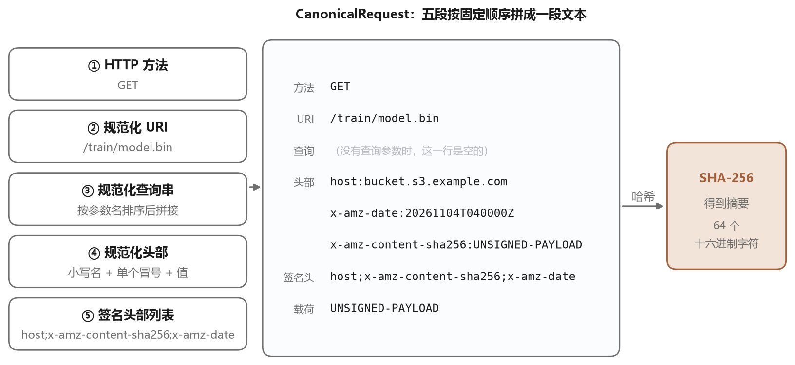
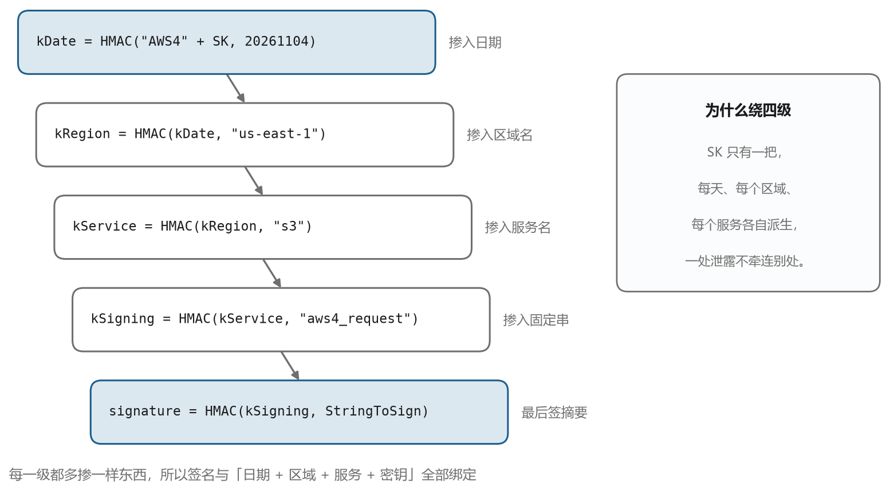

# SigV4：一次签名的完整推导

## 4.1 为什么需要“规范化”

对象存储的请求是 HTTP：方法、路径、查询串、头部、请求体，任何一项不同，语义就不同。

但 HTTP 允许同样的语义有多种写法：头部顺序随意、空格多少不限、查询参数的顺序可以调、路径可以用不同的百分号编码表示同一个字符。如果直接对这些逐字节签名，客户端和服务端算出来的结果一定对不上。

更麻烦的是中间层。反向代理会补上 `Via`、`X-Forwarded-For`，负载均衡器可能把 `Connection: keep-alive` 改写成 `close`，客户端库按哈希表的遍历顺序输出头部。这些改写合法又常见，语义没变，字节全变；签名一旦覆盖原始字节，就会被无关改动打碎。

所以签名之前要先**规范化**：把请求整理成唯一一种写法，再对这段文本签名。规范化的目的不是好看，是让“不同实现算出同一个结果”。

换个说法：规范化把语义相同的请求归成一个等价类，为每个类挑一个代表元，只对代表元签名。规则得覆盖足够多字段，让攻击者没法在被忽略的地方做手脚；确定且无歧义；计算足够便宜。

代价是规范变成了协议契约。规则里任何一处理解偏差，都会变成线上一个 `403`，而错误信息通常不会告诉你是哪一段算错了。表 4-1 列出规范化要消除的四类差异，它们同时也是实现时最常出错的地方。

表 4-1　规范化要消除的四类差异

| 差异来源 | 同一个请求的两种写法 | 规范化后的唯一形式 |
|---|---|---|
| 头部顺序 | 语言 A 让 `host` 排第一，语言 B 让 `x-amz-date` 排第一 | 按头名字节序排列 |
| 空白 | `a   b`、`a` + 制表符 + `b`、`a b` | 压成一个空格，去掉首尾空白 |
| 百分号编码 | `%2F`、`%2f`、`/` | 只对非 unreserved 字符编码，十六进制大写 |
| 参数顺序 | `?b=2&a=1` | 按编码后的名字排序 |

## 4.2 五段拼成规范请求

```text
CanonicalRequest =
  HTTPRequestMethod            + '\n' +
  CanonicalURI                 + '\n' +
  CanonicalQueryString         + '\n' +
  CanonicalHeaders             + '\n' +
  SignedHeaders                + '\n' +
  HexEncode(Hash(Payload))
```

逐段说明：

- **方法**：大写，`GET`、`PUT`。签名里统一大写，避免 `get` 与 `GET` 算出两套结果。
- **URI**：路径，逐段做百分号编码，但斜杠 `/` 不编码。`/a b/c` 变成 `/a%20b/c`。
- **查询串**：按参数名的字典序排序，同名的按值排序；键和值都要编码；空值写成 `key=`。
- **头部**：只取 `SignedHeaders` 里列出的那些，名字转小写，值去掉首尾空格、把连续空格压成一个，最后按名字排序。每一项写成 `name:value\n`。
- **签名头列表**：参与签名的头部名，小写、分号分隔、按字母序，比如 `host;x-amz-content-sha256;x-amz-date`。
- **载荷哈希**：请求体的 SHA-256 十六进制；流式上传时用固定的 `UNSIGNED-PAYLOAD`。

URI 段的规则来自 RFC 3986：`A-Z`、`a-z`、`0-9` 与 `-._~` 这些 unreserved 字符原样保留，其余按 UTF-8 拆成字节，每字节写成 `%XX`，十六进制用**大写**。空格因此是 `%20` 而不是 `+`——`+` 只在 `application/x-www-form-urlencoded` 里表示空格，在路径里它就是个加号。

路径不做点段归一化：`/a/../b` 保持 `/a/../b`，不会先化简成 `/b`。原则是**签你实际发出的那个路径**，而不是你脑子里想的那个；如果框架已经替你解码过一次，而签名用的是解码后的路径，就会出现“看起来对、算出来不对”。

双重编码是同一件事的另一面。如果键里字面就包含 `%2F` 这三个字符，编码后必须是 `%252F`，因为 `%` 本身要变成 `%25`。不少“中文文件名上传 403”的工单，根因都在这层：客户端把 `%` 当成已编码的标志，跳过了再编码。

查询串的细节更多。只取 `?` 之后的部分，键与值分别编码，斜杠在这里**要**编码成 `%2F`，因为查询串没有分段语义。没有值的参数写成 `key=`，不能省略等号。排序发生在编码**之后**，按字节序升序；同名参数按值的编码结果排序并全部保留。这一点违反直觉：`%` 的字节是 `0x25`，比字母数字都小，含空格的值会排到按字面看不该在的位置。

头部段的规则可以压缩成四步：取 `SignedHeaders` 列出的头、名字转小写、值去首尾空白并把内部连续空白（空格与制表符都算）压成一个空格、按名字排序。空值也要保留，写成 `name:` 后面什么都不跟。同名多值按到达顺序用逗号连接，再当作一个值压缩空白，顺序不能重排。

`host` 必须参与签名。原因很实际：不签 `host`，攻击者可以拿一份合法签名去访问另一个虚拟主机，差别只在头部。`host` 的值要包含端口——端口不是协议默认端口时，`example.com:8080` 与 `example.com` 是两个不同的 host。

`SignedHeaders` 与头部块必须严格对应：头部块里出现的名字，一个不少地按序出现在 `SignedHeaders` 里；`SignedHeaders` 里列的，头部块里也必须有，多一个少一个都会失败。头部块最后有一个空行，那是每行末尾 `\n` 的自然结果。

载荷哈希有三种取值。正常请求是请求体的 SHA-256，小写十六进制，64 个字符；空请求体固定为 `e3b0c44298fc1c149afbf4c8996fb92427ae41e4649b934ca495991b7852b855`；流式上传用 `UNSIGNED-PAYLOAD` 或分块签名的 `STREAMING-AWS4-HMAC-SHA256-PAYLOAD`。允许“不签载荷”不是偷懒：大文件要么缓冲进内存，要么读两遍，都很贵；代价是签名只保护头部，载荷完整性交给 TLS。

下面是一个请求落到规范请求的示意，注意末尾的空行。

```text
incoming request
  GET /Photos/2026/a%20b.jpg?prefix=x%2Fy HTTP/1.1
  Host: example.com
  x-amz-content-sha256: UNSIGNED-PAYLOAD
  x-amz-date: 20261104T040000Z

canonical request, one segment per line
  GET
  /Photos/2026/a%20b.jpg
  prefix=x%2Fy
  host:example.com
  x-amz-content-sha256:UNSIGNED-PAYLOAD
  x-amz-date:20261104T040000Z
  (blank line, ends the header block)
  host;x-amz-content-sha256;x-amz-date
  e3b0c442...b855
```

拼接时用单个 `\n`，不要用 `\r\n`，也不要在最后一行之后补换行。图 4-1 是这一段的拼接过程。



## 4.3 待签字符串

```text
StringToSign =
  "AWS4-HMAC-SHA256"           + '\n' +
  "20261104T040000Z"           + '\n' +
  "20261104/ap-guangzhou/s3/aws4_request" + '\n' +
  HexEncode(Hash(CanonicalRequest))
```

第二行是时间戳，第三行是“凭据范围”：日期、地域、服务、终止符。这三行把签名钉死在“某一天、某个地域、某个服务”上。

第一行是算法标识，固定为 `AWS4-HMAC-SHA256`：它声明签名用 HMAC-SHA256，密钥用下一节的四层派生。换算法就换标识，服务端按标识分发。

第二行是 ISO 8601 基本格式的 UTC 时间：`YYYYMMDD'T'HHMMSS'Z'`，精确到秒，不带毫秒与时区偏移。它必须与 `x-amz-date` 的值逐字符相同，不是“表示同一时刻”，而是“完全相同”。用本地时间格式化、或保留毫秒，都会失败。

第三行的四段各有来源：日期必须等于时间戳的日期部分，UTC 零点前后最容易在这里错位；地域必须与请求发往的端点一致；服务是服务名，`s3`、`execute-api` 各有取值；`aws4_request` 是终止符，表示这份派生链用于“请求签名”。服务端会把 `Credential` 里的 scope 与这一行比对，不一致直接拒绝。

第四行是规范化请求的 SHA-256，64 个小写十六进制字符。用哈希而不是原文有三个理由：定长，不会长到几兆；消歧义，规范请求里本来就有换行，套一层会让行边界难判断；只哈希一次，服务端也要算它，正好复用。

行间分隔符是单个 `\n`，最后一行之后没有额外换行。这个细节常被忽略：某些 HTTP 库在拼接时习惯性补一个结尾换行，结果签名差了 1 个字节。

## 4.4 四层派生

签名的密钥不是 SecretKey 本身，而是从它派生出来的：

```text
kDate    = HMAC("AWS4" + SecretKey, "20261104")
kRegion  = HMAC(kDate,    "ap-guangzhou")
kService = HMAC(kRegion,  "s3")
kSigning = HMAC(kService, "aws4_request")

Signature = HexEncode(HMAC(kSigning, StringToSign))
```

HMAC 有两个参数，顺序不能反：`HMAC(key, message)`。这里的 `key` 是上一层的**原始字节**输出（32 字节），不是它的十六进制字符串——把 hex 当 key 是排第一位的实现错误，“64 个字符”和“32 个字节”看起来差不多，算出来完全不同。表 4-2 摊开每一步的输入输出。

表 4-2　签名密钥四层派生的输入输出

| 步骤 | key | message | 输出 |
|---|---|---|---|
| kDate | `AWS4` 前缀加 SecretKey 的 ASCII 字节 | `20261104` | 32 字节 |
| kRegion | kDate 的 32 字节 | `ap-guangzhou` | 32 字节 |
| kService | kRegion 的 32 字节 | `s3` | 32 字节 |
| kSigning | kService 的 32 字节 | `aws4_request` | 32 字节 |
| 签名 | kSigning 的 32 字节 | 待签字符串 | 32 字节，转成 64 个十六进制字符 |

为什么要派生出四层，而不是直接用 SecretKey？一是把密钥和日期、地域、服务绑定，同一个 SecretKey 在不同场景算出的签名密钥不同，一处泄露不影响别处；二是让签名密钥每天变化。展开说有四层意思。

- **域分离**：`AWS4` 前缀让 HMAC 的 key 与 SecretKey 区分开，四层的 message 又都是常量标签（日期、地域、服务名、终止符），每个用途的输入都不同。
- **单向**：从 kSigning 推不出 kDate，从签名推不出 kSigning。泄露一份 kSigning 只等于泄露“某天、某地、某服务”的签发能力，不等于泄露 SecretKey。
- **短期**：kSigning 的有效期天然是一天。跨天时 kDate 变了，整条链都变，昨天的密钥今天作废。
- **可缓存**：同一天、同一地域、同一服务复用同一个 kSigning。缓存在进程内存里，每个请求只剩最后一次 HMAC；不缓存就是四次，单次几微秒，在每秒十万请求的量级上也不便宜。

严格说这四层不是“加密”，而是伪随机函数（PRF）的级联：安全性依赖 HMAC-SHA256 作为 PRF 的性质，而不是“密钥越算越安全”。每层输出都是 32 字节，长度没变，变的是它绑定的上下文。图 4-2 是这四层。



## 4.5 实现时最容易错的六处

1. **路径编码**：把 `/` 也编码了，或者该编码的空格没编码。规则是逐段编码、保留斜杠。症状是带空格或中文的键全部 `403`；修法是把“最终放进请求行的那个路径”直接作为签名输入。
2. **查询串排序**：按未编码的键排序，而不是按编码后的字符串。另外两个坑是空值被丢掉（`?acl` 与 `?acl=` 不等价）和重复键被去重。修法是先编码、再排序、再用 `&` 连接。
3. **头部空格**：`a   b` 要压成 `a b`，前后空格要去掉，名字必须小写。制表符与连续空格的组合、多值头部的逗号连接、空值只留冒号，都归在这一类。
4. **`host` 头**：必须参与签名，且要和实际请求的域名（含端口，如果不是默认端口）完全一致。经过代理或 CDN 时，两侧看到的 host 可能不同；用加速域名访问却按源站域名签名，是最典型的写法错。
5. **时间戳与时钟**：服务端通常允许 15 分钟偏差，机器时间漂移会直接导致 `RequestTimeTooSkewed`。
6. **地域写错**：签名里写 `ap-guangzhou`，请求发到 `ap-shanghai`，服务端算出来的签名不同，报 `SignatureDoesNotMatch`，但错误信息不会告诉你地域错了。

排查顺序建议：先看错误码，`SignatureDoesNotMatch` 查规范化和编码，`RequestTimeTooSkewed` 查时钟，`AccessDenied` 查策略。表 4-3 把六类并列对照。

表 4-3　六类错误的现象与定位

| 类别 | 典型现象 | 根因 | 定位手段 |
|---|---|---|---|
| 路径编码 | 含空格、中文、`%` 的键全失败 | 双重编码或漏编码 | 打印最终请求行，与签名输入逐字符比对 |
| 查询排序 | 带多个参数的请求失败，单参数正常 | 编码前排序、丢空值、去重 | 只留一个参数测通，再逐个加回 |
| 头部空白 | 带自定义头的请求失败 | 制表符未压缩、多值未合并 | 先只签 `host`，再逐个头加入 |
| `host` 不一致 | 走 CDN 或内网代理时失败 | 签名域名与实际域名不同 | 在服务端日志里看收到的 `Host` |
| 时钟漂移 | 间歇性失败，重启后恢复 | NTP 未同步、容器时钟冻结 | 比对 `date -u` 与服务端返回的时间 |
| 地域错配 | 换区之后全部失败 | endpoint 与 scope 的 region 不一致 | 把 endpoint 与 region 成对配置 |

最有效的调试手段是把中间结果落盘。多数对象存储的 `SignatureDoesNotMatch` 响应里会带 `CanonicalRequest`、`StringToSign` 与 `SignatureProvided`，逐字符对比，第一个不同的位置就指向出错的段落。本地可以用官方 CLI 发同一个请求，打开调试日志对照。

更系统的做法是二分：先只签 `host` 确认通过，再依次加入 `x-amz-date`、`x-amz-content-sha256`，每加一项测一次，五个段也能单独验证。另一个技巧是**钉住时间**，用固定的 `x-amz-date` 把时钟排除掉，剩下的差异只可能来自编码与拼接。

时钟问题值得单独说。`RequestTimeTooSkewed` 的响应里通常同时给出服务端时间与客户端声称的时间，差值就是漂移量。常见原因是容器从快照恢复后时钟停在旧值、NTP 被防火墙挡住、容器内无权改时钟，修复靠 chrony 这类常驻同步而不是重启。时间不准的影响不止签名：它还会让 TLS 证书被判定为尚未生效、让 JWT 的 `exp` 与 `nbf` 判断出错、让日志时间线错位。

地域错配是部署配置问题。签名把 region 写死在派生链里，endpoint 与 region 必须成对出现，一个都不能换；多区部署时把两者写进同一个配置项，比分别配两个变量安全。全球端点在服务端会解析到某个具体地域，对新建的桶通常要求客户端显式指定 region，否则会出现“在这个区能跑、换个桶就 403”。

## 4.6 预签名 URL 的差别

预签名把签名从请求头挪到查询参数里，好处是不需要把密钥交给对方，链接本身带权限，到期失效。机制上，它把 `Authorization` 头里的信息拆成查询参数：`X-Amz-Algorithm` 放算法标识，`X-Amz-Credential` 放 AK 与 scope，`X-Amz-Date` 放时间戳，`X-Amz-Expires` 放有效期秒数，`X-Amz-SignedHeaders` 放参与签名的头部，`X-Amz-Signature` 放结果。服务端重建规范请求时把它们当普通参数处理，`X-Amz-Signature` 本身不参与计算。

差别有三点：

- 载荷哈希用 `UNSIGNED-PAYLOAD`，因为签名时还没看到请求体
- 多一个 `X-Amz-Expires`，单位是秒，服务端用它判断是否过期
- 签名的结果要再做一次 URL 编码，因为 `+`、`/`、`=` 在查询串里有特殊含义

三点之外还有几处结构性差异，见表 4-4。

表 4-4　头部签名与预签名 URL 的对比

| 维度 | 头部签名 | 预签名 URL |
|---|---|---|
| 签名位置 | `Authorization` 头 | 查询参数 `X-Amz-Signature` |
| 载荷保护 | 可签完整 body 哈希 | 通常 `UNSIGNED-PAYLOAD` |
| 参与签名的头 | `host` 加若干 `x-amz-*`，可含 `content-type` | 通常只有 `host` |
| 有效期 | 通常 15 分钟窗口 | `X-Amz-Expires`，常见上限 7 天 |
| 泄露后果 | 需拿到整个请求 | 链接即凭证，任何人可用 |
| 能否撤销 | 轮换密钥后失效 | 只能等过期或轮换密钥 |

有效期要留意上下界。`X-Amz-Expires` 通常有上限（7 天是常见值），而用临时凭证签发时，链接有效期不能超过凭证剩余时间——签“七天有效”但凭证一小时后就过期，链接一小时后就会失效，这个矛盾在排查“链接提前失效”时经常被忽略。

一个签名 URL 的权限范围由三件事决定：允许的方法、限定的对象、有效期。给外部临时访问时，这三项都要收紧，不要图省事签一个“全桶、GET、七天有效”。

还有两点容易被忽视。预签名 URL 不绑定客户端身份，链接发给谁谁就能用，适合“一次分享”，不适合“给某个用户长期授权”；它通常也不校验 `Content-Type` 与请求体大小，上传类预签名要靠表单上传的 `policy` 之类机制补足。需要“一次性”语义时，正确做法是自己发不透明 token，校验并消费之后再代理。

## 4.7 这一章记住什么

- 规范化的目的是让不同实现算出同一个结果，不是让请求好看。
- 签名 = 四层 HMAC 派生出密钥，再对“算法 + 时间 + 范围 + 请求哈希”做一次 HMAC。
- 绝大多数 `SignatureDoesNotMatch` 出在路径编码、查询排序、头部空格、地域这四处。
- 预签名 URL 的三个收紧点：方法、对象、有效期。
- 时钟与地域是两个“配置型”故障源：endpoint 与 region 成对配置，NTP 当基础设施而不是可选项。
