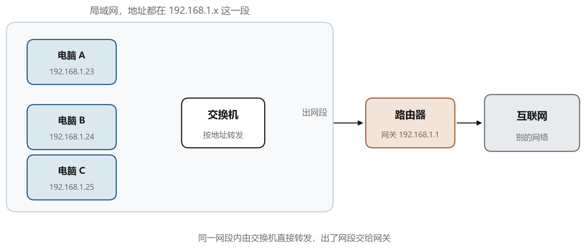
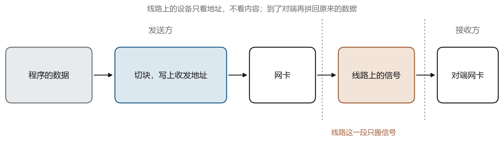
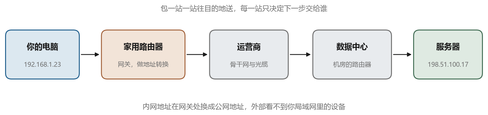

# 计算机之间怎么通信

## 1.1 先要有线

两台计算机要交换数据，中间必须有某种连接。最常见的是网线。网线两端插在机器背后的网口上，网口后面是一块叫网卡的硬件，它负责把计算机内部的 0 和 1 变成线路上可以传输的电信号，也负责把收到的电信号还原成 0 和 1。

网线本身有规格之分。最常见的是双绞线，八根细铜线分成四对，两两绞在一起抵消干扰，接头是那个透明的塑料水晶头。Cat5e 在 100 米内跑千兆，Cat6 同样距离更稳、短距离可以跑 2.5G 或 5G，Cat6a 才能在 100 米内跑万兆。超过 100 米铜线就力不从心了，改用光纤：多模光纤几百米，单模可以几十公里。家里的线多半是 Cat5e，机房里跑万兆的基本是光纤或 Cat6a。

网卡出厂时带着一个 48 位的硬件地址，叫 MAC 地址，写成 `3c:52:82:1a:7f:0e` 这样六组十六进制。前三个字节是厂商编号，后三个字节由厂商自己分配，理论上全球唯一。它和 IP 地址不一样：MAC 固化在网卡上，换一块网卡就换一个地址；IP 是软件配上去的，随时可以改。

还有一件事叫双工。早期的集线器让所有设备共享一条线路，同一时刻只能有一台在说话，这叫半双工，两边同时发就撞车。现在的交换机和网卡都支持全双工，收发各走一对线，同一个时刻可以双向满速。两端上电时会自动协商速率和双工模式，协商出岔子就可能退到百兆半双工，表现出来是“通着，但特别慢”。

一台机器通常只有一两个网口。要让五台机器互相通信，不可能两两拉线，于是有了交换机。交换机是一个带很多网口的小盒子，所有机器都连到它上面，它负责把一台机器发出的数据转给另一台。交换机不关心数据的内容，只关心“这条数据要送给谁”。

无线网络把这根线换成了无线电波。机器里装一块无线网卡，通过天线收发信号，房间里再放一个接入点，所有无线设备都连到它上面。接入点的作用和交换机类似，只是连接方式从线变成了波。

把上面这些设备连在一起，就形成了一个网络。网络这个词没有更神秘的含义，它就是一组能够互相发送数据的设备。

## 1.2 局域网与地址

一个房间、一层楼、一个机房里连起来的网络，叫局域网。局域网的范围通常在几十米到几百米，家里的 Wi-Fi、办公室的网线、机房里机柜之间的连线，都是局域网。

局域网里的设备多了，就需要地址。交换机把数据转给谁，靠的就是地址。最常用的地址格式叫 IP 地址，写成四组数字，中间用点隔开，比如 `192.168.1.23`。这个地址在同一个局域网里必须唯一，否则数据会送错。

地址还有一层含义，叫网段。网段指的是前几组数字相同的一组地址。`192.168.1.23`、`192.168.1.24`、`192.168.1.25` 属于同一个网段，因为前三组都是 `192.168.1`。同一个网段里的设备可以直接把数据发给对方，交换机就能完成转发，不需要别的设备帮忙。

交换机转发靠的是一张表，叫 MAC 地址表。表里每一行记着“某个 MAC 地址在哪个口上”。这张表一开始是空的，交换机靠观察学习：某个口上进来一个帧，它就把源 MAC 和这个口配成一对记下来；下次收到目的地址是它的帧，直接从对应的口送出去，这叫单播转发。家用交换机通常能记几千条，机房里的大箱子能记几十万条，表满了就淘汰最久没用的条目。

表里查不到的地址不会被丢掉，交换机从除来源口以外的所有口各发一份，这叫泛洪。收到的人一看目的 MAC 不是自己，默默丢掉。目的地址是全 `ff:ff:ff:ff:ff:ff` 的帧叫广播帧，交换机一律泛洪，因为广播的意思就是“发给这一片所有人”。同一个广播能到达的范围叫广播域。广播域太大是有害的：地址解析、获取地址、各种服务通告都会变成广播，几百台机器挤在一个域里，光处理广播就够忙。解决办法是在交换机上划 VLAN（虚拟局域网），把一台物理交换机切成几个互不相通的广播域。想看自己机器上的表，`ip link` 里的 `link/ether` 后面就是本机 MAC，`bridge fdb show` 能看到 Linux 网桥学到的表项。

图 1-1 画的是一个典型的局域网。几台电脑连到交换机上，交换机再连到一台路由器，路由器通向外部。



## 1.3 出了局域网要找网关

局域网再大也有边界。数据要送到另一个网络里的机器，交换机就无能为力了，它只认识自己这一片。承担跨网络转发任务的是路由器。

路由器的工作是连接两个或多个网络。它有好几个网口，每个网口接一个网络，收到数据之后看目的地属于哪个网络，再从对应的网口送出去。家里的那台“路由器”其实是个合体设备，里面同时有路由器、交换机、无线接入点和一层简单的防护功能，所以它既能发 Wi-Fi，又能让手机和电脑互相访问，还能连上运营商。

数据离开本网段时，要交给一台特定的设备，这台设备叫网关。网关通常是路由器在本网段里的那个地址，比如 `192.168.1.1`。可以把它理解成小区的大门，所有出门的包裹都要先送到门卫那里，由门卫决定往哪条路送。

把无数个网络用路由器连起来，就是互联网。互联网没有中心，它是一张由运营商、数据中心、海底光缆拼成的网，任何一个网络都只是其中一个节点。

路由器凭什么决定往哪个口送？靠路由表。表里每一行是“目标网段、下一跳、出接口、度量值”。在一台 Linux 机器上敲 `ip route`，看到的多半是这样几行。

```text
default via 192.168.1.1 dev eth0 proto dhcp metric 100
192.168.1.0/24 dev eth0 proto kernel scope link src 192.168.1.23
10.8.0.0/24 via 192.168.1.1 dev eth0 metric 50
```

第一行是默认路由，`default` 等价于 `0.0.0.0/0`，意思是“其余所有地址”。第二行是直连网段，`scope link` 说明目的就在这根线上，不用经过网关。第三行是手工加的，告诉系统去 `10.8.0.0/24` 也要走网关。

一个目的地址常常同时匹配好几行，因为前缀长度不同。选哪一行？选前缀最长的那行，这条规则叫最长前缀匹配。查 `192.168.1.77`，`/24` 和 `/0` 都匹配，`/24` 更长，走直连；查 `10.8.0.9`，`10.8.0.0/24` 和 `/0` 都匹配，还是 `/24` 胜出。这也是子网掩码里的位数不能随便写的原因：位数越长，规则越精确。

局域网和广域网的差别，可以对着表 1-1 看。局域网是自己铺的线，自己说了算；广域网是租来的线路，中间那些设备不归你管，出了故障只能报障等回复。

表 1-1　局域网与广域网

| 项目 | 局域网 | 广域网 |
| --- | --- | --- |
| 距离 | 几十米到几百米 | 城市之间、跨洲 |
| 归属 | 自己建设、自己维护 | 运营商提供，租用 |
| 典型时延 | 小于 1 毫秒 | 同城几毫秒，跨洲上百毫秒 |
| 带宽成本 | 一次性投入，带宽高 | 按带宽计费，越远越贵 |
| 常见故障 | 网线松、端口坏、环路 | 光缆中断、路由震荡、拥塞 |
| 谁来修 | 自己 | 运营商，你只能报障 |

## 1.4 数据是怎么走的

网络传输的不是一个完整的文件，而是一个个小块。发送方把数据切成小块，每块前面加上一段说明，写明从哪来、到哪去、属于哪个文件的第几块。这种带说明的小块叫数据包，通常简称包。

包交给网卡，网卡把里面的 0 和 1 变成电信号或者无线电波送出去。沿途的交换机、路由器只看包头里的地址，不看内容，把包一段段往下传。对端的网卡收到信号，还原成 0 和 1，再交给操作系统，操作系统按包头里的序号把小块拼回原来的数据。图 1-2 是这个过程的示意。



这个设计和寄快递很像。包裹上写清收件地址，分拣中心只扫地址，不拆包裹。包裹可能经过好几个中转站，每一站只负责往下一站送。

这里有一个容易忽略的细节：IP 地址只在路由器之间有用，真正把帧交给下一台设备时用的是 MAC 地址。你的电脑要把包发给网关，得先知道网关的 MAC。这件事由 ARP（地址解析协议）完成：它在局域网里喊一句“谁是这个 IP，把 MAC 报上来”，喊的方式就是广播帧；持有这个地址的机器单播回一句“是我，我的 MAC 是……”。结果被存进一张表，几分钟内不再重复询问，`ip neigh` 能看到这张表，条目带着 `REACHABLE`、`STALE` 这样的状态。

沿着这条链看下去会发现，MAC 地址每一跳都在变，IP 地址从头到尾不变。你把包发给网关，帧的源 MAC 是你的网卡，目的 MAC 是网关；网关转给下一台路由器时重新组一个新帧，源 MAC 换成自己的出口网卡，目的 MAC 换成下一跳的。这就是“IP 负责端到端，MAC 负责一跳之内”。

再往下是长度限制。以太网一个帧最多 1500 字节，这个上限叫 MTU（最大传输单元）。1500 减去 IP 头 20 字节、TCP 头 20 字节，留给应用的有效载荷通常约 1460 字节。IPv4 允许中间路由器把超长的包切成几片分别转发，叫分片；麻烦在于丢一片整包就得重传，接收方还得等齐所有分片才拼得出来。所以现代做法是在 IP 头上打一个“不许分片”的标志位，由发送方自己按路径上最小的 MTU 切好，这叫路径 MTU 发现。它靠 ICMP 的“需要分片”消息回传，一旦这类 ICMP 被防火墙挡掉，就会出现“小请求能过、大响应卡住”的怪现象。

## 1.5 协议：先把话怎么说定下来

不同厂商生产的网卡、交换机、路由器要能互通，就必须事先约定数据长什么样、先发什么后发什么、收到之后怎么回应。这种约定叫协议。

协议在生活里到处都是。寄信要按格式写邮编、地址、收件人，否则分拣不了。打电话要先说“喂”，确认对方在听，再讲正事。网络协议也是这个意思，只不过约定得非常精确，精确到每一个比特的位置。

网络里的协议不止一个，而是一组，各管一段。有的负责把 0 和 1 送到隔壁机器，有的负责把包从北京送到广州，有的负责在丢包时重发，有的负责把数据加密。它们叠在一起工作，形成分层结构，第三章会把这套分层拆开讲。现在只需要记住一件事，网络不是一块铁板，它由许多各管一段的约定拼成。

工程上习惯把这组协议按层次摆开，最流行的两种摆法是 OSI 七层模型和 TCP/IP 四层模型。表 1-2 把它们和实际协议对上。

表 1-2　两种分层模型与实例

| OSI 七层 | TCP/IP 四层 | 典型协议 | 这一层的单位 |
| --- | --- | --- | --- |
| 应用层、表示层、会话层 | 应用层 | SSH、HTTP、DNS | 消息 |
| 传输层 | 传输层 | TCP、UDP | 段、数据报 |
| 网络层 | 网络层 | IP、ICMP | 包 |
| 数据链路层、物理层 | 网络接口层 | 以太网、Wi-Fi | 帧、比特 |

OSI 是教科书里的参考模型，分得细；TCP/IP 是真正跑起来的实现，把上面三层并成一层、下面两层并成一层。日常说的“三层交换机”“七层负载均衡”用的是 OSI 的编号：三层指按 IP 地址转发，七层指能看懂 HTTP 请求的内容再决定转给谁。

分层的价值在于每一层只跟上下两层打交道。换掉网线不影响 SSH，换掉 SSH 的实现也不影响它下面的 TCP。代价是每一层都要加自己的头部：一个 100 字节的按键，裹上 TCP、IP、以太网的头部之后要占 154 字节，所以小包频繁往返的协议，头部开销的比例很高。

## 1.6 明文与密文

数据在线路上传输时，本质上是一串 0 和 1。如果这串 0 和 1 就是原始内容，没有做任何伪装，那么任何人拿到它都能直接读出来。这种状态叫明文。

明文的问题在于，线路上不只有你和对方。数据要经过交换机、路由器、运营商的设备，还要经过无数中间网络。这些设备的所有者并不是你，理论上他们都能把经过的数据复制一份。共享 Wi-Fi 的场景更直接，同一个无线网络里的其他设备，只要愿意，就有机会收到不属于自己的信号。

解决办法是加密。发送方用一套规则把明文变换成看起来毫无意义的内容，这叫密文。只有掌握对应规则的人才能把它还原，这个还原过程叫解密。加密的规则由一把密钥控制，密钥不同，同样的明文会变成完全不同的密文。

打个比方。明文是明信片，一路上谁都能读。密文是装进保险箱的纸条，路上的人只能看到箱子，打不开。密钥就是那把钥匙。

加密能解决“被看到”的问题，但还有两件事要处理。一是内容可能被改动，二是对面可能不是你以为的那台机器。这两件事在后面的章节里会分别展开，第五章讲加密与校验，第七章讲身份与指纹。

## 1.7 早期的远程登录协议 telnet

有了网络之后，人们很自然地想到用它来操作远处的机器。1969 年出现的 telnet 就是做这件事的。它让本地的一台机器变成远端机器的终端（终端指负责显示和输入的那一端，本身不做计算），你在本地敲键盘，字符被送到远端，远端的输出被送回来显示。用起来和坐在那台机器面前几乎一样。

telnet 的设计非常简单，它把按键原样变成字节发出去，把回传的字节原样显示出来。简单带来了两个后果。一是兼容性好，几乎任何系统都能实现。二是没有加密，也没有可靠的身份验证，登录时输入的用户名和密码以明文形式经过整条链路。在所有人都待在同一个可信机房的年代，这个代价可以接受。网络扩展到校园、城市、跨洲之后，它就成了一个明显的漏洞。

telnet 用的是 23 端口，协议里规定了一套“网络虚拟终端”的中立表示，把不同终端的差异抹平，所以四十年前的各种机器都能互通。它还有行模式和字符模式两套交互方式，早期的全屏程序靠一堆转义序列在字符模式里画出来。今天几乎没人拿它登录，但 `telnet 203.0.113.24 22` 这种用法还在：它只是建立一条 TCP 连接，连上就说明端口通，收到 `SSH-2.0-...` 就说明对面确实是 sshd。而留在公网上的 23 端口，现在基本只剩扫描器和老设备。

1995 年出现的 SSH（Secure Shell，一种加密的远程登录协议）针对的正是这一点。它保留了 telnet 的使用方式，你依然是在本地敲命令、看远端输出，但整条通道是加密的，双方还要互相证明身份。今天 telnet 基本只用于调试和教学，实际登录一律用 SSH。

## 1.8 客户端与服务端

网络上的通信总是由一方发起，另一方等待。发起连接的程序叫客户端，等待连接的程序叫服务端。

浏览器是客户端，网站是服务端。你在终端里敲的 `ssh` 是客户端，远端运行的 `sshd` 是服务端。服务端要先在某个位置“守着”，等别人来连，这个守候的动作叫监听。客户端则主动向那个位置发起连接。

同一台机器可以同时扮演两个角色。你的笔记本既是浏览器客户端，也运行着各种服务端程序，随时准备接受局域网里其他设备的请求。角色取决于这一次通信里谁发起、谁响应，和机器本身无关。

## 1.9 一次访问经过的路

把上面这些串起来，一次访问的路径大致如图 1-3。



你的电脑先判断目标地址在不在本网段。不在，就把包交给网关。网关看目的地址，决定往哪条线路送，包经过运营商的网络，经过若干台路由器，最终到达服务器所在的数据中心，再由那里的路由器送到服务器。服务器处理完，把结果按原路送回。

这条路的长度可以用时间来量。一个包从发出到收到回应，这段时间叫 RTT（往返时延）。它由四段组成：信号在铜线或光纤里跑的时间、经过每台设备排队和查表的时间、包被逐位发上线路的时间、两端处理的时间。同城通常 1 到 5 毫秒，国内跨省 20 到 40 毫秒，跨太平洋 150 毫秒上下。这些数字决定了交互的手感：本地终端自己回显，敲键盘感觉不到延迟；但一条需要往返几次才能完成的命令，延迟就会叠加成肉眼可见的卡顿。

时延和带宽是两件事。带宽是管子有多粗，时延是管子有多长。两者相乘得到带宽时延积，也就是“在途数据最多能有多少”：一条 1 Gbps、RTT 40 毫秒的链路，1 Gbps × 0.04 s = 40 Mb，约合 5 MB。发送方必须一次发出 5 MB 才能把管子灌满，窗口小于这个数，带宽就用不满。跨洲传大文件慢，往往不是带宽不够，而是窗口太小、丢包太多。

想知道路上经过哪些设备，用 traceroute。它的办法很巧：把包的 TTL（生存时间，每经过一台路由器减一）设成 1，第一台路由器减到 0 就丢弃并回一条“超时”的 ICMP 消息，地址就暴露了；再把 TTL 设成 2、3 一路试下去，整条路径和每一跳的 RTT 都出来了。

```bash
traceroute -n 203.0.113.24
tracepath 203.0.113.24
```

`-n` 表示不反查域名，快很多。中间出现 `* * *` 通常是那台路由器不回应 ICMP，不代表断线；判断断点要看后面几跳是不是全部超时。Windows 上的对应命令是 `tracert`，它默认发 ICMP，遇到不同的过滤规则时结果可能不一样。

这条路上有两个细节值得先知道。第一，家里的网关通常会把你的内网地址换成它的公网地址再发出去，这样外部只看到网关的地址，看不到你内网的具体设备，这个机制叫地址转换，第三章会讲。第二，路上任何一跳都可能出问题，所以“连不上”从来不是一个单一的原因，而是一串可能。

## 1.10 这一章的位置

这一章只做了两件事。把网络拆成看得见的设备（网卡、交换机、路由器、网关），把通信拆成看得见的动作（切包、加地址、转发、还原）。有了这两层直觉，后面讲具体协议时就不会悬空。如果只带走三句话，那就是：IP 是逻辑地址，MAC 是硬件地址；路由决定从哪个口出去，MAC 决定下一跳交给谁；分层让每一层可以单独替换。

第二章回到这本书的主角，说明 SSH 到底是什么、它保证什么、不保证什么。第三章再往下走一层，把地址、端口、数据包的结构和排错方法讲清楚。如果你在读后面的章节时遇到没解释的名词，多半是在这一章或第三章出现过，可以回头查。
