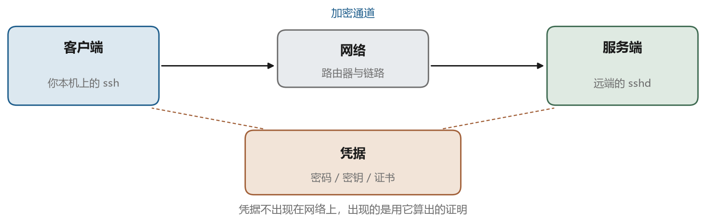
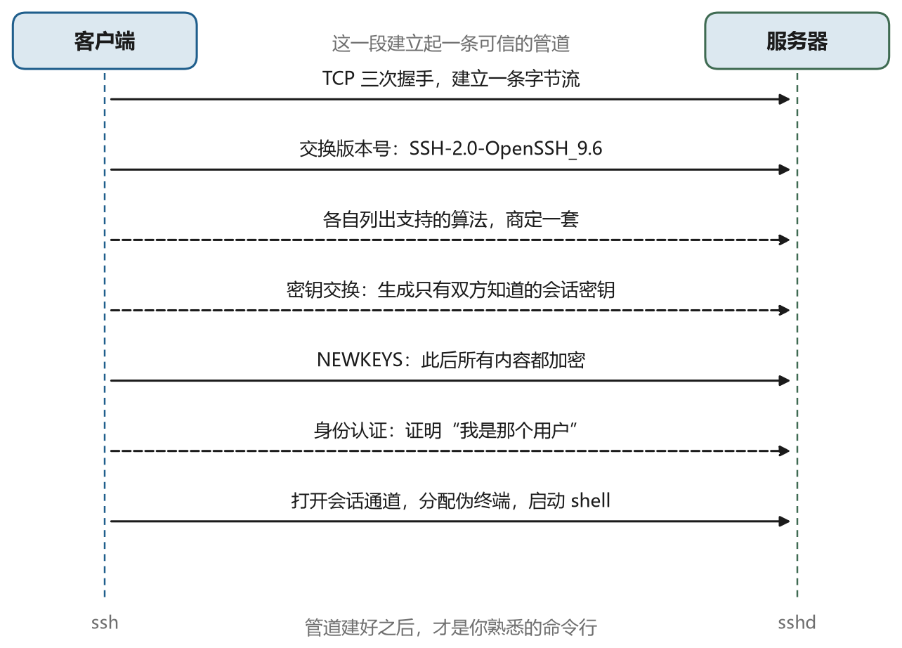
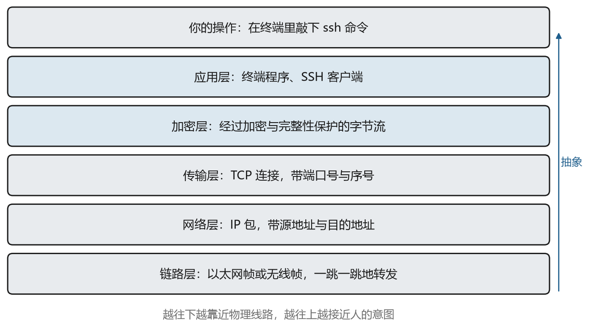

# SSH 是什么

## 2.1 从明文到加密

服务器通常没有显示器和键盘。它被放在机房的机架上，或者以虚拟机的形式跑在云里，通电、联网、启动，然后就静静地等着。要让这样的机器干活，只有一条路，把指令送过去，把结果取回来。

上一章结尾提到过 telnet。它是 1969 年出现的远程登录协议，工作方式很朴素，把本地敲下的字符原样变成字节发出去，把远端回传的字节原样显示出来。问题在于它不加密，登录时输入的用户名和密码以明文形式经过整条链路。网络还局限在同一个机房时，这个代价可以接受；网络扩展到校园、城市、跨洲之后，任何一段链路上的设备都能读到这些内容。同期的 rsh 和 rlogin 更省事：连密码都不传，凭来源主机和用户名放行，规则写在 `~/.rhosts` 里，伪造一个源地址就能冒充你。telnet 至少有密码，密码却是明文。SSH 把这两种做法一并淘汰。

1995 年，芬兰赫尔辛基理工大学的研究者 Tatu Ylönen 在校园网出现窃听之后写了 SSH，本意是给同事一个能安全登录的工具。它保留了 telnet 的使用方式，你依然是在本地敲命令、看远端输出，但整条通道是加密的，双方还要互相证明身份。这个工具传得很快，一年之内就从校园扩散到全世界，后来由 IETF（互联网工程任务组，负责制定互联网标准的组织）标准化为 SSH-2 协议，文档编号是 RFC 4250 到 4254（RFC 是互联网标准的文档编号体系）。1999 年，OpenBSD 项目基于当时最后一版自由发布的代码整理出了 OpenSSH（一套开源的 SSH 实现），今天绝大多数 Linux 服务器上跑的 `sshd` 都是它的后代，Windows 10 之后的系统也自带了这个客户端。

这套协议有两个版本，差别不是修修补补。SSH-1 用同一把长期主机密钥兼做加密和身份，完整性只靠 32 位 CRC，1998 年被证明可以人为构造碰撞（CRC-32 补偿攻击）。SSH-2 于 1996 年重新设计，把传输、认证、连接分成三层，密钥交换用 Diffie-Hellman 系列，每个方向一套独立密钥，完整性用 HMAC 或认证加密，通道级流控也换了做法。OpenSSH 从 7.6 版起默认关闭 SSH-1。

## 2.2 SSH 的定义，以及它保证的四件事

SSH 的全称是 Secure Shell，安全外壳。这个名字容易让人以为它是一个加密版的终端，实际上它是一族协议，规定了两个程序在一条不安全的连接上如何建立一条可信的通道、如何确认彼此的身份，以及如何在这条通道里开终端、执行命令、传文件、转发别的流量。

把它的承诺拆开，有四条。

第一条是身份认证。客户端要能证明“我是某个账号的主人”，服务端也要能证明“我确实是你以为的那台机器”。这两件事分开做，各用各的凭据：客户端用密码、密钥或证书，服务端用它自己的一对主机密钥。

密钥这个词后面会出现很多次，先给它一个最朴素的解释：一段能用来加密、解密或签名的数据，本质上是一长串随机数。非对称加密里的密钥成对出现，私钥只留在自己手里，公钥可以发出去。服务器的那一对叫主机密钥，作用一样，只是用来证明“我是这台机器”；证书是第三方出具的证明，说明某把公钥确实属于某个身份。

这些名词第五章会逐个拆开，第七章再讲服务器怎么证明自己。这里先记住一句话：认证是双向的，双方各自证明自己的身份，很多工具只做前者，SSH 两件都做。

第二条是机密性。连接建立之后，链路上传输的所有字节都是加密的。中间经过的路由器、交换机、运营商的接入设备能看到包的来源、去向和大小，看不到内容。

第三条是完整性。每个数据包都带着一段校验值（第五章会叫它 MAC），接收方先验证再使用。任何一个字节被改动，校验就对不上，这个包会被丢掉，整条连接随即终止——终端里通常冒出 `Connection reset by peer` 或 `Broken pipe`。想继续用只能重新 `ssh` 一次，那是一次全新的握手和认证。

第四条是复用。一条 SSH 连接里可以同时开多个逻辑通道，一个跑交互式 shell（读命令、解释命令、再交给系统执行的程序，第四章细讲），一个传文件，一个转发数据库端口，互不干扰。这也是它能顶替掉一大堆专用工具的原因。

通道复用之外还有一层“连接复用”，两者常被混为一谈。后者指多个 `ssh` 命令共用同一条 TCP 连接和同一套会话密钥、认证结论，做法是在配置里写 `ControlMaster auto` 加 `ControlPersist 10m`，第一条连接在后台留一个插座，后面的命令走插座。复用的是连接、密钥和认证结论；不复用通道、伪终端和远端 shell 的状态，每个新命令依旧有自己的进程和工作目录。

这四条都有各自的边界，记住边界比记住承诺更有用。机密性只保护连接内部，两端的地址、连接的时间、每个包的大小仍然可见，看流量的人能分出你在传文件还是在敲命令。完整性只保证字节没被改，不保证对方发来的内容无害，也不保护已经落盘的文件。认证只认到主机与账号，不认具体的人：一个账号三人共用，日志里就分不出谁是谁。复用也共享同一条 TCP 的拥塞窗口，一个通道传大文件，另一个通道的按键就跟着变慢。

需要说明的是，授权不在这四条里。你能登录之后能做什么，由服务端的策略决定，比如 `authorized_keys`（服务端保存允许登录的公钥的文件）里的限制选项、`sshd_config` 里的规则、操作系统本身的权限。SSH 协议只负责把你安全带进门，进门之后能走到哪个房间，是另一套机制的事。第三篇讲堡垒机（一种集中管控运维访问、记录操作的系统）时，这一点会变得很重要。

## 2.3 SSH 不是什么

初学者常把几个相邻的东西混在一起。下面每一条都说清那样东西是什么，再说它和 SSH 差在哪。

SSH 不是一个软件，而是一套协议。协议是双方事先约定好的通信规则，软件是这套规则的具体实现。OpenSSH 是最流行的一个实现，Linux 和 macOS 自带的 `ssh` 与 `sshd` 都属于它；Windows 上的 PuTTY（一款老牌的图形化 SSH 客户端）是另一个实现。所以“装一个 SSH”这个说法严格讲不成立，装进去的总是某个实现。

SSH 不是 VPN。VPN 的全称是虚拟专用网（Virtual Private Network），它做的事情是把两个相隔很远的网络在逻辑上接成一个内网。客户端在本机加一块虚拟网卡，改掉路由表（决定一个数据包从哪块网卡出去的表格），把发往公司网段的包都塞进隧道送到公司，再由公司那边替你转发出去。效果是你可以用 `10.0.0.5` 这种内网地址直接访问公司的机器，浏览器和数据库客户端都不用改设置。

SSH 的端口转发能做类似的事，但机制完全不同。它不改路由，只在你要用的那个端口上单独开一条通道，用它的程序还得把目标地址改成 `127.0.0.1`（本机自己的地址）。一句话概括，VPN 是整台机器的路都改了道，SSH 转发是给某一个端口修了一条小路，修一条才通一条。

所谓修一条小路，具体就是每次连接都写一段参数：本机哪个端口，对着哪台机器的哪个端口。看内网的网页面板写一段，连数据库再写一段，少写一段对应的服务就不通。服务器那边的配置只回答“允许不允许转发”，不回答“转发到哪里”——目标必须在每次连接的参数里现说，服务是后来加的，参数就得跟着加。

代价因此也不一样：VPN 要装客户端、要配账号，配好之后什么都通；SSH 转发随手就能开，但服务一多命令行就越长。第八章讲端口转发、第九章讲 VPN 时都会回到这个对比。

SSH 不是文件同步工具。`scp` 和 `sftp` 是随 OpenSSH 一起装上的两个命令，做的是搬运：把一个文件从这边拷到那边，拷完就结束。它们不比较两边是否已经一致，不判断哪一份更新，断了也不会接着刚才的位置继续。要“让两边保持一致”的语义，得用 rsync 这类工具，它先比对差异只传变化的部分；而 rsync 自己不管加密，通常就跑在 SSH 之上。

SSH 不是配置管理工具。Ansible 这类工具用来批量配置几十上百台机器：它读一份清单，按预先写好的任务逐台执行，并保证同一套任务跑一次和跑十次结果相同，这个性质叫幂等。它本身不实现远程连接，脚下的路就是 SSH。

SSH 也不等于堡垒机。SSH 是两台机器之间的协议，堡垒机是夹在中间的一个架构角色，前者是协议，后者是一个放在中间的位置。这一条值得单独说，因为它是很多人第一次接触企业环境时最容易误解的地方。

## 2.4 远程访问一定要经过堡垒机吗

不需要。

SSH 是点对点的协议。客户端直接连到服务器的 22 端口，双方认证，建立通道，这就是它最原始也最常见的用法。个人租的云主机、家里的树莓派、实验室里自己管的几台机器，都是这样用的，中间不需要任何设备。

堡垒机是组织规模变大之后才出现的架构角色。它不改变 SSH 协议，也不在协议里占一个位置。它替一个团队做三件事：把散落在每个人手里的密码和私钥收拢到一处统一保管和代填；把“谁能连哪台机器”写成一张可以查询、可以回收的授权表；把每次会话录下来，事后能查、能回放。这三件事在只有三五个人、三五台机器时靠约定就能维持，人一多、机器一多、再加上合规要求，就必须有东西来承担。

所以判断标准不是“该不该有堡垒机”，而是“这个环境的规模和约束需不需要”，表 2-1 是一个粗略的对照。

表 2-1　直连与经过堡垒机的适用场景

| 场景 | 常见做法 | 原因 |
| --- | --- | --- |
| 个人服务器、家庭实验室 | 直连 | 只有一个人用，密码和密钥本来就在自己手里 |
| 小团队，机器少于十台 | 直连加统一密钥管理 | 人员流动少，口头约定够用 |
| 几十人、上百台机器 | 堡垒机 | 密码与密钥的分发回收成本随人数和机器数平方增长 |
| 有等保、审计要求 | 堡垒机 | 等保是国内对信息系统安全的强制分级要求，需要可追溯的会话记录 |
| 需要临时给外部人员开权限 | 堡垒机 | 可以限时、限资产、限操作，到期自动失效 |

代价也要说清楚。堡垒机是所有运维流量的必经之路，它挂了，所有人都进不去。它集中了所有资产的凭据，一旦被攻破，损失比没有堡垒机更大。它还会带来额外的跳数和带宽压力，第十章会展开讲。

理解了这一层，还有一个细节会跟着冒出来。很多人第一次连企业环境，看到的登录名是这么一个字符串。

```text
alice@ubuntu@10.0.0.5
```

一个用户名里有两个 at 符号。放进一条完整的命令里，是这样。

```bash
ssh -p 58222 -l alice@ubuntu@10.0.0.5 203.0.113.24
```

这条命令连的是 `203.0.113.24`，也就是堡垒机，`-p 58222` 是它在监听的端口，`-l` 后面的那一整串才是用户名。三段被两个 at 符号隔开：`alice` 是你在堡垒机上的账号，用来证明你是你；`ubuntu` 是它替你连目标机时使用的系统账号，也就是它库里那套凭据的名字；`10.0.0.5` 才是最终要去的机器。平时登录只写一个 at 符号，左边是人、右边是机器；堡垒机却要在一次连接里知道三件事，而 SSH 的用户名字段只给它一个字符串，于是它把三件事拼进去再分一次。

所以那串字符不是 SSH 的语法，是堡垒机的约定：协议只把用户名当成一个字符串原样传过去，普通服务器收到只会当成一个不存在的账号。

这里有一个容易踩的坑。不写 `-l` 时，客户端认最后一个 at 符号：它之前整段算用户名，之后算主机名。于是 `ssh alice@ubuntu@10.0.0.5` 会被读成“用 `alice@ubuntu` 去连 `10.0.0.5`”，而 `10.0.0.5` 只在公司内网里有意义，离开那张网包就发不出去，命令一直等到超时。写成 `-l alice@ubuntu@10.0.0.5` 才没有歧义。第十一章会讲网关怎么把这三段拆开，以及这种写法为什么会让一些工具出问题。

## 2.5 一次连接里的四个角色

抛开堡垒机，一次最普通的 SSH 连接涉及四样东西。图 2-1 画的是这个结构。



第一样是客户端。它是你本机上的一个程序，Windows 上是 `ssh.exe`，Linux 和 macOS 上通常就是 `/usr/bin/ssh`。它负责读配置、发起连接、协商算法、完成认证，然后把你的按键打包发出去。

第二样是服务端。它是远端运行的 `sshd`，默认守在 22 端口上等别人来连，负责接受连接、验证身份、分配会话、执行命令。端口是同一台机器上用来区分不同服务的编号，第三章会细讲。22 是 1995 年定型时向 IANA（负责分配端口号的机构）申请下来的。改到 2222 之类挡掉的只是无差别扫描的噪音，不构成安全边界；而且要同步改 `sshd_config` 的 `Port`、防火墙规则和 SELinux 端口标签，漏掉最后一项服务会起不来。

第三样是网络。两端之间可能隔着家用路由器、运营商骨干网、云厂商的入口设备，它们只负责转发字节，却决定了连接能不能建立、会不会中途被重置。

第四样是凭据。它是你用来证明身份的东西，可能是一个密码，一对公私钥，或者一张由 CA（证书颁发机构，专门替别人签发证书的机构）签发的证书。凭据不出现在网络上，出现在网络上的是用它算出的证明。四样东西里只有凭据是“你自己的”，客户端、服务端都是现成软件，网络更是你控制不了的；所以出问题时，能改的通常是凭据和配置，能查的则是另外三样留下的痕迹。

## 2.6 最小的一次使用

在终端里敲下面这一行，就完成了一次登录。

```bash
ssh alice@198.51.100.17
```

`alice` 是目标机上的账号，`198.51.100.17` 是它的地址。第一次连接时，会出现类似这样的提示。

```text
The authenticity of host '198.51.100.17' can't be established.
ED25519 key fingerprint is SHA256:9f2c1d4b7a2e6f0c8d3b1a59e7c2f4d6.
Are you sure you want to continue connecting (yes/no/[fingerprint])?
```

这句话的意思是，客户端从来没有见过这台机器，无法确认对面是不是真的。输入 `yes` 之后，那把主机公钥会被记到 `~/.ssh/known_hosts`（一个专门记录服务器公钥的文件）里，下次再连就自动比对。这个机制叫首次使用即信任，它的作用、局限和风险在第七章讲。

登录成功后会看到一个提示符，和本地终端没什么区别。敲 `exit` 退出。如果只想执行一条命令，不必进交互界面。

```bash
ssh alice@198.51.100.17 "uptime"
```

这条命令会在远端执行 `uptime`，把输出送回本地，然后断开。批量巡检、临时查状态时常用这种写法。

两个最常用的选项也在这里交代一下。`-p` 指定端口，服务端不监听 22 时用。`-i` 指定私钥文件，一个账号有多把钥匙时用。

```bash
ssh -p 2222 -i ~/.ssh/id_ed25519_lab alice@198.51.100.17
```

想看到连接建立的过程，在命令后面加 `-v`，加两个 `v` 会更详细。输出里会依次出现连接、版本、算法、密钥、认证、通道这些词，现在不必理解它们，只要知道它们排成一个固定的顺序，第六章会把每一段拆开讲。

SSH 能做的事不止开一个 shell。SFTP 是它的一个子系统，在同一条连接里读写文件；`-X` 和 `-Y` 把远端的图形程序画到本地屏幕上，程序仍在服务器上跑，服务器那边要装 `xauth`，其中 `-X` 会限制部分扩展；端口转发分本地、远程、动态三种，能把远端端口搬到本地、把本地端口推到远端，或在本机开一个 SOCKS 代理。三者都跑在已经建好的加密连接里，不需要额外开放端口。

到这里，日常使用需要的命令其实已经够了。剩下的是理解它为什么这样工作，以及出问题时该看哪里。

## 2.7 一次会话的轮廓

把一次连接按时间顺序摊开，会看到图 2-2 里的几个阶段。这张图先给出轮廓，细节在后面的章节逐一展开。



最先是 TCP 连接。SSH 跑在 TCP 之上，所以要先有一条可靠的字节流。TCP 是一种保证数据按顺序、不重不漏送达的协议。这一步和 SSH 无关，任何基于 TCP 的服务都要走，第三章细讲。

接着双方各发一行版本字符串，形如 `SSH-2.0-OpenSSH_9.6`。这一行是明文，也是整条连接里唯一一定是明文的部分。

然后是算法协商。双方各自列出自己支持的密钥交换、加密、校验算法，从中挑出一套都能接受的组合。

再往后是密钥交换。双方通过数学运算协商出一份只有彼此知道的密钥材料，并由它派生出后面要用的所有密钥。

密钥就绪之后各自发送一个 NEWKEYS 消息，从这一刻起，后面所有内容都加密。第五章讲这套数学，第六章讲协议怎么组织这些步骤。

加密通道建立之后才开始认证。很多人以为先验证身份再加密，实际上是先有加密通道，再在通道里验证身份。好处是密码和签名（用私钥算出的一段数据，别人可以用对应的公钥验证它确实出自你手）都不会以明文出现在网络上。

认证成功后，客户端请求打开一个会话通道，服务端分配伪终端（一对虚拟设备，让远端程序以为自己接在一块真实终端上）并启动 shell，提示符这才出现。第四章讲服务端这一侧的进程与终端，第六章讲通道与流控。

## 2.8 全书的知识地图

图 2-3 把这条链路上的东西按层次排了一遍，它是全书的结构图。



最上面是你的操作，接着是应用程序，再往下是加密层、传输层、网络层、链路层。越往下越靠近物理线路，越往上越接近人的意图。

全书按五层展开，前四层是零件，第五层把零件装成产品。第一篇讲链路：传输层、网络层、链路层，以及服务器上的进程与终端，读完能把“连不上”拆成可以逐段验证的问题。第二篇讲信任，对应加密层和 SSH 协议本身：密码学的基本工具、协议的三个子协议、密钥与指纹、端口转发和 VPN。第三篇讲控制，也就是连接从一个人扩展到一群人之后发生的事，堡垒机、JumpServer、VS Code 的远程开发都在这一层做文章。

第四篇讲数据，离开终端去看代码读写的那一端：对象存储的模型、签名、权限，以及把前四层串起来的完整链路。第五篇讲服务，把零件装成产品——程序守在端口上等请求，大文件分片上传，长任务排队并回传进度，会员登录之后才知道谁能做什么。
