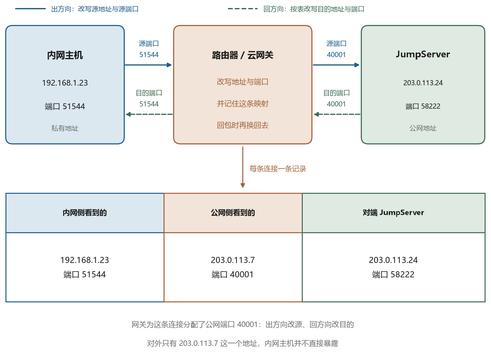
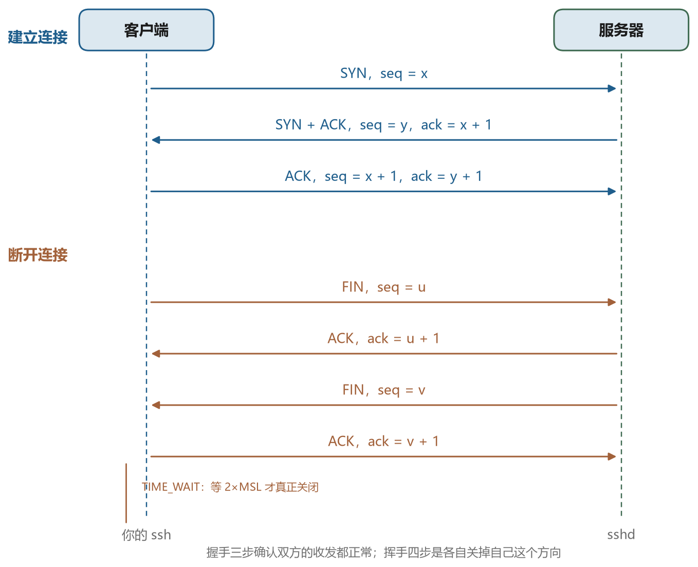
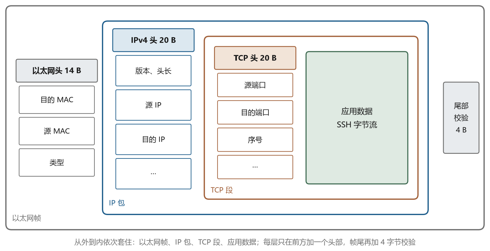

# 地址、端口与那条看不见的路

## 3.1 一台机器在网上叫什么

第一章里的局域网用的是 `192.168.1.x` 这样的地址。这种写法叫 IPv4 地址，四组数字，每组 0 到 255，合起来 32 位，理论上可以提供约 43 亿个地址。上世纪八十年代设计这套体系的时候，没人认为 43 亿会不够用，可后来的事情大家都知道了，手机、电脑、摄像头、汽车都要联网，地址很快就不够分了。

这 32 位并非一整块，而是分成“网段”和“主机”两段，分界由子网掩码标出：`255.255.255.0` 等价于 CIDR 写法 `/24`，`/16` 等于 `255.255.0.0`，`/30` 等于 `255.255.255.252`。主机位数是 32 减前缀长度，可用地址还要减 2（网络地址和广播地址不能分给机器），所以 `/24` 有 254 个，`/30` 只剩 2 个，常用在点对点链路。前缀还决定谁算邻居：`203.0.113.100/25` 和 `203.0.113.200/25` 看似相邻，其实分属两个网段，互访必须过网关。算不清时用 `ipcalc` 加一段地址，它会把网段、广播地址和可用范围一次列出来。

解决办法有两个。一个是新版本的地址格式 IPv6，长 128 位，写成带冒号的一串十六进制，多到几乎用不完，但你日常接触的服务器大多仍然用 IPv4。另一个是复用，也就是让很多设备共用一个公网地址，私底下各自用一套只在内部有效的地址。这套内部地址就是私有地址，三块前缀划定：`10.0.0.0/8` 约 1677 万个地址，公司机房和云上内网常用；`172.16.0.0/12` 约 104 万个；`192.168.0.0/16` 6.5 万个，家用路由器几乎都在这一段。另有一条 `169.254.0.0/16` 要能认出来：它是链路本地地址，拿不到 DHCP 时系统自己编一个，`ip addr` 里看到它基本意味着网络没配通。

私有地址有一个重要性质，它在公网上不可路由。也就是说，你家里那台 `192.168.1.23` 的电脑，从外面的服务器是没法直接连过去的，因为全世界有几千万台机器都在用这个地址，路由器不知道该送到哪一家。这个性质看起来是个限制，实际上是一层保护。多数人的电脑不需要被外部主动连接。

而你租用的云服务器不一样。它有一个公网地址，任何人都能向它发起连接。这也是为什么云主机一开通就要配好访问规则，把不需要对外开放的服务关掉。

## 3.2 端口是同一台机器上的不同门

一台机器上可能同时跑着网页服务、数据库、SSH 服务。数据包到了这台机器，操作系统要知道该交给哪个程序。这个区分工作由端口号完成。端口是一个 16 位整数，范围 0 到 65535。IP 地址定位到机器，端口定位到机器上的程序，两者合起来叫套接字地址，写成 `203.0.113.24:22` 这种形式。

端口号被分成几段，分界由 IANA（负责分配端口号等号码的机构）规定。0 到 1023 是系统端口，绑定它需要 root 或 `CAP_NET_BIND_SERVICE` 能力，这也是 nginx 要监听 80 得先以 root 启动再降权的原因。1024 到 49151 是用户端口，按惯例占用，比如 MySQL（一种数据库）的 3306、Redis（一种内存里的键值存储）的 6379。再往上是动态端口，Linux 只从 `net.ipv4.ip_local_port_range` 里取，默认通常 32768 到 60999，约 2.8 万个；对外并发连接特别多时这些端口会用尽。你家里的电脑连出去时用的就是这种端口，所以同一个网站会看到你每次连接的源端口都不一样。

这个表里出现的 80 和 443 就是 HTTP 与 HTTPS，后者在传输前把内容加密，对象存储的接口也走它，第十三章会用到这一点。

这里有一个必须分清的概念，监听和连接是两件事。服务器上的 sshd 在 22 端口监听，等待别人来连，22 是它那一端的端口，也是你要填在命令里的目标端口。你自己这一端同样需要一个端口：操作系统会从临时端口里随机挑一个，比如 51544，当作这条连接的源端口。所以一条连接的两头各有一个端口号，一头固定、一头随机。四要素合起来唯一确定一条 TCP 连接：源地址、源端口、目的地址、目的端口。任何一项不同，就是另一条连接。

## 3.3 NAT 与地址改写

私有地址的设备要访问公网，需要中间有一台设备帮它做地址转换，这就是 NAT，网络地址转换。图 3-1 画的是这个过程的简化版本。





内网主机 `192.168.1.23` 用源端口 51544 访问 `203.0.113.24` 的 58222 端口。数据包经过网关时，网关把源地址换成自己的公网地址 `203.0.113.7`，同时把源端口换成一个它自己管理的端口，比如 40001，并在内存里记下一条映射。回包到达网关时，目的地址是 `203.0.113.7:40001`，网关查表把它改回 `192.168.1.23:51544`，再送进内网。

NAT 不止一种。静态 NAT 一对一固定映射，`203.0.113.7` 永远对应 `192.168.1.23`，外部能直接连进来，代价是占掉一个公网地址；动态 NAT 从池子里临时挑一个，用完回收；最常见的 NAPT（网络地址端口转换）连源端口一起改写，成百上千台设备共用一个地址，就是图 3-1 这种。端口映射（DNAT）是它的反向用法，写一条“外部访问 58222 转给 `192.168.1.23` 的 22”才连得进来。运营商级 NAT（CGNAT）再套一层，几千个家庭共用一个公网地址，家里拿到的 `100.64.x.x` 就是“假公网”。映射表还有寿命，TCP 空闲几分钟就可能被清，UDP 更短，长连接的心跳包很多时候是在替自己家门口这张表续命。

地址改写还带来两个必然后果。一是服务器看到的客户端地址是网关的地址，而很多服务靠来源地址决定放不放行，这类规则叫基于 IP 的访问控制；NAT 一来，规则就不好使了，一家公司几百人共用一个出口，放行等于放行整个公司，坏的不是规则而是粒度。二是外部无法主动向内网发起连接，因为网关的表里没有对应条目，要用第八章讲的隧道技术从内部主动把通道建出去。

## 3.4 域名只是给人看的

IP 地址难记，于是有了域名。`jumpserver.example.com` 这样的名字人看得懂，机器看不懂，数据包发出去之前必须先把它换成 `203.0.113.24`。干这件事的系统叫 DNS（Domain Name System，域名系统），可以把它想成一本全球共用的电话簿：输入名字，查出号码。

查的过程并不是直接翻那本总簿。你的系统先看自己的缓存，最近查过的名字都记在这里；没有，就去问网络设置里填的那台 DNS 服务器，它通常由路由器或运营商提供。这台服务器手里也没有，就替你去问：先问根服务器 `.com` 归谁管，再问管 `.com` 的服务器 `example.com` 归谁管，最后问到管 `example.com` 的那台权威服务器，它给出 `jumpserver` 对应的地址。答案沿原路返回，沿途每一层都顺手留下一份。

这台替你问来问去的服务器叫递归解析器，客户端交给它的活是“你帮我问到底”；它对外发出的询问则是迭代式的，根服务器不直接给结果，只说“`.com` 归这几台管”。递归是“包在我身上”，迭代是“告诉你下一步去哪问”，两者描述的是同一趟查询里不同的两段责任。

常见记录记住七种：A 映射 IPv4，AAAA 映射 IPv6，CNAME 是别名，MX 指邮件服务器并带优先级，TXT 放任意文本（域名验证和反垃圾策略靠它），NS 指明谁负责这个域，PTR 做反向解析。DNS 主要走 UDP 53，应答超过 512 字节会截断并改用 TCP 重问；EDNS0 能协商更大的 UDP 包，但超限仍转 TCP，所以防火墙只放 UDP 53 是不够的。

缓存不能永久有效，否则域名换了地址，全世界还会按旧地址连过去。所以每条记录都带一个 TTL（Time To Live，有效期，单位是秒），比如 600，意思是“这个答案你可以信十分钟”。这就是为什么改完域名解析之后，有些地方立刻生效，有些地方要等一会儿——那些地方手里的旧答案还没过期。用 `nslookup` 或 `dig` 查一个域名，能看到它还剩多少秒。

对远程登录来说，域名带来一个额外的好处。你可以把同一个域名指向不同的机器，机器换了地址，配置文件不用改。云厂商的负载均衡和故障转移也依赖这一点。缺点是引入了新的失败点，DNS 解析不出来的时候，看起来就像网络不通。用 `ssh -vv` 看输出时，会有一行 `debug1: Connecting to ...`，那里显示的是解析之后的地址，如果域名有问题，这一步之前就会报 `Could not resolve hostname`。

## 3.5 TCP 保证了什么

IP 层只负责把包送到，不保证顺序，不保证不丢，也不保证不重复。SSH 需要的是一个可靠的字节流，也就是“我发出去的字节，按顺序、不重不漏地到达对端”。这个保证由 TCP 提供。

TCP 的做法是给每个字节编号。发送方发出数据时带上序号，接收方收到后回一个确认，告诉对方“我已经收到第 N 个字节之前的全部内容”。发送方如果在一段时间内没收到确认，就重发。接收方如果收到乱序的包，先缓存起来，等前面的缺口补上再交给应用。

建立连接要三次握手，断开要四次挥手，如图 3-2。





三次握手的实质是双方各自确认两件事：我能发出去，你能收到。客户端发 SYN，服务端回 SYN 加 ACK，客户端再回 ACK。两次不够，因为那样只能让客户端确认自己的发送能力，服务端无法确认客户端收到了自己的包。断开要四次挥手，是因为 TCP 全双工（两个方向可以同时传数据），两个方向得各自关闭；主动关闭的一方最后进 TIME_WAIT，等两倍报文最大寿命（通常 60 秒）才真正释放。

整个生命周期是一张状态机：服务器从 `LISTEN` 收到 SYN 变 `SYN_RECV`，再收到 ACK 变 `ESTABLISHED`；主动关闭的一方经 `FIN_WAIT_1`、`FIN_WAIT_2` 到 `TIME_WAIT`；被动关闭的一方先进 `CLOSE_WAIT`，等应用真的调了 close 才发 FIN，进 `LAST_ACK`。`ss -tan` 的 State 一列就是这些名字，成百上千个 `CLOSE_WAIT` 基本等于连接泄漏，一堆 `TIME_WAIT` 反而是正常。拥塞控制则维护一个发送窗口：从十几个报文起每个确认涨一点（慢启动），到阈值后线性增长（拥塞避免），丢包时减半（快重传快恢复）；`ss -ti` 能看到 `cwnd` 和实测 `rtt`，跨洲连接长期停在几十 KB 的窗口上，通常是丢包压下去的。

这些细节和日常使用有什么关系。当你看到 `Connection timed out`，说明 SYN 发出去没有回应，可能是地址不可达，也可能被网络边界的过滤设备静默丢弃。看到 `Connection refused`，说明 SYN 到了，但对方回了一个拒绝包，通常是那个端口上没有程序在监听。两种错误的含义完全不同，处理方式也不同，前者要去查网络路径和边界上的过滤规则，后者要去查服务是否启动。

这些保证都不是白来的。下一节看另一种走向反面的协议，它什么也不保证，却撑起了半个互联网。

## 3.6 UDP 少做了什么

上一节列了 TCP 的四项保证。UDP（User Datagram Protocol，用户数据报协议）一项也不提供：不握手、不编号、不确认、不重传、不排序，也不管网络是否拥堵。它只做三件事，用端口号找到程序，算一个可选的校验和，把一段数据原样装进 IP 包发出去。

区别从头部就能看出来。TCP 的头部至少 20 字节，装着序号、确认号、窗口大小和一堆状态标志；UDP 的头部只有 8 字节，四个字段分别是源端口、目的端口、长度、校验和，没有地方再装别的。

没有连接状态，服务端就不必为每个客户端留一份上下文。一台机器扛几十万个短请求，对 TCP 是压力，对 UDP 只是收发。代价被转移到了应用层：包丢了没人替你重传，包乱序了没人替你排好，重复的包也没人替你丢掉。

“UDP 连接”这个说法其实不严谨。UDP 没有连接这个概念，只有一对地址加端口在收发数据。平时说 UDP 连接，指的是同一对端点在一段时间里持续通信，NAT 设备也把它当成一条记录存着，存的就是第三节里那种映射。

表 3-1 是两者的对照。

表 3-1　TCP 与 UDP 的对照

| 项目 | TCP | UDP |
| --- | --- | --- |
| 建立连接 | 三次握手，双方各自保存状态 | 不握手，无状态 |
| 可靠性 | 确认、重传、排序、去重 | 一概不管 |
| 头部开销 | 20 字节起 | 8 字节 |
| 拥塞控制 | 有，网络拥堵时自动降速 | 没有，发多快由应用决定 |
| 典型用途 | SSH、网页、文件传输 | DNS、音视频、游戏、VPN |

那为什么还要用 UDP。因为有些场景里，等一个迟到的包比丢掉它更糟。视频通话中，每一幅画面只显示几十毫秒，重传回来的那一幅已经没有意义，宁可让画面花一下；游戏里，位置信息晚到两百毫秒就彻底错了，不如直接丢；DNS 查询只有一个来回，重发一次比维护一条连接便宜得多。

第九章讲的 VPN 也用 UDP：隧道里跑的就是加密后的包，丢一个包只损失一点数据，不值得为它在中途等一次重传。HTTP/3 更进一步，它在 UDP 之上自己实现了一套可靠传输，名字叫 QUIC（读作 quick），原因是 TCP 那种“缺一个就全等”的重传方式会把后面的数据一起堵住，业内管这个叫队头阻塞。

判断标准可以压成一句话：要求每个字节都到、顺序不乱，用 TCP；要求快、能容忍丢，用 UDP，可靠性自己补。

## 3.7 数据是怎么被装进包里的

应用层的数据要一层层加上头部才能上路。图 3-3 画的是这个过程。




SSH 客户端产生的字节先交给 TCP，TCP 加上源端口、目的端口、序号、校验和等等，形成 TCP 段。TCP 段交给 IP，IP 加上源地址、目的地址、生存时间等，形成 IP 包。IP 包交给链路层，加上源 MAC、目的 MAC 和帧校验，形成以太网帧，最后变成线路上的电信号。MAC 地址是网卡出厂时写死的硬件地址，和 IP 地址不是一回事：一个跟着网卡走，一个跟着配置走。

每一层加的头部都有固定长度。TCP 头部一般是 20 字节，选项会让它变长。IPv4 头部也是 20 字节。以太网帧的头部 14 字节，尾部校验 4 字节。帧是链路层传输的单元，可以理解为一段线路上跑的一整块数据，也是交换机处理的最小单位。

链路层能承载的单个帧有大小上限，这个上限叫 MTU，以太网通常是 1500 字节，减去各层头部，留给应用的有效载荷大约 1460 字节。如果某一层的数据超过了上限，就要拆成多片，这个过程叫分片，分片会让丢包的概率上升，也会让网络边界的过滤设备处理起来更费劲。

SSH 在建立连接时会自己控制包的大小，通常不会主动制造分片。但如果经过隧道或者 VPN，外层又套了一层头部，可用空间就变小了，可能出现“能连上但传大文件卡住”的怪现象。这种情况在第八章讲隧道时会再提一次。

## 3.8 自己动手看连接

理论讲完，需要一些工具把状态看清楚。Linux 上最常用的是 `ss`，老一些的系统用 `netstat`。

```bash
ss -lntp            # all listening TCP ports with processes
ss -tnp             # current established TCP connections
ss -tnp state established '( dport = :22 )'   # only connections to port 22
```

`-l` 表示只看监听，`-n` 表示不解析服务名，`-t` 表示 TCP，`-p` 显示进程。第一行输出能告诉你这台机器上有哪些服务在等别人连接，第二行输出能告诉你此刻谁连着谁。逐列读下来就是一条连接的全部处境：State 是状态，`ESTABLISHED` 之外的值都值得追查；Recv-Q 和 Send-Q 在监听端口上表示还没被 accept 的连接数和队列上限，在已建立的连接上则表示还没被应用读走、还没被确认的字节，Recv-Q 长期不为零说明程序读得太慢；Local Address:Port 里 `0.0.0.0:22` 是在所有网卡监听，`127.0.0.1:6379` 是只有本机能连，`[::]:22` 是 IPv6 写法；users 一列的 `pid=` 要靠 root 才看得全。

Windows 上的对应命令是 `netstat -ano`，加上 `| findstr :22` 过滤。想知道某个端口通不通，可以用 `Test-NetConnection`，Linux 上可以用 `nc -vz host port` 或者 `curl -v telnet://host:port`。

```powershell
Test-NetConnection 203.0.113.24 -Port 58222
```

还有一个常被忽略的工具是 `traceroute`（Windows 上叫 `tracert`），它逐跳显示数据包经过的路由器。如果是公司网络内部就不通，那和服务器没关系；如果出了公网才断，就要找运营商，或者检查云平台上那组放行规则。

## 3.9 常见端口一览

表 3-2 列出这本书里会反复出现的端口。记住其中几个，读配置文件时会轻松很多。

表 3-2　书中涉及的常见端口

| 端口 | 服务 | 说明 |
| --- | --- | --- |
| 22 | SSH | OpenSSH 默认端口，公网上被扫描得最频繁的端口之一 |
| 2222 | SSH 备用端口 | 常用来避开针对 22 的暴力破解 |
| 58222 | JumpServer 网关 | 部署时自定义的端口，本书示例中使用 |
| 80 | HTTP | 明文网页，多数站点会重定向到 443 |
| 443 | HTTPS | 加密的网页传输，对象存储的接口也走这里 |
| 3306 | MySQL | 数据库，绝不应该直接暴露在公网 |
| 6379 | Redis | 缓存，默认无认证，暴露在公网等于把数据送人 |
| 1080 | SOCKS | 第八章动态转发时本地监听的端口 |

这张表里第 22 和第 58222 两行值得多看两眼。它们说明了一件事，端口号本身没有任何魔力，它只是双方约定好的一个数字。把 SSH 挪到别的端口，安全性并不会因此提高多少，因为端口扫描很容易发现它，但能挡掉大量无差别攻击的噪音，让日志干净一些。真正决定安全的是密钥长度、认证方式和访问控制，这些是第二篇的主题。

地址、端口、包的结构到这里就齐了，连接能够建立起来。但连上之后，服务器那一侧是谁在等你？下一章从认证通过的那一刻讲起。
