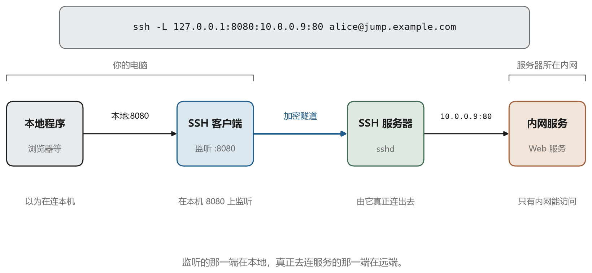
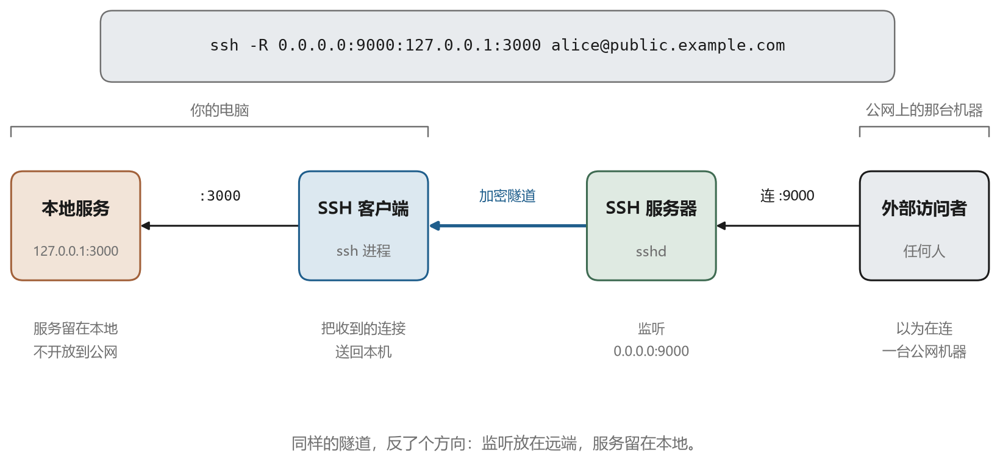
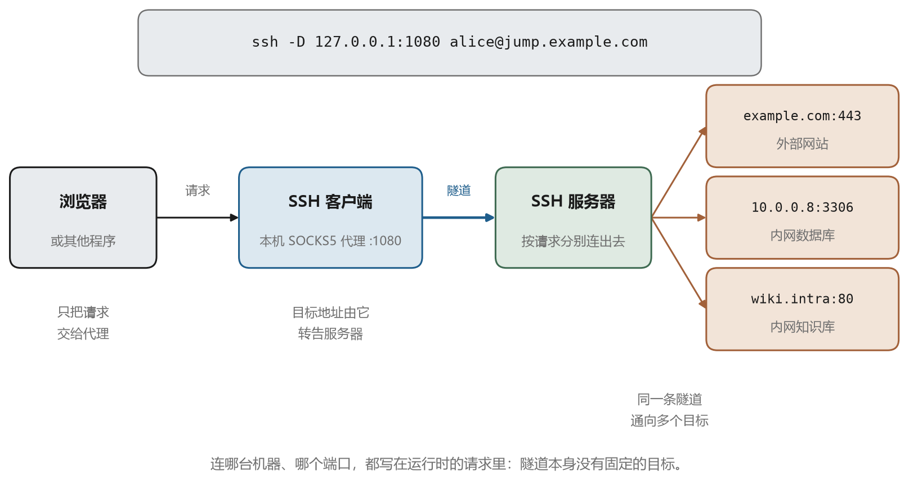
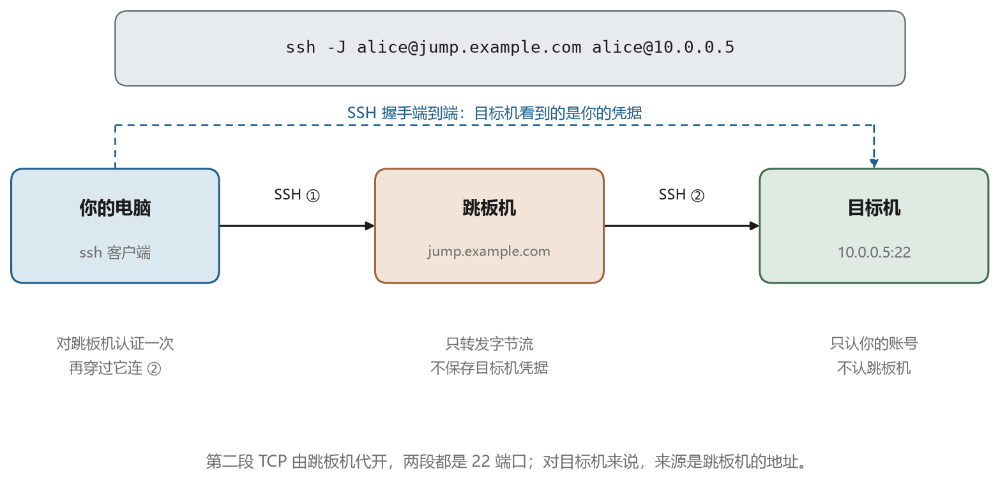

# 端口转发，把远方的服务搬到本地

## 8.1 只开一个端口的世界

很多内网只允许外部访问一个端口，通常就是 SSH 的 22。数据库、内部网页、监控面板全在里面，从外面碰不到。这种设计出于安全考虑，但也带来不便。你需要临时看一眼内网的某个网页，或者用本地的图形化工具连一下内网的数据库，怎么办。

办法是把那些服务“搬”到你本地来。SSH 的连接层本来就支持多路复用，一条加密连接里可以开很多个通道，每个通道承载一路数据。端口转发就是利用这个能力，把某个 TCP 端口上的流量塞进 SSH 通道，从另一端送出去。对使用者来说，本地凭空多了一个端口，连它就等于连到了远端的某个服务。

SSH 定义了三种转发方式，本地转发、远程转发、动态转发。它们的区别只在于谁监听、谁发起连接，以及目标地址是提前写死还是运行时给出。表 8-1 把三者放在一起对比。

表 8-1　三种转发方式的区别

| 方式 | 谁监听 | 谁发起目标连接 | 目标地址何时确定 |
| --- | --- | --- | --- |
| `-L` 本地 | 本机 | 服务端 | 命令行里写死 |
| `-R` 远程 | 服务端 | 本机 | 命令行里写死 |
| `-D` 动态 | 本机 | 服务端 | 每次请求时给出 |

三种方式本质上都是把一段 TCP 字节流接进 SSH 通道，所以它们同样只处理 TCP。UDP 的 DNS、视频通话、监控协议的探针报文，都不在覆盖范围内，这一点在选型时经常被忽略。

## 8.2 本地转发

本地转发的语法是 `-L`，格式为 `本地地址:本地端口:目标地址:目标端口`。

```bash
ssh -L 127.0.0.1:8080:10.0.0.9:80 alice@jump.example.com
```

这条命令的意思是，在本机监听 8080 端口，任何连到这个端口的流量，都通过 SSH 连接送到 `jump.example.com`，再由那台机器向 `10.0.0.9` 的 80 端口发起连接。图 8-1 是这个结构。





这里有一个特别容易搞错的地方。`目标地址` 是由 SSH 服务器去解析和连接的，不是由你的本机。所以 `10.0.0.9` 这个地址只需要在服务器那一侧可达，你的本机根本不需要认识它。很多人以为要先把 `10.0.0.9` 写进本机的 hosts，其实不必。

另一个容易搞错的地方是监听地址。写 `127.0.0.1:8080` 表示只监听本机回环，其他机器连不进来。写 `0.0.0.0:8080` 表示监听所有网卡，同一个局域网里的人也能用你的机器做跳板。默认建议用前者，除非你明确知道自己在做什么。

```bash
ssh -L 8080:10.0.0.9:80 alice@jump.example.com    # bind 127.0.0.1 by default
ssh -L 0.0.0.0:8080:10.0.0.9:80 alice@jump.example.com
```

完整语法是 `[绑定地址:]本地端口:目标主机:目标端口`，方括号里的绑定地址可以省略，省略时等价于 `127.0.0.1`。目标主机由服务端解析，所以那里可以写服务端自己能访问的任意名字。一条命令可以带多个 `-L`，每个都会开一个独立的监听。

```bash
ssh -N -L 127.0.0.1:15432:db.internal:5432 -L 127.0.0.1:16379:redis.internal:6379 jump
```

`-N` 表示不执行远程命令，只做转发，适合放在后台或写进脚本；`-f` 让进程转入后台，两者经常一起用，得到一个安静的隧道进程。如果不加 `-N`，你会多出一个登录 shell，断开它会连带关掉所有转发。本地转发还支持 Unix 套接字，把路径当作地址就行。

```bash
ssh -L /tmp/mysql.sock:/var/run/mysqld/mysqld.sock jump
```

这条命令把服务端的 MySQL 套接字映射到本地的 `/tmp/mysql.sock`，本地客户端连这个文件就等于连到远端。容器和只监听套接字的服务经常需要这种写法，比先找 TCP 端口再转一次省事。

本地转发最典型的用法有三个。看内网的网页面板，把远端的 80 或 443 映射到本地。连内网的数据库，把 3306 映射出来，用本地的客户端连 `127.0.0.1:3306`。访问只允许从特定机器访问的服务，比如某个只对跳板机开放的管理接口。

## 8.3 远程转发

远程转发把方向倒过来，语法是 `-R`，格式为 `远程地址:远程端口:目标地址:目标端口`。

```bash
ssh -R 0.0.0.0:9000:127.0.0.1:3000 alice@public.example.com
```

这条命令的意思是，在 `public.example.com` 上监听 9000 端口，任何连到它的流量，通过 SSH 连接送回你的本机，再由你的本机连到 `127.0.0.1:3000`。图 8-2 是这个结构。





这个方向适合的场景是，你的开发机在内网，没有公网地址，但你想让外面的人访问你本机跑的服务。或者反过来，你在家里，想把公司内网某台机器的服务暴露到一台有公网地址的跳板机上，临时给同事看。

完整语法是 `[绑定地址:]远程端口:目标主机:目标端口`，目标主机同样由你的本机解析和连接。如果目标就在你本机，写 `127.0.0.1`；如果要连你所在内网的另一台机器，写它的内网地址，跳板机不需要能访问它。这一点和本地转发恰好相反，很容易记反，一个简单的办法是看“最后一个字段由谁去连”：`-L` 由远端连，`-R` 由本机连。

远程转发的端口号可以写 0，表示让服务端分配一个空闲端口。分配结果会在标准输出里回一行 `Allocated port 43127 for remote forward`，脚本可以抓这行拿到端口。容器环境里做临时回调、跑一次 OAuth 回调验证时，这个技巧比固定端口可靠。

远程转发有一个常见的坑，就是监听地址。默认情况下，即使你写了 `0.0.0.0:9000`，服务端也可能只在回环地址上监听，外面仍然连不进来。原因是 sshd 的配置项 `GatewayPorts` 默认是 `no`，它禁止把转发的端口绑定到非回环地址（回环地址指 127.0.0.1，永远指向本机）。要让外部能连，服务端必须设置 `GatewayPorts yes` 或者 `GatewayPorts clientspecified`，然后重启 sshd。这件事你自己改不了，需要服务器管理员配合。

三个取值的差别很具体。`no` 是默认值，把所有远程转发都压回回环，客户端写什么地址都不算数；`clientspecified` 尊重客户端的请求，客户端写 `0.0.0.0` 就绑到所有网卡，写 `127.0.0.1` 就只绑回环；`yes` 则强制绑到通配地址，不管客户端请求的是哪个具体地址。

表 8-2　GatewayPorts 的三个取值

| 取值 | 实际监听地址 | 客户端能否决定 |
| --- | --- | --- |
| `no` | 仅回环 | 不能 |
| `clientspecified` | 按客户端请求 | 能 |
| `yes` | 所有网卡 | 不能，一律通配 |

从安全角度看，`clientspecified` 比 `yes` 好，因为它默认仍是回环，只给明确请求的客户端开一个口子。

## 8.4 动态转发

前面两种转发都要事先指定目标地址和端口。如果你想让浏览器把所有网站都走 SSH 出去，总不能每个网站配一条 `-L`。这种需求用动态转发，语法是 `-D`。

```bash
ssh -D 127.0.0.1:1080 alice@jump.example.com
```

这条命令在本机 1080 端口起了一个 SOCKS5 代理（SOCKS 是一种代理协议，客户端把目标地址交给代理，由代理去连）。浏览器配置成使用这个代理之后，每次访问网站，浏览器先把“我要访问 example.com 的 443 端口”告诉代理，代理通过 SSH 通道让服务器去连，再把数据转发回来。目标地址是运行时由客户端指定的，所以一条命令能覆盖所有目标。图 8-3 是这个结构。





动态转发的用途主要是两类。一类是临时改变出口位置，让流量从服务器那一侧出去。另一类是访问内网资源，浏览器通过 SOCKS 代理访问内网的多个站点，不用一个个配 `-L`。

需要提醒的是，`-D` 只处理 TCP。有些应用用 UDP（第三章讲过，它不保证送达，但开销小），DNS 查询和视频通话都属于这一类，它们不经过 SOCKS 代理。另外，浏览器自己会做 DNS 解析，如果配置不当，目标域名可能在本地就被解析了，泄露你在访问什么。Firefox 可以在 `about:config` 里把 `network.proxy.socks_remote_dns` 设为 true，让 DNS 也走代理。

`-D` 的语法也支持指定绑定地址，`-D 0.0.0.0:1080` 会让同网段的人也能用你这个代理。这相当于把一个无需认证的出口开放给整个局域网，任何人扫到 1080 端口都能借你的身份和网络位置访问内网。除非你在做受控的测试，否则永远只绑 `127.0.0.1`。

另外要注意，SOCKS 代理本身不加密，加密的是客户端到服务端那一段 SSH。如果你的浏览器到本机 1080 之间隔着网络，那一段是明文的，里面的目标域名和请求头都能被看到。

## 8.5 跳板与 ProxyJump

前面讲的转发是在一条已经建立的连接上做文章。还有一类需求是在建立连接的过程中绕路，也就是先连 A，再从 A 连 B。这件事由 `ProxyJump` 完成。

```bash
ssh -J alice@jump.example.com alice@10.0.0.5
```

这条命令先连跳板机，认证通过之后，在跳板机上再发起一条到 `10.0.0.5` 的连接，然后把两条连接拼接起来。你的客户端看到的是一条到 `10.0.0.5` 的 SSH 连接，实际上中间经过了跳板机。图 8-4 是这个结构。





这里有个关键细节，第二条连接的认证是由你的本机完成的，只是数据包经过跳板机转发。跳板机上不需要放任何私钥，也不需要开启 Agent Forwarding。这是它比 `ssh -A jump` 再手动 `ssh` 更安全的地方。

`ProxyJump` 可以串联多级，用逗号分隔。

```bash
ssh -J alice@jump1,alice@jump2 alice@target
```

每一跳都可以带自己的用户名和端口，写法是 `用户@主机:端口`，不写就沿用当前用户名和 22。跳板机之间需要能互相访问，本机只需要能访问第一跳。被挤压在一行里的多级跳转，排查时很难看出哪一段断了，所以跳数超过两级就该写进配置文件。

配置文件里的写法更清爽。

```text
Host jump
    HostName jump.example.com
    User alice

Host lab
    HostName 10.0.0.5
    User alice
    ProxyJump jump
```

老一些的环境可能还在用 `ProxyCommand`，效果类似，写法更底层。

```text
Host lab
    HostName 10.0.0.5
    ProxyCommand ssh -W %h:%p jump
```

`-W` 表示把标准输入输出接到目标地址的指定端口上，`%h` 和 `%p` 会被替换成主机名和端口。`ProxyJump` 本质上就是这个命令的封装，从 OpenSSH 7.3 起可用，现在应该优先用它。

两者的等价关系可以写得更直白。`ssh -J jump target` 与 `ssh -o ProxyCommand='ssh -W %h:%p jump' target` 建立的是同一种连接，区别只在参数解析和错误提示：`-J` 会自己处理跳板机的用户名、端口、密钥和 agent，而 `ProxyCommand` 后面的命令完全由 shell 解释。所以能用 `-J` 就用 `-J`，只有在需要传递额外参数、或者要用 `nc`、`connect` 这类外部程序时才回到 `ProxyCommand`。

更老的写法是 `ProxyCommand nc %h %p` 或者 `ProxyCommand connect -H proxy:8080 %h %p`，前者靠 `netcat` 转发，后者走 HTTP 代理。这两种写法在只允许 HTTP 代理出网的环境里很常见，但都不支持 agent 认证和连接复用，而且 `nc` 在不同发行版上的参数还不一样，写进文档时要注明版本。

调试跳转链路有一个好用的选项：`ssh -J jump -v target` 会在输出里分段打印每一跳的协商过程，`-E` 可以把日志写到文件避免刷屏。看到 `Authenticated to jump` 之后很久没有下一行，问题就在第二段。

## 8.6 转发与堡垒机的关系

第八章讲的这些技巧，在堡垒机环境里会遇到额外的限制，这不是偶然。

堡垒机的核心价值是审计。它需要知道你连了哪台机器、敲了什么命令、传了什么文件。如果允许端口转发，你就可以把一条数据库连接塞进 SSH 通道，堡垒机只能看到一串加密的字节流，看不到你执行了什么 SQL。同理，动态转发可以让浏览器访问内网任意网站，堡垒机完全无法审计。所以多数堡垒机的默认策略是禁止端口转发，JumpServer 在资产授权里就有“允许开启 SSH 端口转发”这样的开关，默认关闭。

这也解释了为什么用堡垒机时，一些平时很顺手的做法会失效。VS Code 的 Remote-SSH 需要建立端口转发才能工作，如果堡垒机禁用转发，连接会在某个阶段卡住或者报错。遇到这种情况，正确做法是让管理员在授权里打开对应的权限，或者在堡垒机上使用专门为图形化与 IDE 场景设计的接入方式。绕过限制自己搭隧道，既违反策略，也会让审计记录出现空洞。

服务端禁用转发的开关是 `AllowTcpForwarding`，它有三个值：`yes` 全开，`no` 全关，`local` 与 `remote` 只开一个方向。保守的默认值是 `no`；只允许单向时，多数场景留 `local`，因为它由客户端监听、服务端只发起对外连接，不会在服务端多出监听端口。还有一个 `PermitOpen` 选项，能指定允许转发的目标白名单，它比一刀切更实用：允许连内部数据库的 5432，不允许连其他任何端口。

被禁时客户端看到的报错很有特征。本地转发会在连接建立的瞬间失败，提示 `channel 2: open failed: administratively prohibited: open failed`，其中 `administratively prohibited` 就是“管理员不允许”的意思。如果是 `-D` 动态转发，浏览器侧表现为 SOCKS 连接被拒，而 SSH 会话本身正常，容易误判成代理软件的问题。遇到这类报错先看服务端的 `AllowTcpForwarding` 和 `PermitOpen`，不要先怀疑网络。

## 8.7 让隧道稳定下来

隧道最容易出的问题是莫名其妙地断开。原因通常是中间的网络设备认为连接闲置太久，把 NAT 表项清掉了。表现是终端卡住，过一会儿报 `Connection reset by peer` 或者 `Broken pipe`。

解决办法是定期发心跳。客户端侧用 `ServerAliveInterval`，服务端侧用 `ClientAliveInterval`。

```text
Host *
    ServerAliveInterval 30
    ServerAliveCountMax 3
    TCPKeepAlive yes
```

`ServerAliveInterval 30` 表示每 30 秒发一个加密的空包，`ServerAliveCountMax 3` 表示连续 3 次没有回应才断开。加了这两个选项，闲置的隧道能撑很久。

两个参数分工不同。`ServerAliveInterval` 是应用层心跳，走加密通道，服务端的 sshd 看得见、会回应；`TCPKeepAlive` 是内核层的 TCP 保活，默认要等两小时才发第一个探测包，而且这些包可以被中间设备伪造，在 NAT 环境里靠不住。

服务端侧对应的是 `ClientAliveInterval` 和 `ClientAliveCountMax`。`ClientAliveInterval 60` 表示服务端每 60 秒向客户端发一次探测，连续 `ClientAliveCountMax` 次无响应就断开会话。这个设置对清理“已经死掉但没关闭”的会话很有用，代价是它会误杀那些客户端侧网络短暂抖动的连接。两端都开的时候，心跳是双向的，隧道的存活判断会更灵敏。

另一个常见问题是转发端口被占用。本地 8080 已经被别的程序用了，`-L` 会报 `bind: Address already in use`。换一个端口，或者用 `-L 127.0.0.1:0:...` 让系统随机分配。后者在脚本里很有用，配合 `-v` 能看到实际分配的端口号。

还有 `ExitOnForwardFailure` 这个选项值得打开。默认情况下，如果转发建立失败，SSH 仍然会登录成功，只是隧道没起来，你会以为连上了。打开之后，转发失败就整体失败，脚本里更容易发现。

```bash
ssh -o ExitOnForwardFailure=yes -L 8080:10.0.0.9:80 jump
```

## 8.8 一条通道能装多少东西

回到连接层。一条 SSH 连接里可以开多个通道，每个通道独立流控。本地转发的每个 `-L` 是一个通道，远程转发是另一种通道，交互式 shell 也是一个通道。它们的数量受限于服务端的 `MaxSessions`，默认是 10。

```bash
ssh -L 8080:10.0.0.9:80 -L 3306:10.0.0.8:3306 -L 6379:10.0.0.7:6379 jump
```

这一条命令同时开了三个转发，加上登录 shell 本身用掉的通道，还没到上限。VS Code 的远程开发会开更多通道，文件服务、终端、扩展通信各占一路，所以用 IDE 连接时偶尔会碰到 `open failed: administratively prohibited: open failed` 这类报错，含义是通道数超了，调大 `MaxSessions` 即可。

通道之上还有一层复用，很多人没注意到。`ControlMaster` 让多条 `ssh` 命令共用同一条 TCP 连接，后续连接只走本地套接字，不再重新握手和认证。

```text
Host *
    ControlMaster auto
    ControlPath ~/.ssh/cm-%C
    ControlPersist 10m
```

`%C` 是主机名、端口、用户名等字段拼起来的哈希，长度固定，可以避免路径过长或文件名带特殊字符。`ControlPersist 10m` 表示主连接在最后一个会话结束后再保留 10 分钟，期间再连同一台机器是瞬时的。批量跑 `scp` 或 `rsync` 时，这个设置能把几百次建连的开销降到一次。

复用的代价是单点。所有通道都挂在那一条主连接上，主连接一断，上面所有会话、转发、传输同时结束，不会各自重连。排查时看到“所有窗口一起断开”，先查主连接而不是逐个会话。另外，`ControlPath` 的套接字文件权限要收紧，能连上它的人就能借用已认证的会话，不再需要你的密钥。

理解了通道复用，也就能理解为什么一条 SSH 连接可以很“重”。它不只是一个终端，而是一条可以承载多种用途的管道。下一章换一个角度。不再一条一条地修通道，而是换掉整台机器的路由，把一整张内网搬到身边。
