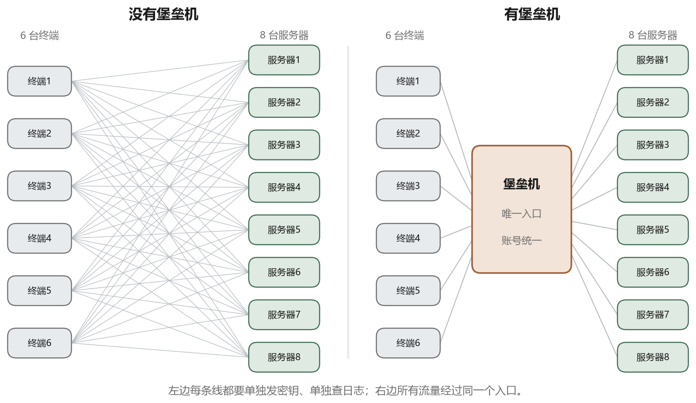
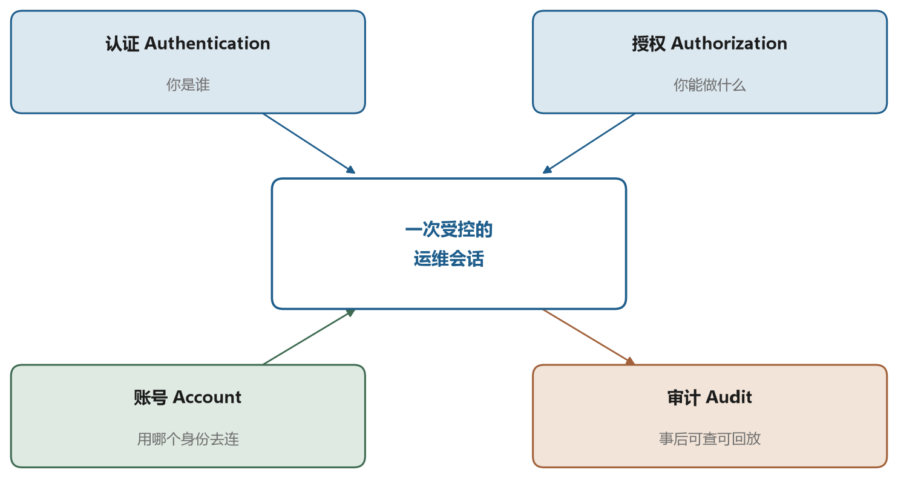
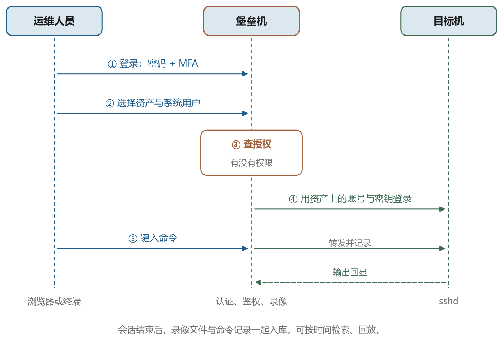

# 为什么需要堡垒机

## 10.1 一个常见的事故

设想这样一件事。测试环境的数据库忽然连不上了，查下来机器还在，端口也在监听，只是数据少了一半。日志里有一条凌晨的 `DELETE` 语句，执行者用的是 `root`。问题是团队里有五个人知道 `root` 的密码，谁也说不清那条语句是谁执行的。有人猜是定时任务，有人猜是误操作，最后不了了之。

这类事情在只有几台机器的小团队里发生概率不高，机器一多就变成常态。人是会流动的，项目是会交接的，三年前配的免密登录还留在某台机器的 `authorized_keys` 里，离职同事的笔记本上可能还存着生产库的私钥。等到出事，你甚至无法回答最基本的问题，谁在什么时候从哪台机器做了什么。

堡垒机就是为了回答这几个问题而出现的一类系统。它把“所有人直接连服务器”改成“所有人先连堡垒机，由堡垒机连服务器”，中间这个节点负责认证、授权、记录。

需要先说清楚，它并不是远程访问的必要环节。SSH 是点对点的协议，客户端直连服务器是最常见也最省事的形态，个人服务器、家庭实验室、几个人的小团队都是这样用的。堡垒机解决的是规模和约束带来的问题，第二章第四节已经给出了判断标准，这里接着讲它具体怎么解决问题。

## 10.2 网状连接的代价

没有堡垒机的时候，连接关系是网状的。图 10-1 左边画的是一个小团队的样子，六台办公终端、八台服务器，理论上每条“人”和“机器”的组合都需要一条通路。





网状结构带来三个具体问题。这三个问题有个共同点：它们随人数和机器数的乘积增长，而不是随其中之一增长，这一点先用公式说清楚。

第一个是凭据扩散。每台服务器上都要放每个人的公钥，每个人手里都要有每台服务器的地址和账号。新同事入职，要在一周内把几十台机器的访问配好。同事离职，要在一夜之间把几十台机器上的公钥删干净。漏掉一台，就是一条长期存在的后门。

第二个是权限失控。为了方便，很多人直接用 `root` 登录，或者在 `sudoers` 里给自己开全权限。时间一长，谁有什么权限没人说得清。等到要做权限审计，只能一台台机器去看 `authorized_keys` 和 `sudoers`，工作量巨大。

第三个是没有记录。Linux 的命令历史（`~/.bash_history`）是用户自己维护的，可以删、可以改、可以不写入。多个人共用同一个账号时，历史记录混在一起，无法归属到具体的人。真出了事故，只能靠猜。

把账算成公式。n 个人、m 台机器，要维护的信任关系是 n×m 条，每条至少包含一个账号名和一份凭据。八个人管四十台机器，这个数字是 320。更麻烦的是变更：新人入职要加 m 条，离职要删 m 条，新增一台机器要加 n 条，统一改一次密码要动 n×m 条。表 10-1 是这几种日常动作在两种结构下的对照。

表 10-1　同一个动作在网状与星形下要改几处

| 动作 | 网状 | 星形 | 漏掉一处的后果 |
| --- | --- | --- | --- |
| 新人入职 | m 台机器 | 授权表 1 行 | 新人干不了活 |
| 同事离职 | m 台机器 | 授权表 1 行 | 一条长期后门 |
| 新增机器 | n 个人 | 资产表 1 行 | 没人能上去 |
| 例行改密 | n×m 个账号 | m 个账号 | 旧密码继续可用 |
| 权限审计 | 逐台看配置 | 导出 1 张表 | 查不清谁能干什么 |

星形把这些动作都压到一行，代价是把所有关系都挪到了同一张表里，这张表本身就是需要保护的资产。除了可见的工时，网状还有两个隐性代价。一是记录与事实脱节，实际的访问关系散在几百份 `authorized_keys` 里，文档永远落后于现实。二是最小权限无法执行，因为收回一个多余权限要登录好几台机器，多数人会选择“下次再说”，权限于是只增不减。星形让收权变成删一行，这件事才有可操作性。

改成星形之后，这三个问题都有了着力点，如图 10-1 右边。凭据只在堡垒机上有一份，人员进出只改堡垒机的授权。权限集中在授权表里，可以查询、可以回收。所有会话经过堡垒机，天然可以记录。

## 10.3 4A

堡垒机的功能通常用四个词概括，英文都以 A 开头，所以叫 4A。图 10-2 是这四个能力的示意。





认证解决“你是谁”。除了密码，还要支持公钥、短信验证码、动态口令、企业微信扫码，重要系统要求双因素。认证的意义在于把操作绑定到一个具体的人，而不是一个共用的账号。

具体到实现，认证要回答四个问题：凭据是什么、错了怎么办、会话能活多久、这次认证从哪来。凭据除了密码，常见的是动态口令，三十秒换一个六位数字，服务端通常允许前后各一个窗口的漂移，也就是实际容忍半分钟左右的时钟误差。错了要有处理，连续五次失败锁五分钟是常见做法，否则一台服务器就是现成的密码爆破平台。会话要有空闲超时，三十分钟无操作断开在运维环境里比较常见，因为一条挂着的会话就是一个没人看的门。来源也要记，内网地址和公网地址进来的会话，风险等级完全不同。

授权解决“你能做什么”。给某个人分配某几台机器，允许他用某个系统账号登录，允许上传下载但不允许复制粘贴，这些都属于授权的范围。授权应该是可查询、可回收、有有效期的。

一条授权至少要写清五个要素：谁、哪些资产、用哪个系统用户、能做哪些动作、什么时候失效。资产通常按节点树组织，给“生产环境 / 华东 / 数据库”这个节点授权，等于给下面所有资产授权，新加进来的机器自动继承。动作是分开开关的，连接、上传、下载、复制、粘贴、删除各算一项，粒度细到可以只允许看日志、不允许下载文件。有效期这一条最容易被忽略，临时排障开的权限如果没写到期时间，半年后它还在那里，而且没人记得为什么开。正规做法是把授权分成长期和临时两类，临时授权带审批流和自动回收。

账号解决“用什么身份连机器”。这里有两层，一层是堡垒机自己的账号，一层是目标机器上的账号。用户登录堡垒机用自己的账号，堡垒机连目标机时用目标机上的账号。后者的密码或私钥由堡垒机托管，用户看不到。这就是所谓的“密码托管”，也是堡垒机最核心的价值之一。

托管不只是“存起来”。一套完整的托管还包括定期改密、改密后验证、失败告警。定期改密常见的周期是九十天，堡垒机拿旧密码登录目标机、执行改密、用新密码重新登录一次确认，再把新密码写回库；这一步失败，说明那台机器上的密码已经和库里不一致了，得人工介入。密钥托管同理，只是把“改密”换成“换一对密钥并把公钥追加到目标机的 `authorized_keys`”。系统用户还分普通和特权两类，特权账号留给自动化采集用，不给人登录，这样机器产出的流量和人的操作能分开记。

审计解决“你做了什么”。会话录像、命令记录、文件传输记录、登录日志，都属于审计的范畴。

一条合格的审计记录至少包含六个字段：时间、人、来源地址、目标资产、动作、结果。少了任何一个，这条记录在追查时就用不上：不知道人，就只能怀疑全体；不知道来源，就分不清是本人还是盗用；不知道结果，就不知道那条 `rm` 到底执行了没有。录像和命令记录是两种不同粒度的东西，前者能还原屏幕，后者能检索，两者都要留。审计数据还要防篡改，通常的做法是写进去之后就不允许应用侧删除，或者定期转存到只写不改的存储上；保留期限按合规要求定，国内常见的是六个月。





图 10-3 把一次登录的过程画了出来。用户先认证到堡垒机，选择要访问的资产，堡垒机检查他有没有对应授权，有的话用托管的凭据连到目标机，同时把整个会话录下来。用户看到的界面和直接连目标机几乎一样，区别是所有操作都留了痕。

四项能力不是并列的，而是一个环。认证产生的身份是授权的主语，授权决定用哪个托管账号，托管账号被使用时产生日志，日志又反过来成为下次审计和收权的依据。环上任何一环断了，其他三项都会缩水：认证只靠共享账号，授权就无法落到人；授权没有有效期，审计就只能看到一堆过期权限下的操作；审计不留录像，认证做得再严也只是“理论上无法抵赖”。表 10-2 把四项能力落到具体形态上，同时给出失效时的典型表现。

表 10-2　4A 在系统里的具体形态

| 能力 | 回答的问题 | 落地形态 | 失效时的表现 |
| --- | --- | --- | --- |
| 认证 | 你是谁 | 密码加动态口令、公钥、扫码 | 多人共用一个账号 |
| 授权 | 你能做什么 | 五要素授权表、节点继承 | 权限只增不减 |
| 账号 | 用什么身份连 | 托管密码与密钥、定期改密 | 密码库里是旧密码 |
| 审计 | 你做了什么 | 录像、命令、文件传输日志 | 事故后查不到人 |

## 10.4 流量怎么走

堡垒机接入流量的方式有两种，理解它们的区别对排查问题很重要。

第一种叫网关模式，也叫代理模式。用户直接用 SSH 客户端连堡垒机的某个端口，堡垒机在中间做协议代理。用户的连接终止在堡垒机上，堡垒机再向目标机发起一条新连接。这种方式下，堡垒机能完整解析 SSH 协议，所以能做到命令级的过滤和记录。代价是兼容性，某些客户端特性可能不支持，比如复杂的端口转发。

第二种叫直连模式，用户先通过 Web 界面拿到一张“通行证”，再直连目标机，堡垒机只做认证和记录。这种方式对网络要求低，性能好，但记录能力弱，因为流量不经过堡垒机。

把两条路径画成跳数，差别就很具体。网关模式下，一条命令要经过四段：客户端到堡垒机的 TCP 连接、堡垒机的协议解析、堡垒机到资产的第二条连接、资产上的 shell。前两段和中间两段各自独立加密，用户看到的服务器指纹是堡垒机的，不是目标机的，这也是使用堡垒机时唯一需要习惯的地方。直连模式下只有两段：先到 Web 认证，拿一个短命的凭据或一次性票据，然后直连资产的 22 端口。表 10-3 是两种模式的对比。

表 10-3　网关模式与直连模式

| 对比项 | 网关模式 | 直连模式 |
| --- | --- | --- |
| 流量路径 | 用户 → 堡垒机 → 资产 | 用户 → 资产 |
| 记录粒度 | 逐条命令加终端录像 | 登录事件，加可选的主机侧审计 |
| 资产暴露面 | 资产不需对用户网段开放 | 资产需对用户网段开放 |
| 额外开销 | 多一跳时延，带宽过一遍堡垒机 | 几乎没有 |
| 适用场景 | 生产环境、有审计要求 | 开发测试、大批量文件传输 |

两种模式之间还有一种常见的变体，就是把堡垒机当跳板，但不做协议终止。用户用 `ProxyJump` 连过去，SSH 在两端之间端到端加密，堡垒机只看到一条 TCP 连接。这种方式登录方便，但命令过滤和录像全部失效，因为堡垒机根本看不到内容。排查时如果发现某个人“明明在堡垒机上，却没有录像”，先查他是不是用了这种方式。

这里有一个网络设计上的细节。网关模式下，堡垒机需要能够访问所有目标资产。它通常部署在运维区，同时能通向外网和内网。如果堡垒机到某台资产不通，用户会看到“连接超时”，而这条链路上其实有两段，用户到堡垒机、堡垒机到资产。排查时要分清是哪一段断了，先在本地试第一段，再在堡垒机上试第二段。

```bash
nc -vz 203.0.113.24 2222     # client to bastion
ssh bastion 'nc -vz 10.0.0.5 22'   # bastion to asset
ss -tnp | grep ':2222'        # half-open sessions on bastion
```

第一段不通，问题在你的网络、防火墙或者堡垒机本身；第一段通、第二段不通，问题在堡垒机到资产的策略，通常是安全组、ACL 或者目标机的 `sshd` 没监听。两条都通但登录还是慢，就要看第三个地方：反向解析。很多 `sshd` 默认会对来源地址做 PTR 查询，堡垒机的地址如果没有反解记录，每次登录都要等几秒超时，症状是“能登上，但卡好几秒才出提示符”。

## 10.5 合规要求

堡垒机在国内的普及和等级保护制度有直接关系。等保指的是信息安全等级保护，国内对信息系统的强制分级要求，2.0 是现行的版本，三级是其中较高的一档。它对运维审计提出了明确要求，包括对远程运维进行身份鉴别、访问控制、操作审计，审计记录要包含日期时间、用户、事件类型、结果，并且要保护记录不被删除、修改。

另一条常被引用的是网络安全法的要求，网络日志留存不少于六个月。这条规定直接决定了堡垒机的存储设计，录像文件要能存半年，容量规划必须按这个来算。

具体到条款，等保三级在安全审计里要求的事情可以拆成五条：开启审计功能；审计覆盖到每个用户；记录包含日期时间、用户、事件类型、是否成功等字段；保护审计记录不被未预期的删除、修改和覆盖；留存不少于六个月。身份鉴别那一条另有要求，三级通常要求对管理员采用两种以上组合的鉴别技术，其中一种基于密码技术，这直接对应到堡垒机的双因素开关。访问控制那一条要求最小权限和默认账户处理，对应到授权表和内置账号的改名、禁用。

这些要求里，最容易被做错的是“审计员和被审计者分开”。很多团队让同一个人既当系统管理员又当审计员，形式上开了审计，实际上那个人可以删录像。合规的做法是三员分立：系统管理员管配置，安全管理员管授权，审计管理员只看日志，三个角色不重叠。另一条常被忽略的是共享账号，一个 `root` 五个人用，审计记录再多也归不到人，双因素也就形同虚设。

容量可以按人数估。一个运维人员一天平均两小时的交互式操作，录像码率与屏幕刷新频率相关，中等的终端操作大约一小时几十 MB；五十个人就是每天几 GB，半年下来几百 GB，再加副本和对象存储的冗余，按 TB 级规划比较稳。如果只存命令日志不存录像，容量能降一个量级，但 `vi` 里改了什么就查不出来了。

合规要求解释了一些看起来不合理的限制。比如为什么不能直接把生产库的公网端口开出去，为什么运维必须走堡垒机而不能用 VPN 直连，为什么堡垒机要限制文件上传下载。这些限制不是为了给工程师添麻烦，而是审计上的硬性要求。

## 10.6 堡垒机保护不了什么

说了这么多好处，也要说清楚边界。堡垒机不是万能的，把它当成安全问题的终极答案会带来新的风险。

它防不住有权限的人做坏事。一个有生产库删除权限的工程师，通过堡垒机删了数据，录像会记录这一切，但数据已经没了。堡垒机的作用是事后追责和事前威慑，不是事前阻止。真正减少这类风险要靠权限最小化和审批流程。

它本身是单点。所有运维流量都经过它，它挂了，所有人都进不去。所以生产环境里的堡垒机通常要做高可用，至少两台，前面挂负载均衡。这一套的成本不低，小团队往往承担不起。

高可用的难点不在机器，在会话。SSH 是长连接，一条会话可能挂几个小时，节点切换时这些会话必然断。常见的做法是两台节点加一个漂移地址，数据库主从，会话按源地址哈希分发，同一台客户端始终落到同一节点；节点故障时存量会话断掉，新会话到另一台，对用户来说就是“重连一下”。要求更高就上会话同步，但实现复杂、收益有限，多数团队接受“断线重连”这个代价。真正的风险是脑裂：两台都以为自己是主，写入冲突，恢复后授权表可能回退。这靠的是心跳链路和仲裁，心跳要走独立链路，不能和业务网同一张网卡。

除了可用性，还要算容量：并发会话数决定 CPU 和内存，因为网关模式下每条会话都要做加解密；录像的连续写入决定磁盘 IOPS，而不是容量；文件传输会瞬时吃掉带宽。上线前拿真实的人数乘一个并发比例（比如五人里有一个同时在线）估一遍，比事后加机器便宜。

它集中了所有凭据。堡垒机上存着几百台机器的密码和私钥，一旦被攻破，后果比没有堡垒机更严重。这也是为什么堡垒机的部署要求特别高，要单独划分安全域，要限制访问来源，要定期打补丁，数据库要加密。

比“被攻破”更常见的，是它压根没看到。堡垒机只管入口，不管入口之后的横向移动：攻击者拿到一台应用服务器的 shell，从那台机器扫同网段的其他机器，这段流量不经过堡垒机，也不会产生任何会话。防御这件事靠的是网络分段和主机侧检测，不是堡垒机。同理，绕过堡垒机的路径还有好几种，它们共同的名字叫影子访问。

表 10-4　堡垒机看不到的几条路径

| 路径 | 为什么绕过 | 补的办法 |
| --- | --- | --- |
| 数据库直连 | 客户端直接连 3306 | 只监听内网，白名单到应用 |
| 容器内执行 | `kubectl exec` 不经过 SSH | API 审计加 RBAC |
| 云控制台 | 网页操作不走运维通道 | 云审计日志、子账号分离 |
| 自动化账号 | CI 里的 token 长期有效 | 短期凭据、按流水线授权 |
| 第二台堡垒机 | 部门自建的跳板机 | 资产侧只信任一个来源 |

这张表说明一件事：堡垒机是“运维入口的收口”，不是“内网的安全边界”。把它当成后者，就会出现“买了堡垒机就觉得安全了”的错觉，而真正的风险在它背后的东西上：资产之间的网络可达性、凭据的寿命、以及那些从来没被纳入管理的入口。

它可能和生产环境抢带宽。网关模式下所有流量都过堡垒机，传大文件时带宽是瓶颈。有些团队因此给堡垒机单独开了一条链路，或者对文件传输做限速。

理解了这些边界，再看堡垒机的配置项就不会觉得是繁文缛节。限制复制粘贴是因为剪贴板里的内容不会被录像记录；限制文件下载是因为下载走的是另一条通道；要求双因素是因为单靠密码无法确认操作者是不是账号的主人。每一条限制背后都有一个具体的攻击场景。

概念层面的问题讲完了，下一章打开一个具体实现：JumpServer 用哪些组件把认证、授权、审计这套概念落地，以及为什么它要拆成好几个服务。
