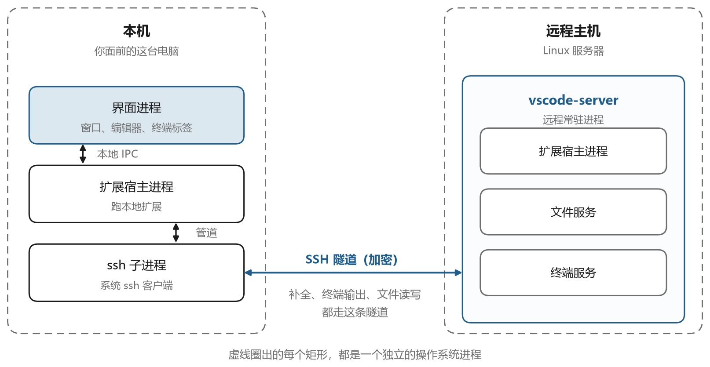
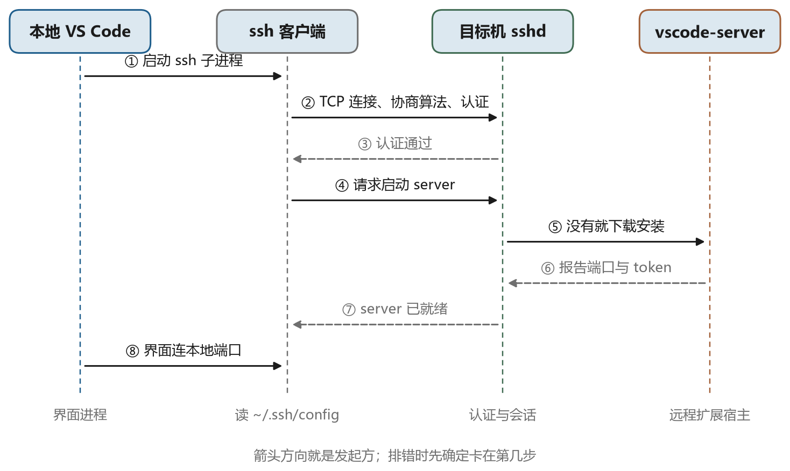
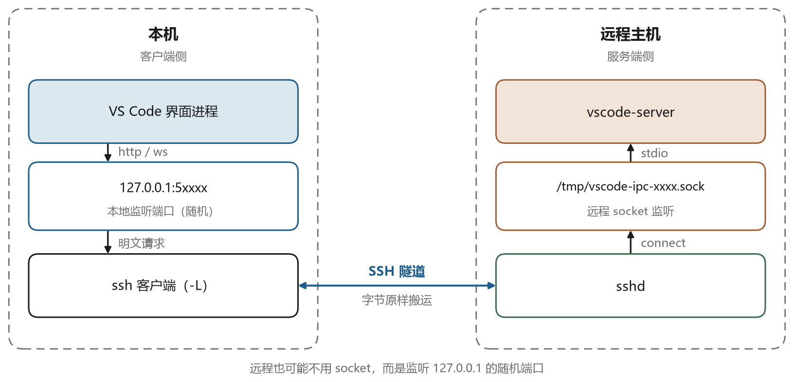
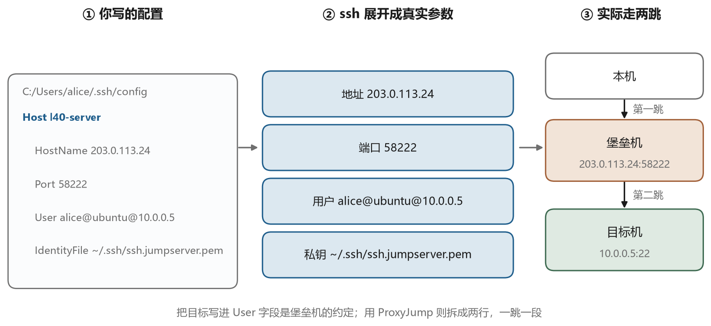

# VS Code 远程开发的工作原理

## 12.1 一个编辑器，四个进程

VS Code 看起来是一个程序，实际上是一组进程。打开任务管理器，能看到好几个 Code.exe。这个结构继承自 Electron（一个用网页技术开发桌面程序的框架），也决定了远程开发可能的形态。

最外层是主进程，负责窗口、菜单、文件对话框、更新。中间是渲染进程，每个窗口一个，负责画界面。再往下是扩展宿主进程，所有扩展的代码都跑在这里，一个扩展崩溃不会把界面带崩。还有一个 pty 宿主进程，专门管理终端，让终端里的程序运行在独立进程里。

平常见到的是五类进程，不止四类。主进程是 Node.js 环境，也是唯一能碰系统资源的那个：窗口、托盘、对话框、自动更新都归它。渲染进程跑在 Chromium 的沙箱里，每个窗口一个，不直接读磁盘。扩展宿主是一个独立 Node 进程，几万个扩展的 JavaScript 全在里面跑。pty 宿主专门管终端，每条终端会话都是它 fork 出来的子进程。还有一个 GPU 进程，负责合成和渲染加速，看不见但一直在。

把扩展宿主拆出去是有目的的。扩展是第三方代码，死循环和内存泄漏都不罕见；假如它们和界面同进程，一个扩展崩了整个编辑器就没了。拆开之后，崩的只是那个进程，界面还在，宿主会被自动拉起，用户在弹窗里看到“扩展宿主意外终止”。这个设计在远程场景里正好用得上：既然扩展宿主可以是一个独立进程，它就可以跑在另一台机器上，只把渲染留在本地。

进程之间靠 IPC 报文通信。界面里一次“保存文件”，实际是渲染进程发给主进程，主进程转给远端的扩展宿主，落地后再反向回一条；这条链上任何一环慢，感觉都是“保存卡了”。远程开发把它拉长到网络上，延迟和丢包会被放大成立刻能感知的卡顿。

知道这个结构，就明白远程开发要解决什么问题。你希望代码在远端，编译和运行在远端，但界面和键盘在自己眼前。最直接的做法是把整个 VS Code 搬到远端，界面通过远程桌面显示，但那样延迟高、体验差。VS Code 选择的方案是把一部分进程搬到远端，本机只留界面。





图 12-1 是这个分工。本机保留界面进程和一部分扩展，远端跑一个叫 `vscode-server` 的服务，里面有远端扩展宿主、文件服务、终端服务。两者之间通过一条加密通道通信，通道上跑的是普通的 HTTP 和 WebSocket。

扩展被分成两类。只影响界面的扩展，比如主题、图标、快捷键提示，跑在本机。需要读写文件、调用编译器、访问远端的扩展，比如语言服务、调试器、Jupyter，跑在远端。VS Code 会根据扩展声明的 `extensionKind` 自动决定装在哪边，也可以手工指定。

## 12.2 连接时发生了什么

Remote-SSH 扩展做的事情，可以拆成图 12-2 里的几步。





你在界面上选一个主机，扩展读 `~/.ssh/config`，把别名展开成具体参数。然后它调用系统的 `ssh` 客户端，也就是你平时在终端里用的那个，建立一条连接。注意这一步用的是系统自带的 ssh，不是自己实现的协议栈，所以你在 `config` 里写的所有选项、你的 `known_hosts`、你的 `ssh-agent`，全都照常生效。

四步可以分得更清。第一步叫解析，把别名展开成主机、端口、用户、密钥路径四组参数；这一步完全由 OpenSSH 的规则决定，所以配置写错时，扩展也救不了你。第二步叫拨号，启动 `ssh -T -D <本地端口>` 并把一条 `sh` 命令作为远端命令发过去；`-T` 表示不要分配终端，`-D` 表示在本机开一个 SOCKS 代理，后面所有到远端的连接都从它里拨。第三步叫探针，那一小段脚本用几个标记行告诉本地“远端能否执行命令、目录在不在、版本是多少”。第四步叫握手，启动 server、拿到它监听的地址，再通过刚才那个 SOCKS 代理接上去，换成 WebSocket。

连上之后，扩展在远端执行一小段脚本来检查环境。它检查三件事，`~/.vscode-server` 目录是否存在、里面的版本是否匹配当前 VS Code 的版本、远端能不能正常执行命令。版本不匹配或者目录不存在，它就下载一个对应版本的 server 包，解压到 `~/.vscode-server/bin/<commit-id>/` 下面。

下载这一步是最容易失败的地方。远端机器需要能访问更新服务器，如果它在一个没有外网的机房里，下载就会超时。解决办法有两个，一是在本地下载好安装包，手工传上去解压；二是配置代理，让远端的下载走你的本机。后者的做法是在 `config` 里加 `Remote.SSH.RemoteServerListenOnSocket` 之类的选项，或者更简单地用第八章的本地转发把更新服务器的地址映射过去。

版本匹配的钥匙是四十位的 commit id，不是“1.95”这种版本号。`code --version` 会输出两行，第二行就是它；server 的目录也用这个 id 命名，所以同一台机器上可以共存好几个版本，不互相覆盖。版本对不上时，扩展不会去升级旧目录，而是直接另下一个，这也是为什么 `~/.vscode-server/bin/` 下会慢慢堆出好几个目录。

```bash
code --version
# 1.95.3
# <commit-id>
ls ~/.vscode-server/bin/

# offline install on a host without internet access
curl -L -o vscode-server.tar.gz \
  https://update.code.visualstudio.com/commit/<commit-id>/server-linux-x64/stable
mkdir -p ~/.vscode-server/bin/<commit-id>
tar -xzf vscode-server.tar.gz -C ~/.vscode-server/bin/<commit-id> --strip-components=1
```

`--strip-components=1` 不能省。包里的内容多套了一层目录，不解掉这一层，启动脚本就不在预期的位置上，server 起不来，日志里只有一句“无法启动”。

server 起来之后，它会监听一个本地端口或者一个 Unix socket。扩展在本机也启动一个监听，然后通过 SSH 的端口转发把两边接起来。界面通过 `127.0.0.1` 上的这个端口和远端通信，对你来说完全透明。

为什么是本机监听而不是远端监听，这一点值得想一下。本地监听意味着“只有本机能发起连接”，远端的 server 永远不对外暴露端口，安全上更干净；代价是每次连接都要多一层转发，而且转发断了界面就会挂。这也是为什么它必须依赖 SSH 的 `-D`：SOCKS 代理本身就是个能按名字拨号的接口，本地拿到一个“逻辑地址”，拨号由 ssh 去完成。

## 12.3 那条隧道的两端

图 12-3 画的是这条隧道两端的细节。





本机这一端，VS Code 随机选一个空闲端口，通常是 5 万多的一个数字，监听在 `127.0.0.1`。远端那一端，`vscode-server` 监听一个 Unix socket 文件，路径在 `~/.vscode-server/` 下面，或者监听一个 `127.0.0.1` 上的随机端口。中间的转发由 `ssh` 客户端完成，用的不是 `-L` 也不是 `-R`，而是 `-D`：本机开一个 SOCKS 代理，所有到远端的连接都从它里“拨号”过去。

为什么选 SOCKS 而不是简单的端口映射，原因在数量。一次远程会话不止一条连接，文件服务、终端、扩展宿主、日志各走各的，端口数量不固定，而 `-L` 要求你事先知道每个远端端口。`-D` 只给一个入口，后面的连接按名字拨，数量多少都无所谓。代价是排错时看 `ss` 只能看到一个 SOCKS 端口，看不到里面跑了几条流。

这个设计解释了几个现象。第一，你在远端用 `ss -lntp` 会看到 `vscode-server` 监听在回环地址上，端口号是随机的，从外部连不进去。第二，如果你在堡垒机上禁用了端口转发，Remote-SSH 会在建立隧道这一步失败，报错通常出现在输出面板里，而不是终端里。第三，隧道断了之后界面会显示“正在重新连接”，因为 WebSocket 断了，VS Code 会尝试重连并重新建立端口转发。

还有一条很容易混的路叫 Remote Tunnels。它把方向反过来：远端主动跑一个 `code tunnel`，向微软的转发服务注册一个隧道名，本机的 VS Code 或浏览器再连到同名隧道上。整个过程远端不需要开任何入站端口，也不需要 SSH，适合那些你进不去防火墙、也不方便配密钥的机器。代价是多了一个第三方中转，代码流量经过它加密转发。表 12-1 是两者的对照。

表 12-1　Remote-SSH 与 Remote Tunnels

| 对比项 | Remote-SSH | Remote Tunnels |
| --- | --- | --- |
| 连接方向 | 本机主动连远端 | 两端各自向外连 |
| 前提 | 能 SSH、有账号或密钥 | 远端能访问外网 |
| 中转 | 你自己控制的跳板 | 厂商的转发服务 |
| 适用 | 公司资产、合规环境 | 个人设备、演示、应急 |
| 审计 | 走堡垒机就能留痕 | 不经过你的审计链路 |

## 12.4 ssh_config 的解析规则

Remote-SSH 完全依赖系统的 ssh 客户端，所以 `config` 文件的解析规则就是 OpenSSH 的规则，值得花点时间搞清楚。

文件从上往下读，对每一段 `Host` 检查当前连接的主机名（也可能是命令行里给的别名）是否匹配，匹配的段里的选项生效。这里有一条和多数配置文件相反的规则：同一个参数只取第一次出现的值，后面的同名设置不会覆盖前面的。所以具体的段写在前面，`Host *` 这种兜底段写在最后。写反了不会报错，症状是某台机器莫名其妙用了另一个网段的用户名或密钥。

```text
Host lab-gpu
    HostName 10.0.0.9
    ProxyJump jump

Host lab-*
    User alice
    IdentityFile ~/.ssh/id_ed25519_lab

Host *
    ServerAliveInterval 30
```

上面的例子里，连 `lab-gpu` 时三段都匹配。`HostName` 和 `ProxyJump` 来自第一段，`User` 和 `IdentityFile` 来自第二段，`ServerAliveInterval` 来自第三段，各项互不冲突。假如把 `Host *` 放到最前面，它里面的每一项都会先被取走，后面的段就只能补它没写过的参数，一旦以后有人往那段里加个 `User`，就会发现怎么改都不生效。

支持的写法还有 `Include`，可以把配置拆成多个文件。

```text
Include ~/.ssh/config.d/*
```

OpenSSH 7.3 起支持，通配符和 `~` 都能用。企业里常用它把不同环境的配置分开管理。要注意它是就地展开，不是“最后读”：`Include` 那一行的位置，就是被包含文件的那些段原本所在的位置，所以展开后的先后顺序仍然要按“具体在前、兜底在后”排。配置不生效的常见原因就是包含进来的文件里也有一段 `Host *`，而且它排在你的具体段前面。

带条件的配置用 `Match`。`Host` 匹配的是别名，`Match` 匹配的是连接参数：

```text
Match host 10.0.0.*
    User ops

Match exec "test -f ~/.ssh/inside"
    ProxyJump jump
```

`Match` 里可以用 `host`、`user`、`originalhost`、`exec`、`all`，后者只能单独用，且通常放最后。`exec` 会在本机真的执行一条命令，用它做“在家才走跳板”这类判断很方便，代价是每次连接多一次进程开销，写死路径比依赖环境变量稳。

优先级比优先级本身更容易记错：命令行上的 `-o` 最高，其次是 `-F` 指定的文件，再其次是 `~/.ssh/config`，最后是系统级的 `/etc/ssh/ssh_config`。同一层里只有“第一次出现的值”生效。所以排查“为什么这个参数没生效”时，先看命令行里是不是有人写了一个 `-o`，再去挖配置文件。

几个替换符号在写 `ProxyCommand` 时会用到。`%h` 是目标主机名，`%p` 是端口，`%r` 是用户名，`%d` 是本机的家目录。写 `ProxyCommand ssh -W %h:%p jump` 时，这些符号会被替换成实际值。

还有两个容易忽略的点。一是 `HostName` 不写时默认等于 `Host` 后面的名字，所以 `Host lab` 加 `HostName 10.0.0.5` 两者都要写清楚，别指望它能猜。二是别名只是字符串，大小写在不同工具里处理不一致，团队里统一用小写最省事。

## 12.5 逐行拆解那份配置

现在回到那种看起来别扭的配置。图 12-4 把每一行的作用标了出来。





```text
Host l40-server
    HostName 203.0.113.24
    User alice@ubuntu@10.0.0.5
    Port 58222
    IdentityFile C:/Users/alice/.ssh/ssh.jumpserver.pem
```

`Host l40-server` 定义了一个别名，你在 VS Code 里选的就是这个名字，命令行里 `ssh l40-server` 用的也是它。名字本身可以随便起，只要自己记得住。

`HostName 203.0.113.24` 是真正要连接的地址。这里是堡垒机的公网地址，不是你目标机的地址。这一点是整份配置里最容易误解的地方。

`User alice@ubuntu@10.0.0.5` 是三合一用户名，第十一章讲过它的三段含义。SSH 客户端不解析这个字符串，它原样发给服务器，由堡垒机去解析。

`Port 58222` 是堡垒机 SSH 网关的端口。不是 22，因为堡垒机的 22 端口通常留给系统自身的运维，网关用另一个端口。

`IdentityFile` 指向你在堡垒机上注册的公钥对应的私钥。这个私钥认证的是你本人，也就是 `alice` 这个堡垒机账号，不是目标机上的账号。

五行里没有写 `IdentitiesOnly`，这在密钥多的机器上会出事。默认会把 `ssh-agent` 里的钥匙逐把试过去，服务端只允许试几次，钥匙一多就可能还没轮到对的那把就被断开，表现是“密码正确但登录失败”。稳妥的写法是加上 `IdentitiesOnly yes`。同类配置还有 `ServerAliveInterval 30`，每三十秒一个心跳，防止中间设备回收闲置连接。

把五行合起来读，意思是“连接 203.0.113.24 的 58222 端口，用这把私钥证明我是 alice，然后告诉它我要用 ubuntu 这个系统用户去连 10.0.0.5”。一行配置里塞了两次认证、三段信息，难怪第一次看会懵。

这里有一个实际会遇到的问题。VS Code 的 Remote-SSH 在内部会解析用户名，某些版本会把 `User` 按第一个 at 符号切开，导致只把 `alice` 发过去。如果遇到这种版本，解决办法是在 `config` 里用 `User alice@ubuntu@10.0.0.5` 的同时，加上 `Remote.SSH.UseLocalServer` 或者改用 `ProxyCommand` 手工拼参数。具体做法随版本变化，判断依据是输出面板里的日志，看它实际发出的用户名是什么。

## 12.6 出问题时看哪里

Remote-SSH 的错误提示往往很笼统，只说“无法连接”。真正的细节在输出面板里。

打开方式是菜单里的“视图 → 输出”，然后在右侧下拉里选 “Remote - SSH”。这里会打印完整的 ssh 命令行、连接过程、每一步的输出。它其实就是在替你执行一条 `ssh` 命令，把参数都拼好了。

按故障类型分，排查顺序不一样。连不上要自下而上：先在本机 `nc -vz 主机 端口` 确认路通，再在跳板上试同一条命令，最后才看认证。反复重连从连接稳定性下手：看 `ServerAliveInterval` 有没有配、网络是不是在 Wi-Fi 和有线之间切、跳板的空闲超时是不是短于重连间隔。

```text
Running script with connection command: ssh -T -D 5xxx "l40-server" sh
```

看到这一行，就可以把它复制到终端里手工执行，加上 `-v` 看更详细的输出。这是排查最快的路径，因为你在终端里能拿到完整的调试信息，而输出面板有时候会截断。

几个常见故障和对应的原因。报“Could not establish connection”，先看是不是网络不通或者端口写错。报“Permission denied”，检查私钥路径、私钥权限、堡垒机上的公钥是否配对。卡在“Downloading VS Code Server”，是远端下载失败，检查外网连通性或者手工安装。连上了但界面一直转圈，多半是端口转发被禁用，或者远端的 `vscode-server` 进程僵死。

清理远端残留是另一个常用操作。有时候 `vscode-server` 的进程卡住，删掉目录重来最快。

```bash
ls ~/.vscode-server/bin/
ps -ef | grep vscode-server
rm -rf ~/.vscode-server
```

VS Code 里还有一个命令叫 “Kill VS Code Server on Host”，效果一样，不用记路径。执行之后重新连接，它会重新下载并启动。

磁盘满是最常见的一种“忽然就连不上了”。`vscode-server` 把每个版本的 server、每个扩展、每个工作区的索引和日志都放在家目录下，跑上几个月就几个 GB。`~/.vscode-server/bin/` 下的旧 commit 目录可以直接删，下次用到时它会重下；`data/logs` 里的日志超过一个月的可以清。清理前先确认没有活跃会话，否则界面会直接断开。

```bash
du -sh ~/.vscode-server/*
du -sh ~/.vscode-server/data/logs/* | sort -h | tail -5
ls -1 ~/.vscode-server/bin/
```

扩展不可用的原因比较琐碎。有些只能在本地跑，比如主题和快捷键提示；有些必须在远端跑，比如调试器和语言服务；更多的一类两边都能跑，由 `extensionKind` 和安装位置共同决定。把只能在本地跑的装到了远端，界面会显示“已安装但未激活”，不报错，功能就是不出现。看扩展页面上标的是 “SSH: 主机名” 还是 “本地”，就知道它装在哪边。

最后提醒一句资源问题。`vscode-server` 会占内存，语言服务和索引在大项目上能吃掉几个 GB。如果在共享的 GPU 机器上开发，注意别让它把内存吃满，导致训练任务被 OOM 杀掉。可以在远端限制扩展数量，只装必需的语言支持。

到这里，第三篇结束。连接从一个人扩展到一群人，从终端扩展到编辑器，问题最后都落在同一处：数据。下一章换到链路的那一端，看代码跑起来产出的东西存在哪里。
