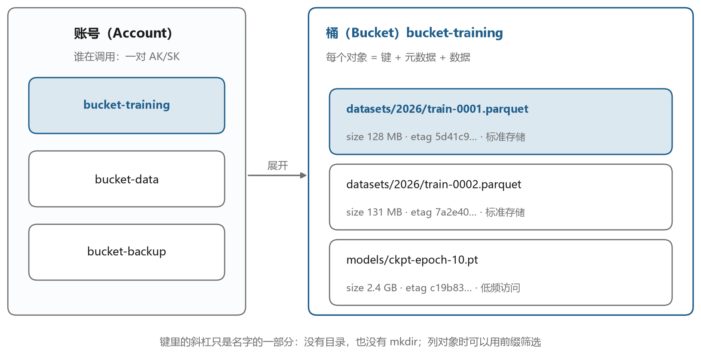
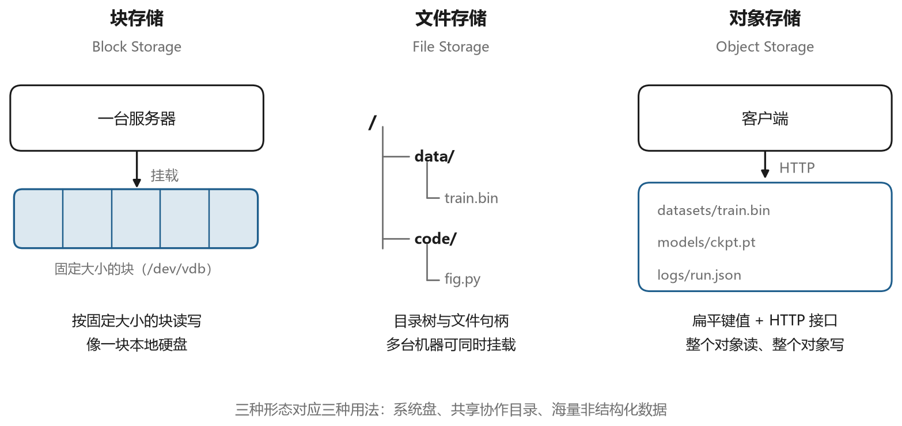
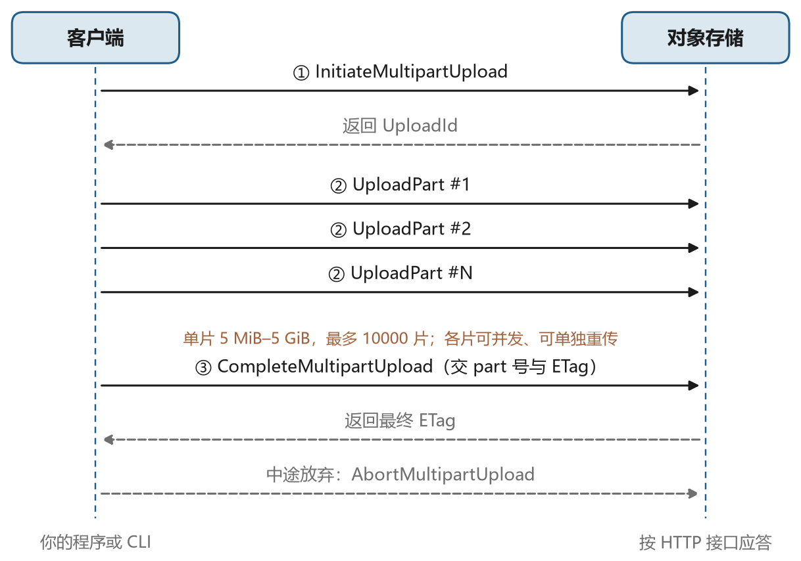

# 对象存储的模型

## 13.1 为什么不用文件夹

服务器上的数据通常放在文件系统里，一个目录套一个目录，文件有名字、有路径、有属性。这套模型用了几十年，很成熟。但当数据量到了几十 TB、文件数到了几千万，文件系统开始吃力。目录树的元数据要放在内存里，几千万个 inode（文件系统里记录单个文件属性的数据结构）会把内存吃光；单机的容量有上限，扩容要停机；跨机器共享要靠 NFS（一种让多台机器挂载同一个目录的协议），性能和稳定性都不理想。

对象存储是为这个场景设计的。它放弃了目录树，放弃了随机写，放弃了文件锁，换来的是近乎无限的容量、很高的持久性和简单的 HTTP 接口。代价是你不能像本地文件那样 `append` 一段内容，也不能 `rename` 一个目录，每次操作都是整体替换一个对象。





图 13-1 是它的数据模型。最上层是账号，账号下面可以建多个存储桶（Bucket），桶里放对象（Object）。对象由三部分组成，一个键（Key）、一段数据、一组元数据。键是一个字符串，可以包含斜杠，看起来像路径，但它不是路径。

```text
logs/2026/11/04/app.log
```

这个键在对象存储里就是一个完整的名字，没有 `logs` 这个目录。控制台上把它显示成目录树，是为了照顾人的习惯，实际存储时它就是一串字符。这个设计带来一个后果，按前缀列举很快，按“目录”操作不存在。想删除一个“目录”，得先列出所有以这个前缀开头的对象，逐个删。

前缀之所以快，是因为键在索引里按字典序排列，`logs/2026/11/` 下所有对象是连续的一段，读出来不用扫全表。“空目录”也不存在，最后一个对象删掉，那一层就从控制台消失了。反过来，“重命名目录”退化成逐个复制再逐个删除，一千万个对象就是两千万次请求，所以键的结构要在写入之前想好。

几个数字能建立尺度感。键名按 UTF-8 编码后通常限制在 1024 字节以内；桶名 3 到 63 个字符，只能是小写字母、数字和连字符。单个桶的对象数没有硬上限，但同一个前缀下堆几十万个对象时列举会变慢，实践中按日期再分一层，让每个前缀控制在几千个的量级。

放弃的东西也要说清楚。没有 append，想在日志末尾追加一行，只能读出整个对象、拼上新内容、写回去；没有 rename，改名等于复制加删除；没有文件锁，两个客户端同时写同一个键，后到的静默覆盖先到的。判断一份数据适不适合放桶里，标准只有一条：它是不是需要原地修改。

表 13-1 从五个维度对比两种模型，能看出这不是“新的替代旧的”，而是两种不同的权衡。

表 13-1　文件系统与对象存储的对比

| 维度 | 文件系统 | 对象存储 |
| --- | --- | --- |
| 组织方式 | 目录树，路径唯一 | 扁平键空间，前缀只是字符串 |
| 修改方式 | 任意位置随机写 | 整个对象替换 |
| 单对象上限 | 受文件系统限制 | 通常 5 TB |
| 容量扩展 | 换盘、扩容，可能要停机 | 按需增长，近乎无限 |
| 计费单位 | 磁盘容量 | 容量加请求加流量 |

桶的名字全局唯一，跨账号也不能重复，因为访问时要用它拼域名。腾讯云 COS 的域名形如 `bucket-1250000000.cos.ap-guangzhou.myqcloud.com`，其中前半段是桶名加 APPID，后半段是地域。AWS S3 的域名形如 `bucket-name.s3.region.amazonaws.com`。这个域名规则在排查访问问题时很重要，因为签名计算和域名绑定，写错地域就会报签名不匹配。

## 13.2 三种存储形态

块存储、文件存储、对象存储经常被放在一起比较，它们解决的是不同层次的问题。图 13-2 是这三者的示意。





块存储提供的是一块裸设备，操作系统在上面建文件系统，用起来和本地磁盘一样。云厂商的云硬盘属于这一类。它的优点是延迟低、支持随机读写，适合数据库。缺点是同一时刻只能挂给一台机器，共享要靠集群文件系统。

文件存储提供的是共享目录，多台机器同时挂载（把远端目录接到本地的一个路径下，用起来像本地目录），看到同一份数据。NFS、SMB（两种共享目录的协议）属于这一类，云上的 NAS（专门提供共享目录的设备）也是。它适合多台机器共享配置、共享代码，缺点是元数据操作多的时候性能下降明显。

对象存储提供的是 HTTP 接口，通过 PUT 和 GET 存取整个对象。它不适合放数据库文件，也不适合放需要频繁修改的文件。它适合放图片、视频、备份、日志、训练数据、模型权重，这些内容写进去之后很少改，但量很大。

表 13-2 把三者放在同一把尺子上量。延迟这一列最能说明问题，块存储是零点几毫秒，文件存储是一到几毫秒，对象存储是几十毫秒，差了两三个数量级。差距来自协议本身，一次对象读取要走 DNS、TCP、TLS、HTTP 几个来回。

表 13-2　三种存储形态的对比

| 维度 | 块存储 | 文件存储 | 对象存储 |
| --- | --- | --- | --- |
| 呈现形式 | 裸块设备 | 共享目录 | HTTP 接口 |
| 访问粒度 | 扇区 | 文件 | 整个对象 |
| 典型延迟 | 0.1 到 1 毫秒 | 1 到 5 毫秒 | 20 到 100 毫秒 |
| 多机共享 | 一般不支持 | 原生支持 | 天然支持 |
| 计费单位 | 容量加 IOPS | 容量 | 容量加请求加流量 |

有一类误解值得提前纠正，能挂载不等于适合挂载。对象存储通过 FUSE（用户态文件系统接口）也能挂成本地目录，但语义差别很大。程序如果依赖 `fsync` 的持久性、依赖文件锁做互斥、依赖 `rename` 的原子性，迁过来就会出问题，而且往往在压力大时才暴露。

判断用哪种存储，可以问三个问题。需要随机读写吗，需要多机共享吗，数据量大到单机放不下吗。数据库用块存储，共享的配置和代码用文件存储，海量冷数据用对象存储。

## 13.3 接口就是 HTTP

对象存储的接口是 REST 风格的 HTTP（REST 指用几个固定动作操作资源，比如 GET 取、PUT 放、DELETE 删）。上传一个对象用 PUT，下载用 GET，删除用 DELETE，查元数据用 HEAD。这几个方法都是幂等的，同一个 PUT 执行两次，结果一样，这对重试很友好。

```bash
curl -X PUT "https://bucket-1250000000.cos.ap-guangzhou.myqcloud.com/test.txt" \
     -H "Authorization: ..." \
     --data-binary "hello"
```

手工拼 `Authorization` 头不现实，比较省事的办法是让 curl 自己算签名。它内置了 SigV4 支持，只要给出区域和服务名。

```bash
curl --aws-sigv4 "aws:amz:ap-guangzhou:s3" \
     --user "$COS_SECRET_ID:$COS_SECRET_KEY" \
     -X PUT --data-binary "hello" \
     "https://bucket-1250000000.cos.ap-guangzhou.myqcloud.com/test.txt"
```

第二条能真的跑，前提是环境变量里有可用密钥，且桶就在 `ap-guangzhou`。`--aws-sigv4` 需要 curl 7.75 以上，老版本会报 `option --aws-sigv4: is unknown`，那就得改用 SDK。

返回的状态码能说明大部分问题。表 13-3 是对象存储里最常碰到的一批。

表 13-3　对象存储常见的 HTTP 状态码

| 状态码 | 含义 | 典型场景 |
| --- | --- | --- |
| `200` | 成功 | GET 拿到对象 |
| `204` | 成功但无内容 | DELETE 成功，跨域预检 |
| `206` | 部分内容 | 带 Range 的分段下载 |
| `400` | 请求格式错 | 参数缺失、分片序号越界 |
| `403` | 无权限或签名错 | 策略拒绝、签名不匹配 |
| `404` | 不存在 | 键名拼错、桶已被删 |
| `409` | 冲突 | 桶名被占用 |
| `412` | 前置条件失败 | `If-Match` 的 ETag 不匹配 |
| `5xx` | 服务端问题 | 后端错误、内部超时 |

排错时先看状态码，再看返回的 XML 里的错误码，后者更具体。同样是 `403`，可能是签名不匹配、密钥不存在、策略拒绝、时钟偏差，只有 `Code` 能区分。响应头里的 `x-cos-request-id` 要记下来，那是关联服务端日志的唯一线索。

两个容易被低估的能力。一个是 Range 请求，下载时带 `-r 0-1048575` 只取前 1 MB，服务端返回 `206`，断点续传和多进程并行下载都靠它。另一个是条件请求，`If-None-Match` 命中返回 `304` 不传数据，`If-Match` 带上 ETag，对象被改过就返回 `412`，这是没有文件锁时的乐观并发控制。

```xml
<?xml version="1.0" encoding="UTF-8"?>
<Error>
  <Code>SignatureDoesNotMatch</Code>
  <Message>The request signature we calculated does not match...</Message>
  <Resource>/test.txt</Resource>
  <RequestId>...</RequestId>
</Error>
```

`Code` 字段是最有价值的信息，第十四章会把常见的几个错误码和它们的成因列出来。

还有一个容易忽略的方法 HEAD。它只返回头部，不返回内容，可以用来快速判断对象是否存在、有多大、是什么类型，不用把整个对象下载下来。

```bash
curl -I "https://bucket-1250000000.cos.ap-guangzhou.myqcloud.com/big-model.bin"
```

## 13.4 大文件怎么传

对象存储的单个 PUT 有大小限制，通常是 5 GB。超过这个大小必须用分片上传。即使没超，大文件用分片上传也更可靠，因为某一片失败只需要重传那一片。

分片上传分三步，如图 13-3。先发起一个分片上传请求，服务端返回一个 UploadId。然后按顺序或者并发上传各个分片，每片带上序号，服务端返回每片的 ETag（服务端为这段内容算出的校验值，用来确认分片完整）。最后提交完成请求，把所有分片的序号和 ETag 列出来，服务端按顺序拼接成一个对象。





这套机制有两个细节值得知道。第一，分片有大小限制，除了最后一片，每片不能小于 1 MB（不同厂商的数字略有差异，S3 是 5 MB），最大不能超过 5 GB。第二，未完成的分片上传会占用存储空间，因为已经上传的分片还在服务端。所以要配置生命周期规则，自动清理超过一定天数还没完成的分片，否则存储费用会莫名其妙地上涨。

把三步写成可执行的形式会更清楚。第一步发起上传，服务端返回 `UploadId`，它通常有几天到一周的有效期，过期后已传的分片作废。

```bash
aws --endpoint-url https://cos.ap-guangzhou.myqcloud.com s3api \
    create-multipart-upload --bucket dataset-1250000000 --key model/ckpt.bin
```

第二步上传分片，每片一个从 1 开始的序号，片与片之间没有顺序要求，可以并发。

```bash
split -b 64m ckpt.bin part-
aws --endpoint-url https://cos.ap-guangzhou.myqcloud.com s3api \
    upload-part --bucket dataset-1250000000 --key model/ckpt.bin \
    --part-number 1 --upload-id "$UPLOAD_ID" --body part-aa
```

每个分片的响应里带一个 `ETag`。第三步提交，把序号和 ETag 按升序列成清单，服务端按序号拼接。

```json
{
  "Parts": [
    { "ETag": "\"d41d8cd98f00b204e9800998ecf8427e\"", "PartNumber": 1 },
    { "ETag": "\"0cc175b9c0f1b6a831c399e269772661\"", "PartNumber": 2 }
  ]
}
```

```bash
aws --endpoint-url https://cos.ap-guangzhou.myqcloud.com s3api \
    complete-multipart-upload --bucket dataset-1250000000 --key model/ckpt.bin \
    --upload-id "$UPLOAD_ID" --multipart-upload file://parts.json
```

三个辅助动作也常用。`list-parts` 查看已传的片，断点续传靠它；`abort-multipart-upload` 放弃一次上传，省下存储费。

ETag 的生成规则值得单独讲，它经常被误用。普通上传的对象，ETag 就是内容的 MD5，三十二位十六进制。分片上传的对象，算法是取每一片 MD5 的二进制形式（十六字节）拼接，再对拼接结果算一次 MD5，末尾加连字符和分片数量，形如 `5d41402a-3`。所以它和整个文件的 MD5 不相等，分片数一变，内容相同 ETag 也不同。

分片大小有一个经验公式。单个对象最多一万片，每片至少是总大小除以一万，再向上对齐到 8 MB 的整数倍。一个 100 GB 的文件每片取 16 MB 比较合适，2 GB 的文件用默认的 64 MB 就够。

分片上传还支持断点续传。客户端把 UploadId 和已完成的分片列表存下来，下次从断点继续。`coscli`、`aws s3 cp` 这些工具内部都实现了这套逻辑，命令行看起来是一条命令，背后可能是几十个并发请求。

## 13.5 元数据与存储类型

每个对象除了数据，还有一组元数据。系统元数据由服务端维护，包括大小、修改时间、ETag、内容类型。用户元数据是自定义的键值对，以 `x-cos-meta-` 或者 `x-amz-meta-` 开头，可以用来记录业务信息。

```text
x-cos-meta-project: video-2dto3d
x-cos-meta-owner: alice
```

用户元数据有几个隐含限制。总量通常只有 2 KB，键名和值都算在内；键名不区分大小写，存进去就是小写；头的值不能带换行，中文要先做 URL 编码。它只能随对象一起写，改一个标签值的做法是把对象复制到自己身上、只换元数据，数据不重新上传。

比用户元数据更常被忽略的是几个标准头。`Content-Type` 写错，图片会被当成二进制文件下载；`Cache-Control` 决定中间缓存存多久，带签名的链接应该设 `no-store`；`Content-Disposition` 写 `attachment`，点击就变成下载。三个头都能事后用原地复制改，漏设的后果要等用户投诉才显现。

ETag 常被误认为是文件的 MD5。对普通上传的单文件，它确实是内容的 MD5；对分片上传的对象，它是各分片 MD5 拼接后再算 MD5，和整个文件的 MD5 不同。用它做完整性校验时要小心，比较靠谱的做法是自己在本地算 MD5 或者 SHA-256，存进用户元数据。

存储类型决定了费用和取回时间。标准存储适合频繁访问的数据，低频存储便宜一些但取回要等，归档存储更便宜但要解冻几个小时。

表 13-4　常见存储类型的取舍

| 类型 | 最小计费期 | 取回耗时 | 适用对象 |
| --- | --- | --- | --- |
| 标准 | 无 | 立即 | 在线素材、热数据 |
| 低频 | 30 天 | 立即，有取回费 | 备份、偶尔翻的日志 |
| 归档 | 90 天 | 几分钟到一小时 | 合规留存、旧权重 |

这些类型可以按规则自动转换，比如“创建 30 天后转低频，90 天后转归档”，这就是生命周期规则。配规则时要注意最小计费期，一个对象存三天就转归档又删掉，仍按 90 天收费。

成本由四块组成。存储费按容量和类型计，以常见的公有云报价为例，标准存储每 GB 每月在零点一元量级，低频约为六七成，归档约为三分之一。请求费按次数计，写比读贵十倍左右。下行流量费往往才是大头，跨地域或出公网每 GB 几毛钱。

## 13.6 一致性与持久性

对象存储宣传的持久性通常是“11 个 9”，意思是每年丢失数据的概率是千亿分之一。这个数字来自冗余设计，同一份数据存多个副本或者用纠删码编码后分散到多台机器、多个机架，坏掉几个不影响整体。

一致性是另一个维度。早期的 S3 只保证最终一致，上传之后立刻读可能读到旧版本。2020 年底 AWS 宣布 S3 对新建对象的读写提供了强一致性，覆盖列表操作。国内厂商的文档里也有类似说明，但具体行为要看版本。这一点对训练任务有实际影响，上传完数据立刻开始训练，如果读到的是旧版本或者读不到，会很困惑。稳妥的做法是上传后校验，或者等几秒再开始。

把“一致”拆成三种操作看会更清楚。新对象写入，PUT 返回 `200` 后任何 GET 都能读到它；覆盖写和删除，后续读到的必定是新值或 `404`，没有中间态；列表立即反映刚才的变更。弱一些的是跨区域复制和 CDN 缓存，前者异步同步，延迟几秒到几分钟。

并发写是另一回事。两个客户端同时 PUT 同一个键，服务端不做互斥，落盘的是后到的那个，前面的静默丢失，两边都收到 `200`。要防覆盖只能用条件请求，先 HEAD 拿到 ETag，再带 `If-Match` 去写，ETag 变了就返回 `412`。

持久性和可用性也要分开看。十一个九说的是数据不丢，不保证随时能读，服务整体故障时照样报错。对训练场景更实用的做法是把“上传完成”做成显式信号：数据传完后写一个几十字节的 `_SUCCESS` 对象，脚本只认这个标志。

## 13.7 工具与挂载

日常使用对象存储有三类工具。

图形界面的客户端，用来浏览桶、上传下载、生成分享链接。这类工具适合偶尔用，不适合批量操作。

命令行工具，比如 `coscli`、`aws s3`、`rclone`。它们支持并发、断点续传、同步目录、按规则过滤，是脚本里的主力。

```bash
coscli cp ./data/ cos://bucket-1250000000/dataset/ --recursive
coscli sync ./checkpoints/ cos://bucket-1250000000/ckpt/ --delete
```

`sync` 的两个参数得想清楚再用。`--delete` 的意思是目标端多出来的文件删掉，它保证两端一致，也正是误删的常见原因，第一次跑先加 `--dry-run` 看一眼名单。`rclone` 的并发靠 `--transfers`（默认 4）和 `--checkers`（默认 8），小文件多时把后者调高。

```bash
rclone sync ./data remote:dataset --dry-run
rclone check ./data remote:dataset --size-only
```

`--size-only` 只比大小不比哈希，几秒钟能跑完，适合每日巡检；去掉它就是全量比对，代价是要把对象读一遍。

挂载工具，比如 `cosfs`、`s3fs`、`goofys`。它们把桶挂成一个本地目录，应用程序不用改代码就能读写。这看起来很美好，坑却不少。

第一个坑是延迟。每次读文件都是一次 HTTP 请求，随机读小文件的性能比本地磁盘差两个数量级。第二个坑是随机写。对象存储不支持在文件中间插入数据，很多程序（比如数据库、某些编译工具）会先写临时文件再改名，这种模式在挂载的文件系统上可能失败或者产生额外开销。第三个坑是文件锁。对象存储没有锁的概念，多台机器挂载同一个桶，同时写同一个文件会互相覆盖。

结论是，挂载适合“读多写少、顺序访问”的场景，比如让训练脚本直接读数据集。不适合放数据库、不合适放代码仓库、不合适放需要频繁 rename 的编译输出。

真要挂，几个参数决定体验。元数据缓存的 TTL 设小了每读一个文件都要一次 HEAD，设大了会读到刚被删掉的文件；本地磁盘缓存让第二次读快很多，代价是多占一块盘；大文件的分片大小默认往往只有 8 MB，写权重时该调到 64 MB。

## 13.8 和堡垒机的关系

这两件事看起来无关，其实在企业里经常连在一起。

堡垒机的会话录像要存起来，本地磁盘存不下六个月的数据，于是存到对象存储。训练任务的日志和模型权重也要存，于是也放对象存储。数据的入口和人的入口，构成了运维体系的两端。

这也带来一个安全上的共同点。两者都依赖凭据，堡垒机托管服务器的密码和私钥，对象存储依赖访问密钥。凭据泄露的后果一样严重。第十四章要讲的签名机制，本质上就是让凭据在使用时不出现在网络上，这一点和 SSH 的公钥认证思路相同。

还有一个细节能看出两者的关系。会话录像文件是“写完就不改”的，正合对象存储的语义；对象存储的访问日志也该当成审计证据，单独的日志桶、只允许写、开版本控制防覆盖。
