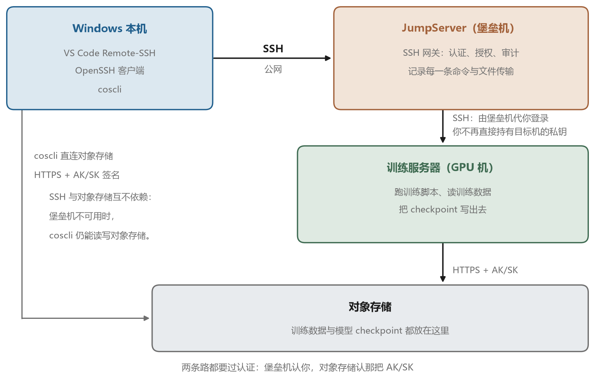
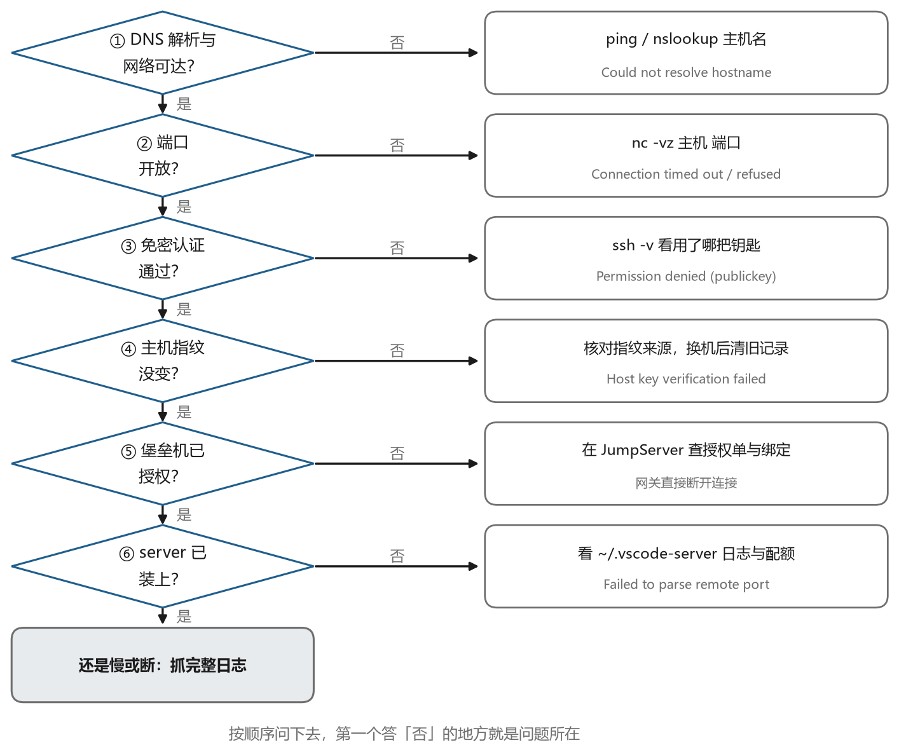

# 从登录到数据存取

## 15.1 一个真实的工作流

前面十四章各自讲了一个部件，这一章把它们装到一起。

设想这样的场景。你在办公室的 Windows 电脑上写代码，代码要跑在实验室的一台 GPU 服务器上，那台服务器在机房内网，外面进不去，只有一台堡垒机暴露在公网。训练数据有几百 GB，放在对象存储的一个桶里，模型权重也要定期存回桶里。你希望能在本地的 VS Code 里编辑远端代码、开终端、跑训练，同时让训练脚本自己从桶里读数据、往桶里写检查点。

这个场景里用到了四样东西，SSH 客户端、堡垒机、VS Code 的远程开发、对象存储的 API。它们分别对应这本书的前四篇。图 15-1 是整体的拓扑。





图里有四条链路，每条都有自己的认证方式。本机到堡垒机是一次 SSH 认证，用的是你的私钥。堡垒机到训练机是另一次认证，用的是堡垒机托管的凭据，你看不到。本机到训练机之间还有一条逻辑上的 VS Code 通道，它跑在前两条连接之上。训练机到对象存储是一次 HTTPS 请求，用的是访问密钥的签名。

把这四条链路的认证对象分清楚，排错时就不会乱。图 15-2 是本机侧常见问题的判断路径，后面几节会用到。





开工之前先确认四件事就绪，缺一件都会卡住。本机有可用的私钥，口令还想得起来；堡垒机上这台资产已经授权给你，且包含你要用的系统用户；训练机能访问对象存储的域名和端口，内网机器经常没有出网权限；桶的读权限已经授到某个具体身份上。这四项分别属于本机文件、堡垒机控制台、训练机路由、云上策略页面四个地方，出问题时的表现都是“连不上”或者“403”，入口却完全不同。

后面四节的顺序就是这四件事的顺序，每一节都给出命令和预期输出。如果某一步的输出和预期不符，先停在这一步，不要带着问题往下走，否则后面每一步的判断都会被前面的故障污染。

## 15.2 第一步，把登录打通

一切从一条能用的 SSH 连接开始。在本机建好配置文件，内容大致如下。

```text
Host lab-gpu
    HostName 203.0.113.24
    Port 58222
    User alice@ubuntu@10.0.0.9
    IdentityFile C:/Users/alice/.ssh/ssh.jumpserver.pem
    IdentitiesOnly yes
    ServerAliveInterval 30
    ServerAliveCountMax 3
```

五行核心配置，第十二章已经逐行拆过。这里补充三行可选项。`IdentitiesOnly yes` 让客户端只用指定的这把钥匙，不去试 agent 里的其他钥匙，避免因为尝试次数过多被服务器拒绝。两个 `ServerAlive` 选项负责保持连接，防止中间设备把闲置的会话清掉。

配好之后先别急着开 VS Code，在终端里试一下。

```bash
ssh -v lab-gpu
```

能进到远端的提示符，说明网络与认证这两关都过了。输出的关键行大致如下，读者可以照着对照。

```text
$ ssh -v lab-gpu
OpenSSH_9.6p1, OpenSSL 3.1.4
debug1: Connecting to 203.0.113.24 [203.0.113.24] port 58222.
debug1: Remote protocol version 2.0, remote software version OpenSSH_8.9
debug1: Authentications that can continue: publickey
debug1: Offering public key: ssh.jumpserver.pem RSA SHA256:q8Zk...
debug1: Server accepts key: ssh.jumpserver.pem RSA SHA256:q8Zk...
debug1: Entering interactive session.
```

这几行的顺序就是排查顺序。`Connecting to` 之后如果没有 `Remote protocol version`，TCP 没通，去看网络和端口。有了协议版本但没有 `Authentications that can continue`，多半在密钥交换阶段被断开，常见于老旧的加密算法对不上。出现了 `Offering public key` 却被拒绝，是服务端不认这把钥匙。`Server accepts key` 之后停住，问题已经不在 SSH，而在堡垒机的授权。

进不去的话，按图 15-2 从上往下查。先确认域名或者地址能通，再确认端口开放，再看认证。

```powershell
Test-NetConnection 203.0.113.24 -Port 58222
```

这条命令在 Windows 上测端口连通性，比 `ping` 靠谱，因为很多服务器禁 ping 但端口是开的。如果端口不通，问题在网络或者云平台的放行规则，和密钥无关。

认证失败时报错通常是 `Permission denied (publickey)`。这时依次检查四件事，私钥文件是否存在、权限是否过宽、公钥是否已经登记在堡垒机、用户名里的三段是否写对。第三件事最容易被忽略，很多人把公钥加到了目标机的 `authorized_keys` 里，却忘了在堡垒机上登记，结果怎么都不通。

还有一个细节值得知道。客户端一次连接最多尝试六把钥匙就会放弃，如果 `ssh-agent` 里存着十几把历史钥匙，服务端可能在轮到你真正那把之前就切断了，日志里看起来像“钥匙都不对”。`IdentitiesOnly yes` 就是为了锁死这一点，配合 `-o IdentitiesOnly=yes` 可以直接在命令行上验证。

```bash
ssh -o IdentitiesOnly=yes -i ~/.ssh/ssh.jumpserver.pem -p 58222 alice@ubuntu@10.0.0.9@203.0.113.24
```

注意用户名里的 `@`，它把“堡垒机账号、系统账号、目标主机”三段拼在一起，shell 会把它当成普通字符，但人看着容易数错段数。写成配置文件就只写一次，减少出错的机会。

## 15.3 第二步，让编辑器连上

终端能登录之后，VS Code 的远程连接通常一次就成。装好 Remote-SSH 扩展，按 `F1` 调出命令面板，选“连接到主机”，输入 `lab-gpu`。

第一次连接会慢一些，因为要在远端安装 `vscode-server`。如果远端的家目录所在分区空间紧张，这一步会失败。先看一下余量。

```bash
df -h ~
```

输出里要看的是 `Avail` 这一列，不是 `Use%`。一个 1.8 TB 的盘用了 94%，看起来还有一百多 GB，但 `vscode-server` 安装完还要解压出几百 MB 的文件，加上语言服务、扩展、索引缓存，实际占用经常到一两个 GB。余量低于 5 GB 时先清理，不要赌它够用。

```text
Filesystem      Size  Used Avail Use% Mounted on
/dev/nvme0n1p2  1.8T  1.6T  118G  94% /
```

装好之后，界面左下角会显示远端的主机名，表示已经连上。这时打开远端的项目目录，编辑、保存、开终端都在远端进行。你的本机只负责显示。

装完之后可以用两条命令确认它真的起来了。第一条看目录，里面以 commit 号命名的子目录就是这一次装的服务端版本；第二条看进程，正常情况下能看到一个 `node` 进程带着 `server-main.js` 之类的参数在跑。

```bash
ls ~/.vscode-server/bin/
ps -ef | grep vscode-server | grep -v grep
```

如果卡在“正在下载 VS Code Server”，说明远端下载失败。可以在本机下载对应的安装包，用 `scp` 传上去手工解压。安装包的地址在输出面板的日志里能找到，形如 `https://update.code.visualstudio.com/commit/<commit-id>/server-linux-x64/stable`。这条路走通之后，本机和服务端的 commit 号必须对得上，否则下次连上来还会重装一遍。

```bash
wget https://update.code.visualstudio.com/commit/<commit-id>/server-linux-x64/stable
mkdir -p ~/.vscode-server/bin/<commit-id>
tar -xzf stable -C ~/.vscode-server/bin/<commit-id> --strip-components=1
```

这条路在离线环境里很常用，值得记下来。`〈commit-id〉` 在 VS Code 的“关于”对话框里能找到。

编辑器连上之后还有一件事要验证，就是端口转发。VS Code 的终端、调试器、Jupyter 都依赖它，而堡垒机默认常常禁止转发。判断方法很简单，在远端的集成终端里起一个监听 8000 的服务，再在本地浏览器打开 `http://127.0.0.1:8000`，能打开说明转发正常。打不开时看 `Remote-SSH` 输出面板，如果出现 `open failed: administratively prohibited`，是堡垒机侧的转发策略挡住了，找管理员开一个白名单，不要在客户端反复重装扩展。

## 15.4 第三步，让训练机读写桶

训练脚本要读写对象存储，需要在训练机上配置凭据。这一步最容易出事，因为凭据一旦落到磁盘上，就成了一条长期风险。

最稳妥的做法是用临时密钥。用一个有签发权限的身份去换一组只在几小时内有效的凭据，注入到环境变量里，不写文件。

```bash
export COS_SECRET_ID="<TEMP_SECRET_ID>"
export COS_SECRET_KEY="<TEMP_SECRET_KEY>"
export COS_SESSION_TOKEN="<TEMP_SESSION_TOKEN>"
```

如果没有临时密钥的签发能力，退一步用子账号密钥，把它写进只有自己能读的配置文件，权限 600。

```bash
mkdir -p ~/.coscli
cat > ~/.coscli/config.yaml <<'EOF'
cos:
  base:
    secretid: <YOUR_SECRET_ID>
    secretkey: <YOUR_SECRET_KEY>
    sessiontoken: ""
  buckets:
    - name: dataset-1250000000
      alias: dataset
      region: ap-guangzhou
EOF
chmod 600 ~/.coscli/config.yaml
```

配置好之后先做一次最小验证，列一下桶里的内容，确认权限没问题。

```bash
coscli ls cos://dataset/
coscli ls cos://dataset/train/ --limit 20
```

能列出来，说明读权限有了。再试一次写，往一个临时前缀里传一个小文件。

```bash
echo test > /tmp/probe.txt
coscli cp /tmp/probe.txt cos://dataset/tmp/probe.txt
coscli rm cos://dataset/tmp/probe.txt
```

这三条命令验证了列、写、删三个动作。能列出来说明读权限正常，能传能删说明写权限正常；如果第一条成功第二条 403，就是只有读权限，这在只读挂载和审计账号上很常见。

`coscli ls` 的预期输出大致如下，能看出前缀是按目录显示、对象带时间和大小。

```text
$ coscli ls cos://dataset/
       PRE  train/
       PRE  ckpt/
2026-11-04 12:31:07      1.2KB  readme.md
```

配置的来源要心中有数。命令行工具会按顺序找配置文件、环境变量、命令行参数，后者覆盖前者。这意味着你在 `~/.coscli/config.yaml` 里配了一套只读密钥，临时 `export` 了一套可写密钥，实际生效的是环境变量那套，删掉文件后行为会突然变化。排查“昨天还能写今天不能写”这类问题时，先确认当前进程到底读了哪套配置。

训练进程继承的是启动它的 shell 的环境变量，所以用 `nohup`、`tmux` 在交互式 shell 里启动的进程能读到密钥，而 systemd 托管的服务读不到，除非在单元文件里用 `EnvironmentFile` 显式指定。这个差异经常导致“手动跑得好好的，做成服务就 403”。

```ini
[Service]
EnvironmentFile=/etc/image-api/cos.env
```

环境文件的格式是每行一个 `KEY=VALUE`，不要写 `export`，不要加引号，文件权限设成 600，属主是运行服务的那个账号。

## 15.5 第四步，把结果取回来

训练结束，检查点和日志要取回来。小文件直接下载，大文件用分片加快，中断了能续。

```bash
coscli cp cos://dataset/ckpt/epoch-10.pt ./ckpt/epoch-10.pt
coscli sync cos://dataset/logs/ ./logs/ --include "*.txt"
```

`sync` 只传输有差异的文件，适合日志这种持续增长的内容。`--include` 和 `--exclude` 支持通配符，可以精确控制传哪些。传大文件时注意本机磁盘空间，一个模型检查点几个 GB 很常见，先 `df -h` 看一眼再开始。

下载完要校验。对象是分片上传的话，桶里那个 ETag 和本地算出的 MD5 不会相等，这一点在第十三章讲过，所以校验要么对着自己记录的哈希比，要么用工具自带的校验开关让它比大小加抽样。

```bash
md5sum ./ckpt/epoch-10.pt
rclone check ./ckpt remote:dataset/ckpt --size-only
```

断点续传在跨洋链路上几乎是必需的。传到一半断掉，重新从头开始意味着前面几十分钟白费，而且大文件重传会反复占用出口带宽。命令行工具的默认行为通常是重传整个文件，需要显式打开续传，或者干脆换成支持分片续传的工具。

如果要把结果分享给别人，不要直接给桶的公共链接，用预签名 URL，设一个合理的有效期。

```bash
coscli sign cos://dataset/ckpt/epoch-10.pt --expire 3600
```

这条命令返回一个带签名的链接，一小时后失效。分享之前确认链接里没有敏感信息，因为 URL 里的路径本身就是对象名，`ckpt/experiment-alpha/epoch-10.pt` 这样的键把项目名和实验名都暴露了。

有效期的选择有个经验值。给人点开下载用十分钟到一小时，够用且风险可控；给第三方系统拉取用一天到三天，要提前通知对方过期时间；超过七天的需求应该换成临时密钥，不要用预签名硬撑，因为那等于发了一张长期通行证。

## 15.6 排错的时候按顺序来

图 15-2 的决策树可以展开成一张检查清单。遇到问题，从上往下逐项确认，不要跳步。这个顺序不是随意的，它按“成本从低到高、影响面从大到小”排列：先花三秒测端口，再花三十秒看握手日志，最后才去翻策略页面和工单系统。反过来查，最容易出现的情况是在策略页面里改了半天，最后发现是安全组没放行。

先看能不能通。`Test-NetConnection` 测端口，`ping` 测地址，`tracert` 看路径。这一步不通，后面全是白费。

再看认证。`ssh -v lab-gpu` 的输出里找 `Authentications that can continue`，它列出了服务器接受的认证方式。如果只有 `publickey`，说明密码登录被禁用，得用密钥。如果连这一行都没有，问题在更早的阶段。

然后看授权。堡垒机的授权是独立于 SSH 认证的一层，SSH 认证通过不代表你有权限连某台资产。表现是连接建立后立刻被断开，或者提示没有权限。这时要去堡垒机界面确认授权是否包含这台资产和这个系统用户。

接着看隧道。VS Code 连上但界面转圈，多半是端口转发被禁用。在输出面板里找 `Remote-SSH` 的日志，如果看到 `open failed: administratively prohibited`，就是这个原因。

最后看对象存储。`SignatureDoesNotMatch` 查地域和密钥，`AccessDenied` 查策略，`RequestTimeTooSkewed` 查时钟。三条线索对应三个不同的层面，不要混着改。

把典型现象汇总成表 15-1，遇到问题时先在上面找一行，比自己回忆要快。

表 15-1　常见失败现象与下一步动作

| 现象 | 最可能的原因 | 下一步 |
| --- | --- | --- |
| 连接超时，没有任何输出 | 地址不通、安全组未放行 | `Test-NetConnection` 测端口 |
| `Connection refused` | 端口通了但没有进程在听 | 在服务器上 `ss -lntp` 看监听 |
| `Permission denied (publickey)` | 钥匙未被接受 | 看 `-v` 里有没有 `Offering` |
| 连上即断开 | 堡垒机授权缺失 | 查资产授权与系统用户 |
| 编辑器一直转圈 | 端口转发被禁 | 看 `Remote-SSH` 输出面板 |
| 训练脚本 403 | 凭据未注入或已过期 | 在同 shell 里重跑 `coscli ls` |
| `RequestTimeTooSkewed` | 实例时钟漂移 | `date -u` 后重启时间同步 |

这张表只能覆盖最常见的一批。真正的判断依据还是“每一步验证一个假设”这个习惯：一条命令只回答一个问题，答案和预期不符就停下来，不要靠猜继续往下走。

## 15.7 一份可以照着做的检查清单

把全书的安全要点收成一份清单，部署或者接手一个新环境时可以逐条对照。

凭据方面。私钥权限 600，目录 700。密钥设口令，口令进 agent。不用共享账号，一人一把钥匙。离职当天回收授权，不只是删机器上的公钥，还要删堡垒机上的账号。对象存储的主密钥不进代码，业务用子账号，临时任务用临时密钥。

连接方面。关闭密码登录，只留公钥。关闭 root 直接登录。改默认端口能减少噪音但不是安全保障。`known_hosts` 的警告要认真看，不要习惯性删掉。

堡垒机方面。默认禁止端口转发和复制粘贴，按需开放。开启会话录像和命令记录，保留期不少于六个月。录像存到对象存储，别放本地磁盘。堡垒机本身单独划分安全域，只对运维网段开放。

对象存储方面。桶一律私有，公共读要单独评估。开启访问日志。配置生命周期，清理未完成的分片和过期对象。跨域规则只对需要的域名开放，不要写 `*`。

这些条目看起来琐碎，每一条背后都有具体的事故。把它们做成检查表，新环境上线前过一遍，比事后复盘便宜得多。

举几个例子说明这些条目为什么存在。私钥权限设 600，是因为 OpenSSH 会主动拒绝加载权限过宽的私钥，报错却写作 `bad permissions`，看着像文件坏了；目录设 700 是因为别人能列目录就等于知道了你有几把钥匙、叫什么名字。关闭密码登录是因为密码可以被在线爆破，而 2048 位以上的密钥在这个时间尺度上不可破。录像保留六个月，是因为多数合规要求的最低留存期就在这个量级，出了事再想找三个月前的会话，往往已经滚掉了。

清单的价值不在条目本身，而在于它把“记得住”变成了“查得到”。一个人接手新环境时不可能凭记忆复现全部细节，有一张能逐条打勾的表，就能把经验从个人身上搬到流程里。

## 15.8 最后

这本书从一台机器讲到了一群机器，从人的入口讲到了数据的出口。中间经过了网络分层、密码学、协议握手、堡垒机的权限模型、编辑器的进程结构、对象存储的签名算法。这些内容看起来分散，其实都在回答同一个问题，一个远方的资源，凭什么相信你，你又凭什么相信它。

SSH 用密钥和签名回答这个问题，堡垒机用集中管理和审计回答这个问题，对象存储用 HMAC 签名回答这个问题。手段不同，思路一致。理解了这一点，再遇到新的工具、新的协议，你也能顺着这条线索把它拆开。

到这里，四篇讲完了：链路、信任、控制、数据。它们回答的是“一台机器怎么被远程使用”“一个团队怎么被管住”“数据怎么被存取”。

但还有一个问题没有回答：如果你想把服务器上的一个程序，做成别人能用的产品，还缺什么？端口怎么开、请求怎么接、大文件怎么传、长任务怎么等、会员怎么登录，这些是第五篇的内容。
