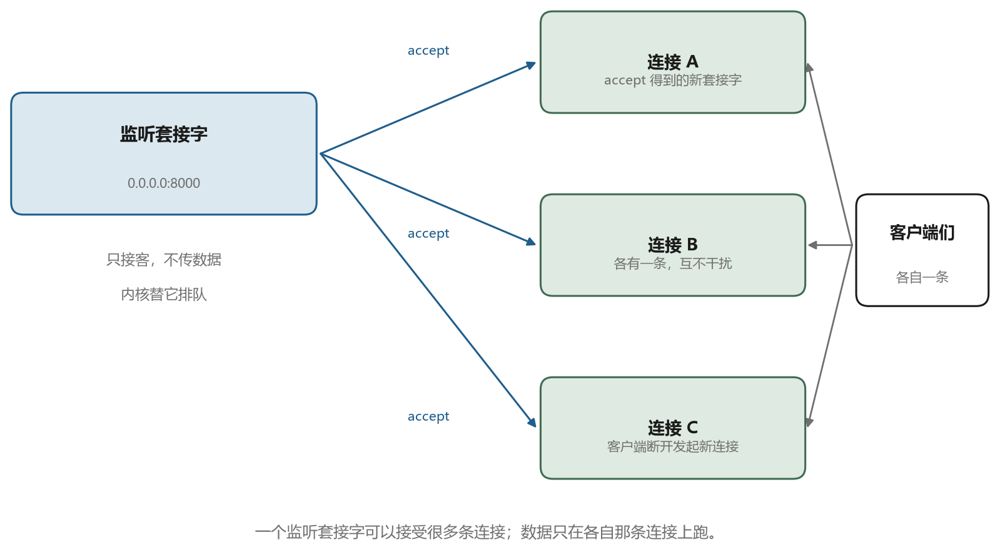
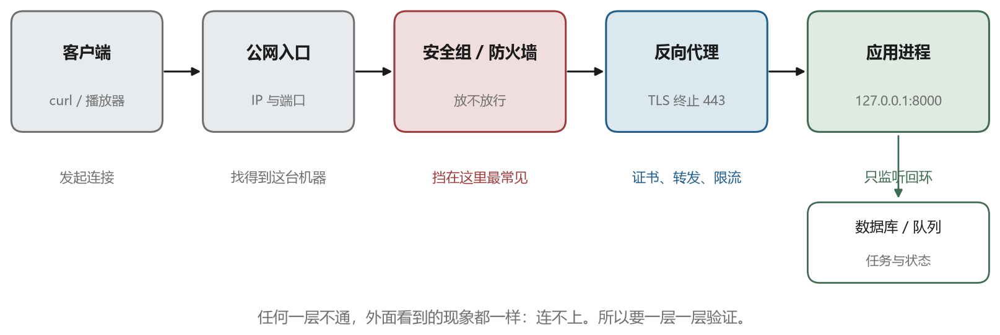

# 端口、监听与 HTTP：程序怎么变成服务

## 16.1 从“我写的程序”到“别人能用的服务”

前面十五章讲的都是你主动去连别人：连服务器、开隧道、取对象。这一篇反过来，你写一个程序放在服务器上，让别人来连它。别人的播放器、浏览器、手机 App，都算“别人”。

要让这件事成立，只需要两个条件，缺一不可：

第一，服务器上得有一个程序守在某个端口上，等连接进来。这个动作叫监听。

第二，网络上的路要通，连接能从外面走到这个端口。云平台的安全组、机器里的防火墙、路由与地址，任何一处不放行，连接就到不了。

这两条看起来简单，却是新手最容易卡住的地方：程序明明跑起来了，在自己机器上 `curl 127.0.0.1:8000` 也通，换个机器就连不上。原因通常不在代码，而在监听地址或者网络规则。这一章把这两条拆开讲。

## 16.2 监听：一个端口怎么“守着”

假设你写了一个小服务：上传一张照片，返回一张风格化图片。程序主体是一个函数，接收请求、处理、返回结果。但要让它能被访问，还得有人把网络上的连接接进来。这件事由“套接字”完成，分三步。

第一步，创建套接字。它就是一个句柄，程序通过它读写网络，和文件描述符是一类东西。

第二步，绑定地址和端口。这一步要选一个地址，选择不同，结果完全不同：

- `127.0.0.1:8000`：只接受本机发起的连接。你在服务器上 `curl` 得通，外面一律连不上
- `0.0.0.0:8000`：接受所有网卡上的连接。写成 `0.0.0.0` 表示“不挑网卡”，外网才有机会进来

第三步，listen。套接字进入等待状态，内核替它维护一个等待队列，连接进来先排队。

之后是 accept：程序每取一次，就得到一个**新的套接字**，专门负责那条连接；原来的监听套接字继续留在原地等人。图 16-1 画的是这两个东西的区别。



这个区别值得记牢。监听套接字本身不传数据，它只负责“接客”；真正收发字节的是 accept 出来的那条连接。所以一个进程能同时服务几百个客户端，每个客户端各有一条连接，互不干扰。也正因为如此，`ss -lntp` 里看到的是监听套接字，而 `ss -tnp` 里看到的是已经建立的连接。

监听这一步还有几个参数值得知道。`listen` 的第二个参数是等待队列长度，内核会把它截到系统上限，Linux 上由 `somaxconn` 决定，较新的内核默认 4096，老的是 128。队列满了之后新连接会被丢掉或收到重置，表现是“偶发连不上”，日志里什么都没有。

```bash
sysctl net.core.somaxconn
ss -lnt | head -5
```

`ss -lnt` 的输出里，`Recv-Q` 这一列在监听状态下表示已经完成握手但还没被 `accept` 取走的连接数。它持续不为零，说明应用取得太慢，或者 `accept` 之后处理逻辑阻塞了主循环。这是判断“程序在听但处理不过来”最直接的证据。

端口释放也有讲究。主动关闭的一方会进入 `TIME_WAIT`，等两个最大报文寿命，大约一分钟，端口才真正可用。频繁重启的服务很容易撞上 `Address already in use`，因为旧连接还占着端口。处理办法是让程序在 `bind` 前设置 `SO_REUSEADDR`，多数框架默认已经这么做，不要直接改内核超时参数。

常见的两个报错都和这一步有关。`Address already in use` 表示端口被别的进程占了，用 `ss -lntp | grep 8000` 找出是谁，或者换一个端口。`Permission denied` 出现在端口号小于 1024 的时候，比如 80 和 443，这些端口只有特权进程能监听，普通用户要用就得走反向代理（16.4 会讲）。

文件描述符是另一道坎。每个连接占一个描述符，默认软限制常常只有 1024，撑到一千个连接就开始报 `Too many open files`。

```bash
ulimit -n
ulimit -n 65535
```

第一条看当前值，第二条只在当前 shell 内生效。要长期生效得改 `/etc/security/limits.conf`，systemd 托管的服务还要在单元文件里单独设 `LimitNOFILE`，因为它不读 shell 的限额。

## 16.3 一次 HTTP 请求长什么样

连接建立之后，双方在上面说的“话”就是 HTTP。它是一段纯文本，格式简单到可以直接用 `nc` 手打出来：

```text
POST /jobs HTTP/1.1
Host: api.example.com
Authorization: Bearer eyJhbGciOi...
Content-Type: application/json

{"prompt": "a lighthouse at dusk", "steps": 30}
```

四部分：第一行是方法、路径、版本；接着是若干请求头；一个空行；然后是请求体。方法表达意图，`GET` 读取、`POST` 提交、`PUT` 覆盖、`PATCH` 局部修改、`DELETE` 删除。路径表达“对哪个东西做什么”，`/jobs` 是任务集合，`/jobs/42` 是 42 号任务。请求头里放元信息，比如身份凭证、内容类型、长度。请求体放真正的数据，上传文件时就是文件本身。

几个头的语义要抠清楚。`Host` 在 HTTP/1.1 里必填，一台机器跑十个站点就靠它区分，缺了直接返回 `400`。`Content-Length` 说明请求体多长，和实际不符时，短了被判为截断，长了会让服务端把后面的字节当成下一个请求，这是一类经典的请求走私。`Transfer-Encoding: chunked` 是另一种表达长度的方式，边算边发，两者不能同时出现。`Connection: keep-alive` 让一条连接复用多个请求。

长度之外还有上限。请求头总大小通常有上限，Nginx 默认单个缓冲区 8 KB、共四个，超了返回 `400`；请求体默认只有 1 MB，这是下一节 `413` 的常见来源。这些默认值不在应用代码里，只翻代码找不到。

响应也是同样的结构，只是第一行换成了状态码：

```text
HTTP/1.1 202 Accepted
Content-Type: application/json

{"id": 42, "status": "queued"}
```

状态码分五段，记住分段就够用了：`2xx` 成功，`3xx` 让你去别处，`4xx` 是你的请求有问题，`5xx` 是服务器自己出了问题。表 16-1 是这本书里会反复出现的几个。

表 16-1　常用的 HTTP 状态码

| 状态码 | 含义 | 什么时候出现 |
| --- | --- | --- |
| `200` | 成功 | 读取任务、下载结果 |
| `201` | 已创建 | 提交任务并立刻有了资源 |
| `202` | 已接受，正在处理 | 提交长任务，先给任务号 |
| `204` | 成功但没有内容 | 删除成功 |
| `301` | 永久重定向 | 域名换了、强制跳 HTTPS |
| `307` | 临时重定向，保持方法 | 换域名但要保留 `POST` 语义 |
| `400` | 请求格式不对 | JSON 解析失败、参数缺失 |
| `401` | 没认证 | 没带凭证，或凭证过期 |
| `403` | 认证过了，但没权限 | 会员等级不够、资源不属于你 |
| `404` | 资源不存在 | 任务号写错 |
| `405` | 方法不允许 | 对只读接口发了 `POST` |
| `409` | 冲突 | 重复提交、状态不允许 |
| `413` | 请求体太大 | 上传超过上限 |
| `415` | 内容类型不支持 | 传了 XML，接口只吃 JSON |
| `422` | 语义错误 | JSON 合法但字段值不合法 |
| `429` | 请求太频繁 | 触发限流、队列已满 |
| `500` | 服务器内部错误 | 代码抛了异常 |
| `502` | 上游返回了坏响应 | 反向代理等不到应用 |
| `503` | 服务暂不可用 | 后端全部不健康、在发版 |
| `504` | 上游超时 | 应用太久没响应 |

`401` 和 `403` 常被混用。区别是：`401` 是“我不知道你是谁”，`403` 是“我知道你是谁，但你不能做这件事”。客户端看到这两个码，处理方式也不同：前者去登录，后者去升级会员或者联系管理员。

还有两个性质要提一句。HTTP 是**无状态**的，每个请求彼此独立，服务器不会自动记得上一个请求是谁发的——所以每个请求都得自己带凭证，这就是第十八章要解决的“登录之后怎么记住你”。另一个是**幂等**：`GET` 不该改变服务器状态，重复发一百次结果一样；`POST` 不保证，重复提交可能建出十个任务，这件事在第十七章用“幂等键”处理。

## 16.4 前面为什么还要放一个反向代理

最省事的做法是让应用直接监听 80 和 443。但生产环境几乎都会在应用前面再放一层，叫反向代理，常见的是 Nginx、Caddy、Traefik。

原因是这一层能替应用干几件它不擅长的活：

- **终止 TLS**。证书只装在一处，应用内部用明文 HTTP 说话，省去在每个服务里配证书
- **按域名和路径分发**。`api.example.com` 转给端口 8000，`www.example.com` 转给静态文件
- **托管静态文件**。图片、前端打包产物由 Nginx 直接给，不占应用的进程
- **限流（限制单位时间内的请求数）与防护**。按 IP 限速、挡住明显的扫描、限制请求体大小
- **补上真实来源**。转发时加上 `X-Forwarded-For` 和 `X-Forwarded-Proto`，应用才知道访问者的真实 IP、原始协议是 HTTP 还是 HTTPS
- **压缩与缓存**。静态资源和 JSON 开了 gzip 之后体积常能降到三分之一，缓存头也在这一层统一加，应用不必重复实现

六条可以按“证书、路由、静态、限流、来源、压缩”记。它们共同的特点是：写在应用里也能做，但要写十遍，每个服务各写一遍还会不一致。放到代理上，配置只有一份。

请求的路径因此变成了：客户端 → 反向代理（443）→ 应用（127.0.0.1:8000）。图 16-2 是这条路径，注意应用只监听回环地址，外网根本碰不到它，所有入口都收在代理这一层。



配置出来大概是这样，读懂大意即可：

```text
server {
    listen 443 ssl;
    server_name api.example.com;

    ssl_certificate     /etc/letsencrypt/live/api.example.com/fullchain.pem;
    ssl_certificate_key /etc/letsencrypt/live/api.example.com/privkey.pem;

    client_max_body_size 200m;

    location / {
        proxy_pass http://127.0.0.1:8000;
        proxy_set_header Host $host;
        proxy_set_header X-Forwarded-For $proxy_add_x_forwarded_for;
        proxy_set_header X-Forwarded-Proto $scheme;
    }
}
```

`client_max_body_size` 这一行值得单独说：Nginx 默认只允许 1 MB 的请求体，上传稍大的文件就会得到 `413`。这个默认值坑过很多人，而报错信息来自代理，应用日志里什么都没有。

超时是第二类高频问题。代理到上游默认的读超时是 60 秒，一个要跑三分钟的生成任务会先被代理断开并返回 `504`，而应用还在后台算。这类任务应该改成“先返回任务号，再轮询结果”，而不是把超时调到十分钟，长连接占着工作进程，几十个并发就能把代理拖垮。

```text
proxy_connect_timeout 5s;
proxy_send_timeout    60s;
proxy_read_timeout    60s;
```

三个超时分别对应建连、发请求、等响应。建连给 5 秒足够，回环上连不上说明应用没起；发和读给 60 秒，超了就该走异步。

还有 `X-Forwarded-For` 的信任链问题。这个头是逗号分隔的列表，每经一层代理追加一个地址，应用取第一个作为客户端 IP。如果请求能直接打到应用，攻击者就能伪造这个头绕开限流，所以应用只监听回环地址，代理用 `proxy_set_header` 覆盖而不是追加。

## 16.5 端口开了，为什么还是连不上

这是最常见的一类问题，排查要按层来，从上到下逐段验证，不要跳步。

第一步，程序在不在听。`ss -lntp | grep 8000`，看有没有进程、监听在哪个地址。如果只有 `127.0.0.1:8000`，外面永远连不上，改成 `0.0.0.0`。

第二步，本机通不通。`curl -v http://127.0.0.1:8000/health`。这一步验证的是应用本身，`-v` 会打印出实际连的地址、返回的状态行和响应头，能区分“连上了但返回 500”和“根本连不上”两种完全不同的情况。

第三步，机器内的防火墙放不放行。Ubuntu 上常见的是 `ufw`，Red Hat 系是 `firewalld`，底层都是 `iptables` 或 `nftables`。

```bash
sudo ufw status verbose
sudo firewall-cmd --list-all
sudo iptables -S | head -20
```

三套命令看的是同一件事。`ufw` 的输出里确认目标端口是 `ALLOW IN`，`firewalld` 看 `ports:` 有没有 `8000/tcp`。规则没生效多半是顺序问题，拒绝排在允许之前，后面的允许不作数。

第四步，云平台的安全组。它是云厂商在机器外面再加的一层防火墙，和机器里的防火墙是两套，只改一处不生效。安全组里要放行 TCP 8000（或者 443），来源可以先限制成自己的 IP。表 16-2 是两层的对比，排查时按这个顺序走，不要来回跳。

表 16-2　安全组与主机防火墙的分工

| 维度 | 安全组 | 主机防火墙 |
| --- | --- | --- |
| 位置 | 云平台侧，机器之外 | 操作系统内核 |
| 生效范围 | 整台实例、网卡 | 进程与端口 |
| 典型工具 | 控制台、云 API | ufw、firewalld |
| 常见误判 | 只改了主机侧 | 以为云上已放行 |

第五步，公网地址对不对。云主机的公网 IP 有时是映射出来的，机器上 `ip addr` 看不到它，这不代表没有公网入口，要以控制台显示为准。

两层都放行后仍然连不上，用一个不依赖 DNS 的方式再测一次，可以排除解析问题。

```bash
curl -v --resolve api.example.com:443:203.0.113.24 https://api.example.com/health
nc -vz 203.0.113.24 443
```

第一条把域名强行解析到你指定的地址，绕开 DNS 和本地 hosts；第二条只测 TCP 能不能握上手。两条都通说明网络链路没问题，剩下的就是应用和代理的配置。

这五步走完，通常能定位到具体是哪一层。很多人卡住，是因为只检查了其中一层就下结论。

## 16.6 让服务活下来

在终端里直接跑 `python app.py`，或者用 `nohup` 挂在后台，都只适合临时验证。它会遇到三个问题：SSH 断开可能被带走、机器重启不会自己起来、进程崩了没人拉起。

生产环境用 systemd 托管，写一个单元文件：

```text
[Unit]
Description=Image style API
After=network.target

[Service]
User=app
WorkingDirectory=/srv/image-api
EnvironmentFile=/srv/image-api/.env
ExecStart=/srv/image-api/.venv/bin/uvicorn app:api --host 127.0.0.1 --port 8000
Restart=always
RestartSec=3

[Install]
WantedBy=multi-user.target
```

几个字段的意思：`User` 指定用哪个账号跑，别用 root；`EnvironmentFile` 把密钥和配置放在一个文件里，不写进代码；`ExecStart` 是启动命令；`Restart=always` 让它崩了自动拉起；`WantedBy` 决定开机自启。

再细看几项容易配错的地方。`After=network.target` 只保证网络栈初始化完成，不保证有 IP 地址，依赖外部网络的服务应该写 `network-online.target`，并加 `Wants=network-online.target`。`Restart` 有三个常用值，`no` 不重启、`on-failure` 只在非零退出时重启、`always` 都重启；配了 `always` 又没配 `RestartSec`，启动即崩的程序会在一秒内重启几百次。`TimeoutStopSec` 决定 `stop` 等多久才强杀，默认 90 秒，有长任务的服务要调大。

改完单元文件别急着重启，先用 `systemd-analyze verify` 检查语法，再 `daemon-reload` 让 systemd 重新读盘。顺序弄反，就会出现“改了配置没生效”。

```bash
sudo systemd-analyze verify /etc/systemd/system/image-api.service
sudo systemctl daemon-reload
sudo systemctl restart image-api
systemctl show image-api -p LimitNOFILE -p Restart -p ExecStart
```

最后一条能把 systemd 实际理解的配置打出来，比看文件可靠，因为环境变量和 drop-in 目录都会影响最终值。

日常操作用 `systemctl start image-api`、`status`、`restart`，看日志用 `journalctl -u image-api -f`。日志要分两类：应用日志记业务（谁提交了什么、失败了为什么），访问日志记请求（方法、路径、状态码、耗时）。两者混在一起，出问题时很难查。

再补一个 `/health` 接口，返回一句 `{"status": "ok"}` 就行。它的用处是让监控、负载均衡、你自己都能一句话判断“服务活着没有”，而不必去看业务接口。

## 16.7 接到域名上，并换成 HTTPS

用 IP 加端口访问能跑通，但不适合给别人用：IP 会变、端口难记、浏览器会提示不安全、很多平台要求 HTTPS。

接域名的动作在 DNS 上：给 `api.example.com` 加一条 A 记录，指向服务器 IP；只有 IPv6 的机器加 AAAA 记录。等解析生效（第三章讲过 TTL），域名就通了。

HTTPS 的证书现在基本不用买。Let's Encrypt 免费签发，Caddy 可以自动申请和续期，Nginx 配 `certbot` 也只要一条命令。证书装好之后，反向代理监听 443，80 端口做成跳转。

申请证书有三个前置条件，缺一个就卡在验证环节。域名必须已经解析到这台机器，颁发机构会从公网回查；80 或 443 端口必须能从公网访问，验证要么走 HTTP 路径要么走 TLS 握手；域名不能被 CDN 或别的代理挡在前面，否则回查打到的是代理。

```bash
curl -I http://api.example.com/.well-known/acme-challenge/test
dig +short api.example.com
```

第一条确认 80 端口上的路径能被外部读到，第二条确认解析指向的就是你以为的那台机器。两条都正常，申请基本一次就过；不正常就先修 DNS 和端口，反复重试会触发颁发机构的限流。

证书文件也有讲究。配置里要指向 `fullchain`（服务器证书加中间证书），不是单独的 `cert`，少了中间证书，浏览器可能能打开，命令行工具却报证书链不完整。续期靠一个定时器每天检查两次，装完用 `systemctl list-timers` 确认它在跑，再用 `--dry-run` 演练一次，别等三个月后才发现续期一直失败。

为什么这一步不能省：这一篇后面要传的东西——会员密码、登录凭证、上传的原图、生成的结果——全在链路上走。HTTP 是明文，中间任何一跳都能看（第五章讲过）。把 `http` 改成 `https` 也不会自动变安全，服务器得真的配好证书，客户端还得校验证书链。

配完用两个办法验证：浏览器地址栏有没有锁，`curl -I https://api.example.com/health` 返回的证书信息对不对。

到这里，服务能被人访问了。但真正的业务不止“一问一答”：用户要上传几十 MB 的素材，转换要跑几分钟，结果要能下载。这些都不是一个请求能装下的，下一章讲怎么把它们拆开。
