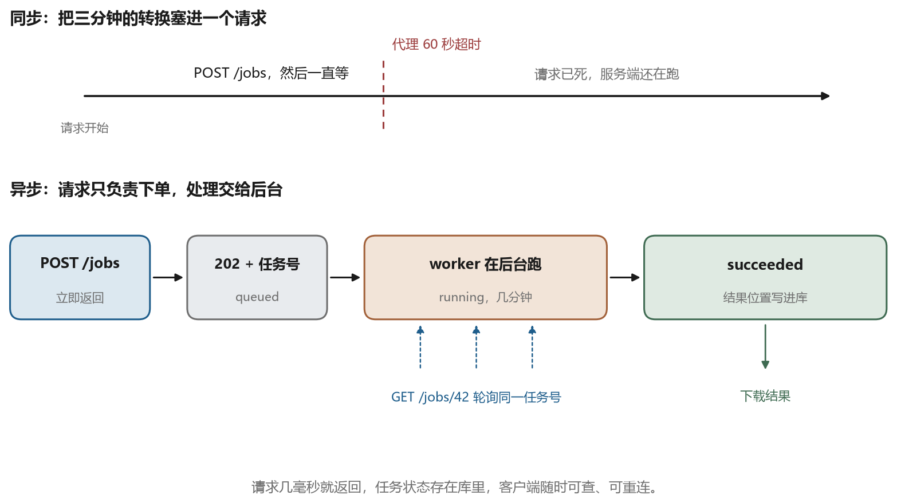
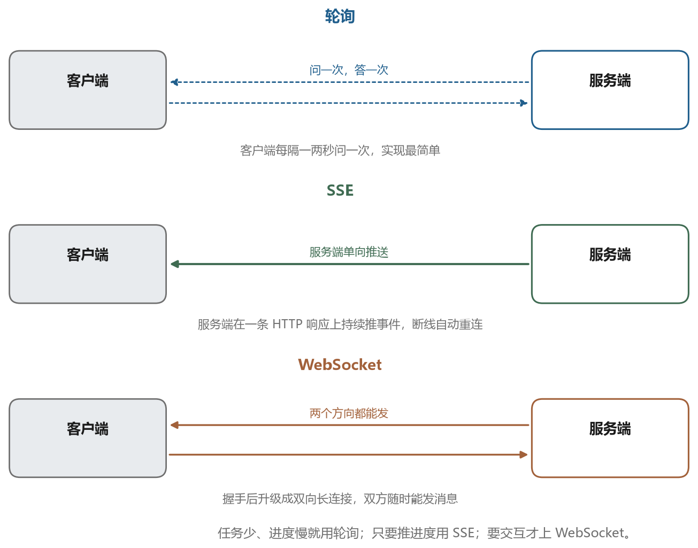

# 上传、下载与长任务

## 17.1 一次上传，字节去了哪里

用户选了一张 20 MB 的照片，点上传。接下来发生的事，可以拆成四段。

第一段，客户端把文件切成字节流，写进 HTTP 请求体。请求头里有 `Content-Type: image/jpeg`、`Content-Length: 20971520`，告诉服务器“这是什么、有多长”。

第二段，字节经过网络到达服务器，由反向代理或应用框架接收。默认情况下，很多框架会先把整个请求体收进内存再交给业务代码。20 MB 还行，2 GB 就会把内存吃满——`413`、`502`，或者进程被系统杀掉，都是这么来的。

请求体进入业务代码前要过一层缓冲策略，大致三种：整个读成字节数组；在内存里攒到阈值（通常 1 MB 到 10 MB）后转写临时文件；或者边收边写。默认值往往小得让人意外：nginx 的 `client_max_body_size` 默认 1 MB，PHP 的 `upload_max_filesize` 默认 2 MB，Spring Boot 的单文件上限默认 1 MB。这些数字在演示项目里毫无存在感，一上真实文件就全部撞墙。

内存风险可以算出来：单请求 200 MB、100 个并发上传，峰值就是 20 GB；容器有上限的话，结局通常是 OOM kill，日志里只剩一行 `Killed`。

第三段，应用把它写成临时文件，校验类型和大小，再决定下一步。这一步要防两件事：文件其实不是图片（改个扩展名就能骗过初检），以及同名覆盖。

第四段，处理完之后，临时文件要么被搬进存储目录，要么被传进对象存储，要么进队列等待转换。

临时文件落在哪值得想一想。多数框架用系统临时目录（`TMPDIR`，通常是 `/tmp`），而不少发行版把 `/tmp` 挂成 tmpfs——它占内存，写 2 GB 等于把内存当磁盘。生产环境一般把暂存目录指到独立分区并给配额，免得一次批量上传写满根分区。

落盘还有两个细节。一是权限：临时文件以 `0600` 创建，只给服务进程读写。二是搬运：从暂存目录移到存储目录，两步要在同一分区，`rename` 才是原子的，不会留下“文件已存在但只写了一半”的中间态；文件名也别用用户给的，改用编号或哈希。

“上传”在服务端看，就是**把请求体落到自己的磁盘上**。服务器读不到你电脑上的 `G:\素材`，只有你传过去的那一份，这一点第四章讲路径时提过；同一个文件名，在你机器上和服务器上是两份互不相干的副本。

## 17.2 大文件：分片、断点、校验

一个 2 GB 的文件用一条请求传完，问题有三个：中途断了要从头再来；服务器的内存和超时都吃紧；进度只能靠客户端自己猜。

解决办法是把文件切成固定大小的片，比如每片 5 MB，逐片上传。这就是分片上传，第十三章讲对象存储时提过它的服务端形态，这里说协议这一侧。

流程是三步：

1. 客户端先请求“我要传一个 2 GB 的文件”，服务端返回一个上传编号，以及每片的上传地址
2. 客户端并发上传各片，每片单独请求，失败只重传这一片
3. 全部传完，客户端请求“合并”，服务端按顺序拼起来，返回最终文件的校验值

好处很直接：某一片失败只重传那一片；并发能跑满带宽；每片都能显示进度；服务重启后，客户端凭上传编号继续，不必从头。

片大小不能随便定。太小，请求数暴涨（2 GB 切成 1 MB 就是两千次请求）；太大，重传代价高、进度也粗糙。常见取值 5 MB 到 16 MB，并让片数落在服务端限制内——对象存储类服务通常限制一次分片上传最多一万片，单片最小 5 MiB（末片除外）。并发四到六路就能跑满一般带宽。

协议这一侧三个接口就够：开会话、传一片、合并。服务端要记住会话编号、用户编号、总大小、片大小、已收到的片号、状态和过期时间，而且要进数据库而不是内存——进程重启后还能续传，靠的就是它。

```text
POST /uploads
{"filename":"clip.mp4","size":2147483648,"sha256":"9f2c...","part_size":8388608}

201 Created
{"upload_id":"u_7f3c9a","parts":256,"expires_at":"2026-11-28T06:00:00Z"}
```

每一片就是一个独立的 `PUT`，请求体是原始字节，响应里带一个片级校验值：

```text
PUT /uploads/u_7f3c9a/parts/37
Content-Type: application/octet-stream

<8388608 bytes>

200 OK
ETag: "5b1e9c0d"
```

中途断了，客户端不知道哪几片成功了，先问一次：

```text
GET /uploads/u_7f3c9a
{"received":[1,2,3,5,6,7],"missing":[4,8,9]}
```

续传的逻辑就一句话：只补 `missing` 里的片号。这也顺手解决了“并发上传时某个请求超时”——不用猜哪个失败了，对着缺失列表重发即可。全部传完再调一次合并，服务端按片号顺序拼接、核对哈希、删掉会话：

```text
POST /uploads/u_7f3c9a/complete
{"sha256":"9f2c..."}

200 OK
{"file_id":"f_2b81","size":2147483648}
```

合并有两个边界。缺片要直接报错，不能拿零字节补齐——那会造出长度正确、内容损坏的文件；会话要过期（比如 24 小时），过期连同已传的片一起清掉，否则用户点十次上传又放弃，磁盘上就堆着十份没人认领的数据。

最后是整文件校验。客户端算一遍 SHA-256（第五章），服务端合并时再算一遍，对不上就删掉重传；只比大小远远不够，长度对但内容坏的情况并不罕见。

## 17.3 下载：流式与 Range

下载看起来比上传简单，其实有两个坑。

第一个坑是“一次性读进内存”。把 2 GB 的文件读成字节数组再返回，服务直接崩。正确做法是**流式响应**：读一块、发一块，发完就丢，内存里始终只有几 MB。

第二个坑是断点续传。用户下到 80% 断了，再点下载要从头开始，体验很差。HTTP 用 `Range` 头解决这件事：

```text
GET /jobs/42/result HTTP/1.1
Range: bytes=1048576-
```

意思是“从第 1 MB 开始给我剩下的部分”。服务端返回 `206 Partial Content`，并在 `Content-Range` 里写明这次给的是哪一段。客户端把几段拼起来就是完整文件，多线程下载器就是同时发好几个 Range 请求，各下一段。命令行两条命令就能验证：

```bash
curl -r 1048576- -o part.bin https://api.example.com/jobs/42/result
curl -C - -O https://api.example.com/jobs/42/result
```

服务端要支持这件事，得能随机读取文件、算出总长度、在响应头里给出 `Accept-Ranges: bytes`——自己写流式接口时，这些经常被漏掉。

Range 的语义比看上去细。返回 `206` 时，`Content-Range: bytes 1048576-20971519/20971520` 三个数字是本次起点、本次终点、文件总长，客户端靠它确认拼的位置对不对。范围超出文件长度要回 `416`，并在 `Content-Range: bytes */20971520` 里给出总长。文件在这期间被重新生成过，客户端可以用 `If-Range` 带上 ETag，服务端发现对不上就忽略 Range、返回完整的 `200`，避免把新旧两版拼成坏文件。

几个头决定能不能好好续传：`Accept-Ranges: bytes` 声明支持，`ETag` 给版本标识并配合 `If-Range`，`Content-Length` 给总长，下载接口再加 `Content-Disposition: attachment; filename="result.zip"`，浏览器才会存盘而不是尝试打开；文件名含非 ASCII 字符时按 RFC 5987 用 `filename*=UTF-8''...` 编码。

实现流式响应还有两个坑。一是压缩：zip、mp4、jpg 已压过，再套 gzip 只白烧 CPU，通常按扩展名跳过。二是背压：读文件必须跟着发送速度走，客户端慢下来就暂停，否则数据全堆在发送缓冲里，一个慢客户端能吃掉几百 MB。用框架的流式 API 或 `sendfile`（零拷贝），比自己写 `while read` 稳。

## 17.4 长任务不能塞进一个请求里

假设转换要跑三分钟。最直觉的做法是：客户端发一个请求，服务端跑完再返回结果。

这条路在实验环境能走通，生产环境会撞上三堵墙。

第一堵是超时。浏览器、反向代理、负载均衡、客户端库，每一层都有自己的超时，通常 30 秒到 60 秒。跑三分钟的请求，会在这条链的某一环被掐断，而服务端还在傻跑。

第二堵是连接占用。一个请求占一条连接，几十个用户同时转换，连接池就满了，其他接口（比如查历史）全部排不上队。

第三堵是失败不可恢复。请求断了，任务状态就丢了；用户刷新一下页面，之前跑的进度无从查起。

所以长任务要改成**异步**：请求只负责“下单”，处理交给后台。图 17-1 是两种做法的对比。



异步的骨架是这样：

1. 客户端 `POST /jobs`，带上素材和参数
2. 服务端把任务写进数据库，状态 `queued`，立刻返回 `202` 和一个任务编号
3. 后台的 worker 从队列里取任务，状态改成 `running`，开始跑
4. 客户端拿着编号反复查 `GET /jobs/42`，或者等服务端推送（17.5）
5. 跑完，状态 `succeeded`，结果的位置写进数据库
6. 客户端请求下载

`202 Accepted` 是唯一合适的响应码：已收到、还没处理完；响应里给 `Location: /jobs/42`，估得出时长再带 `Retry-After: 5`。

这里多出一个角色：worker。它和 Web 服务是两个进程，共享同一个数据库或者消息队列。好处是各干各的：Web 服务只负责接单，worker 只负责干活；GPU 任务把 worker 卡住，也不会让接口失去响应。

队列的存法有两种。简单一点，直接把任务表当队列，worker 轮询（隔几秒问一次）取“最老的 queued 任务”，用一条带条件的 `UPDATE` 保证同一个任务不会被两个 worker 同时拿走。复杂一点用 Redis、RabbitMQ 这类专门的消息队列。小规模用前者足够，第十三章讲的“状态放数据库”在这里同样成立。

取件语句可以这么写，顺带把优先级排好：

```sql
UPDATE jobs SET status = 'running', worker_id = $1, started_at = now()
WHERE id = (
  SELECT id FROM jobs
  WHERE status = 'queued'
  ORDER BY priority DESC, created_at
  FOR UPDATE SKIP LOCKED
  LIMIT 1
)
RETURNING id, user_id, payload;
```

`FOR UPDATE SKIP LOCKED` 是关键：两个 worker 同时取任务时，第二个不等锁，直接跳过被占用的行去看下一个；取任务与标记占用合成一次原子操作，没有“先查再改”的竞态。

状态机要写清楚，不要只有“成功/失败”两个值：

```text
queued -> running -> succeeded
                  -> failed
queued/running -> cancelled
```

每个状态允许哪些转换、谁能取消、失败能不能重试，都定下来，接口才好写，前端才好显示。把允许的转换写成白名单，代码照着实现，就不会出现“失败的任务又变成成功”这种脏数据：

```text
queued    -> running | cancelled
running   -> succeeded | failed | cancelled | queued   (lease expired)
succeeded -> (terminal)
failed    -> queued                                    (attempts < max)
cancelled -> (terminal)
```

任务被取走不等于一定跑完：worker 崩了、机器被回收、进程被 OOM 杀掉，任务就永远停在 `running`。办法是租约——取任务时写 `lease_expires_at`（比如 5 分钟），过程中每 30 秒续心跳；扫描器发现租约过期就把它退回 `queued` 并累加 `attempts`。同一套机制也防住两个 worker 同时跑同一任务，续约失败的那个应当主动停下。

`attempts` 要有上限，常见 3 次；超过就进 `failed`，附上最后一次错误等人来看。停机也要处理：worker 收到 `SIGTERM` 后先停止取新任务，把手上这个跑完或在检查点保存中间结果再退出，编排系统给的宽限期通常 30 秒。

每次状态转换记一条事件（谁、何时、从什么到什么、原因），详情页的“处理记录”就是这张表。提交结果时用 `UPDATE jobs SET status='succeeded' WHERE id=$1 AND status='running'`，影响行数为 0 说明任务已被取消或已被接手，此时丢弃结果而不是覆盖。

## 17.5 进度怎么回传

任务在后台跑，客户端要知道跑到哪了。三种常见做法，各有取舍。

**轮询**：客户端每隔一两秒 `GET /jobs/42`。实现最简单，任何 HTTP 客户端都能做，服务端也不需要保持连接。缺点是延迟取决于间隔，请求多了也是负担，而且大量任务同时查，数据库压力不小。

**SSE**（Server-Sent Events）：服务端在一条 HTTP 响应上持续推送文本事件，客户端用 `EventSource` 接收。它比轮询实时，实现也不复杂，断线能自动重连。缺点是单向的，客户端不能在这条通道上发指令；有些代理会缓冲响应，需要额外配置关掉缓冲。

SSE 的线上格式是一串以空行分隔的文本块，加几个响应头就能跑：

```text
HTTP/1.1 200 OK
Content-Type: text/event-stream
Cache-Control: no-cache
X-Accel-Buffering: no

id: 17
event: progress
data: {"stage":"render","progress":0.42,"queue_position":0}
```

`id` 不只是好看：断线重连时浏览器会自动带上 `Last-Event-ID`，服务端据此从断点之后继续推，不用重放历史；`retry: 3000` 指定重连间隔。`X-Accel-Buffering: no` 是给 nginx 看的，不少“SSE 不实时”的根源就是代理攒了几 KB 才发。再定期发一行注释（`: ping`）保活，间隔小于代理空闲超时，通常 15 秒。

**WebSocket**：一次握手之后升级成双向长连接，双方随时可以发消息。适合需要实时双向交互的场景，比如协同编辑、在线游戏。代价是要自己处理心跳、重连、消息格式、连接数，服务端和客户端的实现都更重。

表 17-1 是三者对照。

表 17-1　进度回传的三种方式

| 方式 | 方向 | 实时性 | 实现成本 | 适合 |
| --- | --- | --- | --- | --- |
| 轮询 | 客户端问，服务端答 | 取决于间隔 | 最低 | 任务少、进度变化慢 |
| SSE | 服务端单向推 | 实时 | 中 | 单任务进度、日志流 |
| WebSocket | 双向 | 实时 | 高 | 需要客户端随时发指令 |

不管用哪种，进度本身要有个统一的定义。一个百分比不够，用户还需要知道“现在在哪个阶段”：排队中、加载模型、生成、后处理、封装。接口里就给两个字段，`stage` 和 `progress`，再加一个 `queue_position` 表示前面还有几个任务。图 17-2 是这三种通道的示意。



选型判断很简单：只要“服务端告诉我进度”，SSE 就够；需要客户端在通道上发指令，才上 WebSocket；调用方是脚本、或只在列表页看进度，轮询最省事。三者可以共存，不必为了统一而统一。

进度还有个诚实性问题。模型跑一步多久并不固定，百分比只能反映“已经完成的步数占比”，不能直接换算成剩余秒数。把百分比当倒计时显示，用户会觉得一直在骗他。

## 17.6 幂等、重试与清理

网络不稳的时候，客户端会重试。重试带来一个新问题：同一次提交被发了两次，服务端建了两个任务，用户被扣了两次额度。

解决办法是幂等键。客户端为每次“逻辑上的提交”生成一个唯一字符串，放在请求头里：

```text
POST /jobs HTTP/1.1
Idempotency-Key: 3f9c2a6e-20261106-0001
```

服务端把键和任务号一起存下来。同样的键再来一次，直接返回原来的任务号，不新建。这样客户端可以放心重试。

键旁边要存三样：键、请求体的哈希、首次处理的结果。同键同体直接回放结果；同键不同体说明用错了键，应该回 `409`；首次还在跑又来一次，可以回 `409` 提示“处理中”，也可以让第二次等第一次的结果。键的有效期 24 小时足够；键名带上用户编号和业务类型（`job:u_1024:3f9c2a6e`），既不撞键，也方便按前缀清理。

失败也要分清楚。有些错误重试有用，比如数据库连接闪断、下游服务临时不可用；有些重试没用，比如参数不合法、素材损坏。所以任务记录里要存“错误码”和“是否可重试”，重试次数要有上限，退避要越来越长（1 秒、2 秒、4 秒……），别把下游打垮。分类可以按表 17-2 来。

表 17-2　错误分类与重试策略

| 类别 | 例子 | 是否重试 | 处理 |
| --- | --- | --- | --- |
| 网络抖动 | 连接超时、连接被重置 | 是 | 指数退避，最多 3 次 |
| 下游限流 | `429`、`503` | 是 | 按 `Retry-After` 等待 |
| 输入问题 | 参数非法、素材损坏 | 否 | 直接失败，提示用户 |
| 资源不足 | 磁盘满、显存不足 | 视情况 | 换机器重试一次 |
| 程序缺陷 | 空指针、断言失败 | 否 | 记堆栈，人工介入 |

退避要加抖动：一百个任务同时失败、同时按 1、2、4 秒重试，下游会被同一波流量再打一次；乘一个 0.5 到 1.5 的随机系数，峰值就摊平了。

```python
import random

def backoff(attempt, base=1.0, cap=60.0):
    delay = min(cap, base * (2 ** attempt))
    return delay * random.uniform(0.5, 1.5)
```

最后是清理。临时文件、中间产物、过期的结果文件都得有删除策略——磁盘满的时候新任务会全部失败，报错还常指向一个和“磁盘”无关的地方。规则要写成表：未完成的分片会话 24 小时清掉，中间产物留 1 小时便于排查，结果文件按等级留 7 天或 30 天，到期前 3 天在接口里提示。使用率到 80% 就该告警，因为从 80% 到 100% 往往只差一批大文件。

## 17.7 结果怎么交回去

任务跑完，结果通常是一个文件。交给客户端有几种方式。

最简单是应用直接把文件流回去，`GET /jobs/42/result`。适合小文件，缺点是所有流量都过应用，大文件会把带宽吃满。

第二种是给一个**签名 URL**：应用生成一个带签名、带有效期的地址，客户端直接去对象存储取。流量不经过应用，还能限时失效。第十三、十四章已经把对象存储和签名讲透了，这里只是把它接进任务流程。

签名是这么算的：用服务端密钥对“方法 + 过期时间 + 对象键”做 HMAC，把签名和过期时间塞进查询参数，校验方重算一遍就能确认地址没被改过。

```bash
expires=$(( $(date +%s) + 600 ))
sig=$(printf 'GET\n%s\n%s' "$expires" "results/u_1024/job_42.zip" \
  | openssl dgst -sha256 -hmac "$SIGNING_KEY" -hex | awk '{print $2}')
echo "https://cdn.example.com/results/u_1024/job_42.zip?expires=$expires&sig=$sig"
```

有效期要短，5 到 15 分钟是常见取值，一次只签一个对象；URL 本身就是凭证，泄露之后在过期前谁都能用。

第三种是 WebSocket 或 SSE 推一个“完成”事件，客户端再自己去下载。适合需要即时通知的场景。

表 17-3　结果交付的三种方式

| 方式 | 流量路径 | 优点 | 代价 | 适合 |
| --- | --- | --- | --- | --- |
| 应用直传 | 应用进程 | 简单，能即时鉴权 | 占应用带宽与连接 | 小于几十 MB |
| 签名 URL | 对象存储或 CDN | 不占应用，可限时 | 依赖对象存储，有泄露窗口 | 大文件、批量 |
| 推送通知 | 长连接 | 即时 | 客户端还要再请求一次 | 需要马上知道 |

不管哪种，响应里都建议带上三样东西：文件大小、校验值、过期时间。客户端据此显示进度、校验完整性、决定什么时候重新申请地址。

服务能访问、任务能跑、进度能看、结果能取，这条线就通了。但还有一个问题没解决：谁有资格上传、谁有资格下载、会员和非会员的差别在哪。下一章讲身份、权限和会员体系。
