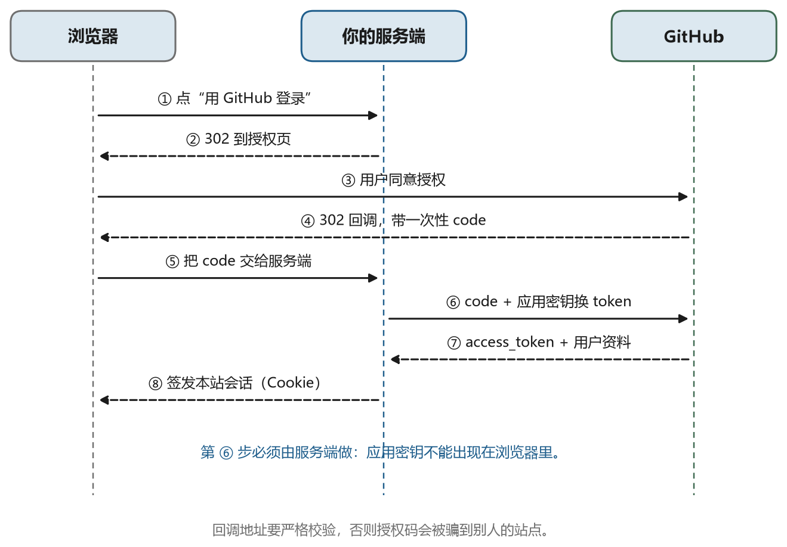
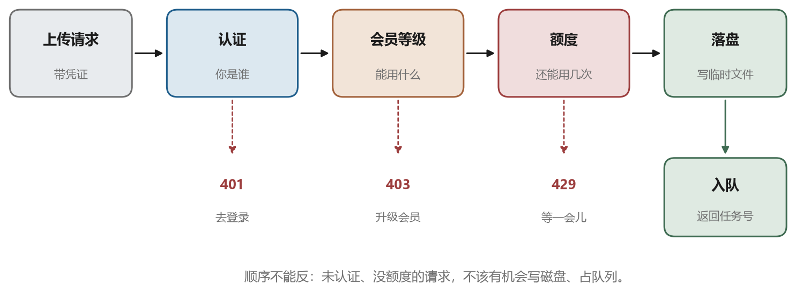

# 会员、登录与权限

## 18.1 会员到底是一组什么东西

产品说“要会员才能用”，技术上要落到四件事上，缺一件就做不完整：

- **身份**：怎么知道这次请求是谁发的
- **认证**：怎么确认他确实是这个人，而不是拿着别人的凭证
- **授权**：这个人能做什么，能碰哪些资源
- **额度**：他能用多少，超了怎么办

这四件事对应四种不同的失败。身份没做，等于所有人都是匿名的，既没法归因也没法限流；认证没做，等于看到凭证就放行，偷到就能用；授权没做，登录用户之间能互相看对方的东西；额度没做，付费就没有理由。错误码也会混：没带凭证是 `401`，凭证有效但没权限是 `403`，超出额度有的系统用 `429`、有的用 `402`。三者能分开，用户和客服才看得懂。

很多项目只做了前两件，做到“能登录”就以为完成了。结果是一个普通会员可以下载别人的结果，或者一个免费用户能无限次提交转换。这类问题不是黑客攻击，而是权限没写。

身份也不只“登录用户”一种。匿名访客、API 调用方、内部服务、后台运营都该各有标识：访客给短期 cookie 或设备编号，调用方给 API key，内部服务给服务身份。全都匿名的话，限流、审计、归属都无从下手。

从“共享令牌”升级到“每人一个身份”是一次结构性变化：以前全系统只有一个密码，现在每个请求都要带上“我是谁”的证据，服务端每次都要判断“他能不能做这件事”。这一章按顺序把这条链拆开。

## 18.2 注册与登录：密码怎么存

注册时用户给一个邮箱和密码。服务器绝对不能存明文，也不能用 MD5、SHA-1 这类“快”哈希。

原因很直接：数据库一旦泄露，明文就是全部账号；快哈希可以被离线暴力破解，一张显卡一秒钟能试几十亿次。正确的做法是**慢哈希加盐**：

- **盐**：每个用户一个随机串，和密码拼在一起再哈希。这样两个人的密码相同，哈希也不同，攻击者不能一次撞一片
- **慢**：算法故意设计得慢，比如 bcrypt、scrypt、Argon2，单次计算几十到几百毫秒。正常登录感觉不到，暴力破解的成本却成倍上升

存进数据库的是算法名、参数、盐和结果，登录时按同样的参数再算一遍比对。升级算法时还能顺势迁移：用户下次登录成功时，用新算法重算一遍存回去。

参数按“单次验证 100 到 250 毫秒”倒推，而不是抄一个数字。bcrypt 的代价因子每加 1、耗时翻一倍，常见 10 到 12；它还有个硬限制：只取密码前 72 字节，超长密码会被静默截断。Argon2 有三个可调项——内存、迭代次数、并行度，常见的 argon2id 档位是 19 MiB 内存、2 次迭代、1 路并行，想要更强抗 GPU 能力可以上到 64 MiB、3 次、4 路，代价是每次验证占更多内存。scrypt 常用的组合是 N=2^15、r=8、p=1。三者都以自己机器上的实测耗时为准，别照抄。

存下来的不是一个裸哈希，而是算法、参数、盐和结果的合体，PHC 字符串就是现在的通行写法：

```text
$argon2id$v=19$m=19456,t=2,p=1$c29tZXNhbHQ$RdescudvJCsgt3ub+b+dWRWJTmaaJObG
$2b$12$KIXQh1Fh2v0yQ9m3o1W3ne3g8s0Kk0mZ0m8Q1o0m3n0p1q2r3s4t5u
```

第一段是算法与版本，中间是参数和盐，最后是哈希。校验时按字段重算，不需要另存一张参数表；升级策略时也能一眼认出旧格式。

迁移要“登录时顺手重算”，而不是一次性全表刷——后者需要明文密码，做不到。校验成功后比对当前策略，参数不一致就用新参数重算并覆盖，用户无感。

密码之外还要有防护：登录失败计数、验证码、异常地点提醒。这些是工程细节，不影响原理，但直接决定账号会不会被撞库。

登录接口本身有两个要防的点。一是账号枚举：密码错和账号不存在必须回同一个错误、耗时要接近，否则攻击者能批量判断哪些邮箱注册过；对不存在的账号也跑一次假的哈希计算，是最省事的对齐办法。二是撞库：按账号和 IP 分别计数，连续失败若干次后加验证码或延迟，计数要有窗口和上限——没有上限的锁定会变成拒绝服务的入口。

密码策略也别走极端：最短 8 位、允许长密码（bcrypt 之下要提前提示 72 字节限制）、拒绝常见弱口令表，比强制“大小写数字符号齐全”有效得多，后者只会逼出 `Passw0rd!`。

```python
from argon2 import PasswordHasher
from argon2.exceptions import VerifyMismatchError

ph = PasswordHasher(time_cost=2, memory_cost=19456, parallelism=1)

def hash_password(pw: str) -> str:
    return ph.hash(pw)          # returns a PHC string with salt and params

def verify_password(stored: str, pw: str) -> bool:
    try:
        return ph.verify(stored, pw)
    except VerifyMismatchError:
        return False
```

## 18.3 登录之后怎么记住你

HTTP 是无状态的，登录成功之后，下一个请求服务器怎么知道还是你？

两条路，本质都是“给客户端一个凭证，之后每次带上”。

**Session 加 Cookie**：服务端生成一个随机的会话编号，把“编号 → 用户”存在服务端（内存、Redis、数据库都行），通过 `Set-Cookie` 发给浏览器。之后浏览器每次自动带上这个 Cookie。用户看不到内容，服务端一查就知道是谁。

**Token**：服务端签发一段自带信息的凭证，最常用的是 JWT（JSON Web Token）。它分三段：头部、载荷、签名，载荷里写着用户编号、角色、过期时间。服务端不存会话，每次验签就行。

表 18-1 是两者的取舍。

表 18-1　Session 与 JWT 的取舍

| | Session + Cookie | JWT |
| --- | --- | --- |
| 状态存在哪 | 服务端 | 客户端（凭签名防篡改） |
| 撤销 | 删掉服务端的记录，立刻生效 | 到期前一直有效，要额外维护黑名单 |
| 横向扩展 | 多台机器要共享存储 | 天然无状态 |
| 适合 | 网页、需要立刻踢人 | 客户端 App、服务间调用 |

安全上有几条硬要求：Cookie 要加 `HttpOnly`（脚本读不到）、`Secure`（只走 HTTPS）、`SameSite`（防跨站请求伪造）；JWT 一定要验签、验过期时间，且不能把敏感信息放进载荷——载荷只是编码，不是加密，谁都能解开看。

会话编号本身要不可猜：32 字节随机数做 base64url 编码，约 43 个字符；不要用自增编号、时间戳或用户编号拼出来。服务端存 `session:{id}` 到用户编号，过期时间设 7 天，访问时滑动续期，并在改密码、退出登录、后台封号时直接删 key。撤销立刻生效，这是 Session 相对 JWT 最大的优势。

Cookie 属性要一次配齐：`Path=/`、域名用 `__Host-` 前缀（要求 Secure 且不带 Domain，能防子域覆盖），涉及资金或删除的接口再加一个 CSRF token 或二次确认——只靠 `SameSite` 不够稳。

JWT 的坑集中在“验证”和“生命周期”两处。验证时必须固定算法（只接受 `RS256` 或 `EdDSA`，显式拒绝 `none`）、校验 `iss`/`aud`/`exp`/`nbf`，密钥轮换时按头部 `kid` 选公钥。生命周期上，访问令牌做短（15 分钟量级），配一个更长的刷新令牌，刷新时轮换并作废旧的那个，泄露窗口就有限。

要在到期前踢人，就得额外维护黑名单：按 `jti` 存一条带 TTL 的记录，网关验签后再查一次。查了就有状态，所以多数系统把“立刻踢人”交给会话或短令牌，而不是给 JWT 打越来越厚的补丁。

```json
{"sub":"u_1024","role":"member","iss":"api.example.com","aud":"web",
 "iat":1764200000,"exp":1764200900,"jti":"8f1c2b"}
```

还有一个常见错误：把 token 存在浏览器的 `localStorage` 里，然后靠前端判断权限。前端的判断只是界面友好，真正的权限必须服务端再判一次。绕过前端太容易了。

## 18.4 第三方登录

“用 GitHub 登录”“用微信登录”背后是 OAuth2（一个开放的授权框架）的授权码流程。它的目的不是把密码交给第三方，而是让第三方证明“这个人确实是他的用户”。

流程四步，图 18-1 是这条链：

1. 用户点“用 GitHub 登录”，浏览器跳到 GitHub 的授权页，带上你的应用编号和回调地址
2. 用户同意后，GitHub 把浏览器跳回你的回调地址，附带一个一次性的授权码
3. 你的服务端拿这个码，加上自己的密钥，去 GitHub 换一个访问令牌
4. 用令牌读用户资料（编号、昵称、邮箱），在你的库里建账号或找到已有账号，然后签发自己的会话



关键在第三步：换令牌这件事必须由服务端做，密钥不能出现在前端。回调地址要严格校验，否则别人可以把授权码骗到自己的站点。

流程里还有两个参数容易被忽略。一是 `state`：发起授权时生成一个随机值、存在会话里，回调时比对，防的是别人把自己的授权码塞给你。二是 PKCE：客户端先生成一个随机串，把它的 SHA-256 摘要随授权请求发出去，换令牌时再带上原串。这样即使授权码被截获，没有原串也换不到令牌；浏览器和手机这类拿不住密钥的客户端现在普遍要求它。

授权码是一次性的，有效期很短（通常 10 分钟以内），用过即废。同一个码被用第二次，很多提供方会把之前签发的令牌一起撤销。`scope` 也要最小化：只要读昵称和邮箱，就不要申请读写仓库的权限。

账号关联要用“提供方 + 用户在该方的编号”作为唯一键，不要拿邮箱当主键。同一个邮箱在不同提供方可能对应不同的人，用户也可能换邮箱；拿邮箱合并账号，等于给了别人一个“用同邮箱注册就能接管”的入口。要么只信提供方标记为已验证的邮箱，要么让用户登录后手动绑定。

```bash
curl -s "https://provider.example.com/token" \
  -d grant_type=authorization_code \
  -d code="$CODE" \
  -d redirect_uri="https://app.example.com/callback" \
  -d client_id="$CLIENT_ID" \
  -d client_secret="$CLIENT_SECRET" \
  -d code_verifier="$VERIFIER"
```

## 18.5 谁能做什么：角色与资源归属

认证解决“你是谁”，授权解决“你能做什么”。最常用的模型是 RBAC（Role-Based Access Control，基于角色的访问控制）：用户挂角色，角色挂权限。

```text
user -> role -> permission
alice -> member   -> job:create, job:read:own, result:download:own
bob   -> admin    -> job:*, user:*, billing:*
```

权限名建议统一成 `资源:动作:范围`，比如 `job:read:own`、`job:read:any`、`result:download:own`。范围放进名字里，比在代码里写一堆 `if role == 'admin'` 好维护：新增角色只是多一组映射，不用改判断逻辑。角色可以继承（`admin` 包含 `member` 的全部权限），但别叠太多层，超过两层就很难回答“他到底能做什么”。

光有角色不够，还要有**资源归属**。同一个“读取任务”的权限，普通会员只能读自己的，管理员能读所有。所以每条业务数据都要记一个 `owner_id`，查询时强制带上 `where owner_id = 当前用户`。这一条比角色配置更重要：没有归属检查，角色配得再细也会越权。

检查顺序固定成三步：认证（有没有有效凭证）→ 功能权限（这个角色能不能调这个接口）→ 数据归属（这条记录是不是他的）。前两步可以放在中间件里统一做，第三步必须落到查询条件上，而不是先查出来再在代码里判断——后者一旦漏掉一个分支就是越权。

列表接口最容易漏。分页查询忘带归属条件，用户翻两页就能看到别人的任务；返回的 `total` 也会泄露规模。管理端和用户端最好用两套查询，而不是靠一个布尔参数切换，避免参数被篡改后越权。

还有一层是**会员等级**。免费用户能上传但只能生成低分辨率，付费用户能用高清模型、能排队优先、能批量。这类差异落在两个地方：接口里按等级决定参数，队列里按等级排优先级——两边必须一致，只在前端显示“高清”、后端不校验，等于没有。

图 18-2 是一次上传请求走过的检查：先验身份，再查会员等级，再查额度，最后才落盘。顺序不能反，否则未认证的请求也会消耗磁盘和队列。



## 18.6 额度、限流与计费

会员体系一定连着额度，否则“付费”没有意义。常见三种限制：

- **次数**：每月 100 次转换
- **并发**：同时最多 2 个任务
- **资源**：单任务最长 10 分钟、最大 4 GB

限制要在服务端算，且要能解释。用户看到“额度不足”时，界面应该告诉他本月用了多少、上限多少、什么时候重置，而不是一个干巴巴的 `429`。

三种限制的实现方式不一样。次数是累加，落在一张按周期分桶的表里（`user_id + period`），提交时原子地加一并检查上限；并发是占位，任务开始时占一个槽、结束或失败时释放，worker 崩了要靠租约回收，否则槽位会泄漏；资源限制是校验，提交时按参数估算，超了直接拒，不要等跑到一半才发现显存不够。

限流是另一件事：它防的不是付费意愿，而是滥用和故障。按 IP、按用户、按接口分别限速，返回 `429` 时带上 `Retry-After`，告诉客户端多久后再试。

算法上，固定窗口最简单（每分钟一个计数器），但会在窗口边界放过两倍流量；令牌桶能平滑突发，允许短时间超过平均速率。按用户限流通常比按 IP 准，NAT 后面可能有几千人共用一个出口；按 IP 限流更适合挡匿名滥用。表 18-2 是三个常见维度的组合。

表 18-2　限流的三个维度

| 维度 | 典型阈值 | 存储 | 适用 |
| --- | --- | --- | --- |
| 按用户 | 免费 5 次/分，会员 30 次/分 | Redis 计数 | 保护额度与成本 |
| 按 IP | 60 次/分 | Redis 计数 | 挡匿名滥用 |
| 按接口 | 登录 5 次/分 | 内存或 Redis | 防撞库、防刷 |

返回 `429` 时要给足信息：`Retry-After` 告诉多久后重试，`X-RateLimit-Limit`、`X-RateLimit-Remaining`、`X-RateLimit-Reset` 让客户端自己控制节奏。只限流不告知，前端只能靠猜。

额度扣减要原子。先查后扣中间有窗口，两个并发请求会同时通过检查；正确做法是一条带条件的更新（`used + 1 <= quota`），或者用 Redis 的 Lua 脚本把读改写合成一步。任务失败要退回额度，退回同样要幂等——否则重试会把额度越退越多。

计费则要落到流水上：谁、什么时候、因为什么、扣了多少。支付回调要验签、要幂等（同一个订单回调两次不能加两次会员），要有对账手段。这些属于业务系统，但都是“认证与授权”这条链的延伸。

## 18.7 会员数据放在哪、怎么管

用户、角色、订阅、流水，这些是关系型数据，放在数据库里，用几张表说清楚：

| 表 | 关键字段 | 作用 |
| --- | --- | --- |
| `users` | 编号、邮箱、密码哈希、状态 | 账号主体 |
| `roles` | 编号、名称 | 角色定义 |
| `user_roles` | 用户编号、角色编号 | 谁是什么角色 |
| `subscriptions` | 用户编号、等级、起止时间、状态 | 会员有效期 |
| `usage` | 用户编号、周期、已用次数/时长 | 额度统计 |
| `ledger` | 用户编号、金额、原因、时间 | 计费流水 |

表 18-3　几张表的约束建议

| 表 | 建议约束 | 理由 |
| --- | --- | --- |
| `users` | `email` 唯一索引 | 登录靠它查，也防重复注册 |
| `subscriptions` | 每人同时只有一条有效 | 避免叠加两个会员等级 |
| `usage` | 主键 `(user_id, period)` | 统计天然去重、可原地累加 |
| `ledger` | 只追加，不更新 | 流水是账，改了就对不上 |

金额一律用整数存最小货币单位（分），别用浮点；时间统一存 UTC，展示时再转时区。缺索引的后果不是慢一点，而是登录接口在几万用户时就开始超时，所以查询走哪条索引要先想好。

管理有两个入口。一个是**后台管理界面**，运营用来查用户、改等级、补额度、封号；另一个是**命令行或脚本**，用于批量操作和应急。两者操作的是同一套接口和同一张表，不要为了图快直接改数据库——没有审计记录，出了问题查不出来。

审计表单独一张，只追加：谁在什么时候、通过哪个入口、对哪条记录做了什么、改前改后各是什么。后台改等级、补额度、封号都必须写进去；出问题时至少要能回答“这个会员是谁给的”。审计记录里不要存密码、令牌、完整证件号这类敏感值，存编号就够。

```sql
CREATE TABLE users (
  id          BIGSERIAL PRIMARY KEY,
  email       TEXT NOT NULL UNIQUE,
  pw_hash     TEXT NOT NULL,
  status      TEXT NOT NULL DEFAULT 'active',
  created_at  TIMESTAMPTZ NOT NULL DEFAULT now()
);

CREATE TABLE sessions (
  id          TEXT PRIMARY KEY,
  user_id     BIGINT NOT NULL REFERENCES users(id) ON DELETE CASCADE,
  expires_at  TIMESTAMPTZ NOT NULL,
  created_ip  INET,
  user_agent  TEXT
);
CREATE INDEX ON sessions (user_id);
```

还有一件容易忽略的事：**数据隔离**。每个用户的上传、中间产物、结果，目录或对象键里要带上用户编号，删除账号时能一起清掉，备份和迁移时也不会混在一起。删账号本身建议软删（`status` 改成 `deleted`、邮箱打码），但流水和审计要保留——它们既是财务凭证，也是事后追查的依据。

## 18.8 从共享令牌到每人一个身份

如果现在的服务还是“全系统一个令牌”，升级路径可以分三步走，不必推倒重来。

第一步，先把令牌换成“用户 + 令牌”的形式：仍然只有一个令牌，但每个请求都带一个用户编号，数据库里的任务补上 `owner_id`，查询时按归属过滤。这一步不改登录方式，却堵住了最大的越权漏洞。

第二步，加入登录接口，签发会话或 JWT，令牌退居为“服务间调用”或“临时下载”的凭证。老客户端在这段时间里还能用旧令牌，两者并存。

第三步，收紧权限：下载走签名 URL（限时、限对象、限用户），上传按等级限速限量，管理接口单独一套权限。到这一步，会员体系才真正闭环。

这三步每一步都能独立上线、独立回滚，比一次性重写安全得多。

迁移期的关键是“双读单写”：新代码同时认旧令牌和新会话，但只写新表；旧令牌每用一次就记一条日志，用来看还有多少客户端没升级。等旧令牌调用降到很低，再让接口返回 `Deprecation` 和 `Sunset` 头做提醒，最后才关掉。

每一步都要有可观测的指标：401 比例、403 比例、旧令牌调用数、签名 URL 的 403 数。指标突变就是回滚信号——比如上线归属过滤后 403 暴涨，多半是某些接口漏写了 `owner_id`，先回滚再补。

兼容期通常留几个月，期间不要改响应结构，只新增字段。开关比代码分支好收尾：迁移完成后把开关删掉，别留下“两种模式都可能生效”的代码，那种代码过一年就没人敢动。

五篇到这里结束。回过头看，这一篇讲的其实是一件很朴素的事：把前四篇的零件装成一个别人能用的产品——网络让它能被访问，认证让它知道来的是谁，任务系统让它能跑很久，权限让它只对合适的人开放。
